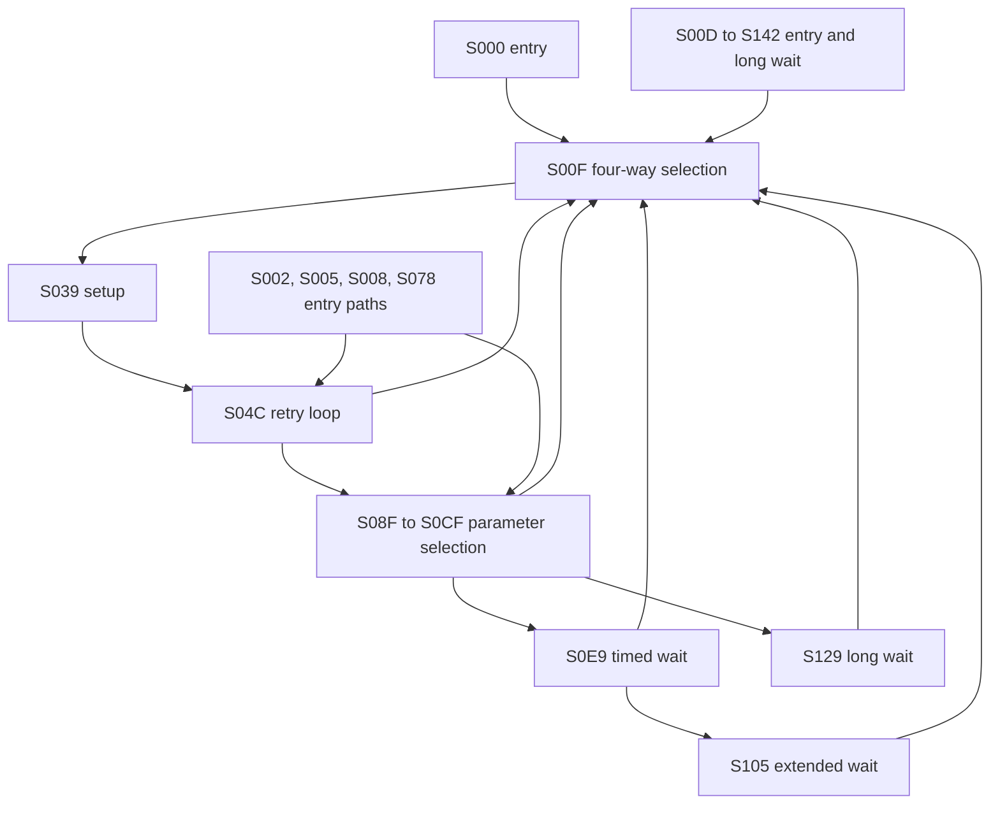

# BL808 Wi-Fi AGC microcode

This listing decodes the `agcmem` object from
[`librf_bl808.a`](../src/bl808/librf_bl808.a). The normal Wi-Fi PHY loads
the image at `0x24C0A000`. The extracted section is 2,048 bytes with SHA-256
`9ffb4e00e16ad974599bbd894e8ddac28159dc1c0deff2f5b3f214208db2566f`.
It matches the [Nim array](../src/bl808/wifi/fw/global_state/rf_bl808_core.nim)
byte for byte. There are 350 program words, followed by 161 zero words and
one final word. The listing uses hex word indices, so `S00F` starts at
`0x24C0A000 + 4 * 0x00F = 0x24C0A03C`.

Paths under `build/` identify local bench capture artifacts.

[ISA encoding](#recovered-isa-encoding) ·
[State control comparisons](#isolating-lower-state-controls) ·
[Section walkthrough](#control-flow-by-section) ·
[Semantic evidence](#semantic-evidence-and-remaining-measurements) ·
[Operand isolation](#isolating-predicates-in-the-program) ·
[Transition index](#complete-transition-index) ·
[Word-by-word listing](#complete-annotated-listing)

## Instruction set identification

The encoding belongs to the RivieraWaves Wi-Fi automatic gain control
and clear channel assessment state machine. Ceva's product brief calls
that block an AGC/CCA software-defined state machine. The SiFlower
SFAX8 loader calls its image FSM microcode, writes it to modem
`+0xA000`, and holds `AGCFSMRESET` during the transfer. The SFAX8 and
BL808 images share the state-header and transition layout, including the
same timer-operand correlation. The RIU event registers expose the same
three operands, combiners, and nine-bit word target as the transition
records. A vendor ISA name, assembler, and full encoding manual remain
unverified. [Ceva Wi-Fi product brief][ceva-wifi-brief] ·
[SFAX8 AGC loader][sfax8-loader] · [Public RIU event fields][riu-events]

Ceva's Wave 3 modem description puts the microcoded sequencer
in the RIU alongside the radio controller, gain computation,
packet detection, power estimators and correlators. That
architecture supplies physical candidates for decoded operands
and actions. It applies to the Wave 3 reference design and
leaves the selector assignments on BL808 open.
[Ceva Wave 3 modem architecture, section 4.1][ceva-wave3-riu]

The SiFlower SDK and the AIC8800 host driver both
refer from their AGC loaders to a modem user manual
section named “AGC/CCA initialization”. The AIC USB
driver encloses its call to that loader in `#if 0`.
The reference identifies documentation to look for.
The source provides no document number or download.
[SiFlower loader comment][sf19-modem-um-reference] ·
[AIC loader comment][aic-modem-um-reference] · [AIC USB boot path][aic-usb-platform-on]

### Public decoder-source audit

The checked source families expose the instruction *fields* but not
their complete behavior. The [BL602 AGC SVD][bl602-agc-svd] and
[SFAX8 RIU header][riu-events] independently place three six-bit
operands and a three-bit `EVT0OPCOMB` at the positions used in this
listing. Neither assigns Boolean meanings to combiner values `0–7`
or names the operand codes. The [BL602 PHY reconstruction][bl602-phy-reconstruction]
contains a 512-word AGC image and calls the event setters, but it
does not decode state words or define the combiner truth table. A
[second PHY object reconstruction][bl602-phy-object-reconstruction]
confirms a paired C2 event recipe in `agc_config` without adding a
decoder. A [published AGC RAM emulator][bk7252-agc-emulator] models the 2 KiB
window as plain storage, so it supplies no execution oracle. The
[BekenEmulator source][beken-emulator-mac] implements a RivieraWaves
Wi-Fi MAC model, but its `src/beken` tree has no `agcmem`, `agcram`, or
AGC sequencer model; it cannot execute these 512 words. The
[IPRO6 PHY build file][ipro6-phy-build] names `phy.c` and `agcmem.c`,
while the published tree provides compiled PHY archives in place of
those source files. The public repository's commit histories for
[`phy.c`][ipro6-phy-history], [`agcmem.c`][ipro6-agcmem-history],
and [`phy_lp.c`][ipro6-phy-lp-history] at those build paths are empty;
the checked default-branch history does not supply them. The
[public branch list][ipro6-branch-list] contains only `main`.
Tags, deleted branches, or differently named paths remain possible. These
are limits of the specific checked sources,
not a claim that no decoder or modem manual exists elsewhere.
One [Beken Trident source comment](#predicate-numbers-in-the-older-trident-encoding)
links an individual branch to receive sensitivity without defining
its operand or a BL808 equivalent.

The extracted `agcmem` objects also identify what their own C source
can and cannot supply. Of 48 local `*agcmem*.o`/`*.obj` files checked,
nine retain DWARF. Each of those nine has one compile unit, scalar and
array types, and one 512-word array variable declared at source line
3; none has a `DW_TAG_subprogram` or a second data variable. The
audit used `llvm-readelf -S` to find `.debug_info` and
`llvm-dwarfdump --debug-info` to enumerate its tags. The older
reference-IP object names an absolute source path ending in
`plf/refip/src/driver/phy/bl602_phy_rf/agcmem_bl602.c`. Two later
objects name `drivers/soc/bl618dg/phyrf/phy/agcmem_2g.c` and
`agcmem_5g.c`. The pinned BL808 and IPRO6 objects carry no DWARF.
This metadata supports treating those `agcmem.c` translation units as
array containers, not as an instruction decoder or generator. It does
not prove that their unpublished source files contain no comments.
[BL602 PHY object reconstruction][bl602-phy-object-reconstruction] ·
[BL618DG PHY archives][agc-bl618dg-phy] · [IPRO6 RF archive][ipro6-phy-archive]

A separately indexed build manifest names
`plf/refip/src/driver/phy/phy_karst.c`, but the file is absent from all
five public branches checked in that Gitee repository. Another SDK
release manifest names both `phy_karst.c` and a separate `phy.c` while
its checked release branches omit those source paths. These are
specific missing-source observations, not evidence about the omitted
files' contents. The useful search target remains a PHY implementation
that defines state/action fields, its microcode generator, or the cited
“AGC/CCA initialization” manual section.
[Gitee build manifest][beken-karst-build-manifest] ·
[Beken release source list][beken-release-source-list]

The available `phy_trident.c` in that Gitee tree was checked against
the pinned BL808 bytes. Its first array starts `30000000`, whereas
BL808 starts `20000000`. Its three conditional array endings are
`14090B11`, `100C0D11`, and `14010B0B`, whereas BL808 ends
`C0088D03`. It is relevant as a related state-machine layout and
named event recipe, but those value differences prevent treating its
array as the BL808 program or its older predicate numbering as an
exact BL808 map. [Gitee Trident PHY source][beken-gitee-trident-phy] ·
[Pinned BL808 image](../src/bl808/librf_bl808.a)

An exact-symbol GitHub code search for `agc_ram_parameter` on
2026-11-21 returned 44 indexed files. Six were linker maps and one
was the camera-port emulator; the 37 `phy_trident.c` source hits
contained four distinct first 512-word arrays. The array-body
comments in those sources supply an overall tuning purpose
(“solve input-power vs PER discontinuous issue”) and the isolated
receive-sensitivity branch comment analyzed below. They do not
define branch predicates or extension actions. This audit covers
the indexed current files with that symbol, not unpublished
source or other symbol names.
[AliOS tuning source][trident-agc-footer] ·
[Older OneOS program][beken-rx-sens-old] ·
[Newer Tuya program][beken-rx-sens-branch]

The source comparisons below were the basis for the original Boolean
hypotheses. Two controlled BL808 RAM runs have since measured all 64
constant-input cases and settled C0–C7 for this board. Cross-image
arguments that favored a different C2 or C6 table are superseded for
BL808. The lower state controls, physical predicate assignments, and
extension actions remain unresolved. The referenced “AGC/CCA
initialization” section of the modem user manual remains a document
lead for those definitions.

The RISC-V architecture tag belongs to the host object
`agcmem.c.o`. Its `.text` is empty. It contains a 2 KiB
`.rodata.agcmem` data section that the PHY copies to the separate modem
RAM window. The first word, `0x20000000`, begins with the illegal
RISC-V halfword `0x0000` in little-endian byte order. As an AGC state
header it describes one transition, and the next word transfers to
`S00F`. [BL808 PHY loader](../src/bl808/wifi/fw/global_state/rf_bl808_core.nim#L1899) ·
[RISC-V compressed instruction specification][riscv-compressed]

The encoding has variants across modem integrations. In all 12 public
SiFlower AX3000 images tested, header bit 27 tracks operand `02` when
six-bit operand windows begin at bits 25, 19, and 13. The BL808 and
SFAX8 images use bits 26, 20, and 14. The AX3000 result is a correlation
across all 1,746 decoded state headers. Several matching branches
also [locate the AX3000 operand combiner in bits 11:9](#cross-checking-the-combiner-field).
The purpose of AX3000 branch bit 31 remains unresolved.
[SiFlower AX3000 images][ax3000-images]

### Repeated branch addresses in AX3000 high-band images

Two branch words retain fixed targets across high-band images
whose state addresses differ. The targets therefore resolve to
different word types under the linear record layout. The same
scan of the 12 images found no other targets outside decoded
state starts.
[AX3000 AGC images][ax3000-images] · [AX3000 DFS image][ax3000-v3-dfs-agc]

| AX3000 v3 image | Word at `1A6`, target of `40002BA6` | Word at `1D6`, target of `0015F1D6` |
| --- | --- | --- |
| `agcram_hb.bin` | Branch `400001B3` in `S1A4` | Branch `0400012A` in `S1D3` |
| `agcram_hb20.bin` | Branch `620C2BAA` in `S1A2` | Header `2814028F` |
| `agcram_hb40.bin` | Header `3000000F` | Extension `29000000` in `S1D5` |
| `agcram_hb20_dfs.bin` | `40002BA6` absent | Branch `020001D7` in `S1D4` |

The first word is the fallback after both `29000301` and
`29000101` in the three non-DFS images. Under the proposed
AX3000 branch layout it encodes `C5(20,00,01)`. The C5
model `A & B & !C` makes both constant slots false and
disables that edge regardless of `P20`. The matching DFS
fallback is `02000101`, an unconditional jump to `S101`.
The repeated destinations inside other records are consistent with
the C5 edge being disabled in the other builds.
[AX3000 branch layout](#cross-checking-the-combiner-field) · [AX3000 DFS image][ax3000-v3-dfs-agc]

The second word is the sole outgoing branch in a count-7 state
with header `2803800E` in all four images. It uses
`C0(00,02,2F)` with the path flag set. In the three non-DFS
images, the enclosing sequence starts with `32000000` at
`S11D`, `S120`, or `S11B`, respectively. Those three
states have no incoming RAM branches. The DFS image
connects the same sequence to its high-byte results at
`S10F` and `S115`, and the raw branch graph reaches it
from reset. Whether its conditions permit that route at
runtime and how hardware treats an interior word target
remain open.
[AX3000 AGC images][ax3000-images] · [AX3000 DFS image][ax3000-v3-dfs-agc]

The standard 20 MHz image puts the count-40 header `2814028F`
at `1D6`. The DFS image shifts the same receive continuation
one word forward to `S1D7`. The preceding `23CC509C` state
updates its jump from `020001D6` to `020001D7`. The separate
count-7 branch keeps `0015F1D6`, which now points at that
updated jump word. The generic high-band and 40 MHz builds
place the matching count-40 continuation at `S1CB` and
`S1C9`, respectively. This pattern supports a fixed address
carried over from the standard 20 MHz layout. It leaves
interior-target behavior unverified.
[AX3000 AGC images][ax3000-images] · [AX3000 DFS image][ax3000-v3-dfs-agc]

The SDK installs the five standard low- and high-band
filenames. Its install rules omit `agcram_hb20_dfs.bin`,
and the three bundled `siwifi_fmac.ko` variants contain
the same five filename strings. The reachable interior target
in the DFS image is therefore evidence from a source-tree
binary with no identified selection in the packaged driver.
The published upload and reload paths both preserve the
input words through reset release.
[SDK firmware installation][ax3000-agc-package] ·
[Kernel module variants][ax3000-v3-driver] ·
[AX3000 upload and reload](#ax3000-kernel-upload-and-firmware-reload)

## Recovered ISA encoding

`STATE`, `EXT`, and `BR` are names used by this disassembler. A state
record consists of a header, its optional extension, and its branch
words in stored order. Parsing starts at word 0. An address's position
in its record determines its word type. The same bit positions have
different meanings in different record slots.

| Word type | Encoded fields | How the sequencer uses it |
| --- | --- | --- |
| `STATE` | Bits 31:29 are branch count `n` (1–7 in the pinned BL808 image). Bit 28 indicates an extension. Bits 27:0 are state controls. | Defines the current state's parameters and the location and size of its branch list. Two Trident profiles also have [addressed headers with count zero](#addressed-states-with-no-stored-branches). |
| `STATE` controls | Bit 27 enables the timer. Bits 25:15 encode its count. [Controlled BL808 timing](#bit-26-in-the-timer-count-field) shows bit 26 is separate from the count. Bits 14:0 are state controls. On BL808, bit 2 tracks RIU bank `02[14]` and bank `05[4]`; bit 3 tracks bank `02[13]` in parked-state tests. | The related diagnostic maps call these outputs `AGCDelayLineEn`, `AGCOFDMFEEn_aligned`, and `InBd20PowEstEn`, respectively. With the measured board clocks, one count is 0.1 µs. The effect of bit 26, exact reload boundary, and most lower controls remain unresolved. |
| `EXT` | One 32-bit word when the owning header sets bit 28. Bits 31:24 hold a selector and bits 23:0 hold its payload. | Supplies additional state parameters. The physical action and internal payload fields remain unresolved. |
| `BR` operands | `A` in 31:26, `B` in 25:20, `C` in 19:14. | Selects three inputs from the hardware predicate table. |
| `BR` combiners and page | Path combiner in bit 13, operand combiner in 12:10. BL618DG names event bit 9 [`PGSEL`](#branch-bit-9-and-predicate-pages). | Controlled RAM runs measured all eight operand Boolean functions with bits 13 and 9 clear. Further runs show C0/C1 on constant inputs and timer predicate `02` have the same result under all four bit-13/bit-9 settings on this board. Their effects on other physical inputs remain unverified. |
| `BR` target | Bits 8:0, an absolute word index from AGC RAM base. | Selects the next state when the branch is taken. A target must resolve to a header in the decoded BL808 image. |
| `PAD`, `FINAL` | Zero words after the last record and the separate word at `1FF`. | These occur outside the decoded branch graph. The role of the final word remains unresolved. |

These are the packing formulas, with each input restricted to its field
width. For a state at index `i`, branches occupy `i+1+e` through
`i+e+n`, where `e` is the extension flag. The next stored header is
at `i+1+e+n`. Runtime transfers use the branch targets.

```text
STATE(n, e, controls)       = (n << 29) | (e << 28) | controls
controls                   = (timer_flag << 27) | (raw26_15 << 15) | raw14_0
EXT(selector, payload)     = (selector << 24) | payload
BR(A, B, C, p, comb, b9, s) = (A << 26) | (B << 20) | (C << 14) | (p << 13)
                             | (comb << 10) | (b9 << 9) | s
```

For example, word `04C` contains `6C193BFF`. Its header specifies
three branches and zero extension words. This makes `04D`, `04E`, and
`04F` branch words. At `04E`, `6DC4C48F` decodes to
`BR(1B,1C,13,0,1,0,08F)` in hex. Its exact meaning in the graph is to
test the encoded condition and transfer to `S08F` when selected. The
current hypothesis for that condition is `P1B & P1C & P13`. The signal
behind each predicate code remains unresolved. The leading bits
`011` in `6DC4C48F` belong to operand `A` in this slot. In the header
slot at `04C`, those bits instead give the branch count.
[Public RIU event fields][riu-events]

With the raw image extracted as `agcmem.bin`, the read-only tool can
classify any word address or repack and compare the complete image.
Verification preserves opaque controls, extensions, and the final
word verbatim. It checks field packing and reconstruction independently
of the proposed hardware meanings.

```sh
python3 tools/disasm_agc.py --word 0x04e agcmem.bin
python3 tools/disasm_agc.py --verify-encoding agcmem.bin
python3 tools/disasm_agc.py --verify-listing docs/bl808_agc_microcode.md agcmem.bin
```

### Changes across related implementations

The classic operand offsets at bits 26, 20, and 14 also fit both
published SF19A28 band images. Each has 134 states and 199 branches
with every branch landing on a decoded state boundary. The timer
operand `02` matches header bit 27 in all their states. In the older
Beken Trident source, state records have zero spacers and bit 27 is
clear. Bit 26 is set in every state with a branch using `02`, plus
three other states in each of its two build variants. This makes bit
26 the timer-flag candidate for those images. The SiFlower AX3000
operand shifts are another variant. [SF19A28 AGC binaries][sf19-bands] ·
[AliOS Trident PHY][beken-trident] · [SiFlower AX3000 images][ax3000-images]

The Trident event header gives all four target fields 11 bits
(`10:0`, mask `000007FF`). Its two-bit operand combiner
occupies `12:11`. Both Trident program arrays keep bits
10 and 9 clear on every decoded branch. In the newer
SFAX8 event layout, bit 10 belongs to the three-bit
combiner, bit 9 is unnamed, and the target is nine bits.
AX3000 RAM branches use bit 9 as part of their shifted
combiner. The field assignment therefore depends on the
decoder and, on AX3000, whether the word is in RAM or
an external event register.
[Trident AGC register header][beken-agc-events] ·
[Trident program arrays][trident-agc-footer] · [SFAX8 event fields][riu-events] ·
[AX3000 event and RAM layouts](#ax3000-event-registers-and-ram-branches)

#### Addressed states with no stored branches

The OpenCam RT-Thread SDK's `phy_trident.c`
contains three distinct 512-word AGC arrays.
Each of the three programs has an expiry edge
from a count-10 state that supplies `68002101`
(BCD selector `68`, binary selector `44`).
The edge lands on a state with the same lower
control bits, `139F`, in all three profiles.
The `SOC_BK7231N` and fallback profiles clear
the branch-count bits and replace the single
stored continuation with the zero spacer.
[RT-Thread Trident PHY driver][opencam-trident-phy]

| Profile | Count-10 state and expiry edge | Destination and following words |
| --- | --- | --- |
| `SOC_BK7231` | `S026: 3402800F 68002101 0800002A` | `S02A: 2000139F 0412080B 00000000` |
| `SOC_BK7231N` | `S02E: 3402800F 68002101 08000032` | `S032: 0000139F 00000000` |
| Fallback | `S02A: 3402800F 68002101 0800002E` | `S02E: 0000139F 00000000` |

An address walk from the reset and event stubs
reaches both zero-count headers. Each has four
incoming branch words, including the timer
edge above and a direct branch after saturation
setup (`S06C` on BK7231N and `S068` in the
fallback). All stored branch destinations in
the three arrays resolve to state boundaries
when the two nonzero, zero-count headers are
included. The BK7231 branch `0412080B` tests
legacy operand `08` with both other operands
set to `01` and targets `S00B`.
The other profiles can use their zero-count
states to wait for an external transfer.
That behavior and zero-count support on BL808
still require a trace.
[RT-Thread Trident arrays and event register writes][opencam-trident-phy]

The BK7252 camera port publishes an independently
written initialization routine that uses the
BK7231 program above. Its array is byte-identical
to the RT-Thread BK7231 profile and the AliOS
`NEW_AGC_PARA=1, RF_DOWN_ENABLE=0` build
(SHA-256 `bd07a509184668ccd8623fe3c701c205bd6033f11462334c2b3132ebdf37aa81`).
The port reports that the vendor and its running
firmware use the same AGC table. That comparison
applies to the BK7231 profile with the stored
branch at `S02A`. The port's historical emulator
models this AGC area as registers and a 2 KiB
RAM block. Its modeled behavior ends at register
and memory access.
[Camera port PHY initialization][bk7252-cam-phy] ·
[Camera port comparison on hardware][bk7252-cam-vendor-diff] ·
[Camera port RAM model][bk7252-cam-agc-emulator] ·
[AliOS array][trident-agc-footer]

#### Timer count across an AGC decoder revision

The SiFlower SF16A18 SDK ships different images for its MPW and
full-mask silicon. The MPW image has 130 state headers. Bit 26 in
its headers tracks operand `02` exactly, with 49 set and 81 clear.
Bit 27 is clear in every state. The full-mask image is identical
to the SFAX8 factory AGC array and uses bit 27.

Matching states in stored order by the low 14 header bits, presence
of an extension, and ordered branch operand triples yields all 130
MPW states. Of those, 127 have the same branch targets after
translating state addresses. The two extra full-mask states divert
four branches. All 49 matched pairs with timers encode the same
count in bits 25:14 of the MPW image and 26:15 of the full-mask image.
For example, the two `S00B` headers are
`440C808F` and `4819008F`. Both encode a count of 50 and have
the same non-timer branch condition plus a timer-only edge. This
corroborates the timer field across a layout change. The wall-clock
duration of a count still requires an execution measurement.
[SF16A18 MPW image][sf16-mpw-agc] · [SF16A18 full-mask image][sf16-full-agc] ·
[SFAX8 factory array][sfax8-image]

The SFAX8 and Trident drivers each program 8,000,000 counts for a
commented 100 ms CCA timeout. That implies an 80 MHz timebase for
their global CCA watchdog. The SFAX8 register is at modem `+0xB3BC`
and resets to `00088B80`, which also appears in the BL808 BLE
initialization at that offset. Both BL808 vendor Wi-Fi initializers
write `001E8480` there, equivalent to 25 ms if their watchdog uses the
same clock. Both set bit 8 at modem `+0xB414`, which the AIC and
QCC743 headers name `IRQMACCCATIMEOUTEN`. The state-header timer
tested by operand `02` is a separate field whose clock may differ.
[SFAX8 CCA initialization][sfax8-riuin] · [Trident CCA initialization][trident-cca] ·
[Public CCA watchdog field][sfax8-cca-reg] ·
[RIU CCA interrupt enable][aic-agc-interrupt] ·
[BL808 BLE initialization](../src/bl808/blecontroller/registers_wireless_rf.nim#L678) ·
[BL808 RF archive](../src/bl808/librf_bl808.a)

The historical Nim Wi-Fi scan capture reads back `001E8480`
at `+B3BC`. The lwIP capture reads `003D0900`, twice that
count. These are direct observations of the watchdog register.
Both captures preserve the same four RIU entry addresses.
Wi-Fi scan snapshot (`build/hw-validation-rfphy-rxstate-pure-c1/logs/m0_wifi_nimfw_scan_hal_test.m0.openocd.log#L178`) ·
Wi-Fi lwIP snapshot (`build/hw-validation-purerf-lwip-smoke-roc-edge-compare/logs/m0_wifi_lwip_smoke.m0.openocd.log#L159`)

BL618DG independently uses the SFAX8 and Trident
watchdog constant. Its named `phy_init` setters
write 8,000,000 at `+0xAE6` and enable the CCA
timeout interrupt at `+0xAF4`. In its RIU
interrupt handler, masked status bit 8 triggers a
diagnostic that reports width and signed ADC
power. That handler gives a CPU-visible way to
identify a watchdog expiry separately from a
microcode state timeout.
[BL618DG PHY archive][agc-bl618dg-phy] ·
[Watchdog status and ADC readout](#readouts-for-gain-power-and-cca)

The ESWIN driver also has a CPU-side AGC reset timer.
`libps_wifi.a:phy_custom_rf.o:set_sta_status` creates a
90 µs one-shot with `agc_reset_timer_isr` as the
callback. In ECR6600F v2.1.22, the modem interrupt
can call `phy_reset_agc_bssid_mismatch`, which
checks the internal receive vector, saves
`NXMAC_MONOTONIC_COUNTER_2_LO` at `0x00610120`,
and starts the one-shot. The callback reads the
same counter and compares the difference with 151.
On its early-reset path it sets `AGCFSMRESET`,
calls a delay routine, and clears `AGCFSMRESET`.
This host timer restarts the sequencer. Its 90 µs
period provides no conversion for the AGC header
count tested by operand `02`.
[ECR6600F Wi-Fi archive][eswin-f-agc] · [ESWIN timer API][eswin-timer]

An address walk over 12 **distinct, source-derived images** with the
BL808-style branch layout gives a wider timer invariant. The local
corpus covers BL808, M1s, BL616 and BL616CL, BL618DG low power,
QCC743, IPRO6, Beken Karst, TizenRT Karst, and three Amlogic W2/W2L
revisions. Identical archive copies were deduplicated, and a locally
edited BL808 test image was excluded. Across their 1,576 state
headers, all 653 with bit 27 set have at least one outgoing branch
using operand `02`; all 923 with bit 27 clear have none. Every target
in these images resolves to a state header. This is an exact
correlation in the selected corpus, not a universal rule: the Trident
and AIC examples below deliberately enable a state timer without
testing operand `02` in an outgoing branch. It does not measure the
timer clock or prove that hardware always waits on the same cycle.
The SF16A18 MPW and AX3000 arrays are excluded because their
independently established header layouts place the timer field
differently.

| Extracted image | States | Headers with bit 27 set |
| --- | ---: | ---: |
| Pinned BL808 | 114 | 50 |
| M1s | 96 | 38 |
| BL616 normal | 121 | 52 |
| BL616CL normal | 124 | 53 |
| BL618DG low power | 143 | 61 |
| QCC743 WLAN | 118 | 49 |
| IPRO6 FMAC | 123 | 53 |
| Beken BK7236 Karst | 138 | 51 |
| TizenRT Karst | 139 | 52 |
| Amlogic W2 | 152 | 62 |
| Amlogic W2L | 155 | 65 |
| Amlogic W2L October 2024 | 153 | 67 |
| **Total** | **1,576** | **653** |

[BL808 image](../src/bl808/librf_bl808.a) ·
[M1s PHY archive][m1s-agc-phy-rf] ·
[BL616 AGC arrays][agc-bl616-mainline] ·
[BL618DG low-power array][agc-bl618dg-phy] ·
[QCC743 PHY archives][qcc-phy-archives] ·
[IPRO6 archive][ipro6-phy-archive] ·
[Amlogic W2 revisions](#amlogic-w2-and-w2l-combiner-contexts) ·
[Karst image comparison][beken-karst-agc] ·
[TizenRT Karst archive][tizen-karst-agc] ·
[Timer layout revision](#timer-count-across-an-agc-decoder-revision)

#### State timer independent of the branch operand

In BL808, every state with the timer bit set has an outgoing
branch that evaluates operand `02`. The same field in the
related Trident and AIC programs can be set even when all
outgoing branches use other operands. The Trident examples
include two consecutive states with count 10 and unconditional
branch encodings. AIC has count-0 and count-1 examples. This
separates the header's timer control from the branch's decision
to test expiry. It leaves open whether the enabled count delays
an otherwise unconditional branch in those implementations.
[Trident AGC source][trident-agc-footer] · [AIC CSI RX firmware][aic-csi-rx-agc]

| Image and state | Header | Count | Extension with normalized selector | Outgoing branch |
| --- | --- | ---: | --- | --- |
| Trident newer tuning `S119` | `3400528F` | 1 | `2200289C` | `0400011D`, `C0(01,00,00)` |
| Trident newer tuning `S1A4` | `34028000` | 10 | `50000000` | `041049A8`, `C1(01,01,01)` |
| Trident newer tuning `S1A8` | `34028000` | 10 | `5F000000` | `0410481E`, `C1(01,01,01)` |
| AIC CSI RX `S07D` | `38000086` | 0 | `22800000` | `04000080`, `C0(01,00,00)` |
| AIC CSI RX `S094` | `380095FE` | 1 | `32010000` | `04000097`, `C0(01,00,00)` |

The two Trident tuning builds each have exactly three such
states. All three AIC arrays have the records at `S07D` and
`S094` byte for byte. The two RF-test arrays add a reachable
count-0 example at `S028`. In these five images, every state
whose outgoing branches use `02` still has its timer bit set.
[AIC CSI and RF-test array comparison](#aic8800-images-recovered-from-firmware-loaders)

The DA16200 PHY provides a direct timer edit. On channels
5–8 and 13–14, `spur_canceller` changes an unconditional
edge holding operand `01` to the same edge with operand
`02`. It sets header bit 27 and a count of 50 in that state.
The extension, lower controls, and destination are
identical. The preceding state drops from count 100 to 50.
This splits the programmed interval across two states with
different extensions and independently supports the
timer-enable and expiry assignments. The actual clock
period remains open.
[DA16200 channel-dependent AGC edits](#da16200-channel-dependent-agc-edits)

#### Bit 26 in the timer count field

A RAM-loaded [timer probe](../examples/m0_agc_timer_probe.nim) now
settles the count width on BL808. Each state had one branch using
`C0(02,00,00)` and led to the next state. The M0 sampled the RIU
fetch address, its cycle counter, and the 1 MHz `mtime` counter
configured by [`systemInit`](../src/bl808/startup.nim) through
[`pdsConfigureLpMtimerClock`](../src/bl808/pds.nim). The measured
M0 cycle/mtime ratio was 319.99993. The two counters agree on
approximately 0.1 µs per programmed count:

| Count | Bit 26 clear: mtime ticks | Bit 26 set: mtime ticks |
| ---: | ---: | ---: |
| 50 | 6 | 4 |
| 100 | 9 | — |
| 200 | 20 | — |
| 500 | 50 | 50 |
| 1,000 | 100 | 101 |
| 2,000 | 201 | 199 |

The one-tick resolution and sampled state-entry boundary explain the
short-count variation. At 500, 1,000, and 2,000, setting bit 26
does not add 2,048 timer counts. It is a separate state control, not
the timer count's high bit on this board. The branch condition `02`
advanced each state after its programmed interval. The probe restored
the stock AGC image. The trace (`build/hw-validation/captures/bl808_agc_timer_bit26_sweep_2026-11-21.uart.log`)
has SHA-256 `62d2ac7322ab947da82c6545436a7123f842aef83acbf7162b147ea11031f89c`;
[`analyze_agc_timer.py`](../tools/analyze_agc_timer.py) checks the
counts, timing, and full sample accounting. The physical effect of bit
26 remains unmeasured.

Bit 26 is set only at `S04C` in the pinned BL808 image.
The timer edge there runs `41000F00` at `S050` and then returns.
The raw value of bits 26:15 is 2098. Bits 25:15 alone give 50,
the same count used before the corresponding `41000F00`
retry action in the M1s and earlier YoC programs. Those programs
also use `0414140F` as the restart edge from the same state.
[M1s PHY archive][csi-archive-published-rc2-register-accessors] ·
[YoC PHY package][agc-yoc-phy-760] ·
[Retry loop comparison](#bit-4-in-the-acquisition-retry-loop)

| Image | Retry head | Bit 27 | Bit 26 | Bits 25:15 | Bits 26:15 |
| --- | --- | ---: | ---: | ---: | ---: |
| BL808 | `S04C = 6C193BFF` | 1 | 1 | 50 | 2098 |
| M1s and earlier YoC | `S02B` and `S049 = 4819339F` | 1 | 0 | 50 | 50 |
| Earlier BL616 | `S04F = 6C1D3BFF` | 1 | 1 | 58 | 2106 |
| BL616 mainline | `S04F = 6C203BFF` | 1 | 1 | 64 | 2112 |
| PineVoice V2.4 and V2.6.1 | `S048 = 6C203BFF` | 1 | 1 | 64 | 2112 |
| BL616CL Arduino | `S050 = 44001BFF` | 0 | 1 | 0 | 2048 |

The earlier and mainline BL616 retry heads have
identical three-word branch lists. The only header
change at that state is the count from 58 to 64.
On PineVoice, the same `6C203BFF` header precedes
`0810444C`, the same expiry test `C1(02,01,01)` with
a relocated target. The two non-timer branches
use different predicates. The expiry destination
`S04C` contains `200012FF 04000048`, an extension-free
jump back to `S048`. The BL616 expiry destination
`S053` contains `380112FF 41000F00 0800004F`, a
count-2 wait that issues selector `41` before its
return. Bit 26 is therefore shared by retry heads
with and without the gain action on expiry. The
BL808 timing experiment above excludes treating it
as a count high bit on this board.
[PineVoice PHY packages][agc-pinevoice-phy] · [Earlier BL616 archive][agc-bl616-early] · [Mainline BL616 archive][agc-bl616-mainline]

The normal BL616CL v2.3.18 and v2.3.19 archives
show the timer being removed at the same word address.
In v2.3.18, `S04F` has header `6C1D1BFF` and ends
with the expiry branch `08104453`. In v2.3.19 its header
is `44001BFF`. The release removes the expiry edge and
retains the restart word `0414140F`. The other condition
changes from `C1(1B,00,1C)` to `C1(1B,13,1C)`.
The header keeps bit 26 and all lower control bits
while clearing bit 27 and the low 11 count bits.
[BL616CL v2.3.18 PHY archive][agc-bl616cl-218] ·
[BL616CL v2.3.19 PHY archive][agc-bl616cl-219]

Two other BL616CL states, `S084` and `S094`, also set bit 26
with bit 27 clear. The corresponding states in both BL616
archives, `S07C` and `S08C`, do the same. None of those states
tests operand `02`. The separate-control interpretation
accounts for the repeated use with the timer disabled and for
the matching retry count of 50. A 12-bit reload field whose
high bit can remain set with the timer disabled also fits the
stored words. The BL808 hardware measurement now
selects the separate-control interpretation for this board.
[BL616 mainline archive][agc-bl616-mainline] ·
[Earlier BL616 archive][agc-bl616-early] ·
[BL616CL PHY package][agc-arduino-phy]

Across 27 official SDK archives for BL616, BL616CL, and
BL618DG, the 32 normal-use band images reduce to 10 distinct
programs and 1,274 state headers. All four timer-enabled
headers with bit 26 set are versions of this retry head.
Each tests `C1(02,01,01)` for expiry and has a low count
of 58 or 64. The other 20 headers with bit 26 set all
clear bit 27 and omit operand `02`. The largest enabled
count with bit 26 clear is 1,500. No paired state in this
set changes bit 26 alone while preserving its extension
and ordered branch conditions. The apparent counts above
2,047 therefore come from one retry operation, with no
independent long wait in these images to validate that
reading of bit 26.
[BL616 SDK archive history][agc-bl616-sdk-history] ·
[BL616CL SDK archive history][agc-bl616cl-sdk-history] ·
[BL618DG SDK archive history][agc-bl618dg-sdk-history]

The controlled BL808 chain above measures the timer slope and
toggles bit 26 without competing branches. It rules out the 2,048
tick extension independently of the stock `S04C` retry path.
The role of bit 26 in that retry path remains to be measured.
[Diagnostic capture correlation](#correlating-a-diagnostic-capture-with-the-disassembly)

#### A controlled timer test at S00D

The pinned image has an independent timer-only entry at
`S00D`. It has no extension and exactly one branch,
`08000142` at `00E`, which tests `02` in the middle
operand. This avoids the two competing predicates at
`S04C`. The transition enters `S142` and issues `0EF1F10B`.
After validating an external-event transfer on the board,
the constant-one event `0400000D` can supply the entry.
Use the same event source for each trial and verify a single
entry in the trace so that repeat transfers cannot restart
the timer during measurement.
[BL808 transition index](#complete-transition-index) · [Constant-event controls](#constant-input-c6-event-test) · [RIU capture workflow](#correlating-a-diagnostic-capture-with-the-disassembly)

| Trial | Header at `0x24C0A034` | Branch at `0x24C0A038` |
| --- | --- | --- |
| Stock 50-count wait | `2819008F` | `08000142` |
| 100-count wait | `2832008F` | `08000142` |
| Stock header with bit 26 set | `2C19008F` | `08000142` |
| Stock header with a constant-true branch | `2819008F` | `04000142` |
| Constant-true branch with timer enable cleared | `2019008F` | `04000142` |

The dedicated timer chain measured the 50- and 100-count
intervals and the effect of bit 26 without needing the
external `S00D` entry. The last two trial words above still
offer a separate test of whether an enabled timer delays a
constant-true branch, as seen in the AIC and Trident encodings.
That behavior has not been measured.
[AIC and Trident state examples](#state-timer-independent-of-the-branch-operand) · [AGC RAM copy-window readback](#wi-fi-event-register-and-ram-readback)

#### Observing expiry while the state stays active

A RAM-loaded BL808 control probe now observes expiry directly on this
board. [`m0_agc_timeout_diag_probe.nim`](../examples/m0_agc_timeout_diag_probe.nim)
holds `S000` with the always-false `C1(02,01,00)` branch, so expiry
cannot advance the state. It samples RIU bank `01` low bit 0 in 50 µs
bins while reading the AGC fetch address. With a 1,000-count timer,
the bit is clear in the first two bins and set in every sampled read
from 100 µs onward. With 2,000 counts, it first appears near 200 µs
and stays set thereafter. The timer-disabled controls hold the bit
clear throughout 400 µs, and all sampled fetch addresses remain in
the parked `S000` words. The probe restores the original 512 AGC RAM
words and RF settings after each run. The 1,000-count trace (`build/hw-validation/captures/bl808_agc_timeout_diag_1000_2026-11-21.uart.log`)
and 2,000-count trace (`build/hw-validation/captures/bl808_agc_timeout_diag_2000_2026-11-21.uart.log`)
establish RIU bank `01[0]` as the observable state-timer expiry flag
on BL808. Together with the count-only branch chain, this directly
supports operand `02` = timer expiry; it does not map the other RIU
lanes to numeric predicates.

The compact BL616CL low-power program has a stock
case in which bit 26 is set and expiry alone cannot
advance the state under the inferred rules. The
count-32 state `S041` (`281020CF`) reaches `S043`
on its only edge, `08000043`. At `S043`, header
`4C1933DF` sets bits 27 and 26. Its two edges are
`0414140F`, which restarts on `!P10` under C5,
and `08100446`, which tests `C1(02,01,00)`.
Holding `P10` high would keep both edges ineligible,
including when `P02` asserts. This gives a way to
observe the candidate `TimeOutReg` signal in the
same state across expiry. The preceding count-32
state gives a second timer observation in the same
sequence. The two intervals share the capture clock.
[Compact BL616CL PHY archive][agc-bl616cl-lpfw] ·
[Linked low-power firmware][agc-lpfw-images] ·
[Candidate diagnostic lane](#observable-signals-and-the-bl808-diagnostic-route)

The compact program gives a one-bit control for
the branch. At word `045`, setting bit 14 changes
`08100446` to `08104446`. The target still
points to `S046:41000F00`. The last operand
becomes `01` and the branch reduces to `P02`
under the C1 model. An analogous stationary timer
test on BL808 uses `08100542` at word `00E`
to park `S00D`, or `08104542` to take its
existing edge to `S142` on expiry. On either
device, pair the timer lane with the fetch bus
to rule out an external transfer or new entry
before the observed expiry.
[Compact BL616CL program](#dsss-acquisition-in-the-compact-bl616cl-program) ·
[BL808 timer-only entry](#a-controlled-timer-test-at-s00d)

The four headers below cross bits 25:15 with
bit 26. The binary checks preserve each state
boundary and branch target for both settings of
the branch's last operand.

| Low count | Bit 26 | BL808 `S00D` | BL616CL low-power `S043` |
| ---: | ---: | --- | --- |
| 50 | 0 | `2819008F` | `481933DF` |
| 100 | 0 | `2832008F` | `483233DF` |
| 50 | 1 | `2C19008F` | `4C1933DF` |
| 100 | 1 | `2C32008F` | `4C3233DF` |

The controlled BL808 chain has now run the 50-count
and longer-count comparison with bit 26 both clear
and set. Its equal 500-, 1,000-, and 2,000-count
durations rule out the twelfth-count-bit model on BL808.
The corresponding BL616CL timing remains unmeasured.

#### AX3000 bit 31 on paired timer edges

The AX3000 v3 DFS image has a count-32 state at `S0CF`
with extension `2200309C` and exactly two edges. Word
`840000D3` targets `S0D3`, and word `040000F0` targets
`S0F0`. Both use `C0(02,00,00)`. After masking the
destinations, bit 31 is the only difference. The first
destination executes `239C309C` with a count of 6. Its only
coded incoming edge is the one with bit 31 set.
[AX3000 DFS AGC program][ax3000-v3-dfs-agc]

The same pair occurs in the original high- and low-band
images and other v3 high-band images, with timers and targets
adjusted. The original high-band 20 MHz image also has the
sequence `80000005`, `5600003C`, `04000052`,
`0001E81F` at the count-50 state `S037`. Its first edge
uses `C0(00,00,00)` with bit 31 set. If bit 31 inverted
the result and the first matching edge won, that first edge
would always win and the next three would be unreachable.
If bit 31 were ignored under the same priority, the first
timer edge at DFS `S0CF` would always win on expiry. These
comparisons expose how the flag affects interpretation of
the timer routes. Its actual behavior remains unverified.
[AX3000 band and release images][ax3000-images]

There is a complementary case in the original low-band
image at `S163`. The first edge `82000169` has the flag
set and the six-bit decode `C0(01,00,00)`. It selects
`0EEAEDA7`. The second edge, `04000166`, selects the
different payload `0EEAED87` on the count-2 timer.
Both targets have the same header `38040000`, and each
has only one coded incoming edge. With earlier-match
priority, an unconditional interpretation of the flagged
`01` would shadow the timer route. Inverting the full
result would make the flagged `01` edge always false.
[Original low-band AX3000 image][ax3000-images]

Across the 12 images, the 78 flagged branch slots all use
C0 with path flag zero. Their first operand values before
considering bit 31 are `00`, `01`, `02`, and `03`,
occurring 27, 25, 17, and 9 times, respectively. Every
flagged `02` has an unflagged timer test in the same
state. A seven-bit first operand would assign these slots
codes `40` through `43`. That is consistent with the
otherwise-constant `00` and `01` becoming conditional.
It remains a candidate alongside a separate flag that
changes how the first operand or combined condition is
evaluated.
[AX3000 band and release images][ax3000-images]

#### AX3000 event registers and RAM branches

The AX3000 RISC-V firmware directly writes the external
event word `0173C805` at file offset `1CDBC` on high
band and `1D256` on low band. Both stores target modem
`+B384`, at `0x56C0B384` and `0x54C0B384`,
respectively. In the classic RIU layout this preserves
`P17`, `P0F`, C2, and destination `S005` from the
SFAX8 detection word `5573C805`, and changes its
first operand from `15` to `00`.
[AX3000 high-band firmware][ax3000-hb-fmac] ·
[AX3000 low-band firmware][ax3000-lb-fmac] · [SFAX8 event fields][riu-events]

Both ESWIN Wi-Fi initializers write the same word
`0173C805` to `0x0070B384`, at `wifi_agc_init+0x2B8`
and `+0x27A`. Their destination `S005` also issues
`32000000`. This corroborates the external event
layout across a third CPU and modem integration.
[Original ESWIN Wi-Fi archive][eswin-agc] · [ECR6600F v2.1.22 Wi-Fi archive][eswin-f-agc]

The high-band firmware also writes `04FFC40B` to
`+B38C` at `49B24` on the path that clears
`OFDMONLY`; another path writes zero there at
`49476`. The nonzero value exactly matches the
AIC8800 event reset and Beken Karst's DSSS setup.
The classic layout decodes it as `C1(01,0F,3F)`
to `S00B`. The shifted AX3000 RAM layout would
instead read `C2(02,1F,3E)`. The exact event value
and its enable/disable writes support keeping the
classic external-event layout on AX3000 independently
of the shifted in-RAM branch layout.
[AX3000 high-band firmware][ax3000-hb-fmac] ·
[AIC8800 DSSS event][aic-agc-evt3] · [Beken PHY archive][beken-karst-agc]

Both firmware builds have a separate 512-word RAM reload.
The high-band loop at `1F94C` starts with counter zero
and destination `0x56C0A000`. At `1F990` it loads a
source word, increments the counter, and stores the word
with `th.swia`, advancing the destination by four bytes.
The low-band code has the same sequence at `1A5BC` and
`1A600` with destination `0x54C0A000`. Both copy word
`1FF` and then clear AGC reset and the clock-force bits.
This establishes the CPU-side treatment of the full
array in the runtime loader.
[AX3000 high-band firmware][ax3000-hb-fmac] ·
[AX3000 low-band firmware][ax3000-lb-fmac] · [Indexed store semantics][thead-swia]

#### AX3000 kernel upload and firmware reload

The v3 kernel module has two paths to AGC RAM. The initial
`siwifi_plat_agc_load` call sets clock-force bits 29 and 28
and asserts AGC reset. It calls `siwifi_plat_bin_fw_upload`
at `.text.unlikely+0x1E36` with the selected filename and
the mapped AGC RAM destination. The word loop at
`.text+0x1000A–0x10022` copies the file in order. The loop
at `0x1003A–0x10054` reads each destination word back and
compares it with the file, including word `1FF` in the 2 KiB
images. A mismatch retries the upload from the beginning.
The caller then releases reset and clears the clock forces.
[AX3000 v3 kernel module][ax3000-v3-driver]

For a width change, `siwifi_check_agc_bin` passes the selected
standard filename to `siwifi_plat_agc_reload`. The reload
uses `memcpy` at `.text+0x100CE` to put the file in a DMA
buffer. `siwifi_send_load_agc_req` places that buffer's DMA
address in the four-byte payload of request `0xB6` at
`0x5C2C` and waits for confirmation `0xB7`. The two FMAC
dispatch tables link that request to the 512-word copy
described above. The table and handler offsets below are
relative to each FMAC file.
[AX3000 v3 kernel module][ax3000-v3-driver] ·
[High-band FMAC firmware][ax3000-hb-fmac] · [Low-band FMAC firmware][ax3000-lb-fmac]

| FMAC build | Dispatch record and handler pointer | Handler start | Last destination word |
| --- | --- | --- | --- |
| High band | `0x5B878` contains ID `0xB6` and pointer `0x53E1F8DC` | `0x1F8DC` | `0x56C0A7FC` |
| Low band | `0x5B1A0` contains ID `0xB6` and pointer `0x53C1A54C` | `0x1A54C` | `0x54C0A7FC` |

Each handler asserts AGC reset, copies the complete buffer
in order, clears reset and the clock forces, and issues
`0xB7`. The initial upload verifies the stored bytes through
readback. The firmware reload writes the same words and
proceeds directly to reset release and confirmation. Neither
copy loop rewrites branch targets or interprets the trailer
as an instruction.
[AX3000 v3 kernel module][ax3000-v3-driver] ·
[High-band FMAC firmware][ax3000-hb-fmac] · [Low-band FMAC firmware][ax3000-lb-fmac]

#### Clock controls around the AGC loader

The pinned BL808 archive accesses clocks and reset through
CRM base `0x24940000`. ListenAI's related ARCS register header
names controls with the same relative offsets and bit positions.
SFAX8 exposes separate AGC and AGC-memory clock force controls
with the same two masks in its modem block. Its AGC loader
explicitly distinguishes opening the AGC clock from switching
the memory's clock domain for download.
[Archived BL808 clock and PHY code](../src/bl808/librf_bl808.a) ·
[ARCS CRM header][arcs-agc-crm] · [SFAX8 modem clock fields][sfax8-agc-clocks] ·
[SFAX8 AGC loader][sfax8-loader]

| BL808 CRM field | Archived operation | ARCS field at the same offset and bit |
| --- | --- | --- |
| `+0x010[27]` | `crm_init` sets it before the PHY reset. | `RCCLKFORCE` |
| `+0x010[29]` | `phy_init` sets it for the AGC RAM copy and clears it afterward. | `AGCMEMCLKFORCE` |
| `+0x018[4,0]` | `crm_mdm_reset` pulses `0x11` before modem initialization. | `AGCSWRESET`, `PHYSWRESET` |
| `+0x008[5:4]` | `crm_clk_set` writes 0 for bandwidth code 0 and 1 for bandwidth code 1. | `FECLK_FREQ_SEL` |

The BL616CL CRM object supplies names for both writes at
`0x24940008`. Its inlined `crm_feclk_freq_sel_setf`
clears bits 5:4 at `crm_clk_set+0x0A`. Its
`crm_dacclk_freq_sel_setf` clears bits 7:6 at
`+0x12`. These are the same masks the pinned BL808
`crm_clk_set` uses for its two channel-width codes.
BL618DG retains FE select in bits 5:4 and moves DAC
select to bits 30:28. Its driver writes both selectors
with codes 0, 1, or 2, depending on `chan_type`.
These accesses identify the two clock selectors.
The clocks' connection to the AGC timer remains open.
[BL616CL CRM object][agc-bl616cl-phy] · [BL618DG CRM object][agc-bl618dg-phy] ·
[Archived BL808 clock code](../src/bl808/librf_bl808.a)

The ARCS map puts `AGCCLKFORCE` at `+0x010[28]`, next to
the RAM clock control. Its separate frequency meter has FE and
PHY results at `+0x324` and `+0x32C`. The published map gives
no explicit result for the AGC state timer. BL808's
`crm_get_mac_freq` in the selected newer RF archive returns 60 MHz,
but the pinned SDK's BL808 demo links `bl606p_phyrf`, whose Wi-Fi-facing
`phy_get_mac_freq` returns 40 MHz. The MAC firmware programs 40 in
the low byte of its timing register and uses the PHY query to rescale
timing fields. These are configured MAC timing inputs.
The state timer's source, divider, and tick duration remain
unverified.
[ARCS clock meter registers][arcs-agc-crm] · [SDK clock interface][sdk-mac-clock] ·
[BL808 MAC firmware](../src/bl808/libwifi_fw.a) · [MAC timing port](../src/bl808/wifi/fw/kernel_mac_channel.nim#L1488)

The pinned BL808 initializer reads `HDMVERSION` twice
at `0x24C0003C`. It computes
`10 × (word[31:24] + 2) + word[23:16]` and compares it
with 32. The accompanying assertion names
`NX_MDM_VER` and the modem major and minor version
accessors. The Nim port previously applied that arithmetic to `HDMCONFIG`
at `0x24C00000`; it now reads `HDMVERSION` twice, as the archive does. Its
archived UART log records `HDMCONFIG=0C822111` and `clk=0000010E` from the
old source. That log cannot validate the corrected path or establish the
board's current `HDMVERSION` value.
[Archived PHY and clock code](../src/bl808/librf_bl808.a) ·
[Nim port of the startup check](../src/bl808/wifi/fw/global_state/rf_bl808_core.nim#L2405) ·
[Configuration field comparison][csi-archive-qcc743-register-definitions-and-actual-driver] ·
Board UART log (`build/hw-validation-ssidbytes-layout-run-20260610/logs/m0_wifi_nimfw_hal_test.primary.uart.log#L83`)

The BL808 archive calls `crm_clk_set` at
`phy_set_channel+0x40` before `mdm_set_channel`.
The RF code supports width codes 0 and 1 with the
same `agcmem` array. In BL618DG the ordinary
`phy_hw_set_channel` path calls `crm_clk_set`
at `+0x44` with the width argument in `s1`.
Its branch at `+0x70` selects the AGC array on
the band argument in `s3`. The 2.4 and 5 GHz
loops load their respective arrays independently
of the width argument. These drivers therefore
reuse timer counts across the FE clock selector
settings within a band. Whether the elapsed time
scales with the new clock selection remains open.
[Archived BL808 PHY](../src/bl808/librf_bl808.a) ·
[BL808 channel setting port](../src/bl808/wifi/fw/global_state/rf_bl808_core.nim#L2378) ·
[BL618DG PHY archive][agc-bl618dg-phy] ·
[BL618DG band loader](#the-same-trailer-in-both-band-images)

#### PHY timing registers across channel widths

The SiFlower factory PHY labels the timing block for
20 MHz channels as 60 MHz and the wider-channel block
as 120 MHz. The channel setter doubles
`TXSTARTDELAY` and both `TXCTRL3` delays across
these blocks. In the corresponding clock units the
programmed durations are 3, 12, and 18 µs. The
factory initializer loads one AGC array. The channel
setter adjusts modem controls and the radio channel
without rewriting that array. This provides a
related implementation with explicit bandwidth-specific
PHY timing parameters and a shared AGC program.
[SiFlower factory PHY timing and load][sfax8-phy-width-timing] · [SiFlower timing fields][sfax8-txctrl0] · [SiFlower TXCTRL3 fields][sfax8-txctrl3] · [SiFlower AGC array][sfax8-image]

| Field | Modem offset | SFAX8 20 MHz | SFAX8 40 MHz | M1s BL808 20 MHz |
| --- | --- | ---: | ---: | ---: |
| `TXSTARTDELAY` | `+0838[9:0]` | 180 | 360 | 180 |
| `TXPHYRDYHTDELAY` | `+0898[27:16]` | 720 | 1440 | 720 |
| `TXPHYRDYNONHTDELAY` | `+0898[11:0]` | 1080 | 2160 | 1080 |
| `TBECOUNTADJUST20` | `+0858[7:0]` | 0 | 2 | 0 |

M1s `phy_init` DWARF names the same four fields in
the inlined 20 MHz setup. RV32 replay confirmed
stores of `000000B4` and `02D00438` at `+0x1AA`
and `+0x1C0`, and a clear of the low byte at
`+0x1D2`. The archived BL808 vendor BLE and Wi-Fi
dumps show those two delay words and the cleared
TBE byte. The numerical match supports using the
SiFlower configuration as a reference for the
older BL808 values. The actual BL808 clock rate
for those fields requires independent calibration.
[M1s PHY archive][csi-archive-published-rc2-register-accessors] · Vendor BLE readback (`build/hw-validation/logs/prebuilt_vendor_bl606p_phy_snapshot.m0.openocd.log#L160`) · Vendor Wi-Fi readback (`build/hw-validation-rfphy-vendor-current-mmactive-bp-c1/logs/m0_wifi_nimfw_scan_hal_test.m0.openocd.log#L175`)

The pinned BL808 channel routine writes
`TXSTARTDELAY=384` in both width cases, at
`mdm_set_channel+0x134` for width 0 and
`+0x2CE` for width 1. Replay of its preceding
`crm_clk_set` confirmed FE and DAC select pairs
`(0,0)` and `(1,1)`, with other bits preserved.
The archived readback of `180` matches the M1s
recipe. The pinned channel setter shows why that
value is insufficient as a clock label across
BL808 builds. To measure the tick, pair an
independent capture clock with the timer-driven
state intervals at each width.
[Pinned BL808 PHY and CRM archive](../src/bl808/librf_bl808.a) · [BL808 timing port](../src/bl808/wifi/fw/global_state/rf_bl808_core.nim#L2194) · [Comparison of BL808 timer intervals](#state-timer-and-50-ns-receive-controls)

#### Separate front-end, PHY, and analyzer clock controls

The ListenAI ARCS archive retains `crm_clk_set` from the
RivieraWaves `driver/crm/v30/crm.c`. Its DWARF names the
fields of the seven-row `clk_config` table. The function
passes `fe_div` to dynamic clock-manager addresses `0x10`
and `0x12`, and `phy_div` to `0x06`. It passes `ldpc_div`
and `vtb_div` to addresses `0x08` and `0x0A` with clock
manager select 1. The register header gives the write
enable, manager selection, address, and data masks.
AMD's MMCM documentation matches the output addresses
and high and low counter fields. The table gives the
encoded words and integer counter sums from the archive.
[ARCS PHY and CRM archive][arcs-agc-plf] · [ARCS CRM header][arcs-agc-crm] ·
[AMD MMCM register map and counter fields][amd-mmcm-drp]

| `clk_config` row | `fe_div` and count sum | `phy_div` and count sum |
| --- | --- | --- |
| `0` | `130C`, 24 | `1104`, 8 |
| `1–2` | `1186`, 12 | `1104`, 8 |
| `3–4` | `10C3`, 6 | `1104`, 8 |
| `5–6` | `1081`, 3 | `1104`, 8 |

Width code 0 selects row 0. Width code 1 selects row 1 or 2
according to the stream count. `crm_fe_160m` returns true
when the current FE word is `10C3`. The compiled recipe
changes the FE divider while holding the PHY divider fixed.
Its execution in a regular Wi-Fi build remains unverified.
The BL808 programmed clock rates and the AGC timer's
source also remain open.
[ARCS PHY and CRM archive][arcs-agc-plf]

The ARCS board clock configuration defines a 960 MHz
baseband PLL. The common-bus header gives Wi-Fi its own
PLL output enable, `BBPLL_ADDABUF_WFCLKEN`, and
postdivider selection, `BBPLL_POSTDIV_WFSEL`.
An effective 960 MHz input to the MMCM divider in the
table would give nominal FE rates of 40, 80, 160, and
320 MHz and a fixed PHY rate of 120 MHz. The 160 MHz
case agrees with the `crm_fe_160m` code check.
The path from the PLL through the Wi-Fi postdivider to
the MMCM remains unverified.
[ARCS board clock configuration][arcs-agc-board-clocks] ·
[ARCS baseband PLL divider fields][arcs-agc-bbpll] ·
[ARCS PHY and CRM archive][arcs-agc-plf]

On the same ARCS target, `crm_init+0x2C` starts the
frequency meter through `0x4B400300[1]` and waits for
bit 30. It reads `FMETRE_PLF` at `+0x340` and multiplies
by 1,000 for the CPU frequency returned by
`crm_get_cpu_freq`. The header also identifies separate
`REF40`, `REF80`, `FE`, `PHY`, and `LA` readouts at
`+0x31C`, `+0x320`, `+0x324`, `+0x32C`, and `+0x334`.
Both `crm_init` and
`crm_resume` select `LACLK_FREQ_SEL=1` at `+0x008[25:24]`.
This identifies a way to read the analyzer frequency
directly on ARCS for comparison with the AGC timer.
The corresponding frequency-meter layout on BL808
remains unverified.
[ARCS PHY and CRM archive][arcs-agc-plf] · [ARCS CRM header][arcs-agc-crm]

The BL61x SDR sample supplies an independent timing
reference for the RF dump taps. It selects a 20 MHz
channel and reports 80 MS/s at the ADC tap and 40 MS/s
at the decimated tap, checked against a known RF tone.
Its initialization then forces RX through `rfc_rf_fsm_force`
and clears `RF_PU_CTRL_RXGAIN_HW`, taking gain control
back from the modem. The two rates describe raw I/Q in
forced receive. The sample records no AGC state timer.
[SDR sample results][bl61x-sdr-results] ·
[SDR channel and receive setup][bl61x-sdr-rf-setup]

#### State timer and 50 ns receive controls

The SiFlower, AIC, and QCC743 RIU headers name
separate 50 ns timing fields for holding or
zeroing the DC compensation stages. A historical
BL808 BLE register dump reads all three control
words at their corresponding offsets and matches
the header reset words exactly.
[SiFlower DC compensation fields][sfax8-riu-dc-time] ·
[AIC DC compensation fields][aic-riu-dc-time] ·
[QCC743 DC compensation fields][qcc-riu-dc-time] ·
BL808 register dump (`build/hw-validation-no-conn-rf-retune-central/logs/m0_ble_nim_controller_pure_central_hal_test.m0.openocd.clean.log#L747`)

| Modem offset and readback | Selected named fields | Encoded intervals |
| --- | --- | --- |
| `+0xB374`, `13111400` | `DCADCHOLDTIME50NS[14:8]`, `DCADCZEROTIME50NS[6:0]` | Hold 20 counts (1 µs), zero 0 |
| `+0xB378`, `08020002` | `DCCENTEREDHOLDTIME50NS[30:24]`, `DCCENTEREDZEROTIME50NS[22:16]`, `DCAGC20ZEROTIME50NS[6:0]` | Centered hold 8 counts (400 ns), centered and AGC20 zero 2 counts (100 ns) each |
| `+0xB37C`, `00020000` | `DCDSSSHOLDTIME50NS[30:24]`, `DCDSSSZEROTIME50NS[22:16]` | Hold 0, zero 2 counts (100 ns) |

These 50 ns controls give a candidate scale to compare
with the state timer. In the two BL808 DSSS-associated
paths, `P1F` directly enters a count-600 wait for `P23`,
which would allow 30 µs at 50 ns per count, plus
sequencer overhead. If `P1F` and `P23` mark the end
of SFD and completion of the full header with comparable
latency, the short format needs 24 µs and the long
format needs 48 µs. A long-format capture that takes
the `P23` edge would test the timer scale and
the signal assignments together. The named DC
compensation field units give no direct link to
the sequencer clock.
[BL808 receive waits](#timed-waits-and-return-paths) ·
[DSSS timing comparison](#distinct-uses-of-p1f-and-p23)

The stock BL808 program also contains a controlled
comparison for measuring the tick directly. The
three qualifier destinations of `S073` differ
only in the header count field. They have no
extension and all use the exact same branch
`6C00808F`, which can exit on `P1B` or timer
expiry. A trace must isolate the timer exit, for
example by observing `TimeOutReg` and confirming
that `P1B` has stayed low during the wait.
[BL808 transition index](#complete-transition-index) ·
[SiFlower RIU timer lane][sf16-riu-diag]

| State | Header | Count | Shared branch target |
| --- | --- | ---: | --- |
| `S083` | `28060CEF` | 12 | `S08F` |
| `S081` | `28080CEF` | 16 | `S08F` |
| `S07F` | `28100CEF` | 32 | `S08F` |

On those timer exits, subtract the measured
state durations for counts 16 and 12 to obtain
four ticks. Counts 32 and 16 differ by 16 ticks.
The subtraction cancels any common fixed latency
in the measured durations. With a 50 ns tick
the two differences would be 200 ns and 800 ns,
respectively. Comparing the differences across
width settings would test whether the timer follows
the FE selector.

##### Calibrating the timer against a MAC diagnostic pulse

The SF16A18 and AX3000 diagnostic maps both put
`tick1us_p` at bit 0 of MAC bank `04` (`MACTimerUnit`).
The AX3000 converter can export that pulse in the same
record as RIU bank `00`'s `AGCMemAddr` and RIU bank
`01`'s `timeoutreg`. In the exporter's configuration
files, `plfdiags=01030003` selects the two RIU banks
and the low half `0401` of `plfdiags1` selects the MAC
bank. These are the SiFlower mappings. The corresponding
BL808 selector and pulse period still need confirmation.
[SF16A18 MAC timer diagnostics][sf16-mac-timer-diag] · [AX3000 MAC timer diagnostics][ax3000-mac-timer-diag] · [AX3000 RIU diagnostics][ax3000-riu-diag] · [AX3000 VCD exporter][ax3000-genvcd]

Measure the median spacing `R` between rising edges of
`tick1us_p` and the elapsed times `D12`, `D16`, and `D32`
from the same state-entry marker to timeout. If the pulse
period is independently confirmed as 1 µs, the timer tick
estimates in nanoseconds are `1000 × (D16 − D12)/(4 × R)`
and `1000 × (D32 − D16)/(16 × R)`. The ratios cancel the
exporter's timestamp scale. Subtracting the state durations
cancels fixed latency common to the three observations.
The two slopes should agree before using them to label a
timer count. Confirm the timeout edge and successor, since
the AGC address bus also carries prefetched words.
[Matched BL808 waits](#state-timer-and-50-ns-receive-controls) · [Fetch decoder](../tools/trace_agc_fetch.py)

In nine synthetic raw captures, the AX3000 exporter and
fetch decoder recovered injected 12.5, 50, and 100 ns ticks
at each of 240, 300, and 480 MS/s, with a common 100 ns
latency. For example, at 240 MS/s and a 50 ns timer tick,
the exporter reports `R=499920 ps`, `D16 − D12=99984 ps`,
and `D32 − D16=399936 ps`. Both ratios recover 50 ns
even though the converter assumes 480 MHz. These are
injected values. The actual BL808 timer tick remains open.
[AX3000 record format](#ax3000-analyzer-record-timing)

The BL808 clock programming gives a separate reason to
check the reference pulse on hardware. The SFAX8 MAC
header names `macCoreClkFreq` at MAC `+E4[7:0]` and
`slotTimeInMACClk` at `+E8[23:8]`. The pinned BL808
`hal_machw_init+0x8C` writes `40` to the first field.
Its `+0x100..0x11C` multiplies the slot count by the
value from `phy_get_mac_freq`, then divides by the old
`+E4` low byte. The selected newer RF archive's CRM helper returns
`60`, while the PHY paired with the pinned BL808 Wi-Fi SDK returns
`40`. Replay verified the two stores on 16 inputs. The historical
vendor and Nim Wi-Fi snapshots below both read `40` in `+E4` and a
slot setting of `9` in `+E8[7:0]`; the old Nim image used the 60-MHz
CRM value and its cycle count is exactly 1.5 times the vendor value.
The current shim and timing baseline postdate these snapshots and have
not been checked on hardware. These configured ratios do not establish
a physical clock rate.
[SFAX8 MAC timing fields][sfax8-mac-timing] · [Pinned MAC archive](../src/bl808/libwifi_fw.a) · [Pinned CRM archive](../src/bl808/librf_bl808.a) · Vendor Wi-Fi snapshot (`build/hw-validation/vendor_full_rf_trace.gdb.log#L124`) · Nim Wi-Fi snapshot (`build/hw-validation/nim_full_rf_trace.gdb.log#L124`)

| BL808 snapshot | `TIMINGS_1` | `TIMINGS_2` | Configured MAC clocks for slot setting 9 |
| --- | --- | --- | ---: |
| Vendor Wi-Fi | `02200028` | `00016809` | 360 |
| Earlier Nim Wi-Fi | `02200028` | `00021C09` | 540 |

##### Splitting the first receive timeout across two states

Beken and TizenRT Karst both make the shortened
`P1F` wait part of a two-state timer sequence.
Their `S0F9` issues `32000100` and waits 50 counts
before entering `S0FC`. Only `S0FC` tests `P1F`.
Its 1,450-count expiry still takes the total from
`32000100` to timeout to 1,500 programmed counts.
Both images also have a route that issues
`32000100` and immediately enters a single
1,500-count `P1F` wait. Each `P1F` exit loads a
new 600-count wait for `P23`. Both timeout branches
on each route go to `S100`, which clears the
selector-`32` payload. This supports reloading
the timer on entry to the next timed state.
[Beken Karst image][beken-karst-agc] ·
[TizenRT Karst image][tizen-karst-agc] ·
[Independent DA16200 timer split](#da16200-channel-dependent-agc-edits)

| Karst route | `32000100` state | `P1F` wait | `P23` wait |
| --- | --- | --- | --- |
| Both images, split | `S0F9:3819130F`, 50, only `080000FC` | `S0FC:5AD5130F`, 1,450 | `S103`, 600 |
| Beken, single wait | `S1A9:3000138F`, untimed | `S1AC:5AEE138F`, 1,500 | `S1B0`, 600 |
| TizenRT, single wait | `S1AE:3000138F`, untimed | `S1B1:5AEE138F`, 1,500 | `S1B5`, 600 |

The original AX3000 low-band 20/40 MHz pair and both
v3 low- and high-band 20/40 MHz pairs preserve the
1,500-count `P1F` and 600-count `P23` waits. The
v3 high-band pair also changes a separate `P23` wait
reachable without taking a `P1F` edge. It changes from
260 at `S18A` to 300 at `S17D`, with the same
`4100001F` extension and ordered conditions after
target relocation. A single width-dependent count
multiplier cannot account for those individual edits.
The unchanged waits provide a comparison for the
measured elapsed time across widths, once their
expiry branches are observed.
[AX3000 band and width images][ax3000-images] ·
[Width-dependent PHY timing](#phy-timing-registers-across-channel-widths)

The pinned BL808 route can reproduce the Karst
split without moving any addresses. Replace word
`151` with `3819128F`, `153` with `08000154`,
and `154` with `5AD5138F`. The repacked image
keeps the same addresses, extensions, branches
from `S154` onward, and trailer. In this variant
the state first tests `P1F` after the
first 50-count expiry. The added wait predicts
0.625 µs at a 12.5 ns tick, 2.5 µs at 50 ns,
or 5 µs at 100 ns, before accounting for
transition latency. Comparing the two
first expiry times and the final timeout can
test immediate timer reload and distinguish
a transient `P1F` assertion from a held or
latched indication. No BL808 timing has been
measured for this variant.
[BL808 transition index](#complete-transition-index) ·
[MAC reference pulse](#calibrating-the-timer-against-a-mac-diagnostic-pulse)

#### Centered DC compensation across channel widths

The BL618DG channel driver names two of the
DC-compensation settings in DWARF. In the
20 MHz path it sets `DCCENTEREDTYPE` to 3
at `0x24C0B374[25:24]`. The wider path clears
that field and sets `DCCENTEREDHOLDTIME50NS`
to 8 at `0x24C0B378[30:24]`, a 400 ns hold
setting. The pinned BL808 and QCC743 driver
instructions make the same field updates.
[BL618DG PHY archive][agc-bl618dg-phy] ·
[Pinned BL808 PHY archive](../src/bl808/librf_bl808.a) ·
[QCC743 PHY archives][qcc-phy-archives] ·
[Generated register fields][qcc-riu-dc-time]

| Channel driver | Store of type 3 in 20 MHz path | Stores of hold 8 and type 0 in wider path |
| --- | ---: | ---: |
| BL808 `mdm_set_channel.constprop.0` | `+0x17C` | `+0x20C/+0x21C` |
| BL618DG `mdm_set_channel.constprop.0` | `+0x220` | `+0x3DC/+0x3F0` |
| QCC743 `phy_hw_set_channel.constprop.0.isra.0` | `+0x1A4` | `+0x33A/+0x34A` |

Spike replay verified the six instruction
slices with four initial register patterns.
The 20 MHz slices preserve the hold setting.
The wider slices change the two named fields
and preserve the ADC, DSSS, and zero-timing
fields. The BL808 Nim port also performs
these updates. All 45 archived
BL808 OpenOCD rows containing all three
registers have `13111400 08020002 00020000`,
corresponding to type 3 and hold 8 in those
snapshots. The wider mode's type-0 readback
remains unverified on BL808.
[BL808 Nim width settings](../src/bl808/wifi/fw/global_state/rf_bl808_core.nim#L2198) ·
BL808 vendor Wi-Fi readback (`build/hw-validation-rfphy-rxstate-vendor-c1/logs/m0_wifi_nimfw_scan_hal_test.m0.openocd.log#L176`) ·
BL808 BLE readback (`build/hw-validation-no-conn-rf-retune-central/logs/m0_ble_nim_controller_pure_central_hal_test.m0.openocd.clean.log#L747`)

BL808 uses the same AGC words across these
width settings. In BL618DG, the driver selects
the array by band independently of width.
The host can therefore change the centered
DC-compensation type while `3D` and the other
extension words remain fixed within a band.
This gives a control for testing whether a
state-local action changes the compensation.
The names of the host fields do not specify
the effect of an individual `3D` payload bit.
[Width and AGC loader comparison](#clock-controls-around-the-agc-loader) ·
[Selector 3D payloads](#setup-selectors-3d-3e-and-3f)

#### OFDM plateau-fall timeout and the state timer

The SiFlower SFAX8, QCC743, and ARCS modem headers
all put the 12-bit `TDFOPlatFallTimeOut` in bits
23:12 of `TDFOCTRL3` at modem offset `+0x870`.
The SFAX8 and QCC743 reset words differ in the
low byte but both program the timeout to `0x1F4`
(500). All 173 rows covering `0x24C00870` in
53 archived BL808 OpenOCD logs returned
`881F40C1`. This is the SFAX8 reset word and
gives the same timeout count. The headers supply
no units for that field.
[SFAX8 TDFOCTRL3][sfax8-tdfoctrl3] · [QCC743 TDFOCTRL3][qcc-mdm-tdfoctrl3] · [ARCS TDFOCTRL3][arcs-mdm-tdfoctrl3] ·
Vendor Wi-Fi snapshot (`build/hw-validation-rfphy-vendor-current-mmactive-bp-c1/logs/m0_wifi_nimfw_scan_hal_test.m0.openocd.log#L177`) ·
Vendor BLE snapshot (`build/hw-validation/logs/prebuilt_vendor_bl606p_phy_snapshot.m0.openocd.log#L162`)

The pinned BL808 `phy_init+0x300` and 20 MHz
`mdm_set_channel+0x188` writes set bit 24 at
this address and preserve every other bit. The
40 MHz channel path makes no write to this
register. BL618DG DWARF identifies the 20 MHz
write at `mdm_set_channel+0x230` as
`mdm_tdfocpeslopeen_setf(1)`, consistent with
the named bit 24 in the QCC743 and ARCS maps.
RV32 replay confirmed both pinned channel paths
and the initialization write on five input words.
[Pinned BL808 PHY archive](../src/bl808/librf_bl808.a) · [BL618DG PHY archive][agc-bl618dg-phy] ·
[QCC743 TDFOCTRL3][qcc-mdm-tdfoctrl3]

The Nim 20 MHz channel path previously used a broader mask
at `channelProfile870`, clearing bits 31 and 27,
named `TDFOCOMPEN` and `TDFOFINEESTEN` in the QCC743 and
ARCS maps. Given `881F40C1`, that expression gave
`011F40C1`, while the pinned path writes `891F40C1`.
Nim now preserves every bit except bit 24 in both normal
`phy_init` and the 20 MHz channel path. The archived
readbacks retain the high bits but predate this correction,
so its effect on a live receive trace is still unverified.
[Nim channel setter](../src/bl808/wifi/fw/global_state/rf_bl808_core.nim#L2199) ·
[QCC743 TDFOCTRL3][qcc-mdm-tdfoctrl3]

SF16A18 exposes `AGCPlatFallP` in HDM bank
`0x00[11]` and `PhyRxTDPlatTimeout` in HDM
bank `0x01[14]`. AX3000 puts `plattimeout`
in HDM bank `0x04[13]`. RIU bank `0x01[0]`
carries the candidate AGC state expiry
`TimeOutReg`. These are separately exposed
signals. In an OFDM capture, retain a normal
training-field boundary in one run and extend
the short-training waveform at fixed amplitude
in the other. Vary only `TDFOCTRL3[23:12]` and
record both the plateau-fall event and its timeout
alongside the AGC fetch address and `TimeOutReg`.
Compare the state timer in the same state across
trials. A branch that follows the OFDM timeout
when its threshold moves would support a distinct
receive predicate. The mux mapping and measured
intervals on BL808 remain open.
[SF16A18 plateau diagnostics][sf16-tdfo-diag] · [AX3000 HDM map][ax3000-hdm-diag] ·
[SF16A18 RIU timer lane][sf16-riu-diag] · [Timer-only control](#a-controlled-timer-test-at-s00d)

#### Extension selector and payload

The same 130 state pairs match 99 extension words. Their lower
24 bits are identical in every case. For each of the 29 distinct
upper-byte values, converting the MPW byte from two BCD digits
to an ordinary binary integer gives the full-mask byte. For example,
`61020200 → 3D020200` keeps payload `020200` and encodes selector
61 as BCD `0x61` and binary `0x3D`, respectively. The production
format uses the binary selector, as does the matching SFAX8
factory image.

| MPW word | Full-mask word | Selector in decimal | Payload |
| --- | --- | ---: | --- |
| `91000000` | `5B000000` | 91 | `000000` |
| `3400109C` | `2200109C` | 34 | `00109C` |
| `41000300` | `29000300` | 41 | `000300` |
| `62000101` | `3E000101` | 62 | `000101` |

The fixed boundary at bit 24 holds even when multiple low bytes
vary with the same selector. The full-mask-only states at `S179`
and `S17C` both add `64000101`, using binary selector 100 with
payload `000101`. The same saturation-entry branch uses selector
91 in the MPW and legacy Trident images and in the matching
SFAX8 and BL808 stubs. This identifies its context. The register
or signal driven by selector 91 remains unresolved.
[SF16A18 MPW image][sf16-mpw-agc] · [SF16A18 full-mask image][sf16-full-agc] ·
[Trident AGC event configuration][beken-phy-events]

### Isolating lower state controls

The `sf_wifi` driver selects `agcram_24g.bin` for its low-band
module and `agcram.bin` for the other band. Both files at the
pinned revision have 134 states at identical addresses. Thirty
corresponding states differ by one lower header bit while keeping
the count, extension, and exact branch words unchanged.
[SF19A28 band loader][sf19-band-loader] · [SF19A28 AGC binaries][sf19-bands]

| Header bit | Changed states | Value in `agcram.bin` → `agcram_24g.bin` | Isolated example |
| ---: | ---: | --- | --- |
| 8 | 20 | 1 → 0 | `S100: 2000130F → 2000120F` on the `C4(25,00,11)` return. |
| 9 | 8 | 1 → 0 | `S06C: 380406AF → 380404AF` with extension `1F191010` and a timer-only branch. |
| 12 | 2 | 0 → 1 | `S020: 4819239F → 4819339F` on the count-50 loop. `S023` changes the same bit on its return to `S020`. |

Bit 8 also changes in AX3000's [20/40 MHz comparisons](#bandwidth-controlled-comparisons).
These cases establish where the respective recipes alter the
control bits. The comparisons leave their hardware outputs unresolved.

The normal and low-power BL616 AGC programs isolate state
header bit 13 at two points on the signal-detection path.
Their `S008` headers are `300010EF` and `300030EF`.
Their `S07C` headers are `54001CEF` and `54003CEF`.
At both addresses, the extension and every branch word are
identical between images. The low-power image sets bit 13
on the event entry carrying `32000000` and the subsequent
decision carrying `29000000`. BL808 uses the same
`300030EF` entry header. These are matched states for
measuring the output driven by bit 13.
[Normal BL616 PHY archive][agc-bl616-mainline] ·
[BL616 low-power PHY archive][agc-bl616-lpfw] ·
[BL808 event entry](#entry-stubs-and-external-events)

The Beken SDK 3.0.62 revision supplies a third bit-13 comparison,
but its program changes in other places as well. In the BK7238
profile, a newly inserted extension moves the old zero-branch
state from `S02E` to `S02F`; its header changes
`0000139F → 0000339F`. A separate four-word insertion later
shifts subsequent targets by another four addresses. After
aligning those insertions, the source changes no other state
header's upper 21 bits. The new bit-13 setting is consistent
with the BL616 low-power comparison above, but neither source
names the signal controlled by bit 13.
[Beken SDK 3.0.62 revision][beken-large-signal-revision] ·
[New BK7238 state][beken-bk7238-bit13]

The same driver still writes `0000139F` at AGC RAM index `02E`
in its ATE path. In the revised array, index `02E` is the zero
spacer before the new `S02F` header. That write therefore does
not isolate the revised state's bit 13 and cannot be used to
assign an ATE-mode meaning to it.
[Beken ATE write][beken-bk7238-ate-write] ·
[New BK7238 state][beken-bk7238-bit13]

#### SF19A28 bridge configuration

The SiFlower release installs `agcram-brg/agcram.bin` as
`/lib/firmware/agcram.bin` when `CONFIG_SFFMAC_ENABLE_BRG`
is set. The normal high-band and bridge images have 134
states in the same order. Renumbering the states after
`S14A` by one word leaves every original branch intact.
There are seven changed records. The bridge image adds
one branch at `S14A`, clears one header bit at `S020`,
and changes five extension payloads.
[SiFlower package selection][sf19-brg-loader] · [Normal high-band image][sf19-brg-base] ·
[Bridge AGC image][sf19-brg-agc]

`S020` changes from `4819239F` to `4819219F`.
This isolates header bit 9 in the count-50 retry
state. Both images keep the exact branches
`08000023` and `0003D011` and have no extension.
The count and the branch conditions therefore
preserve the same encoded retry behavior with
either setting of the state bit.
[SiFlower program pair][sf19-brg-agc] · [Normal high-band image][sf19-brg-base]

The added branch `94045155` is `C4(25,00,11) → S155`.
The target applies `29000000` with header `3000620F`,
then tests the same combiner and operands in
`9404517B`. The continuation through `S17B`
returns to `S011`. The BL808 image uses that same operand
triple in all four of its combiner-4 branches. The
bridge sequence identifies a concrete restart path
for the triple and a downstream state that checks
the condition again after issuing an extension.
[Bridge AGC image][sf19-brg-agc] · [BL808 combiner-4 comparison](#combiner-4-on-a-matched-timeout-route)

The bridge board package also supplies a different
external PA configuration. The high-band RX settings
change from `F0` to `F4` and `HB_RX_STEP2_VALUE`
changes from `F6` to `F4`. The RF driver passes
those bytes to its RF application configuration and
to a separate receive-step property. The same board
profile tunes the [five AGC extension payloads](#bridge-profile-payloads).
The two configuration paths leave the extension's
physical output unresolved.
[Normal RF configuration][sf19-brg-rf-base] · [Bridge RF configuration][sf19-brg-rf] ·
[RF driver configuration][sf19-brg-rf-apply]

#### Matched records in the pinned BL808 program

The pinned BL808 image also supplies single-bit comparisons. All
pairs below preserve the timer parameters, extension data, and
ordered branch conditions. The first row preserves branch destinations
as well. In the other rows the listed destination differs.
[Pinned BL808 word listing](#complete-annotated-listing)

| Bit | BL808 states | Header words | Branch destination comparison |
| ---: | --- | --- | --- |
| 12 | `S0F9` or `S126` versus `S13F` | `3000030F` / `3000130F` | Both take the same conditional return to `S00F` and carry `29000000`. |
| 7 | `S12F` versus `S154` | `5AEE130F` / `5AEE138F` | Both time out to `S133`. The `P1F` branch advances to `S136` or `S158` on the DSSS-associated path. Both carry `4100000F`. |
| 13 | `S071` versus `S08A` | `20000CEF` / `20002CEF` | Unconditional branch to `S073` or `S08C`. |
| 1 | `S041` versus `S0A8` | `30000005` / `30000007` | Unconditional branch to `S044` or `S0AB`. Both carry `3D000303`. |

Two bit pairs are coupled in every pinned BL808 state. Bits 0 and 2
always have the same value, as do bits 5 and 6. M1s, PineVoice and YoC
contain states with bit 5 set and bit 6 clear. One is M1s `S04F`;
its lower control word is `0C2F`. Bit 14 is clear throughout the
pinned image and appears in the same position in older headers,
such as M1s `S0E2` (`30004000`). These comparisons show where the
older images exercise combinations absent from the pinned program.
[M1s RF archive][csi-archive-published-rc2-register-accessors] ·
[PineVoice PHY packages][agc-pinevoice-phy] ·
[YoC v8.1.0 PHY package][agc-yoc-phy-810]

#### State bits 0 and 2 in the reference images

The original AX3000 high- and low-band programs use all
four combinations of bits 0 and 2. In the original
high-band 20 MHz image, header `38020083` at `S031`
and `S1CE` sets bit 0 and clears bit 2. Both states
issue `40000001` and wait four counts. State `S076`
has header `38022004`, clears bit 0, sets bit 2,
and issues `0D001E21` on a different count-four wait.
The original high-band 40 MHz image keeps these bit
settings and changes the latter wait to three counts.
The low-band images preserve the same combinations in
the corresponding records.
[Original AX3000 band and width images][ax3000-images]

In the AIC CSI RX graph, 37 of the 58 addressed states
instead clear bit 0 and set bit 2. They include the
saturation entry `S002` (`3000200E`, `5B000000`)
and the count-1500 receive wait `S0BF`
(`9AEE028E`, `32010100`). The pinned BL808 image
uses only the two equal settings across its 114 states.
The two state bits therefore need separate treatment
in a decoder even though BL808 always changes them together.
[AIC CSI RX image][aic-csi-rx-agc] · [Pinned listing](#complete-annotated-listing)

In both public Trident tuning builds, two matched
setup records distinguish bit 0. The named signal-detection
event targets `S008`, which jumps to the bit-set setup.
The named saturation event targets `S004`, which can
reach the bit-clear setup through its acquisition branches.
The two setups issue the same extensions and use the same
timer and unconditional conditions. Translating the branch
destinations leaves bit 0 as the only local header change.
Both settings preserve bit 2 high.
[Trident event recipes][beken-phy-events] · [Trident program arrays][trident-agc-footer]

| Trident tuning | Bit 0 clear from `S004` | Bit 0 set from `S008` | Matched setup |
| --- | --- | --- | --- |
| Original | `S06C → S070` | `S079 → S07D` | Count-8 `1F191910`, then `33000101` with no timer. |
| Newer | `S050 → S054` | `S05D → S061` | Same pair of extensions and branch conditions. |

The corresponding headers are `340204AE/340204AF`
and `30000EAE/30000EAF` in both builds. On the bit-clear
route, the second state enters the three-way qualifier.
On the bit-set route, it enters an unconditional jump to
a separate receive wait. If both routes execute, a steady
level of bit 0 cannot hold the entire sequencer in reset.
The repeated pair gives state addresses for testing whether
`AgcFsmInit` instead marks a detector or datapath action.
[Trident program arrays][trident-agc-footer] · [Diagnostic name comparison](#observable-signals-and-the-bl808-diagnostic-route)

#### Bit 6 without bit 5 in AX3000 setup

The original low-band AX3000 20 and 40 MHz programs
each use `32000001` in `S0A7` with header `3000604F`.
`S0B8` uses the same action and unconditional branch
condition with header `3000600F`. Bit 6 changes while
bit 5 remains clear. The branch targets differ and
execute different following actions. These states give
an independent bit-6 setting that the pinned BL808 image
lacks, complementing M1s `S04F`, which sets bit 5 alone.
[Original AX3000 band and width images][ax3000-images] · [BL808 and M1s bit pairing](#matched-records-in-the-pinned-bl808-program)

#### Bit 11 at the qualifier exit

The QCC743 default and `4wlan` programs isolate bit 11
at `S08C`. The incoming timer edge from `S089` and both
outgoing words are identical. `4E799C53` tests
`C7(13,27,26)` and reaches `S053`, which issues
`41000F00`. The fallback `0400008F` reaches the first
selector-`29` decision. The default, manufacturing, and
low-power images all set bit 11 at this state. `4wlan`
clears it. All four retain the same C7 operand codes,
branch targets, and successor extensions.
[QCC743 PHY archives][qcc-phy-archives] · [C7 branch comparison](#inferred-transition-conditions)

| State | Default, manufacturing, and low-power header | `4wlan` header | Difference |
| --- | --- | --- | --- |
| `S08C` | `44001AEF` | `440012EF` | Bit 11 |
| `S08F` | `6000082F` | `6000000F` | Bits 11 and 5 |

All three `S08F` branches and their destination records
are identical in the four images. Bit 6 is clear in
both headers, giving a first-decision use of bit 5
independent of bit 6. The default and `4wlan` drivers
both write `C078` to `BLAGCFSMREG` at `0x24C0C864`
and `00D406F8` to the CCA mask at `0x24C0B3B4`.
The corresponding `phy_init` stores are
`+0x87E/+0x8EE` and `+0x7A0/+0x80E`. The low-power
loader also writes `C078` at `lp_phy_init+0x78A`.
The state-bit differences therefore occur with the
same programmed `BLAGCFSMREG` word. The physical
functions of header bits 11 and 5 remain open.
[QCC743 PHY archives][qcc-phy-archives] · [CCA masks](#receive-state-cca-masks-and-the-header-controls)

The pinned BL808 `S08F` has the same header as
`4wlan`. At word `08F` (`0x24C0A23C`), headers
`6000080F`, `6000002F`, and `6000082F` test bit 11,
bit 5, and both bits against the stock `6000000F`.
All three branch words stay fixed. Compare the first
selected result and the diagnostic outputs at `S08F`
with the same entry condition. The QCC743 `S08C`
pair provides a separate bit-11 comparison before
the decision. Neither comparison has been traced.
[BL808 transition listing](#complete-transition-index) · [Diagnostic lane correlation](#correlating-a-diagnostic-capture-with-the-disassembly)

#### Return states that isolate bits 8 and 9

AIC CSI RX `S0C8` and `S0DC` have headers
`3000028E` and `3000038E`. Both issue
`29000000` and branch via the exact word `94045011`.
Bit 8 is clear on the return reached through
`S0BF → S0C5`, after `P1F` advances the
count-1500 wait. It is set on the alternative
return `S0DC`, which can be reached on `P0D`
after `0EF10052` at `S0D9`. The D80 and
D80X2 programs keep this bit-8 split and use
`9404500E` on both arms. This isolates bit 8 at
the return itself in three firmware images.
[AIC CSI RX image][aic-csi-rx-agc] ·
[AIC D80 image][radxa-d80-rf-agc] ·
[AIC D80X2 image][radxa-d80x2-rf-agc]

AX3000 SRB at `S13D/S14D` and v3 low band
at `S13B/S14B` both preserve the pair
`3000030F/3000010F` with extension `32000000`
and branch `0200004C`. Bit 9 is set in the
state entered after `29000002` and clear in the
state entered on expiry of the preceding receive
waits, including the count-1500 and count-600 pair.
The 40 MHz v3 image sets bit 9 on both return
states and sends the expiry fallback to a different
continuation. The matched 20 MHz records isolate
the state control for a diagnostic comparison.
[AX3000 SRB and v3 images][ax3000-images] ·
[AX3000 v3 low-band 40 MHz image][ax3000-v3-low40-agc]

The DA16200 channel setter also clears bit 8 in six
successive records while retaining their exact extensions,
branch words, and count fields. A seventh state clears it
and changes its timer. In ESWIN, a matched count-100
`34000000` state clears the same bit with the timer held
fixed. These are independently implemented receiver
tuning changes. The bit's driven signal remains open.
[DA16200 channel-dependent AGC edits](#da16200-channel-dependent-agc-edits) ·
[ESWIN fuse patch](#eswin-revision-dependent-agc-images)

#### Bit 12 through the DSSS receive waits

Across 46 archive and driver-patched image entries,
41 distinct decoded streams contain 62 uses of
`32000100`. Header bit 12 is set at every one of
those uses. The comparison includes both public
Trident tunings after selector normalization,
BL602, BL808, both ESWIN fuse settings, DA16200,
and both normal and compact low-power images.
In BL808, both DSSS-associated routes enter with
bit 12 set on the `32000100` action and keep it
set through the subsequent `P1F` and `P23` waits
and the continuations from those inputs. Both timeout
edges clear it at `S133`, which issues `32000000`.
The bit also appears in the acquisition retry
loop and the signal-detection entry.
[Trident program arrays][trident-agc-footer] ·
[BL602 loader comparison](#later-bl602-phy-uploads-only-the-first-320-words) ·
[DA16200 lower-MAC archive][da16200-lmac] ·
[BL808 transition index](#complete-transition-index) ·
[ESWIN fuse variants](#eswin-revision-dependent-agc-images)

In AIC CSI RX, D80, D80X2, and both D80N
initialization images, the analogous `S0BF` and
`S0C5` records carry `32010100` with header
bit 12 clear. The count-1500 `P1F` wait is
in the first record itself. Its timeout changes
the payload to `32010000`; both settings preserve
payload bit 16. The AIC records separate header
bit 12 from the presence of a `P1F` wait and
provide a different combination of the header
and extension settings. Their comparison leaves
open whether bit 16 in the extension substitutes
for any header-controlled effect.
[AIC CSI RX image][aic-csi-rx-agc] ·
[D80 image][radxa-d80-rf-agc] · [D80X2 image][radxa-d80x2-rf-agc] ·
[D80N initialization images](#d80n-initialization-stages-the-same-table-on-two-silicon-revisions)

Four repacked BL808 images test the two controls
independently. Clear bit 12 at `S151`, `S154`,
`S158`, and `S15C` to change the full interval
on the DSSS-associated entry route. Independently,
clear payload bit 8 in word `152` to change
`32000100` to `32000000`. The four combinations
preserve every branch, timer count, state boundary,
and the trailer. The RIU receive and CCA lanes
can compare changes at the `P1F` and `P23`
decisions with changes in the reported busy state.
Repacking verifies the test words. The physical
outputs and transitions remain unmeasured.
[BL808 transition index](#complete-transition-index) ·
[Receive and CCA observation lanes](#saturation-and-disappearance-inputs-to-cca)

#### Bit 14 in parameter selection

The SF16A18 MPW and full-mask comparison separates
two uses of the physical bit position. In MPW all 17
headers with bit 14 set have odd timer counts. In
full-mask, bit 14 is set in 64 states, including 46
without a timer. Of the 64, two are new states at
`S179` and `S17C` that issue `64000101`. The other
62 match MPW states whose lower 14 controls, extension
presence, operand triples, and decoded timer counts
are retained. The bit is therefore part of the timer
count in the MPW format and a separate field in the
full-mask format.
[SF16A18 MPW image][sf16-mpw-agc] · [SF16A18 full-mask image][sf16-full-agc] · [Timer layout comparison](#timer-count-across-an-agc-decoder-revision)

Five matched records isolate bit 14 across modem
implementations. The last selector-`29` decision
at BL808 `S0CF` and its five result states use
headers `E0000B6F` and `3000030F`, respectively.
ESWIN, SFAX8, and SF19A28 high-band and bridge
use `E0004B6F` and `3000430F` for the same
decision and results. The same five payloads
cover both parameter bytes and their zero fallback.
For example, the BL808 and bridge high-byte
`29030002` states both jump to a state that issues
`32000000` with bit 14 clear.
The older programs keep bit 14 set through parameter
selection and clear it on entry to that continuation.
The BL808 image leaves it clear through both steps.
The corresponding hardware control is still open.
[BL808 parameter decisions](#three-parameter-decisions) · [SFAX8 AGC program][sfax8-image] ·
[Bridge AGC image][sf19-brg-agc] · [ESWIN Wi-Fi archive][eswin-agc]

#### Bit 14 in the two BL618DG band programs

The BL618DG 2.4 GHz image clears bit 14 in all 143
states. The 5 GHz image sets it in 98 of 152 states.
Aligning the states in stored order by the header with
bit 14 masked, the extension word, and the ordered
branch conditions matches 115 records. Of those, 59
change bit 14 and keep all branch targets equivalent
under the same address translation. The change spans the
power-based gain selection, receive setup, and later waits.
[BL618DG band programs][agc-bl618dg-phy]

| 2.4 GHz state | 5 GHz state | Same action or condition |
| --- | --- | --- |
| `S070`, `4803206F` | `S078`, `4803606F` | `C6(14,00,37)` before the count-6 expiry. |
| `S088`, `D0000000` | `S090`, `D0004000` | `60000000` and the same six page-1 gain-bin predicates. |
| `S112`, `380402EF` | `S11A`, `380442EF` | `1F102021` and the count-8 expiry. |
| `S159`, `8940020F` | `S157`, `8940420F` | Count-640 decision with four matched conditions and targets. |

In the same archive, the normal channel setter clears
`CFG_BAND_5G` at `0x24C0C864[31]` for 2.4 GHz and
sets it for 5 GHz, at `+0xB8` and `+0x1F0`.
Both the host setting and the image selection follow
the band argument. The 5 GHz image keeps bit 14 clear in
some states, including the cold-start sequence `S022`
through `S045`. This establishes a state-dependent use
of bit 14 in the 5 GHz program. The simultaneous host
change leaves the signal driven by each bit unresolved.
[BL618DG PHY archive][agc-bl618dg-phy] · [BLAGCFSMREG initialization](#blagcfsmreg-initialization)

#### Bit 4 in the acquisition retry loop

Bit 4 is set in exactly two BL808 states, `S04C` and
`S050`. The timer edge from `S04C` runs `41000F00`
at `S050` and returns after a second timer. Both other
edges leave the loop and land in states with bit 4 clear.
M1s and SFAX8 preserve the same concentration of this bit
in the corresponding loop while changing the conditions and
timers. The M1s and SFAX8 first loop states have the same
header, `4819339F`.
[BL808 transition index](#complete-transition-index) ·
[M1s archive comparison][csi-archive-agc-state-machine-disassembly] ·
[SFAX8 AGC program][sfax8-image]

| Image | All states with bit 4 set | Selector-`41` word in the loop | First timer count |
| --- | --- | --- | ---: |
| BL808 | `S04C`, `S050` | `41000F00` | 50 or 2098 |
| M1s | `S02B`, `S02E`, `S031` | `41000F00` | 50 |
| SFAX8 full mask | `S020`, `S023` | `41000700` | 50 |
| SF19A28 low band | `S020`, `S023` | `41000700` | 50 |
| AX3000 v3 low band, 20 MHz | `S046`, `S049` | `41000700` | 50 |
| AX3000 v3 low band, 40 MHz | `S045`, `S048` | `41000700` | 50 |

The AIC CSI array preserves the three words of the SFAX8
`S023` record at the same location, including bit 4 in
header `3000339F`. Its new coded graph switches `S020`
to a different route and has no incoming edge to `S023`.
AIC also uses bit 4 in several reachable states on a
different loop. The BL808 and SiFlower comparisons identify
a narrow window for observing bit 4 on those programs.
They leave its physical output unresolved.
[AIC CSI RX AGC program][aic-csi-rx-agc] · [SF19A28 band images][sf19-bands] ·
[AX3000 band images][ax3000-images]

#### Bit 7 selected by a predicate

In AX3000 v3 low band at 40 MHz, `S154` takes
`0001095D`, `C4(00,00,08)`, to `S15D`. The
unconditional fallback `02000158` goes to `S158`.
The two target records differ only by header bit 7.
Both have count 300, extension `4100000F`, and the exact
same outgoing words `46000162`, `0402290E`, and
`48082396`. This gives a controlled comparison for an
output that changes with bit 7 while the encoded timing,
parameter, and successor actions stay fixed.
[AX3000 v3 40 MHz low-band AGC program][ax3000-v3-low40-agc]

| Image | Fallback target and header | `C4(00,00,08)` target and header | Difference |
| --- | --- | --- | --- |
| AX3000 v3 low band, 20 MHz | `S159`, `7896630F` | `S15E`, `7896628F` | Bits 7 and 8 |
| AX3000 v3 low band, 40 MHz | `S158`, `7896630F` | `S15D`, `7896638F` | Bit 7 |

The same bit distinguishes the two long-wait routes in
AX3000 v3 high band at 20 MHz. The route from the
DSSS-associated entry `S00B` runs through the familiar
`34000000` and `32000100` setup. Its count-1500 and
count-600 waits and the following return state all set bit 7.
Their counterparts on the separate route clear it.
After translating state addresses, the three pairs preserve
extensions and exact branch conditions. The last pair,
`S134` and `S1E6`, even has identical destination addresses.
This extends the BL808 comparison between `S12F` and
`S154` to a complete three-state sequence in a related
program. Bit 7 can distinguish a DSSS-associated path or be
selected locally by a predicate, as in the low-band example.
[AX3000 band images][ax3000-images] ·
[BL808 and SFAX8 DSSS path](#the-dsss-associated-path-in-the-related-image)

The SF19A28 low-band program shows bit 7 carrying
through an identical pair of long waits. `S0F5/S1A8`
both issue `4100000F` and wait for `P1F` or count-1500
expiry. The next pair, `S0FC/S1AC`, both issue
`29000000` and wait for `P23` or count-600 expiry.
The `P23` targets `S100/S1B0` differ only by bit 7
(`2000120F/2000128F`) and have the exact same branch
`94045011`. The DSSS-entry side keeps bit 7 set
through both waits and the final return condition.
The control difference survives after both predicates
have been tested.
[SF19A28 low-band image][sf19-bands] · [DSSS entry comparison](#the-dsss-associated-path-in-the-related-image)

The AX3000 v3 low-band 40 MHz image also has a
matched count-24 pair at `S0DB/S0F5`. The two
headers are `280C6B6F/280C6BEF`, with no extension
and the exact same timer branch `040000F7`. Each
route previously issued the same `1F102021` and
`2200209C`. Bit 7 already differs in those setup
states and remains different until both routes join
the shared `0C000004` action. This gives an earlier
timed comparison of the same bit, separate from
the long waits that test `P1F` and `P23`.
[AX3000 v3 low-band 40 MHz image][ax3000-v3-low40-agc]

#### Bit 3 before the common receive return

Three AX3000 low-band programs contain two `33000000`
states with identical outgoing branches and headers that
differ only by bit 3. In each image, the bit-clear record
follows a count-6 `3D020202` state. The bit-set record
follows `33000001` on a route selected by `P0D`.
Both records issue the same extension and converge on
the `29000000` return.
[AX3000 SRB and v3 low-band images][ax3000-images]

| Image | Bit 3 clear, header `30006007` | Bit 3 set, header `3000600F` | Identical branch |
| --- | --- | --- | --- |
| SRB low band | `S196` | `S1D1` | `02000199` |
| v3 low band, 20 MHz | `S194` | `S1CF` | `02000197` |
| v3 low band, 40 MHz | `S193` | `S1C8` | `02000196` |

The pinned BL808 image clears bit 3 in its
early `3D000303` states `S041` and `S0A8`
and sets it in the later DSSS-associated waits
at `S12F` and `S154`. The AX3000 pair provides a
matched return state for testing bit 3 with timing,
extension payload, and destination held fixed.
Its hardware output remains open.
[Pinned BL808 listing](#complete-annotated-listing)

### ESWIN revision-dependent AGC images

The ESWIN `libps_wifi.a:hal_rf_6600.o` member contains
`agc_mem_init` in writable `.data.agc_mem_init`. DWARF
declares 479 words. The original SDK and ECR6600F
v2.1.22 archive have the same array bytes, SHA-256
`3f43d801f2057beeea40f219f0ef5c6617494c8a4b0bb4a76b8cf79b62d2f33d`.
The unpatched array has 135 states, 199 branches,
and 101 extension words. All targets resolve to a
state header. Word `1B2` ends the program and
words `1B3` through `1DE` are zero.
[Original ESWIN Wi-Fi archive][eswin-agc] · [ECR6600F v2.1.22 Wi-Fi archive][eswin-f-agc]

Both revisions enable this image's `S00B` entry through
the DSSS channel configuration. In
`phy_custom_rf.o:mdm_set_channel`, the `PHY_BAND_2G4`
path sets `RXDSSSEN` at `0x00700820[0]`, clears
`OFDMONLY` at `0x0070B390[8]`, and writes
`04FFC40B` to `0x0070B38C` at function offset
`0x332`. DWARF names the inlined setters
`mdm_rxdsssen_setf`, `riu_ofdmonly_setf`, and
`riu_rwnxagcevt3_set`. The `PHY_BAND_5G` path
clears `RXDSSSEN`, sets `OFDMONLY`, and writes
zero to the same event register at `0x19E`. The
nonzero event encodes `C1(01,0F,3F) → S00B`.
The event identifies the route that contains all
seven bit-8 changes in the original patch as the
vendor's DSSS acquisition route. The specific
output driven by header bit 8 within those states
remains unresolved.
[Original ESWIN Wi-Fi archive][eswin-agc] · [ECR6600F v2.1.22 Wi-Fi archive][eswin-f-agc] ·
[Matching EVT3 layout](#what-named-event-recipes-establish)

Both versions of `rf_init_6600` read four bytes from
eFuse offset `10` into `efuse_ft`, and `version_get`
returns bit 26. The RF initializer uses this bit to
select between the `pa_bias_6600` and
`pa_bias_6600a_*` tables. In `wifi_agc_init`, setting
the same bit selects an AGC source-array patch, at
function offsets `350..3E0` in the original SDK and
`316..6D0` in v2.1.22. The following cold-load path
checks `rf_sleep_flg` and copies 479 words to
`0x0070A000..0x0070A778` when the flag is clear.
Its source and destination advance through the array
at offsets `3FE/400` and `6EE/6F0`, respectively.
[ESWIN eFuse offsets][eswin-efuse] · [Original ESWIN Wi-Fi archive][eswin-agc] ·
[ECR6600F v2.1.22 Wi-Fi archive][eswin-f-agc]

The original patch replaces 11 words. Seven changes
set only header bit 8, at `00B`, `192`, `19B`, `19E`,
`1A1`, `1A3`, and `1A6`. These all belong to the
DSSS-associated entry and its setup sequence.
For example, at `S1A1` the change
`2814028F → 2814038F` preserves count 40, the
absence of an extension, and the exact timer edge.
At `S19B` the patch also changes the extension.
The full patch leaves the branch graph and the timer
fields unchanged.
[Original ESWIN AGC loader][eswin-agc] · [Matching DSSS-associated route](#the-dsss-associated-path-in-the-related-image)

The v2.1.22 patch includes all 11 replacements and
changes 65 additional words. It sets bit 8 in the
same DSSS setup and clears it in other matched
states. It also isolates bit 10 and bit 0.
The following cases preserve the entire record
except for one lower header bit.
[ECR6600F v2.1.22 AGC loader][eswin-f-agc]

| Bit | State | Header before and after patch | Preserved extension and branch |
| ---: | --- | --- | --- |
| 0 | `S16C` | `30004000 → 30004001` | `33000001`, `0400016F` |
| 8 | `S0B0` | `30006B6F → 30006A6F` | `21000003`, `040000B3` |
| 8 | `S0CC` | `38324BEF → 38324AEF` | `34000000`, `080000CF` |
| 8 | `S153` | `3000628F → 3000638F` | `29000000`, `9404517B` |
| 10 | `S06C` | `380404AF → 380400AF` | `1F191010`, `0800006F` |
| 10 | `S06F` | `20000CAF → 200008AF` | No extension, `04000071` |

The `S16C` edit separates bit 0 from bit 2, which
are coupled in the pinned BL808 image. The bit-10
edits isolate that bit on the same early setup path.
The bit-8 edits show that this revision tunes the
bit for individual stages, including several that
also use it in the other band comparisons. The
physical outputs driven by these bits remain open.
[ECR6600F v2.1.22 Wi-Fi archive][eswin-f-agc]

The ECR6600F store at `wifi_agc_init+0x3B2`
changes the `S16C` header. Following the encoded
edges from entry `S005` reaches
`S16C` before and after the patch. In both images,
the only branches to it come from the count-5
`0FEEEA07` and `0EEEEA07` states `S164` and
`S168`. Both use `3420456C`, which tests
`P0D` and expiry under the C1 model.
The following sequence
`33000001 → 3D030303 → 33000000 → 29000000`
keeps the same words throughout the two versions
apart from the one header bit. The unchanged
local conditions and actions give a specific place
to observe [`AgcFsmInit`](#observable-signals-and-the-bl808-diagnostic-route).
Coded reachability depends on those conditions
executing on the target.
[ECR6600F v2.1.22 AGC loader][eswin-f-agc]

#### Independent adjustments of bits 9 and 10

Three versions of the timed setup at `S06C` and
`S06F` preserve the exact same stored addresses,
extensions and branch words. The SF19A28 band
change isolates bit 9. The ECR6600F patch isolates
bit 10 in both states and also changes the
qualifier that follows.

| Image | Header at `S06C` | Header at `S06F` | Header bits 10 and 9 in both |
| --- | --- | --- | --- |
| SF19A28 high-band and bridge | `380406AF` | `20000EAF` | 1, 1 |
| SF19A28 low-band and ESWIN base | `380404AF` | `20000CAF` | 1, 0 |
| ECR6600F fuse-patched | `380400AF` | `200008AF` | 0, 0 |

All three versions issue `1F191010`, wait a count
of 8 to reach `S06F`, then jump to `S071`.
The SF19A28 band pair also preserves the
bit-9 difference across `S071` and its three
qualifier destinations. The ECR6600F patch turns
`S071` into a count-20 state and reduces its
branch count from three to one. The new branch
`09B00084` is the same timer-or-`P1B` branch
that the original qualifier used, and the new
count matches the old `P05` destination at
`S077`. The new header has bit 10 clear.
This puts the cleared bit through the setup
and the replacement qualifier. The physical
signals for both bits remain unresolved.
[SF19A28 band images][sf19-bands] · [Bridge AGC image][sf19-brg-agc] ·
[ECR6600F Wi-Fi archive][eswin-f-agc]

An independent W2 source revision isolates these bits at two more
records. Its January 2024 and July 2024 arrays differ at exactly two
of 512 word indices: `S091: 30002E2B → 30002A2B` clears header bit 10,
and `S0B7: 3801EE2F → 3801EC2F` clears header bit 9. Both records keep
their extensions and branches. The trailer is `ADCE69AA` in both files.
The bit changes are verified in the source patch; their physical
effects are not described there.
[W2 January array][aml-w2-jan-agc] · [W2 July change][aml-w2-july-commit]

#### Addressed records in the patched ECR6600F program

The v2.1.22 loader puts new records at `S1B6`,
`S1D2`, `S1D6`, and `S1D9` in the old zero-filled
region. It also shortens the branch list at
`S04B`. The old branch at `050` remains in the
buffer, outside the new record. Following the
nine-bit targets from the five entry stubs recovers
132 addressed states and 193 branches with no
overlapping records. All four added states are
reachable in this encoded graph. A sequential
parse would encounter the leftover branch at
`050` as a header. This independently supports
interpreting targets as absolute word addresses.
[ECR6600F v2.1.22 AGC loader][eswin-f-agc]

The same patch changes `S069` from header
`3800802F` to `2000008F`. The former state
issues `26000000` at `06A` and tests the timer at
`06B`. The new header clears the extension flag
and the timer. Word `06A` becomes `0400006C`,
the direct branch to the same destination, and
`06B` remains outside the new record. This shows
how the header determines whether the following
word supplies an extension or a branch.
[ECR6600F v2.1.22 AGC loader][eswin-f-agc]

Three records in the added decision also isolate
the bottom byte of selector `22`. The patched
`S1D2` branches to `S0AA` on `C0(05,06,07)`,
to `S1D6` on `P04`, or to `S1D9` on `P03`.
All three targets have header `380A6A6F` and
branch `080000AD`. The first issues `2200209C`.
The other two issue `22002097`. In both ESWIN
initializers, the named ADC and in-band power
floor fields at `+B398[15:8]` and `+B3A0[7:0]`
also receive `97`. This matches `−105 dBm`
under the signed-byte encoding. The controlled
branch choice supports a local power-floor code
in `22[7:0]`. The ADC and in-band destinations
remain distinct candidates.
[ECR6600F v2.1.22 AGC and PHY code][eswin-f-agc] · [ADC floor register][riu-adc-floor] ·
[In-band floor register][riu-inbd-floor]

### AIC8800 images recovered from firmware loaders

The AIC8800 CSI RX firmware has a copy loop at file offsets
`0x518–0x52C` that transfers `0x800` bytes from `0x001905B0` to
modem AGC RAM at `0x4033A000`. The startup copy at
`0x499C–0x49BE` maps `0x0811ED40` to `0x00190180`. Thus the
AGC array begins at file offset `0x1F170`. The corresponding TX
firmware contains the same array at `0x1F168`. Its SHA-256 is
`f2b81eece11b9b7704d626ebfa0f26e6284a94298b820a6ecfef7d335575d5ba`.
[AIC CSI RX firmware][aic-csi-rx-agc] · [AIC CSI TX firmware][aic-csi-tx-agc]

The AIC8800DC SDIO and USB host drivers also publish
the full 512-word array as `agc_cfg_ram`. Parsing
the C initializers from 30 pinned driver copies
yields one image, byte-identical to the CSI RX/TX
and DC RF-test array. In normal mode, both Radxa
host drivers read the AGC configuration destination
from slot `0x10170` and transfer the array in four
512-byte blocks. This corroborates the full image
and its branch encodings from the normal-mode
host side. The resolved destination and later modem
RAM contents during normal boot remain unmeasured.
[SDIO array][aic-dc-host-agc-array] ·
[SDIO destination lookup][aic-dc-host-agc-pointer] ·
[SDIO transfer loop][aic-dc-host-agc-copy] ·
[USB array][aic-dc-usb-agc-array] ·
[USB transfer loop][aic-dc-usb-agc-copy]

The same load sequence appears in the Radxa AIC RF-test binaries.
The tables are 512 words. The loader sets `AGCRAM_READY` at
`0x4033B390` after the copy and releases the FSM reset. It does
this for both zero and nonzero final words.
[AIC RIU control field][aic-agc-ready] · [Radxa SDIO firmware][radxa-agc-fw]

| Firmware | Array file offset | Words `1FE`, `1FF` |
| --- | --- | --- |
| CSI LMAC RX / TX | `1F170` / `1F168` | `00000000`, `00000000` |
| AIC8800DC RF test | `2177C`, byte-identical to CSI array | `00000000`, `00000000` |
| AIC8800D80 RF test | `0353C` | `8FD5AD7E`, `A9154ABF` |
| AIC8800D80X2 RF test | `3A658` | `00000000`, `00000000` |

The D80 RF-test loader reads destination word `1FF` at
file offset `0xFF0`. At `0xFF2` it overwrites the value with
a read of the control register. The DC RF-test loader reads the
same location at `0xA08` and executes a data synchronization
barrier at `0xA0E` only when the read returns zero. Both loaders
set `AGCRAM_READY` regardless of the trailer value. The D80X2
loader goes from copying the array to setting ready without a
separate trailer read. This establishes three CPU-side treatments
of the same word position. Whether the sequencer uses that word
independently remains unresolved.
[D80 RF-test binary][radxa-d80-rf-agc] ·
[DC RF-test binary][radxa-dc-rf-agc] ·
[D80X2 RF-test binary][radxa-d80x2-rf-agc]

The comparison supplies three additional observations about words
that also occur in the BL808 encoding.

- AIC word `022` is `00000101`, a branch slot with `C0(00,00,00)`
  and target `101`. Word `101` is the extension `3D040431` of
  `S100`. This supports treating the branch as disabled even when
  its destination bits are nonzero. The CSI RX image also has fully
  zero branch slots at `0A8`, `0A9`, and `0C4`.
- In SF19A28 and AIC, the same count-50 timer branch from the
  DSSS-associated `S00B` goes to `S191`. SF19A28 enters the longer
  DSSS setup there. The AIC CSI array replaces that entry with
  `34000000` and a jump to `S008`. BL808 uses the same extension
  at `S145` in its DSSS setup, supporting a shared use of selector
  `34` across the two routes.
- All three AIC arrays use `C6(1B,1C,26)` at word `099`.
  The next edge is `C5(3F,01,27)`. The D80 image routes the
  second edge through `0FF1E803`, a `P0D` condition, and a
  count-20 wait before rejoining `S0B9`. The CSI and D80X2 arrays
  go directly to `S0B9`. This isolates the extra setup associated with
  selector `0F` in that path while leaving its hardware output open.

The AIC arrays contain gaps and reused words outside their main
graphs. Traversal from reset and the four inherited event targets
finds 58 nonoverlapping headers with valid coded successors in the
CSI array under the `C0(00,00,00)` disabled-branch interpretation. The contiguous
BL808 parser does not model these AIC gaps.
[AIC CSI array source][aic-csi-rx-agc] · [SF19A28 AGC image][sf19-bands]

#### D80N initialization stages the same table on two silicon revisions

The public D80N SDIO driver uploads a chip initialization
image at `0x00133000` before loading the ROM patch and
calibration. In both U02 and U02C, the initialization
image passes an SRAM destination, an AGC table source,
and length `0x800` in `r0`, `r1`, and `r2`.
The arguments and the adjacent calls with the same
convention identify a ROM copy call. The two tables match byte for
byte, with SHA-256
`df6062e630ddc6e58d57396e5cdd64892690e8cb32a2b2c133f8c019e5e82223`.
The initialization code then signals completion through
`0x40500184[13]`. The subsequent transfer from SRAM to
AGC RAM during normal ROM boot remains unlocated.
[D80N SDIO boot source][aic-d80n-linux-driver] ·
[Linux firmware submission][aic-d80n-linux-firmware] ·
[D80N U02 initialization image][aic-d80n-u02-cinit] ·
[D80N U02C initialization image][aic-d80n-u02c-cinit]

| D80N revision | Copy call | Table file offset and source address | SRAM destination |
| --- | --- | --- | --- |
| U02 | `0x0013325A → 0x0005E4AC` | `0x3860 → 0x00136860` | `0x001245A4` |
| U02C | `0x001330D8 → 0x0005E39C` | `0x3EB4 → 0x00136EB4` | `0x00124614` |

The D80N and D80 RF-test tables share 470 of their 512
words. Both D80N revisions have `2F1A92A4 35B29850`
at `1FE–1FF`, while D80 has `8FD5AD7E A9154ABF`.
The D80N array has 73 zero words from `1B5` through
`1FD` ahead of those two words. Following branches
from reset and the inherited entry addresses `S002`
and `S005` gives 63 nonoverlapping D80N states.
Neither trailer word appears in that graph. The
IEEE CRC-32 of words `000–1FE` is `68B27D90`,
which differs from the final word. The SRAM stage
includes both trailer words, with their hardware
use still open.
[D80 RF-test image][radxa-d80-rf-agc] ·
[D80N U02 initialization image][aic-d80n-u02-cinit]

The D80N image also preserves both branches out of
`S097` from D80. Its `C5(3F,01,27)` arm
changes `0FF1E803` to `0FF1E703` at `S152`
while retaining header `30000004` and the exact
`P0D` branch `34000155`. The successor remains
the count-20 wait `280A0004 080000B9`. This
isolates the middle-byte change of selector `0F`
within an otherwise matching DSSS setup sequence.
[D80 RF-test image][radxa-d80-rf-agc] ·
[D80N U02 initialization image][aic-d80n-u02-cinit]

#### D80N RF-test firmware writes both trailer words to AGC RAM

The Radxa SDIO driver uploads and starts `lmacfw_rf_8800d80n.bin`
at `0x00132C00`. The 2 KiB at file offset `0x31DA0` in that firmware
matches both Linux initialization images and the earlier Radxa U02
initialization image at file offset `0x37A4`. All four copies match
through word `1FF`. The RF-test initialization call at `0x00135CF4`
enters this Thumb routine.
[RF-test upload base][radxa-d80n-rf-base] ·
[RF-test upload and start][radxa-d80n-rf-loader] ·
[D80N RF-test image][radxa-d80n-rf-agc] ·
[Earlier U02 initialization image][radxa-d80n-cinit]

| RF-test CPU address | Operation |
| --- | --- |
| `0x00134202` | Assert AGC reset at `0x4033B390[12]`. |
| `0x00134210` | Force the AGC memory clock at `0x40340010[29]`. |
| `0x00134214–0x00134228` | Copy `0x800` bytes in 32-bit steps from `0x001649A0` to `0x4033A000–0x4033A7FC`. |
| `0x00134234` | Set `AGCRAM_READY` at `0x4033B390[19]`. |
| `0x0013423E` | Release AGC reset at `0x4033B390[12]`. |
| `0x0013424E` | Clear the clock force at `0x40340010[29]`. |

The final two writes place `2F1A92A4` at `0x4033A7F8` and
`35B29850` at `0x4033A7FC`. The copy goes directly to reset release
via the ready bit, with no CPU readback or signature check in this
loader. This establishes both words as part of the D80N RAM load.
Any hardware interpretation of either word remains open.
[D80N RF-test image][radxa-d80n-rf-agc] · [AIC RIU control fields][aic-agc-ready]

Three companion tables from the Linux U02 SRAM staging code also
match the earlier U02 image and the RF-test image byte for byte.
[D80N U02 initialization image][aic-d80n-u02-cinit] ·
[Earlier U02 initialization image][radxa-d80n-cinit] ·
[D80N RF-test image][radxa-d80n-rf-agc]

| Size | Linux U02 file offset | Earlier U02 file offset | RF-test file offset |
| --- | --- | --- | --- |
| `0x180` | `0x2DE0` | `0x2D24` | `0x34888` |
| `0x900` | `0x2F60` | `0x2EA4` | `0x34A08` |
| `0x2290` | `0x0B50` | `0x0A94` | `0x325F8` |

The RF-test routine at `0x001340D4` writes a 96-word table to
`0x40342400–0x4034257C`, bracketing the writes with set and clear
operations on `0x40342248[26]`. The call at `0x00135CFE`, immediately
after AGC loading, passes zero in `r0` and selects the `0x180`-byte
table. A nonzero argument calls the selector at `0x00134078`, which
compares the second argument with `5254`, `5489`, `5574`, `5654`, and
`5734` and selects one of the six `0x180`-byte slices of the `0x900`-byte
table. The thresholds align with 5 GHz frequencies in MHz. All six
slices are byte-identical in this image. These tables have a separate
hardware destination from the AGC program. Their field meanings remain open.
[D80N RF-test image][radxa-d80n-rf-agc]

The `0x2290`-byte block contains seven records of `0x4F0` bytes.
The RF-test calls at `0x001345B2` and `0x001395AA` pass a selected
record's offsets `0x10` and `0x490` to the routine at `0x0013412C`.
It uses `0x403422C4[17:16]` to select pages 0, 1, and 2 and writes
128, 128, and 32 words from offset `0x10` through the window at
`0x40342600`. It then passes the 24 words at offset `0x490` to an
indexed write routine using `0x40342274[20:16]` and data register
`0x40342280`. A separate code path at `0x001389C2–0x00138A3C`
indexes the same records and prints `dpd use %d table`, identifying
this block as digital predistortion data. The first 16 bytes of each
record precede the two ranges consumed by the loader.
[D80N RF-test image][radxa-d80n-rf-agc]

#### D80N predicate changes in receive setup and return

D80N `S008` and `S157` both issue `22800000`
and test `C1(2D,36,01)` and `C1(2E,35,01)`.
Either pair can select an earlier route into
the common receive setup. When both tests fail,
`S15C` tests `P2D` alone in `B400015F`. The
default applies `0EEEEE01` at `S080` as it does
in D80. The `P2D` edge applies `0EEEE701` at
`S15F`. Both states have header `30000000` and
the exact branch `36004883`, which tests
`C2(0D,20,01)` and enters `S083`. Only the
middle extension byte changes, from `EE` to
`E7`. These records isolate that byte under
a single ordinary-page predicate.
[D80 RF-test image][radxa-d80-rf-agc] ·
[D80N U02 initialization image][aic-d80n-u02-cinit]

There is a separate way to reach this comparison.
D80 word `024 = AC10447D` enters `S07D` on
`C1(2B,01,01)`, issues `22800000`, and then
goes to `S080`. D80N changes only the target
of that branch, using `AC10455C` to enter
`S15C` directly. This brings the same `P2D`
decision into the `P2B` route without going
through the paired tests in `S008` or `S157`.
It supplies an isolated comparison for the
`P2D` input used in AX3000's C6 recipe.
[D80 RF-test image][radxa-d80-rf-agc] ·
[D80N U02 initialization image][aic-d80n-u02-cinit] ·
[AX3000 C6 comparison](#combiner-6-before-a-timer-fallback)

The late return from `S0CB` takes a positive
`P30` edge to `S035` after the earlier C4
return condition fails. D80, D80X2, and D80N
all issue `3D040472` there with header
`58010006` and a count of 2. D80N changes
only operand A in each branch. The subsequent
count-20 decision at `S039` is byte-identical
to D80 and D80X2.
[D80 RF-test image][radxa-d80-rf-agc] ·
[D80X2 RF-test image][radxa-d80x2-rf-agc] ·
[D80N U02 initialization image][aic-d80n-u02-cinit]

| Branch word | D80 and D80X2 | D80N | Destination |
| --- | --- | --- | --- |
| `037` at count 2 | `DC204439`, `C1(37,02,01)` | `04204439`, `C1(01,02,01)` | `S039`, count 20 |
| `038` at count 2 | `081DD4D2`, `C5(02,01,37)` | `001DD4D2`, `C5(00,01,37)` | `S0D2`, supplies `0EF1F141` |
| `03A` at count 20 | `DC2044DC`, `C1(37,02,01)` | Same | `S0DC`, supplies `29000000` |
| `03B` at count 20 | `081DD43C`, `C5(02,01,37)` | Same | `S03C`, supplies `0FF1F103` |

Under the leading C1 and C5 rules, D80 and D80X2
sample `P37` at the count-2 expiry. The low
case applies the early `0E` setting. D80N
advances on expiry for either `P37` value and
leaves that first setting disabled. All three
keep the later `P37`-low adjustment at count 20.
A transfer from D80N `S035` to `S0D2`
before expiry would contradict the prediction
that `C5(00,01,37)` is always false.

Both adjustment states and the separate
DSSS setup at `S152` then use `P0D` as their
sole exit condition, with no state timer. Across
the 63 decoded D80N states, all six branches
of the form `C0(0D,00,00)` are sole exits from
states with selector `0E` or `0F`. This ties
the predicate to progress after a receive
adjustment on these paths. A native DSSS
reception through `S152` would test whether
the input can assert in the absence of an
OFDM frame, separately from the proposed relation
between predicate numbering and diagnostic order.
[D80N U02 initialization image][aic-d80n-u02-cinit] ·
[Diagnostic signal order](#observable-signals-and-the-bl808-diagnostic-route)

### Beken Karst images recovered from PHY objects

The Beken SDK and both Tuya archives contain `agcmem_init_value`
at offset zero in the `0x800`-byte `.iram` section of
`phy_karst_bk7236.c.obj`. The loader copies all 512 words
to `0x4980A000` while holding the AGC FSM. The three archives
contain identical AGC images. The TizenRT BK7239N archive
contains a distinct image in `phy_karst_bk7236.o` and loads
it to `0x5980A000`. All three images below pass the contiguous
decoder and every branch lands on a state header.
[Beken PHY archive][beken-karst-agc] · [Tuya T3 PHY archive][tuya-t3-karst-agc] ·
[Tuya T5AI PHY archive][tuya-t5-karst-agc] · [TizenRT PHY archive][tizen-karst-agc]

| Image | States | Branch words | First padding word | Word `1FF` |
| --- | ---: | ---: | --- | --- |
| Beken May 2024 and early Tuya T3 | 138 | 198 | `1B6` | `C4C6D042` |
| Beken, Tuya T3, Tuya T5AI | 138 | 198 | `1B6` | `9E54082C` |
| TizenRT BK7239N | 139 | 201 | `1BB` | `6ABA2244` |

The comparison below uses the later Beken image. The
[earlier image](#a-one-word-karst-trailer-comparison) isolates
a change to selector `14`. Aligning the state records of
the later Beken image and TizenRT with destinations masked
pairs 134 identical records. Four paired records change only
their extension payloads. TizenRT also inserts a count-450
state at `S167`, which redirects one alternative of the
`0E`/`0F` decision at `S164`.

| Condition at `S164` | Beken | TizenRT |
| --- | --- | --- |
| `C1(01,21,01)` | `0610456D` to `S16D`, with `0EE8E407` | `06104567` to `S167`, with `2200289C` |
| `C5(01,01,21)` | `0418556A` to `S16A`, with `0FE8E407` | `0418556F` to `S16F`, with the same `0FE8E407` |

Both images reach `S164` from `S159` on `P31`. In
TizenRT, `S167` can check `P31` again and return to `S164`,
take the expiry edge to `S16C`, or check `P25` and take
the zero-payload `29` route through `S161`. The original
Beken `0E` state survives at TizenRT `S172` with payload
`E8EA07` in place of `E8E407` and has no coded incoming
branch. A separate, reachable `0E` at `S098` gets the
same middle-byte update under an identical header and
branch word. This shows `P31` initiating and retrying the
same decision, alongside its gating role in BL808. The
physical source of `P31` remains unverified.
[Beken PHY archive][beken-karst-agc] · [TizenRT PHY archive][tizen-karst-agc] ·
[BL808 selector decision](#selector-0e-and-0f-choices)

### DA16200 channel-dependent AGC edits

The DA16200 FreeRTOS SDK mirror ships three distinct
lower-MAC archive blobs for the QFN, fcCSP LP, and
fcCSP NP packages. The QFN, module, and default
archive names share one blob. All three distinct
archives have the same 2 KiB `agc_table_da16x` in
`agc_table.o`, with SHA-256
`9c898024699fc858749a10c2cb85b8d2a75834a543b31500cf8beea398bd686b`.
The public DPM test calls `rwnx_agc_load` after
resetting the PHY. The loader's debug source is
`core/wifistack/lmac/rwnx_drv/rwnx_da16x.c`.
DWARF also identifies `phy.c`, `phy_da16200.c`,
and generated modem headers in the archive objects.
[DA16200 SDK libraries][da16200-libraries] ·
[Public DPM test call][da16200-agc-caller]

At `rwnx_agc_load+0x04`, the CPU writes `00011403`
to `0x60C03390`. It polls bit 20 and then copies
512 words to `0x60C0A000–0x60C0A7FC` in the
loop at `+0x14–0x20`. At `+0x24`, it writes
`00010403` to release reset through bit 12. The
generated macros retained by `phy.o` identify the
address, bit 12, and `00010403` as the reset word.
The BL808 vendor BLE snapshot records the same
value at its corresponding control register. The
DA16200 poll establishes an observed host dependency
on bit 20, whose field name and use on BL808 remain
unverified.
[DA16200 lower-MAC archive][da16200-lmac] ·
[BL808 BLE readback](#ram-readiness-and-reset-release)

The DA16200 header macros give RIU version `00956222`
and `AGCRAMMODE=2` as reset defaults. The version
matches the AIC8800 header default. The four external
event reset words at `0x60C03380–0x60C0338C` are
`51004402 5573C805 6403A808 04FFC80B`, matching
the SFAX8 register header. The DA16200 event
fields use the same classic operand windows
at bits 26, 20, and 14, and combiner bits 12:10.
The DA16200 RAM image uses a third packing.
Its six-bit operands start at 25, 18, and 12,
with the combiner at 11:9 and the destination
at 8:0. All 206 stored branch words point to
one of 145 state headers. All 51 stock states
with header bit 27 set use operand `02` in
these windows. All 94 states with the bit clear
omit it. The AX3000 windows at 25, 19, and 13
miss the timer at `S04A` and `S177`. The
classic windows detect no `02` in the stock
RAM image. Bits 31 and 24 also occur in DA16200
RAM branches. Their effects remain open.
[DA16200 lower-MAC archive][da16200-lmac] ·
[AIC8800 RIU version][aic-riu-version] ·
[SFAX8 event fields][riu-events] ·
[AX3000 event and RAM comparison](#ax3000-event-registers-and-ram-branches)

Matched sequences confirm both less obvious operands.
The `41000700` action returns to the count-50
wait in each image below. All three return words
encode a one-branch fallback with `C1(01,01,01)`
under their respective layouts. The two missing
timer edges in the AX3000 layout decode as
`C2(20,0D,02)` at `S04A` and `C1(0D,02,01)`
at `S177` in DA16200.
[DA16200 lower-MAC archive][da16200-lmac] ·
[SFAX8 and AX3000 loop comparison](#cross-checking-the-combiner-field)

| Image | Operand shifts | Edge from `41000700` to the count-50 wait |
| --- | --- | --- |
| SFAX8 | 26, 20, 14 | `04104420` to `S020` |
| AX3000 v3 low band | 25, 19, 13 | `02082246` to `S046` |
| DA16200 | 25, 18, 12 | `02041222` to `S022` |

The DA16200 count-free decision at `S0F7`
also keeps the seven branch conditions and
five result values of BL808 `S0CF`, with one
change to the operand recipe. DA16200 uses
`01` where the first two BL808 branches use
`P29`. In both programs these branches test
`P1E` with `P1D` and `P1C` with `P1B`,
respectively. They lead to `29030002` and
`29000302` in the same order. The remaining
five branches use the same individual predicates
and fallback. With the inferred C1 and first-match
rules, DA16200 matches all 16 BL808 results when
`P29=1`. When `P29=0`, seven assignments differ
because DA16200 can still select a combined result.
This independently supports a role for `P29` in
qualifying those results. Its physical input remains
unverified.
[DA16200 lower-MAC archive][da16200-lmac] ·
[BL808 third parameter decision](#three-parameter-decisions)

`da16x_phy_set_channel` in `phy_da16200.o` calls
`spur_canceller` with a zero-based channel index.
It computes the index from the center frequency
or sets index 13 explicitly for 2484 MHz. The
`spur` lookup enables the alternate path on channels
5–8 and 13–14. Each path asserts reset, polls
`0x60C03390[20]`, writes 17 AGC RAM words, and
releases reset. The stores begin at
`spur_canceller+0xB6` for the alternate path and
`+0x222` for the other path in the default archive.
Host-only replay of the three compiled versions
for all 14 channels produced the same two RAM images
in every package. The replay supplies the polled bit on
the reset-status read and records the CPU's memory writes.
Both images retain every state boundary and branch
target. Two writes set bit 7 at `093` and `09D`
in both channel groups. The other 15 written words
differ by group.
[DA16200 SDK libraries][da16200-libraries]

| RAM word or state | Channels 1–4 and 9–12 | Channels 5–8 and 13–14 |
| --- | --- | --- |
| `085` in `S084` | `10EAE419` | `10EAF019` |
| `0B3`, `178`, `1A3` | `0EEAE4xx` | `0EEAF0xx`, same low bytes `1B`, `17`, `0B` |
| `090` | `380504AE` | `3805042E`, clears bit 7 |
| `0DE` | `60006B6F` | `60006A6F`, clears bit 8 |
| `0E2`, `0E5`, `0E8`, `0EB`, `0EE` | `30006F6F` | `30006E6F`, clears bit 8 |
| `S0F1` | `38324BEF 34000000 040000F4` | `38194AEF 34000000 040000F4`, count 100 to 50, clears bit 8 |
| `S0F4` | `30004B6F 21000101 020000F7` | `38194B6F 21000101 040000F7`, enables count 50, operand `01 → 02` |
| `1AF` in `S1AE` | `2200209C` | `2200109C`, same `9C` floor code |

The exact `E4 → F0` change in selectors `0E` and
`10` under the same channel flag shows both actions
accept a common middle-byte tuning value on these
routes. The upper payload byte remains `EA`, and
each lower byte is preserved. It also establishes
a change to `22[15:8]` with the power-floor byte
held fixed. These are ties to the channel-dependent
spur configuration. The physical quantities remain
open.
[DA16200 lower-MAC archive][da16200-lmac] ·
[BL808 selector-22 field comparisons](#power-settings-in-selectors-22-and-23)

The setup uses `40000001` during a count-4 wait
at `S01C` and `44002101` during a count-50 wait
at `S01F`. This is the same selector order and
payloads as the older Trident `64000001 → 68002101`
pair under the decimal-selector mapping, with
different state timing. Neither runtime channel
patch changes that pair. Both also preserve
word `1FF = 14011D0D`. As four binary bytes, the
value fits the Trident date candidate of
2020-01-29 13:00. No source labels it as a timestamp.
[DA16200 lower-MAC archive][da16200-lmac] ·
[Trident program arrays][trident-agc-footer] ·
[Trident trailer comparison](#trident-build-date-candidate)

#### Package settings that vary independently of the AGC words

Replaying `spur_canceller` with the original
`phy_rc_rf_reg_write` linked in exposes a separate
spur control. That helper is byte-identical in the
three packages. It stores its second argument at
`0x60F00000 | (index << 2)`. On every channel that
uses the alternate RAM image, the driver writes
`0x80` at index 5, sets bit 0 of the control word
at `0x60C0F240` (`BA12 → BA13`), and writes the
channel's `spur_frq` entry to `0x60C0F244`.
For example, that entry is `0CCCC9FF` on channel 5
and `83333200` on channel 7. Both channels receive
the exact same AGC image. Thus the `E4 → F0` change in
selectors `10` and `0E` follows the channel group's
spur mode, while the per-channel frequency varies
independently in the separate register. The units
and destination of each byte remain open.
[DA16200 SDK package archives][da16200-libraries]

The same replay separates the extension words from
the host gain-range settings. The `phy.o` macros name
`0x60C03304` as `RWNXAGCGAINRANGE` and identify its
four seven-bit fields. In order from high byte to low,
they are `RFGAINMAX4DETDB`, `RFGAINMIN4DETDB`,
`RFGAINMAXDB`, and `RFGAINMINDB`. The active
spur group keeps the same RAM image in all three
packages despite different writes to these gain
limits and the other addresses shown below.
[DA16200 lower-MAC archive][da16200-lmac] ·
[Independent RIU gain-range field definitions][sfax8-riu-gainrange]

| Package | Channel group | `RWNXAGCGAINRANGE` | `0x60C03628` | `0x60C03634` | `0x60C03638` |
| --- | --- | --- | --- | --- | --- |
| QFN | 1–4, 9–12 | `505A505A` | `002A003C` | `2A2A2B29` | `00000B00` |
| QFN | 5–8, 13–14 | `505A505A` | `002A153C` | `2A1C2820` | `00001500` |
| fcCSP LP | 1–4, 9–12 | `525B525B` | `002A003C` | `2A2A2B29` | `00000B00` |
| fcCSP LP | 5–8, 13–14 | `525B525B` | `002A113C` | `2A1E2920` | `00001100` |
| fcCSP NP | 1–4, 9–12 | `515B515B` | `002A003C` | `2A2A2B29` | `00000B00` |
| fcCSP NP | 5–8, 13–14 | `525B525B` | `002A113C` | `2A1E2920` | `00001100` |

The QFN versus fcCSP comparison rules out a literal
copy of any of the listed register values into the
changed extension bytes. It still permits a local
override or an action that reads those registers.
The reverse comparison on QFN and fcCSP LP also
shows that `RWNXAGCGAINRANGE` can stay fixed while
the four selector-`10` and selector-`0E` payloads
change together. Both channel groups leave the host
ADC and in-band comparator registers at `0x60C033C4`
and `0x60C033C0` untouched in all three packages.
This separates the channel-dependent byte settings
from writes to those host thresholds. The modem
state machine runs separately from the replay.
[DA16200 lower-MAC archive][da16200-lmac] ·
[Receive comparator fields][qcc-adc-comparator] ·
[In-band comparator fields][qcc-inbd-comparator]

### The final word and memory validation

Word `1FF` is outside the decoded BL808 branch graph. The host
copies it to `0x24C0A7FC` with the rest of the image. The pinned
vendor routine exits the loop when the destination pointer reaches
`0x24C0A800` and proceeds to the clock and reset controls.
A retained cold scan log from the Nim port records `C0088D03` in
both the source and immediate RAM readback, with a completed
Wi-Fi scan. Seven distinct vendor images
from the pinned archive, M1s, PineVoice, YoC, and the BL616-family
SDKs all end with `C0088D03`. They contain between 96 and 124
states. Ordinary CRC-32 over the preceding words of the pinned
and M1s images gives `8BA7EDED` and `3BE09862`, respectively.
[BL808 loader](../src/bl808/wifi/fw/global_state/rf_bl808_core.nim#L1899) ·
Cold scan record (`build/hw-validation/logs/m0_wifi_nimfw_cold_scan_hal_test.primary.uart.log#L48`) ·
[Vendor archive provenance][csi-archive-downloadable-phy-and-wi-fi-archives]

#### ASCII zero checksum candidate

The BL808 trailer is exactly the IEEE CRC-32 of eight
ASCII zero digits. Word `1FE` is zero in the pinned BL808
and M1s images, the August and October BL602 images,
both BL618DG band images, and the QCC743 normal images.
All of these arrays store `C0088D03` at `1FF`. The
matching input has eight bytes of value `30` and no
line ending or `0x` prefix.
[Pinned BL808 image](../src/bl808/librf_bl808.a) · [BL602 archive][agc-bl602-2022-08] ·
[BL618DG program arrays][agc-bl618dg-phy] · [QCC743 PHY archives][qcc-phy-archives]

| Input to IEEE CRC-32 | Result |
| --- | --- |
| ASCII `00000000` | `C0088D03` |
| ASCII `00000001` | `B70FBD95` |
| ASCII `00000000` followed by LF | `AB1E5FA4` |
| Four binary zero bytes | `2144DF1C` |
| Eight binary zero bytes | `6522DF69` |
| BL808 words `000–1FE` as concatenated eight-digit uppercase hex | `0859CDD4` |
| BL808 words `000–1FE` as concatenated eight-digit lowercase hex | `4BF25B30` |

This gives a candidate origin in a default value
or the text representation of a padding word.
The loaders examined copy the stored constant.
They supply no evidence of a text checksum step.
The SiFlower MPW and full-mask arrays also have
zero at `1FE` but end in `0C02A8D6` and
`510EB1CD`, respectively. The AIC D80 and D80N
trailers do not equal the CRC-32 of their nonzero
penultimate words rendered as eight hex digits.
The ASCII match therefore does not supply a general
trailer formula or establish a hardware check on BL808.
[SiFlower MPW image][sf16-mpw-agc] · [SiFlower full-mask image][sf16-full-agc] ·
[AIC D80 RF-test image][radxa-d80-rf-agc] · [AIC D80N initialization image][aic-d80n-u02-cinit]

The SF16A18 MPW image associated with hardware
BIST still has no matching conventional checksum
in a prefix and suffix scan. The test advanced
in whole words and checked eight CRC-32
polynomials on binary words, varying word order,
byte order, reflection, and zero or all-ones
initial and final XOR values. A separate IEEE
CRC-32 scan used displayed hex and binary text
with and without word prefixes and delimiters.
It recovered the eight-zero ASCII match on
BL808 and BL602. The same scans gave no
match for the SF16A18 MPW and full-mask words,
the two SF19A28 prototype releases, or either
trailer word in D80 and D80N. The latter two
scans stop before the two-word trailer. These
tests constrain direct exported CRC values in
the checked layouts. The BIST recurrence and
coverage remain open.
[MPW root image][sf16-mpw-root-agc] ·
[Full-mask image][sf16-full-agc] ·
[Early SF19A28 prototype][sf19-a28-mpw-early] ·
[Later SF19A28 prototype][sf19-a28-mpw-later] ·
[D80 RF-test image][radxa-d80-rf-agc] ·
[D80N initialization image][aic-d80n-u02-cinit]

In a mode-2 readback test, a follow-up to the
single-bit trailer comparison could cross two values
of `1FE` (`00000000`, `00000001`) with the two
corresponding CRC values at `1FF`. Both locations
are outside the decoded BL808 graph. A result gated
by the matched pairs would support a dependency on
the contents of both words. Successful first fetches
and packet reception for all four combinations would
rule out such a gate on those paths. This test remains
unrun. [BL808 listing](#complete-annotated-listing) ·
[Native mode-2 comparison](#signature-checks-in-later-loaders)

#### The same trailer in both band images

The published BL618DG archive provides a controlled
comparison on one modem. Its `phy_hw_set_channel`
and extended variant select separate `agcmem_2g`
and `agcmem_5g` arrays for the two bands. In
`phy_hw_set_channel.constprop.0.isra.0`, the 2.4 GHz
loop at `0x122..0x12A` and 5 GHz loop at
`0x2A0..0x2A8` both copy to
`0x24C0A000..0x24C0A7FC`. Both then reach the code
at `0x12E..0x14C`, which clears the forced RAM
clock and releases `AGCFSMRESET`. The CPU performs
the same sequence for both arrays.
[BL618DG PHY archive][agc-bl618dg-phy]

| BL618DG array | States | First padding word | IEEE CRC-32 over words `000–1FE` | Word `1FF` |
| --- | ---: | --- | --- | --- |
| `agcmem_2g` | 143 | `1DA` | `9EF2FD79` | `C0088D03` |
| `agcmem_5g` | 152 | `1FA` | `8721AD14` | `C0088D03` |

The two arrays differ at 444 word indices. This
is a same-driver example of the shared constant
across different active programs. The word cannot
identify which of the two images was loaded.
[BL618DG program arrays][agc-bl618dg-phy]

The seven previously compared programs and these
two band images also give a test of a common linear
signature. Since the nine trailer values are equal,
the XOR differences of the 511-word bodies must
all have a common nontrivial generator if one
fixed-residue polynomial produces the word. Across
512 combinations of word order, byte and bit order,
and 1–64 bits of advance per word, the greatest
common divisor had degree zero after removing
powers of `x`. This rules out a shared CRC-style
generator over that full span in those layouts.
[Vendor archive provenance][csi-archive-downloadable-phy-and-wi-fi-archives] ·
[BL618DG program arrays][agc-bl618dg-phy]

#### Amlogic source revisions with unchanged trailers

Two W2 driver updates give smaller controlled comparisons than the
band-image pair. The March 2023 images differ only at three extension
words: `084: 2200309C → 22002A9C`,
`089: 2200309C → 2200199C`, and
`1A7: 12EDE906 → 12ECE906`. Both end in `4E43D1C4`.
The January-to-July 2024 change instead alters only the two
[state headers described above](#independent-adjustments-of-bits-9-and-10).
Both of those arrays end in `ADCE69AA`. In each pair, the other
509 or 510 words, respectively, are identical.
IEEE CRC-32 over words `000–1FE` changes from
`236205D9` to `97C2A32E` in the March pair and from
`A870485F` to `1F5EF63E` in the 2024 pair.
[W2 March base][aml-w2-mar-base] · [W2 March change][aml-w2-mar-update] ·
[W2 January array][aml-w2-jan-agc] · [W2 July change][aml-w2-july-commit]

The two sparse differences also test a shared 32-bit linear residue
without choosing a polynomial. If the same fixed-residue generator
covered the preceding words in both pairs, it would divide both
XOR-difference bit streams. Across all four byte/bit orientations,
both word orders, and 1–64 bit advances per RAM word, their greatest
common factor after removing powers of `x` had degree at most 5.
No degree-32 generator fits those full-span layouts. This does not
exclude a masked range, version-dependent signature, or non-linear
BIST function.

The W2 loader uses `sizeof(agc_ram)` to upload all 512 words. It then
starts RAM BIST only for `agc_ver == 1` and tests the match-status bit;
the signature-status word is printed on failure. These source pairs
show that the stored trailer need not change when selected program
words change. They do not establish the BIST result on hardware, its
coverage, or what the sequencer does with word `1FF`.
[W2 AGC upload and BIST][aml-w2-loader] ·
[W2 July AGC array][aml-w2-july-agc]

The November 2021 BL602 SDK archive already supplies
`C0088D03` in `agcmem_bl602.o:.rodata.agcmem`.
Ten revisions from November 2021 through August
2022 carry the same complete 96-state array.
The program is distinct from M1s and the pinned
BL808 program. The accompanying `phy_init` copies
all 512 words to `0x54C0A000..0x54C0A7FC` at
offsets `0x304..0x30C`, then clears the clock-force
bit and AGC reset at `0x320` and `0x332`.
[November 2021 BL602 SDK archive][agc-bl602-2021-11] ·
[August 2022 BL602 SDK archive][agc-bl602-2022-08]

#### Later BL602 PHY uploads only the first 320 words

The October 2022 BL602 SDK still defines `agcmem` as a
`0x800`-byte object ending in `C0088D03`. Its `phy_init`
uses `0x54C0A500` as the exclusive upper bound. The
loop at `+0xF8..+0x100` writes words `000–13F`.
The stores at `+0x116` and `+0x126` then clear bit 29 at
`0x44C00874` and bit 12 at `0x44C0B390`, respectively.
Those are the same RAM clock-force and AGC reset
controls used in the August version. The only code
references to the array are the two address relocations
for this loop. The November 2024 SDK has the same image,
upload bound, and release sequence. The source line
tables for both builds put the loop at lines 99–102 of
`components/network/wifi/plf/refip/src/driver/phy/bl602_phy_rf/phy_bl602.c`.
[October 2022 BL602 SDK archive][agc-bl602-2022-10] ·
[November 2024 BL602 SDK archive][agc-bl602-2024-11]

| BL602 build | Last decoded program word | Last uploaded word | IEEE CRC-32 over words `000–1FE` | Array word `1FF` |
| --- | --- | --- | --- | --- |
| November 2021 through August 2022 | `121` | `1FF` | `B9E2ABDE` | `C0088D03` |
| October 2022 and November 2024 | `120` | `13F` | `0E92AAA1` | `C0088D03` |

Both images decode to 96 states. The only changed word
indices are `10C–121`. The same branch at `10B` is the
sole entry from the preceding program. August issues
`0A000000` in a count-2 state and then takes a count-5
wait and two jumps. October removes the `0A000000`
state and adds a count-40 wait with control `028F`
after those two jumps. From `32000100` onward, the
same count-1500 `P1F` decision, count-600 `P23` decision,
and return are preserved at addresses one word earlier.
The later upload covers every decoded state and
branch destination. Word `1FF` is outside its
write range. The power-on contents of `1FF` and
its autonomous use on BL808 remain open.
[August 2022 BL602 SDK archive][agc-bl602-2022-08] ·
[October 2022 BL602 SDK archive][agc-bl602-2022-10]

#### Trailer access through reset release

RV32 replay checked the instruction slices from
reset assertion through reset release in eight
BL602 archive members and both pinned BL808
initializers. Each slice ran with four source
trailers, two existing RAM patterns, and three
control-register seeds. All 240 runs asserted
FSM reset, forced the RAM clock, copied the
words, cleared the clock force, and released
reset. The only CPU reads after the upload
and before reset release were for the two
control-register updates. The replay used the
vendor CPU code with its image relocations
applied and modeled the three T-Head indexed
memory instructions in the BL808 loops.
[November 2021 BL602 SDK archive][agc-bl602-2021-11] ·
[October 2022 BL602 SDK archive][agc-bl602-2022-10] ·
[Pinned BL808 PHY archive](../src/bl808/librf_bl808.a) ·
[T-Head indexed stores][thead-swia]

| Loader slices | Words copied | Destination of the final source word |
| --- | ---: | --- |
| BL602, six checked PHY objects through August 2022 | 512 | `0x54C0A7FC` |
| BL602, October 2022 and November 2024 | 320 | Outside the transfer |
| Pinned BL808 normal, `phy_init+0x42E..0x48E` | 512 | `0x24C0A7FC` |
| Pinned BL808 low power, `lp_phy_init+0x32C..0x3A2` | 240 | Outside the transfer |

The full copies wrote each supplied trailer
verbatim, including zero, all ones, and a
one-bit change to the stock word. The shorter
copies left their preexisting destination
trailers intact for each of the same sources.
This establishes the CPU-side contract through
reset release. Any independent check by the
sequencer remains unmeasured.
[Pinned BL808 PHY archive](../src/bl808/librf_bl808.a) ·
[Native load-mode comparison](#signature-checks-in-later-loaders)

#### Receive-only BL602 loader

The September 2022 `bl60x-wifimon` implementation
also supplies its AGC array and loader in `phy.c`.
Its 512-word array differs from the August SDK image
at exactly word `01E`. The value is `44002C01` in
the monitor and `44002001` in the archive. The
monitor copies all 512 words to `0x54C0A000`,
then clears the forced clock and releases the FSM.
The copy preserves `C0088D03` after that two-bit
program change. The README identifies received-frame
output on UART as the intended use of this loader.
[Monitor array][bl60x-monitor-agc-array] ·
[Monitor loader][bl60x-monitor-agc-loader] · [Monitor README][bl60x-monitor-readme] ·
[August 2022 BL602 SDK archive][agc-bl602-2022-08]

#### BL616CL loads the same final word after a single-bit program change

The normal BL616CL v2.3.17 and v2.3.18 images
differ in exactly one bit across all 512 words.
Word `042` changes from `44002001` to `44002401`.
The loader uses the same `th.lrw` and post-incrementing
`th.swia` loop at `phy_init+0x51A..0x522` in both
releases. The source relocation is `agcmem - 0x24C0A000`.
The destination starts at `0x24C0A000` and advances by
four until `0x24C0A800`. Both copies write `C0088D03`
at `0x24C0A7FC`. The later v2.3.34 and v2.3.35 pair
also preserves the final word while changing only
word `022`, from `0C003C03` to `0C003003`. Its copy
loop at `phy_init+0x270..0x278` uses the same bound.
[BL616CL v2.3.17 archive][agc-bl616cl-217] · [BL616CL v2.3.18 archive][agc-bl616cl-218] ·
[BL616CL v2.3.34 archive][agc-bl616cl-234] · [BL616CL v2.3.35 archive][agc-bl616cl-235] ·
[Post-increment store semantics][thead-swia]

All 32 normal-use images from the 27 BL616, BL616CL,
and BL618DG archives share that same word `1FF`.
They contain ten distinct programs with ten distinct
IEEE CRC-32 values over words `000–1FE`. The
single-bit BL616CL pair gives a stronger check than
testing a list of standard polynomials. A CRC using
a nontrivial polynomial with a nonzero constant term
must detect a one-bit change anywhere in its covered
span. The unchanged trailer therefore excludes a
recalculated CRC over the full program with the same
coverage and parameters in both releases. This leaves
fixed metadata or a hardware-specific use of the
word open.
[BL616 SDK history][agc-bl616-sdk-history] · [BL616CL SDK history][agc-bl616cl-sdk-history] ·
[BL618DG SDK history][agc-bl618dg-sdk-history] · [Selector 44 revision](#receive-setup-words-0d-and-44)

#### QCC743 normal and low-power copy bounds

The QCC743 SDK carries four PHY archives. The default
and manufacturing builds share the 121-state BL616
image byte for byte. The separately packaged `4wlan`
archive carries the other 118-state BL616 normal image.
Both normal images end in `C0088D03`. The low-power
archive carries a `0x600`-byte object identical to
BL616's dedicated low-power object. Every branch in
that image lands on a state header within the copy.
The QCC743 CMake file selects the default, manufacturing,
or low-power archive. The `4wlan` archive is available
as a comparison from the SDK tree.
[QCC743 archive selection][qcc-phy-selection] · [QCC743 PHY archives][qcc-phy-archives] ·
[BL616 SDK history][agc-bl616-sdk-history] · [BL616 low-power archive][agc-bl616-lpfw]

| QCC743 archive | Copy loop | Last RAM word written | Word `1FF` in the object |
| --- | --- | --- | --- |
| `libqcc743_phyrf.a`, `libqcc743_phyrf4mfg.a` | `phy_init+0x444..0x44C` | `1FF` | `C0088D03` |
| `libqcc743_phyrf4wlan.a` | `phy_init+0x37A..0x382` | `1FF` | `C0088D03` |
| `libqcc743_lpphyrf.a` | `lp_phy_init+0x368..0x384` | `17F` | Outside the object |

The low-power loop has an explicit `agcmem+0x600`
source-limit relocation. It clears the forced RAM
clock and releases reset at `+0x39A` and `+0x3A6`.
The full `4wlan` loader does the same at `+0x394`
and `+0x3A4`. The two 118-state programs have identical
record boundaries and differ at eight indices in their
shared 384-word span. The low-power upload therefore
provides a same-modem comparison that releases the
sequencer without writing any of the last 128 RAM words.
The silicon values in those words after reset remain
unmeasured.
[QCC743 PHY archives][qcc-phy-archives] · [QCC743 RIU version field][qcc-riu-version]

#### Loads that omit a trailer or retain it after a program edit

The public Trident C gives a controlled example. For either setting
of `NEW_AGC_PARA`, flipping `RF_DOWN_ENABLE` from zero to one
changes only word `01C`, from `0810481E` to `0870481E`. The trailer
stays at `10080C10` for the old program or `100C0D11` for the new
one. The loader writes all 512 words and releases the FSM reset
without checking a signature. The two inputs differ in two adjacent
bits in the same byte. A conventional full-coverage CRC-32 would
distinguish them, so this rules out a recalculated CRC-32 across
those build options.
[Trident AGC array and loader][trident-agc-footer]

An independent BK7231N source pair differs at only branch word
`132`, which retargets legacy operand `21` from `S13F` to `S163`
for a commented receive-sensitivity change. Both full 512-word
arrays retain trailer `14090B11`. This is a second controlled case
where the trailer is not updated after a program edit. It does not
establish how the later BL808 decoder treats `C0088D03`.
[One-word receive-sensitivity comparison](#predicate-numbers-in-the-older-trident-encoding)

The two ESWIN loaders stop at word `1DE`. The v2.1.22
patch uses previously zero-filled slots through `1DB`
for reachable AGC words, within the same upload size.
Word `1FF` falls outside both loader transfers. This
establishes that a supplied trailer is absent from
those load routines. The BL808 loader copies its
trailer, so its role requires evidence from that
decoder or initialization path.
[ESWIN loader and patched graph](#eswin-revision-dependent-agc-images)

#### Trident build date candidate

Six distinct Trident programs from the AliOS and Beken C
sources end in words that decode as plausible build dates
and hours. Reading the four bytes from high to low as
`year - 2000`, month, day, and hour gives the following.
Each value is stored as a binary byte.
[AliOS Trident arrays][trident-agc-footer] · [Beken Trident arrays][beken-multisoc-agc]

| Program | Word `1FF` | Candidate build date and hour |
| --- | --- | --- |
| AliOS older tuning | `10080C10` | 2016-08-12 16:00 |
| AliOS newer tuning and Beken BK7231 | `100C0D11` | 2016-12-13 17:00 |
| Beken fallback | `14010B0B` | 2020-01-11 11:00 |
| Beken BK7231N | `14090B11` | 2020-09-11 17:00 |
| Beken BK7238 before SDK 3.0.62 | `150C0811` | 2021-12-08 17:00 |
| Beken BK7238 at SDK 3.0.62 | `160C0F0E` | 2022-12-15 14:00 |

The newer AliOS tuning array is byte-identical to the Beken
BK7231 array for either setting of `RF_DOWN_ENABLE`. The
one-word change leaves the candidate timestamp intact in
both sources. This, the chronological ordering of the two
AliOS tuning builds, and the valid calendar fields in all
four values favor a timestamp interpretation for these
Trident arrays. The source does not label the fields. The same
layout gives an invalid day for BL808 `C0088D03`, leaving
its meaning open.
[AliOS Trident arrays][trident-agc-footer] · [Beken Trident arrays][beken-multisoc-agc]

The BK7238 source revision changes its trailer from
`150C0811` to `160C0F0E`. The revised driver labels two
external-event target edits `huaming20221215: for large signal`.
The new trailer's first three bytes decode to that exact
2022-12-15 date. This is stronger evidence for the
**year/month/day** interpretation of legacy Trident trailers
than calendar plausibility alone. The final byte `0E` is a
plausible hour (14), but the dated comment does not confirm
the hour. The source edit was committed in April 2023, so
the candidate date records the microcode revision or its
generation, not the repository commit date. The BK7231N
one-word edit below shows that later source changes need
not update the trailer. None of these facts explains the
different BL808 `C0088D03` value.
[Beken SDK 3.0.62 revision][beken-large-signal-revision] ·
[New BK7238 trailer][beken-bk7238-trailer] ·
[Dated driver comment][beken-bk7238-large-event]

The Beken SDK commit dated 2021-01-22 changes branch word `132`
in the BK7231N array while retaining the date-like
`14090B11` trailer. If the four bytes encode a date and hour,
they identify an earlier baseline or generator run rather than
the final source edit. The exact trailer format remains unproven.
[Beken receive-sensitivity revision][beken-rx-sens-revision] ·
[Isolated word comparison](#predicate-numbers-in-the-older-trident-encoding)

#### AGC and flash-image validation in DA16200 and DA16600

Nine prebuilt DA16200 and DA16600 firmware images
contain the same 2,048-byte AGC table as the three
[DA16200 SDK archives](#da16200-channel-dependent-agc-edits).
Each contains exactly one copy, including the final
word `14011D0D`. The linked `rwnx_platform_on+0x0A`
call reaches `rwnx_agc_load` when the platform is
first started. The loader's linked source pointer
is the AGC file offset plus `0x00100000` in every
image. Selected examples show that the same table
and trailer persist across different builds and
placement in flash.
[Avnet prebuilt Wi-Fi firmware][da16k-avnet-images] · [Archived OTA firmware images][da16k-ota-images] · [SDK lower-MAC archive][da16200-lmac]

| Prebuilt firmware | Loader file offset | AGC table file offset | AGC `1FF` |
| --- | ---: | ---: | ---: |
| DA16200 `0000000280-210826` | `0DEB2C` | `142FE4` | `14011D0D` |
| DA16200 `v3.2.8.1` | `0DEB34` | `142E38` | `14011D0D` |
| DA16200 `v3.3.0.0` | `0E16EC` | `14794C` | `14011D0D` |
| Avnet DA16200 `2aa77df370-006629` | `0E28DC` | `14CD80` | `14011D0D` |
| Avnet DA16600 `ccd7e9513f-007000` | `0E38EC` | `14DCC0` | `14011D0D` |

All nine images also have three separate IEEE CRC-32
fields in the published `DA16X_IMGHEADER_TYPE`.
`hcrc` at file offset `04` covers the first `0x50`
bytes with the `hcrc` field zeroed. `datcrc` at `3C`
covers the data from `0x50` through the end, and
`ccrc` at `44` covers the code from `0x1400` through
the end in these images. Both payload ranges include
the AGC table. The checksums differ across all nine
files as the flash images change. In all nine,
flipping one bit in the AGC trailer or in program
word `021` invalidated both payload CRCs. The SDK
checks the `datcrc` and `ccrc` fields in its flash
image routines.
[DA16X image header][da16k-image-header] · [Image data check][da16k-image-data-check] · [Image code check][da16k-image-code-check]

The AGC copy has a distinct pre-write condition.
In 192 CPU replays across the three SDK archive
variants, `rwnx_agc_load` asserted reset and waited
for bit 20 at `0x60C03390` before writing any word.
Supplying that bit on read 1, 2, or 5 caused a
512-word copy and immediate reset release, even
with word `1FF` set to zero, `C0088D03`, or the
stock word with one bit flipped. With bit 20
held clear the CPU stayed in the polling loop and
left all AGC words untouched. The replay logged
no post-copy RAM or control read. The internal use
of an AGC trailer by the modem remains open.
[SDK lower-MAC archive][da16200-lmac] · [DA16200 loader and runtime channel edits](#da16200-channel-dependent-agc-edits)

#### Signature checks in later loaders

In an SF19A28 high-band comparison, the image from the public
`sf_wifi` tree and the earlier `1806_SDK` image differ at only
five words before `1FF`. The differences are at `01E`, `020`,
`023`, `03D`, and `14A`. The trailer changes from `89F89835`
to `F8368778`. Thus these two builds use different trailer values
alongside edits to the program at fixed addresses.
[Earlier SF19A28 image][sf19-agc-earlier] · [Public SF19A28 image][sf19-bands]

The generic SiFlower loader first copies all firmware words.
On Karst load revision 1 it starts AGC RAM built-in self-test with
dynamic-config bit 28, waits for that bit to clear, and requires
`AGCMEMBISTMATCH`. On a mismatch it prints the value of the
32-bit read-only `AGCMEMSIGNATURESTAT` field. The only data it passes
to this sequence are the RAM image and the start bit. The SF19A28
platform loader compares the uploaded bytes against the file, and
the SFAX8 register header marks the BIST start control unused.
Both load paths preserve the final word. Whether hardware BIST uses word
`1FF` as its comparison value, and whether BL808 uses that
mechanism, remain unverified.
[Generic BIST loader][sf19-agc-bist] ·
[SF19A28 readback loader][sf19-agc-readback] ·
[SFAX8 dynamic configuration][sfax8-bist-control] ·
[RIU BIST status and signature][riu-signature]

#### Shipped SF16A18 self-test and readback paths

The SiFlower reference root filesystem includes
`sf16a18_lb_smac.ko` and `sf16a18_hb_smac.ko`, and its
startup script names both modules. Their
`rwnx_platform_on` routines request `agcram.bin` and
copy the complete file while holding FSM reset.
The root filesystem's file is byte-identical to the
130-state SF16A18 MPW image and ends in `0C02A8D6`.
This associates an exact stock trailer with a packaged
driver that requests hardware BIST.
[Root filesystem startup script][sf16-mpw-root-script] ·
[Low-band MPW module][sf16-mpw-lb-module] ·
[High-band MPW module][sf16-mpw-hb-module] ·
[Root filesystem AGC image][sf16-mpw-root-agc] ·
[SF16A18 MPW image][sf16-mpw-agc]

Both modules use the same instruction sequence in
`.text` at the following addresses. The low-band
modem mapping starts at `0xB1100000`, and the high
band starts at `0xB1500000`.

| Module instructions | Operation |
| --- | --- |
| `6444–6464` | Set bit 28 at modem `+0x0874`. The related SFAX8 register defines bit 28 as `AGCCLKFORCE` and bit 29 as the separate RAM clock force. |
| `6468–647C` | Set FSM reset at `+0xB390[12]` before requesting the image. |
| `64C8–64E8` | Copy the requested file word by word, including `1FF`. |
| `64F4–64FC` | Write `10000000` to modem `+0xB008` to start BIST. |
| `6500–6514` | Poll bit 28 for up to 100 reads and report a timeout if it stays set. |
| `6548–6564` | Read `+0xB238` after completion. Bit 0 gives pass or mismatch. |
| `6568–657C` | Clear FSM reset at `+0xB390[12]` on success, mismatch, and timeout. |
| `6580–65A4` | Branch on the saved result. Only the success path calls `rwnx_tasks_create`. |

The failure message prints the raw match status.
The modules do not read `+0xB23C` in this sequence.
The image and start bit are the only inputs the
host supplies to BIST. This establishes the
shipped MPW setup and the address of its match test.
It leaves the computed value and the hardware's
comparison source open.
[Low-band MPW module][sf16-mpw-lb-module] ·
[High-band MPW module][sf16-mpw-hb-module] ·
[RIU BIST status and signature][riu-signature] ·
[SFAX8 clock control fields][sfax8-agc-clocks]

Host-only replay of both MIPS modules from
`+0x6444` through the branch at `+0x6580`
confirms four outcomes. The replay supplies the
firmware file and the MMIO poll and match values.
For each successful file request, all 512 RAM
stores match the source words. Changing just
`1FF` from `0C02A8D6` to `0C02A8D7` changes
the RAM store at `+0xA7FC` and leaves the host
path identical for a given simulated BIST response.
`AGCCLKFORCE` stays set through this part of
the replay. Hardware computes the real match
bit outside this model.
[Low-band MPW module][sf16-mpw-lb-module] ·
[High-band MPW module][sf16-mpw-hb-module] ·
[Stock MPW AGC image][sf16-mpw-root-agc]

| Condition supplied to the driver | Internal status | FSM reset at the result branch | Platform continuation |
| --- | ---: | --- | --- |
| Complete and match | `0` | Released | Create tasks |
| Complete and mismatch | `-3` | Released | Error cleanup |
| Start bit still set after 100 reads | `-2` | Released | Error cleanup |
| Image request fails | `-1` | Asserted | Error cleanup |

The MPW loop also uses the length supplied by the firmware file.
In 192 further MIPS replays across both modules, a declared
length of `0x7FC` copied words `000–1FE` and left word `1FF`
at its seeded value. The driver still started BIST, polled
`+0xB008[28]`, and checked only `+0xB238[0]` when it
completed. Seeds of zero, `0C02A8D6`, `0C02A8D7`, and
`C0088D03` all followed the same CPU path for the same
injected completion and match status. A `0x800`-byte file
replaced every seed with `0C02A8D6`. The MPW host invoked
BIST for every seeded value at `1FF`. The match status was supplied
by the replay, so these cases cannot establish whether the
hardware BIST covers or compares the retained word.
[Low-band MPW module][sf16-mpw-lb-module] ·
[High-band MPW module][sf16-mpw-hb-module] ·
[Stock MPW AGC image][sf16-mpw-root-agc]

The SF16A18 full-mask SDK packages `agcram.bin`
ending in `510EB1CD`. In its standard
`sf16a18_smac.ko`, `rwnx_platform_on` copies the
file at `6A98–6AB8`. At `6ACC` it calls
`memcmp` with the firmware data, RAM destination,
and full file size. It retries the comparison
with 10 ms pauses before releasing reset. In this
build the log message containing `load agc bist timeout`
comes from the readback failure path at `6AEC–6B04`.
The matching log wording alone does not establish
hardware BIST activity.
[Full-mask module][sf16-full-smac-module] ·
[SF16A18 package rules][sf16-agc-package] ·
[SF16A18 full-mask image][sf16-full-agc]

The SFAX8 factory C array is byte-identical to that
full-mask binary when serialized as little-endian
words. `load_agc_ram_bin` writes all 512 words,
including `510EB1CD`, and clears the FSM reset
without a software comparison. The two drivers
use different checks around the exact same payload.
[Factory C array][sfax8-image] · [Factory loader][sfax8-loader] ·
[Full-mask image][sf16-full-agc]

The SF19A28 prototype package also changed its
trailer in the course of swapping images. The first
SDK's `a28mpw0/agcram.bin` ends in `0AA4F283`.
The supplied SMAC module requests the file at
`.text+0x7554`, writes the word array at `75B4–75CC`,
and calls `memcmp` with the firmware length at
`75E4`. Its A28 package rules select the
`a28mpw0` directory. The later prototype file has
14 changed program words and ends in `EDE422F0`.
It matches the earlier `a28fullmask` binary over all
2,048 bytes. The later FMAC module checks the
uploaded AGC bytes with `memcmp` at `.text+0xC314`.
The shared image carries the same trailer across
target variants. The associated compiled tests
are readback comparisons.
[Early A28 prototype image][sf19-a28-mpw-early] ·
[Early A28 package rules][sf19-a28-mpw-package] ·
[Early SMAC module][sf19-a28-smac-early] ·
[Later A28 prototype image][sf19-a28-mpw-later] ·
[Earlier A28 full-mask image][sf19-a28-full-mask-first] ·
[Later FMAC module][sf19-a28-fmac-later]

On a modem with the revision-1 BIST interface, compare
the computed signature and match bit for three loads of
the same stock program. Use the original image, a
one-bit edit to word `1FF`, and a one-bit edit to a
zero-padding word outside the state graph. A change
to the match bit alone after the trailer edit supports
an expected-signature field. A change to the reported
signature after the padding edit establishes coverage
of that padding word. Substituting that new signature
at `1FF` and recovering the match would test direct
comparison. These measurements require a device
with the BIST interface. Its availability on
the revision-2 BL808 remains unverified.
[MPW stock image][sf16-mpw-root-agc] · [Generic BIST loader][sf19-agc-bist] ·
[Legacy BIST readouts][riu-signature]

The generic loader reads the load revision from bits 23:22
of the RIU version register. The QCC743 and AIC8800 headers
name this field `AGCRAMMODE` and both give reset value 2.
The SFAX8 version reset word `00956111` also has value 2 in
those bits. The generic loader uses RAM clock-force bit 29
for any nonzero revision. Its separate revision-1 test
controls the signature check. Both pinned BL808 loaders
use the clock-force sequence and proceed directly to AGC
reset release after the copy. The low-power loader copies
`0x3C0` bytes and reaches reset release without writing
word `1FF` as part of that load. It may retain data
from an earlier load.
[Generic RAM clock sequence][sf19-agc-clock-sequence] ·
[Generic load-revision field][sf19-agc-load-revision] ·
[QCC743 RIU version][qcc-riu-version] · [AIC RIU version][aic-riu-version] ·
[SFAX8 RIU version][sfax8-riu-version] · [BL808 PHY archive](../src/bl808/librf_bl808.a)

An archived BL808 Wi-Fi scan records `00B44111`
at `0x24C0B000` and `0C822111` at `0x24C00000`
in four pairs of OpenOCD reads. The full-mask
SiFlower driver's mode check first extracts
`HDMCONFIG[19:16]=2`, which that build calls
Karst. It then uses `RWNXVERSION[23:22]=2` as
the load revision. Applying those rules to the
captured pair selects the forced-clock upload
and skips the revision-1 BIST. This matches the
BL808 vendor's observed CPU-side protocol. The
SiFlower driver selects the CRM or modem clock
register using a separate system signature check.
BL808 compiled code directly selects CRM. Any
autonomous hardware use of word `1FF` remains open.
BL808 HDM configuration snapshot (`build/hw-validation-rfphy-pure-wide-mmactive-c1/logs/m0_wifi_nimfw_scan_hal_test.m0.openocd.log#L200`) ·
BL808 RIU version snapshot (`build/hw-validation-rfphy-pure-wide-mmactive-c1/logs/m0_wifi_nimfw_scan_hal_test.m0.openocd.log#L224`) ·
[SiFlower full-mask RF mode constants][sf19-fullmask-rfmode] ·
[Generic load-revision field][sf19-agc-load-revision] ·
[Generic loader mode selection][sf19-agc-mode-pick] · [Generic BIST loader][sf19-agc-bist]

The generated QCC743 and AIC8800 RIU maps keep
`AGCINBDPOWSTARTCAPTURE` at `+B008[16]`.
Both omit the BIST start field and jump directly
from the noise status at `+B230` to RX I/Q status
at `+B240`. SFAX8 documents the intervening FIFO,
BIST-match, and signature words at `+B234`, `+B238`,
and `+B23C`. The August AIC D80 SDIO proposal
declares the two legacy BIST addresses in its host
header. The November driver's D80 and D80N boot
paths use firmware upload and application startup.
Those sources give no confirmed BIST interface for
BL808 load mode 2.
[QCC743 dynamic config][qcc-riu-dynamic-config] ·
[QCC743 status map][qcc-riu-bist-gap] ·
[AIC dynamic config][aic-riu-dynamic-config] ·
[AIC status map][aic-riu-bist-gap] ·
[AIC August host definitions][aic-linux-rfc-v3] ·
[AIC November boot driver][aic-d80n-linux-driver] ·
[SFAX8 status registers][riu-signature]

The AIC SDIO source for the Allwinner A133 also
retains the revision-1 BIST function. It reads the
signature only to report a mismatch, then releases
the AGC clock and reset before returning `-EIO`.
Its caller sits in a disabled legacy startup block,
as it does in the AIC USB source. This explains
why finding the function or its register literals
in an SDK is insufficient to establish that its
running firmware checks an AGC trailer.
[AIC A133 legacy BIST function][aic-a133-agc-bist] ·
[AIC A133 platform startup][aic-a133-platform-on] ·
[AIC USB platform startup][aic-usb-platform-on]

The native BL808 comparison can use its ordinary
mode-2 load. Compare two loads from the same reset
condition, one with `C0088D03` at `1FF` and one
with a single bit changed there. Read back `1FF`
before releasing reset and check the first AGC
fetches and packet reception after release. A
difference would locate an effect of that word
without depending on the legacy BIST registers.
Matching results would establish that the tested
startup and receive paths tolerate the change.
This comparison remains unrun.
[Pinned BL808 loader](../src/bl808/librf_bl808.a) ·
[BL808 RAM readback point](../src/bl808/wifi/fw/global_state/rf_bl808_core.nim#L1899) ·
[AGC fetch trace workflow](#correlating-a-diagnostic-capture-with-the-disassembly)

#### SiFlower restart and the final word

The SF19A28 FMAC module calls the same AGC
loader at `.text+0xC1F0` from both restart
(`siwifi_platform_restart+0x244`) and startup
(`siwifi_platform_on+0xB08`). Both paths
branch to error handling on a nonzero return
before creating the LMAC tasks. The published
`siwifi_v1.c` identifies the restart reload as
a measure to avoid a CCA watchdog timeout
during recovery. Its loader validates the copy
with a full-length `memcmp` despite the
BIST wording in its timeout message.
[Packaged FMAC module][sf19-a28-fmac-later] ·
[Published v1 AGC loader][sf19-v1-agc-copy] ·
[Recovery call and purpose][sf19-v1-agc-restart] ·
[Startup call][sf19-v1-agc-start]

The compiled loader copies file words at
`0xC2E4–0xC2FC` and compares the full
firmware length at `0xC314`. MIPS replay
with the packaged 2 KiB file confirmed that
both register mappings accept a matching
readback with word `1FF` set to either
`EDE422F0` or `ECE422F0`. A simulated
one-bit mismatch at that same location on
the first comparison causes one delay and
a successful retry. A persistent mismatch
makes 100 comparisons and returns `-2`. The
loader clears FSM reset after a successful
file request on both comparison outcomes.
The host therefore checks the stored bytes,
including the trailer, against the supplied
file. The hardware's treatment after reset
release remains unobserved.
[Packaged FMAC module][sf19-a28-fmac-later] ·
[Packaged 2 KiB file][sf19-a28-mpw-later]

In 32 further replays of that FMAC loader, a file with
declared length `0x7FC` copied and compared exactly that
many bytes. The seeded word at `1FF` remained in RAM and
was outside the `memcmp` range. The loader returned success
for every seeded value at `1FF`. With a `0x800`-byte file,
an injected one-bit readback error at `1FF` caused 100
comparisons and return `-2`. This bounds the readback check to the file
length. The shipped file has length `0x800` and includes
its trailer.
[Packaged FMAC module][sf19-a28-fmac-later] ·
[Packaged 2 KiB file][sf19-a28-mpw-later]

#### RAM readiness and reset release

AIC defines separate `AGCROM_MODE_SEL[18:17]`
and `AGCRAM_READY[19]` fields in `RWNXAGCCNTL`.
The CSI RX, D80 RF-test, and D80N RF-test upload
routines assert reset, copy the image, set ready,
and release reset with read-modify-write masks
that preserve the ROM mode. This shows the host's
RAM readiness step with zero and nonzero trailer
words. The runtime ROM-selection code remains
unmeasured.
[AIC RIU control fields][aic-agc-ready] · [AIC CSI RX firmware][aic-csi-rx-agc] ·
[D80 RF-test image][radxa-d80-rf-agc] · [D80N RF-test image][radxa-d80n-rf-agc]

The same relative control register on BL808,
`0x24C0B390`, reads `00000001` with the vendor
Wi-Fi PHY, `00010001` with the Nim Wi-Fi PHY,
and `00010403` with the vendor BLE image. Bits
19:17 are clear in all 45 archived OpenOCD dump
rows starting at `0x24C0B380`. The vendor Wi-Fi run
reports a completed scan with results. The AIC
ready-write protocol therefore cannot be assumed
from the shared register layout. The use of
those bits on BL808 remains unverified.
Vendor Wi-Fi snapshot (`build/hw-validation-rfphy-rxstate-vendor-c1/logs/m0_wifi_nimfw_scan_hal_test.m0.openocd.log#L177`) ·
Vendor Wi-Fi scan results (`build/hw-validation-rfphy-rxstate-vendor-c1/logs/m0_wifi_nimfw_scan_hal_test.primary.uart.log#L65`) ·
Nim Wi-Fi snapshot (`build/hw-validation-rfphy-rxstate-pure-c1/logs/m0_wifi_nimfw_scan_hal_test.m0.openocd.log#L177`) ·
Vendor BLE snapshot (`build/hw-validation/logs/prebuilt_vendor_bl606p_phy_snapshot.m0.openocd.log#L183`)

The host implementations sequence clock and
reset release differently. In the pinned BL808
archive, normal `phy_init+0x482/+0x48E` and
low-power `lp_phy_init+0x396/+0x3A2` clear
`AGCMEMCLKFORCE` before clearing `AGCFSMRESET`,
as does the full-mask SiFlower driver. The normal
Nim port releases reset first, as does the D80N
RF-test loader. The current Nim low-power port
follows the vendor order. This difference matters
when timing the first post-load AGC state. The
cold Nim scan's trailer readback occurs before
either control is cleared.
[Pinned BL808 PHY archive](../src/bl808/librf_bl808.a) · [SiFlower clock and reset sequence][sf19-agc-clock-sequence] ·
[Normal Nim PHY release](../src/bl808/wifi/fw/global_state/rf_bl808_core.nim#L2035) ·
[Low-power Nim PHY release](../src/bl808/wifi/fw/global_state/rf_bl808_core.nim#L2911) ·
[Nim AGC RAM readback](../src/bl808/wifi/fw/global_state/rf_bl808_core.nim#L1899) ·
[D80N RF-test image][radxa-d80n-rf-agc]

The Beken BK7236 and TizenRT BK7239N copies also
release reset using the clock-force sequence, with
different final words. Both `agcmem_init` routines
make an indirect call immediately after the copy.
Their DWARF identifies it as the inlined
`udelay(1)`, with the argument named `us`.
The call is followed by clearing the RAM clock
force at offset `0x52` and FSM reset at `0x5C`.
This resolves the host-side sequence after copying
the last word. The hardware's BIST comparison
value remains unobserved.
[Beken PHY archive][beken-karst-agc] · [TizenRT PHY archive][tizen-karst-agc]

The AX3000 comparison also tested for a shared 32-bit polynomial
signature without choosing a polynomial, initial value, or final XOR.
For a fixed-residue linear signature, XOR differences between
equal-length encoded messages must share the generator polynomial as
a factor over GF(2). Across the 12 AX3000 images, no common factor of
degree 32 could fit all the differences in the tested layouts. The
test used 1–32 bit advances per RAM word and varied byte and bit order
for the payload and final word independently. It covered the complete
image and equal-length comparisons with the trailing zero fill
removed. This narrows the simple fixed-residue explanation for that
corpus. The hardware's coverage, recurrence, and final-word purpose
remain open. [SiFlower AX3000 images][ax3000-images]

A second comparison grouped older and newer releases separately so
that each family could have its own polynomial. The groups were
four SF19A28 high-band images, three SF19A28 low-band images, five
original AX3000 images, and six AX3000 v3 images. The test allowed
1–64 bits of advance per RAM word, both word orders, and independent
byte and bit order for program words and the trailer. It checked
the full pre-trailer span and used a common cutoff at the last
nonzero program word in groups that shared that cutoff. None of
the four groups admitted a degree-32 generator in these layouts.
[SF19A28 release history][sf19-agc-earlier] ·
[SiFlower AX3000 images][ax3000-images]

#### A one-word Karst trailer comparison

The May and September 2024 Beken SDKs differ at only
two word addresses. At `021`, the extension of count-16
`S020` changes from `14010043` to `1401F843`.
Its header `3808200F`, branch `08000023`, and all
other program and padding words are identical. The May
and September images occur under both BK7236 and BK7258
archive paths. The early Tuya T3 archive independently
contains the exact May image. The history search yielded
these two images across 15 Tuya T3 archive blobs and
only the September image across 36 Tuya T5AI archives
with the Karst array. All 11 examined revisions of the
TizenRT BK7239N Wi-Fi archive contain the same third image.
[Beken May archive][beken-karst-agc-may] · [Beken September archive][beken-karst-agc-sep] ·
[Early Tuya T3 archive][tuya-t3-karst-agc-early] · [Tuya T5AI PHY archive][tuya-t5-karst-agc] ·
[TizenRT archive history][tizen-karst-agc-history]

| Image | Word `021` | Word `1FF` | IEEE CRC-32 over words `000–1FE` |
| --- | --- | --- | --- |
| Beken May 2024 | `14010043` | `C4C6D042` | `22A9DA0A` |
| Beken September 2024 | `1401F843` | `9E54082C` | `B7BE69E2` |
| TizenRT BK7239N | `1401F843` | `6ABA2244` | `2E6E88D4` |

The Beken trailer XOR is `5A92D86E`; the CRC-32 XOR
is `9517B3E8`. For the two equal-length Beken images,
eight conventional CRC-32 polynomials were tested on
both the 511-word span and the 438-word program, with
both word orders and independent byte and bit orders for
the input and trailer. None reproduced the trailer XOR.
Across the three images padded to 512 words, a
GF(2) divisibility test evaluated 6,144 combinations of
word order, bit and byte order, per-word advances of
1–64 bits, and trailer placement. The largest common
factor had degree 12, ruling out a shared degree-32
fixed-residue signature in those layouts. The result
leaves the hardware treatment of `1FF` unresolved.
[Beken May archive][beken-karst-agc-may] · [Beken September archive][beken-karst-agc-sep] ·
[TizenRT PHY archive][tizen-karst-agc]

## Reading the instructions

The pinned image accounts for every one of its 512 words:

| Word class | Count | Established meaning | Remaining semantic question |
| --- | ---: | --- | --- |
| `STATE` | 114 | Record boundaries, branch count, extension presence, 10 MHz timer count on this board | Physical effect of bit 26 and lower controls, and precise timer reload boundary. |
| `EXT` | 83 | Selector and payload bytes; 22 distinct selectors | Hardware action and payload bit meanings. |
| `BR` | 153 | Three operand codes, all eight measured combiner tables, first-eligible-slot priority, and absolute destination | Physical meaning of the 27 nonconstant predicate IDs and path/page flags. |
| `PAD` | 161 | Zero fill outside the decoded graph | None for the stored image. |
| `FINAL` | 1 | Stored value `C0088D03` outside the decoded graph | Hardware use, if any. |

The 153 RAM branches use combiner codes `0`, `1`, `2`, `3`,
`4`, `5`, and `7`. Code `6` occurs in the Wi-Fi external-event
configuration, so its behavior remains part of the ISA question.
The RAM branches use 30 operand codes including the candidate
constant and timer codes `00`, `01`, and `02`.

| Record word | What it does |
| --- | --- |
| `STATE` | Starts a state record. Bits 31:29 give the number of following transitions. Bit 28 tells the decoder to consume an extension word first. Bit 27 enables a timer whose count is bits 25:15. Bit 26 is a separate, still unnamed control. The remaining control bits are shown verbatim. |
| `EXT` | Supplies the optional extension for the state above it. The listing separates the upper-byte selector from the lower 24-bit payload. The physical action selected by each value is unresolved. |
| `BR` | Specifies a transfer to the state given by bits 8:0 when the encoded condition matches. The listing retains all three operand codes, the operand combiner, the path combiner, and raw bit 9. |
| `PAD`, `FINAL` | Zero fill and the separate last word of the RAM image. The function of the final word is unresolved. |

The record boundaries and all 153 destinations were checked against the
archive. A question mark in the listing marks a behavioral inference.
The public RIU header corroborates the transition field positions, but
leaves the operand codes unnamed. The BL808 RAM probe measures the
combiner truth tables independently. All 153
transitions here have path combiner and bit 9 clear.
[Public RIU event fields][riu-events]

Starting at state word `i`, the first transition is at `i + 1`, or
`i + 2` when there is an extension. Each of the following transition
words contains a destination independent of where the record ends.
For example, the header at `00D` is followed by `08000142`. The next
record in memory is `S00F`, while the coded destination is `S142`.
The execution model waits in the current state for a matching
predicate or an external event. The stored words specify destinations
and the available conditions. Controlled probes establish the first
eligible stored branch for constant inputs. Hardware sampling time,
external event priority, and changing-predicate races remain unverified.

### Inferred transition conditions

The simplest transfer words use `(01,00,00)` with combiner 0 and
`(01,01,01)` with combiner 1. They repeatedly connect states that have
no timer and provide fallback edges. That supports reading `01` as
true, `00` as false, and these forms as jumps. In both BL808 images and
the SFAX8 image, header bit 27 is set exactly when an outgoing transition
uses operand `02`. Header bits 26:15 stay zero otherwise. For example,
`S00D` sets a count of 50 and has only the `(02,00,00)` transition to
`S142`. A controlled timer chain now confirms `02` as the expiry
operand and measures 0.1 µs per count with the current board clocks.
The exact reload boundary and remaining header controls need measurement.
[SFAX8 AGC image][sfax8-image]

The AIC CSI RX and AX3000 DFS images provide a comparison of
zero operands in C1. AIC `S026` and AX3000 `S04C` both have
header `90000000`, issue `49000000`, and select the same
four target actions in order. AIC replaces the middle operand
of all three C1 branches with `00`. AX3000 uses `32`, `32`,
and `33` in those slots. BL618DG 5 GHz `S1A8` matches the
AX3000 operand codes and target actions. Under the conjunction
model, the AIC substitutions disable the three optional branches
and leave the default `46000000` route. This comparison identifies
a branch pattern to use when testing the effect of `00` in C1.
[AIC CSI RX image][aic-csi-rx-agc] ·
[AX3000 DFS image][ax3000-v3-dfs-agc] ·
[BL618DG 5 GHz image][agc-bl618dg-phy]

| Combiner | BL808 RAM function for operands `A`, `B`, `C` | Truth mask, bit `4A+2B+C` |
| --- | --- | --- |
| 0 | `A \| B \| C` | `FE` |
| 1 | `A & B & C` | `80` |
| 2 | `(A \| B) & C` | `A8` |
| 3 | `(A & B) \| C` | `EA` |
| 4 | `A \| B \| !C` | `FD` |
| 5 | `A & B & !C` | `40` |
| 6 | `(A \| B) & !C` | `54` |
| 7 | `A & !B & !C` | `10` |

The table is from two [controlled BL808 RAM captures](#all-eight-ram-combiner-truth-tables-in-one-capture)
with 50-count and 500-count marker waits. It supersedes earlier
cross-image arguments that favored two-of-three for C2 or a different
C6 function. It does not prove the same tables for the external event
decoder or other silicon revisions.

`Pxx` denotes a predicate whose hardware input is unresolved. The
listing preserves the order the transitions are stored in. Controlled
[two- and seven-slot BL808 RAM probes](#branch-slot-priority-on-bl808)
show that the first eligible slot wins when two constant-true branches
compete with page and path bits clear. This explains the unconditional candidates
placed at the ends of `S073`, `S08F`, `S0BC`, and `S0CF`.
Under the inferred Boolean rules, a last-match preference would
select those fallback destinations whenever they were eligible.

Exhaustively enumerating the Boolean inputs **within each BL808
state**, treating `00=false`, `01=true`, `02` as a free timer flag,
and other predicate IDs as independent free inputs, makes the
priority consequence explicit. The earlier calculation used the
then-candidate C0–C5 and C7 tables, with majority for C2. Replacing
C2 with the measured `(A | B) & C` leaves both counts unchanged;
no BL808 RAM branch uses C6, path combination, or page 1.

| Selection rule if several branches match | Locally selectable branch slots of 153 | State headers reachable from `S000` and the five archived event targets |
| --- | ---: | ---: |
| First matching branch | 152 | 109 of 114 |
| Last matching branch | 138 | 74 of 114 |

The sole locally unselectable slot under first-match is word `077`,
an exact duplicate of the preceding unconditional word `076`; both
target `S07F`. Under last-match, the unconditional final words at
`S073`, `S08F`, `S0BC`, and `S0CF` shadow all earlier branches in
those states. The eleven earlier branches at `S08F`, `S0BC`, and
`S0CF` are shadowed under last-match using only the high-confidence
`C1(01,01,01)=true` fallback rule; their own combiner tables do not
affect that result. This suppresses the distinct result actions at `S093`,
`S096`, `S0C1`, `S0C4`, and all six nonfallback branches of `S0CF`
from the known-root closure. Thus the authored multiway decisions
are consistent with the measured first-eligible-slot rule. The counts
are **model-dependent upper bounds**: correlations between physical
predicates and timer timing can remove more paths. The hardware probe
establishes slot ordering for constant-true page-0 branches; it does
not establish asynchronous event priority or changing-predicate races.
[Entry reachability](#entry-stubs-and-external-events) ·
[Result actions](#three-parameter-decisions)

The Beken source gives one control-flow change tied to a named mode.
`RF_DOWN_ENABLE` switches word `01C` from `0810481E` to
`0870481E` in each of its two builds. This changes the middle
operand from `01` to `07` and keeps the destination at `S01E`.
The matching Trident event register defines a **two-bit combiner in
bits 12:11**, with its three operand slots numbered from the low end.
Under that layout the branch uses combiner 1, with operands
`(01,01,02)` changing to `(01,07,02)` in Trident operand order.
This is an RF-down clue for selector `07` on Trident. Its physical
signal and equivalence across modem revisions remain open.
[AliOS Trident PHY][beken-trident] · [Trident AGC register header][beken-agc-events]

The two SF19A28 images strengthen the first-match interpretation.
The driver selects `agcram_24g.bin` for its low-band module. At
`S0D2`, the files contain the same seven branch words with six
reordered and the candidate unconditional branch last in both.
The main file tests the `P1C/P1B` pair first, while the 2.4 GHz file
tests `P1E/P1D` first. Under the candidate combiner rules, if both
pairs hold, an earlier-match rule leads to `S0DD` in the main file
and `S0DA` in the low-band file. Those outcomes are a model of the
encoded order. Simultaneously asserting both pairs on real hardware
and observing the destination remains unverified.
[SF19A28 band selection][sf19-band-loader] · [SF19A28 AGC binaries][sf19-bands]

The BL616 and BL616CL packages isolate the first
input of C7. BL616 `S08C` and BL616CL `S094` both have
header `44001AEF` and put the C7 edge first. Its word
changes from `4E799C53`, `C7(13,27,26)`, to
`02799C53`, `C7(00,27,26)`. Only the first operand
changes. Both point to `S053` with header `380112FF`
and extension `41000F00`. The second edge in each
source still enters the first parameter decision.
[BL616 PHY archive][agc-bl616-mainline] · [BL616CL PHY archive][agc-bl616cl-phy]

BL616CL also removes the timer edge from its
version of the loop head, `S050`, to `S053`. That
leaves the C7 branch with the constant-false input
as the only encoded incoming edge to `S053`. The
two edits are consistent with disabling the retry
route and support C7 requiring its first input.
The physical source of `P13` remains unresolved.
[BL616CL PHY and AGC arrays][agc-bl616cl-phy] · [Related retry loop](#bit-4-in-the-acquisition-retry-loop)

#### C5 and C7 across the startup programs

The stock BL808 startup puts C7 last, after C1 and
two C5 branches. PineVoice V2.4 and V2.6.1 share
the same AGC image. Both put C7 first and use the
opposite order for its two mode operands. The
PineVoice host gain setter supplies mixed, DSSS-only,
and OFDM-only profiles. Replaying both copies of the
setter confirms that the three host modes program
gain indices 8, 7, and 6, respectively. The BL808
setter also defines a profile with both flags set.
[Host gain comparison](#matching-the-startup-branch-to-host-gain-modes) · [PineVoice PHY archives][agc-pinevoice-phy] · [BL808 driver archive](../src/bl808/librf_bl808.a)

Assume `P26=DSSSONLY`, `P27=OFDMONLY`, C1 is
conjunction, and C5 and C7 use the same tables in
both images. For each supported mode, require that
`S00F` stay in place while its timer is pending and
select the host-matched index when the timer expires.
Enumerate all 65,536 pairs of C5 and C7 Boolean
tables. In the table below, bit `4*A + 2*B + C` is
the output of a combiner mask for that input row.

| Programs and dispatch rule | Possible C5 masks | Possible C7 masks |
| --- | --- | --- |
| BL808, earlier slot first | `40`, `C0` | `10`, `30`, `50`, `70`, `90`, `B0`, `D0`, `F0` |
| BL808 and PineVoice, earlier slot first | `40`, `C0` | `10`, `90` |
| BL808 and PineVoice, highest unsigned branch word first | `40` | `10` |

The extra PineVoice constraints come from word
`011 = 0A69DC14`, `C7(T,26,27) → S014`.
It selects index 8 in the mixed profile. With only
`P26` or only `P27` asserted, taking this first
branch would select index 8 in place of the
encoded one-hot indices 7 or 6. Under earlier-slot
dispatch, this requires `C7(1,1,0) = 0` and
`C7(1,0,1) = 0`. The masks `10` and `90`
differ only at `111`, the mode PineVoice's setter
omits and BL808's first C1 edge can mask. Under
highest-word dispatch, the BL808 C7 word is already
ranked first, so the both-flags profile requires
that row to be clear as well.
[Startup branch words and mode values](#matching-the-startup-branch-to-host-gain-modes) · [Priority candidates](#comparing-other-branch-rankings-with-stored-order)

C5 mask `C0` makes `C5(01,01,P10)` at BL808
word `04D` true for either level of `P10`. For
the `04E → S08F` edge to win from `S04C`, slot 1
would then have to precede slot 0. At `S08F`,
slot 1 (`091`) is true whenever slot 0 (`090`)
is true under the candidate C0 and C1 rules.
The `090 → S093` route requires slot 0 to precede
slot 1. If both destinations are intended to be
selectable under a single fixed slot ranking,
these two states exclude C5 mask `C0`. Repeating
the all-slot search independently for each table
pair found the same 15 orders with C5 mask `40`
for either C7 table. Both C7 tables remain
consistent with every distinct stock branch word
under those orders. BL618DG gives a separate C5
check. In three states per band, C5 precedes C1
on the same operand triple `(20,01,05)`. For the
C1 branch to be selected with earlier-slot dispatch,
C5 must be clear at `111`.
[BL808 transition index](#complete-transition-index) · [BL618DG band programs][agc-bl618dg-phy] · [BL618DG branch comparison](#p20-after-gain-related-setup)

An isolated BL808 trial moves C7 to the front of
`S00F`. Repacking and decoding verified that words
`011–014` become `0A799C15 0A69C430 0A69D41E 0A799427`
with the rest of the image byte-identical. Hold
both mode flags high and observe the first state
after the count-1 expiry. `S030:10000221` would
agree with mask `10`. `S015:10000821` would agree
with mask `90` when C7 is ranked first. Stock and
the mixed and one-hot profiles provide controls.
The comparison and repacking are offline. No
hardware trace has tested the row.
[Stock startup routes](#four-way-selection-and-the-common-setup-loop) · [Constant-input combiner capture](#all-eight-ram-combiner-truth-tables-in-one-capture)

### Cross-checking the combiner field

All 195 paired branches in the SF16A18 MPW and full-mask programs
keep bits 31:9 identical. The pairing uses the 130 corresponding
states from the timer and extension comparisons. It includes four
branches whose destinations changed. This establishes that this
silicon revision kept the branch operands and combiner bits even
though it moved the timer field in the state header.
[SF16A18 MPW image][sf16-mpw-agc] · [SF16A18 full-mask image][sf16-full-agc]

The AX3000 v3 low-band image preserves a two-state loop found in the
SFAX8 program. SFAX8 `S020` and AX3000 `S046` have identical
headers `4819339F`. Their timer and combiner-4 branches lead to
corresponding states. The next state in each loop uses header
`3000339F`, extension `41000700`, and a combiner-1 return to the
first state of the loop. For all three branches, the part above
the nine-bit destination shifts right by one bit as the targets
are relocated.
[SFAX8 program][sfax8-image] · [AX3000 v3 low-band image][ax3000-v3-low-agc]

| Matched branch | SFAX8 word | AX3000 v3 low-band word |
| --- | --- | --- |
| Timer edge from the first state | `08000023` | `04000049` |
| `C4(00,00,0F)` out of the loop | `0003D011` | `0001E815` |
| `C1(01,01,01)` returns to the first state | `04104420` | `02082246` |

The shifted layout places combiner code 1 in AX3000 bit 9
and code 4 in bit 11. This strongly supports bits 11:9 as
the AX3000 combiner field. The remaining comparisons below
assume that the corresponding combiner codes have the same
logic in both encodings.

- BL808 word `07E` calls `C3(00,00,T)` as the timer exit of
  `S07B`. In the original AX3000 high-band 20 MHz image, `S0AA`
  first tests `C3(P1C,P1B,P26)` for the `29000300` route.
  The next two edges test `P1C` or `P1B` individually for the
  `29000100` route. With earlier-match priority, plain OR would
  always shadow those two edges. `(A & B) | C` fits both the
  BL808 timer exit and the AX3000 choice.
  [BL808 word listing](#complete-annotated-listing) · [AX3000 high-band image][ax3000-images]
- The AX3000 DFS image also takes `C3(15,1A,00)` at
  `S18C` to `S005`, which supplies `32000000`.
  If that branch is live, C3 has a true row with the
  third input held false. This complements the BL808
  timer branch with the first two inputs held false.
  [AX3000 DFS image][ax3000-v3-dfs-agc]
- AX3000 v3 low-band `S0A9` first tests `C2(P04,P05,01)`,
  then tests `P0E`, then a combiner-6 condition, then the
  timer. If `C2` were `(A & B) | C`, the first branch would
  be unconditional and shadow all three later edges. This favors
  candidate functions in which a true third operand still leaves
  the result dependent on `A` or `B`.
  [AX3000 v3 low-band image][ax3000-v3-low-agc]

#### Combiner 3 restarts with its third input clear

The AX3000 v3 high-band 20 MHz DFS file adds the
same branch `2AD00605 = C3(15,1A,00) → S005`
at four receive states. `S005` issues `32000000`.
Each matching state in the standard 20 MHz file
has the same ordered predicates after that added
branch is removed. The new edge sits immediately
after the positive `P25` branch and before
`C4(00,18,11)`, which leads to the state that
issues `41000003`. The state headers also vary
across the two files.
[AX3000 v3 high-band 20 MHz program][ax3000-v3-hb20-agc] ·
[AX3000 DFS program][ax3000-v3-dfs-agc]

| Standard state | DFS state | Added C3 word index | DFS timer |
| --- | --- | --- | ---: |
| `S18F` | `S18C` | `190` | 300 |
| `S194` | `S192` | `194` | 700 |
| `S198` | `S197` | `19A` | — |
| `S1BE` | `S1BE` | `1C1` | — |

The two untimed DFS states, `S197` and `S1BE`,
both have header `7000678F`, extension `29000000`,
and identical C3 and C4 branch words. With `P25`
low, `P18` low, and `P11` high, the inferred C4 rule
leaves only the C3 edge eligible. Varying `P15` and
`P1A` then distinguishes AND from OR at `C=0`.
The proposed `(A & B) | C` rule branches to
`S005` only when both predicates are high.
In the DFS file, word `340822A8` also tests
`P1A` alone at `S0A4` before the timer expires.
Both edges there reach `S0A8:23CC289C`.
In the standard file, the matching `26000000`
state `S099` uses a single `C0(02,1A,00)` edge
to that setup. This is an independent place to
observe `P1A` and compare its timing.
[AX3000 v3 branch layouts](#cross-checking-the-combiner-field) ·
[C4 comparison](#separate-return-tests-for-p25-and-p11)

For the sole BL808 C3 word `07E`, a controlled
comparison can change `00008C4C` to `0000804C`.
Only the combiner changes, from 3 to 0. Both
forms test `(00,00,02)` and target `S04C`.
The two preceding `S07B` branches require
`P1A` under C1, so holding it low isolates the
timer exit. The comparison image round-trips
exactly and keeps the same record boundaries
and destinations. Observing the timer exit in
both versions would establish C3's behavior
for the operand restriction used by this word.
[BL808 annotated branch](#complete-annotated-listing) ·
[All constant-input combiner tests](#all-eight-ram-combiner-truth-tables-in-one-capture)

#### Receive-path selection and combination

The event registers have a global receive-path mask, `COMBPATHSEL`,
and a per-event bit, `PATHCOMB`. The SFAX8 driver describes mask 1
as restricting AGC to receive path 0. DWARF in the M1s RF archive
records the same call, `riu_combpathsel_setf(1)`, at
`phy_init+0x10C`. SFAX8, QCC743, and AIC8800 give the mask a reset
value of 3. [SFAX8 RIU initialization][sfax8-riuin] ·
[QCC743 mask][qcc-agc-control] · [AIC8800 mask][aic-rwnxagccomb] ·
[M1s PHY archive][csi-archive-published-rc2-register-accessors]

| Recipe | Trident driver `PATHCOMB` | SFAX8, QCC743, and AIC8800 defaults |
| --- | ---: | ---: |
| Saturation | 0 | 0 |
| Detection | 0 | 0 |
| Disappearance | 1 | 1 |
| DSSS detection | 0 | 0 |

These assignments suggest `PATHCOMB=0` means any selected path
and `PATHCOMB=1` means all selected paths. Disappearance would then
wait until the signal is absent on every selected path. The
assignments leave the Boolean rule and the order of path and
operand combination unverified.
[Named Trident event recipes][beken-phy-events] · [SFAX8 defaults][riu-events] ·
[QCC743 disappearance default][qcc-agc-evt2] · [AIC8800 disappearance default][aic-agc-evt2]

The SFAX8 disappearance word `6403A808` and the BL808 BLE word
`6403880B` both encode `C2(19,00,0E)`. Above the nine-bit
destination, their entire difference is bit 13. The historical BLE
snapshot also recorded `B390=00010403`, with `COMBPATHSEL=3`
under the public register layout. The M1s Wi-Fi initializer,
separately, clears the path bit at `B380`, `B384`, and `B388`
and preserves it at `B38C` while writing the same disappearance
operands and combiner. These observations separate the path flag,
the path mask, and the operand recipe.
[BL808 event snapshot and initializer](#entry-stubs-and-external-events) ·
[SFAX8 defaults][riu-events] ·
[M1s PHY archive][csi-archive-published-rc2-register-accessors]

Both AX3000 FMAC binaries program the receive-path
mask from modem `+0000[11:8]`, the field named `NSS`
in the matching HDM configuration layout. The low-band
build extracts the nibble with `th.extu` at `1D122`.
If it equals 2, the code writes 3 to `ACTIVEANT` at
`+B004` and sets both `COMBPATHSEL` bits at `+B390`.
The other path writes 1 to `ACTIVEANT` and sets the
mask to 1 before joining the same store at `1D13A`.
The high-band binary makes the same choice at
`1CC8A` with mask store `1CCA2`. Under either
any-path or all-path reduction, the per-branch
`PATHCOMB` setting has the same result when the
mask selects one path. This limits the receive-path
qualification on the C4/C5 restart comparison to
the two-path case. The capability of a particular
running device remains unmeasured.
[AX3000 low-band firmware][ax3000-lb-fmac] · [AX3000 high-band firmware][ax3000-hb-fmac] ·
[HDM configuration fields][qcc-hdmconfig] · [RIU active-antenna fields][qcc-activeant] · [T-Head field extract][thead-extu]

The published Beken Karst `phy_karst_bk7236.c.obj` independently
implements the same mask choice. DWARF names
`mdm_nss_getf`, `riu_activeant_setf`, and `riu_combpathsel_setf`.
Both the initializer and the wakeup routine bypass these writes
when RIU `+B000[21]` is set. On the path that programs the
masks, `NSS=2` writes 3 to `ACTIVEANT` and `COMBPATHSEL`.
The other nibble values write 1. The mask write preserves
the other bits of `+B390`.
[Beken Karst PHY archive][beken-karst-agc] · [HDM configuration fields][qcc-hdmconfig]

| Routine | NSS extraction | `COMBPATHSEL` store for mask 1 | Store for mask 3 |
| --- | --- | --- | --- |
| `phy_init` | `+0x410` | `+0x42C` | `+0x702` |
| `mdm_wakeup_reinit` | `+0x36A` | `+0x3B0` | `+0x53C` |

Replaying the two Thumb paths from the published object with
emulated MMIO verified the writes for all 16 `NSS` inputs,
all four prior mask values, and both values of the RIU
version bit, for 256 cases. The older Trident header gives
`COMBPATHSEL` four bits and a reset value of `0xF`. Karst
uses two bits, so a raw mask from a different generation
needs the matching register layout.
[Beken Karst PHY archive][beken-karst-agc] · [Trident mask definition][trident-combpathsel]

The archived BL808 Wi-Fi scan reads `00B44111`
at `+B000` and `00000001` at `+B004`. Using
the generated RIU fields, these are `NRX=1`
and `ACTIVEANT=1`. Its separate `HDMCONFIG`
read also has `NRX=1`. Two other Wi-Fi snapshots
read `+B390 = 00010001` and `00000001`,
both of which select path 0 with `COMBPATHSEL=1`.
The captures establish a single active receive path
for the Wi-Fi configurations. With one selected
path, both candidate reductions produce the same
result, so these snapshots cannot distinguish them.
BL808 RIU version snapshot (`build/hw-validation-rfphy-pure-wide-mmactive-c1/logs/m0_wifi_nimfw_scan_hal_test.m0.openocd.log#L224`) ·
[QCC743 RIU version][qcc-riu-version] · [RIU active-antenna fields][qcc-activeant] ·
[HDM configuration fields][qcc-hdmconfig] ·
Wi-Fi scan registers (`build/hw-validation-rfphy-rxstate-pure-c1/logs/m0_wifi_nimfw_scan_hal_test.m0.openocd.log#L177`) ·
Wi-Fi lwIP registers (`build/hw-validation-purerf-lwip-smoke-roc-edge-compare/logs/m0_wifi_lwip_smoke.m0.openocd.log#L158`)

The related AX3000 v3 40 MHz low-band program uses both flag
values on RAM branches. The first branches of `S0D8` and `S0F2`
encode the same `C5(01,01,2F)` to `S005`. Their words
`020DEA05` and `020DFA05` differ by bit 12 alone, the
AX3000 position corresponding to bit 13 in BL808. Each state
has a timer fallback to a count-24 state, and the two count-24
states go to `S0F7`. The same image also has a `PATHCOMB=1`
branch with `C0(00,00,00)` before a timer edge at `S054`.
If that timer edge is live and earlier branches have priority,
the path flag must allow an all-zero operand triple to evaluate
false. Every RAM branch in the pinned BL808 image uses flag value 0.
[AX3000 v3 40 MHz low-band image][ax3000-v3-low40-agc]

##### Distinguishing path reduction from operand evaluation

The two AX3000 source headers `48026B6F` and `48026BEF`
differ in lower control bit 7. Use one fixed source record
to isolate the path flag. At word `0D9` in `S0D8`, the
stock `020DEA05` and the three alternate words below all
target `S005`, which issues `32000000`. The count-4 timer
path still goes to `S0DB` and then `S0F7`, which issues
`0C000004`. Repacking and parsing each variant verified
the word offset, fields, and destination, with the rest
of the 512-word image identical. The same replacements
parse at word `0F3` in `S0F2`.
[AX3000 v3 40 MHz low-band image][ax3000-v3-low40-agc] · [Lower control bit 7](#bit-7-selected-by-a-predicate)

| Condition | `PATHCOMB=0` | `PATHCOMB=1` |
| --- | --- | --- |
| `C0(2F,00,00)` | `5E000005` | `5E001005` |
| `C5(01,01,2F)` | `020DEA05` | `020DFA05` |

Under `C5(1,1,C) = !C`, the two operations can yield
opposite results when the path inputs disagree. Establish
that `P2F` reads differently using `C0` and one-hot masks
1 and 2 on a two-path modem. With mask 3, the C0 result
then identifies which flag chooses OR and which chooses
AND. Use the C5 variants to test whether inversion happens
before or after that reduction. The following predictions
use the candidate polarity 0 for OR and 1 for AND. Each
pair gives the outcomes for flag 0 followed by flag 1.

| `P2F` on path 0 and path 1 | C0 positive control | C5 evaluates each path first | C5 reduces the inputs first |
| --- | --- | --- | --- |
| `00` | `00` | `11` | `11` |
| `01` or `10` | `10` | `10` | `01` |
| `11` | `11` | `00` | `00` |

These are predicted outcomes from exhaustive Boolean
enumeration. If `P2F` is shared across paths, this pair
cannot produce the split input needed for the test. A
predicate with demonstrated path-local behavior can replace
`P2F` in both encodings. The recorded single-path BL808
configuration gives the same result under both evaluation
orders.

#### Branch bit 9 and predicate pages

Two BL808 RAM runs now isolate branch bits 13 and 9 with constant
operands. A 68-case chain varies both bits, C0/C1, and every
three-input constant assignment. With either bit set or clear, C0
has truth mask `FE` and C1 has `80`, in row order `000..111`.
Both runs reach a unique true or false marker for every case;
the longer 500-count run has at least 36 fetch samples in each
selected marker. This establishes that the path/page bits do not
alter these Boolean results when both receive paths, if present,
see the same constant inputs. The 50-count trace (`build/hw-validation/captures/bl808_agc_path_page_50_2026-11-21.uart.log`),
500-count trace (`build/hw-validation/captures/bl808_agc_path_page_500_2026-11-21.uart.log`),
and [analyzer](../tools/analyze_agc_path_page.py) preserve the matrix.

A separate parked-state probe tests the nonconstant timer operand
`02` with bit 13 and bit 9 in all four combinations. Each has a
timer-disabled control, which stays at the source for 300 µs.
The enabled 1,000-count phases transfer to a marker at about
100 µs, and the 2,000-count phases at about 200 µs. The 2,000-count
run has one marker sample in the preceding 150–200 µs bin in one
phase; all subsequent samples are in the marker. The
1,000-count trace (`build/hw-validation/captures/bl808_agc_page_timer_1000_2026-11-21.uart.log`),
2,000-count trace (`build/hw-validation/captures/bl808_agc_page_timer_2000_2026-11-21.uart.log`),
and [analyzer](../tools/analyze_agc_page_timer.py) document this
control. Thus `P02` remains timer expiry under both settings on
this single-path BL808 configuration. These probes do not establish
how bit 9 selects nonconstant predicate wiring or how bit 13
combines differing signals on multiple receive paths.

BL618DG's public `phy.c.obj` preserves inlined setter names in
DWARF. In `phy_init`, each `riu_evtNpgsel_setf` writes exactly
bit 9, and the matching `riu_evtNtgtadd_setf` writes exactly
bits 8:0. The instructions and debug names identify separate
page and target fields in this modem's event registers.
[BL618DG PHY archive][agc-bl618dg-phy]

| Event | Register | `PGSEL` and store offset from `phy_init` | Final word, target, and store offset |
| --- | --- | --- | --- |
| EVT0 | `+B380` | 1 at `+67A` | `1F938A02`, `S002` at `+68A` |
| EVT1 | `+B384` | 1 at `+6F2` | `44E10A06`, `S006` at `+702` |
| EVT2 | `+B388` | 0 at `+772` | `3D7A9409`, `S009` at `+782` |
| EVT3 | `+B38C` | 0 at `+7E2` | `6403A80C`, `S00C` at `+7F2` |

The first two events use page 1 with `C2(07,39,0E)`
and `C2(11,0E,04)`. On page 0, EVT2 preserves the full
`C5(0F,17,2A)` condition from the pinned normal Wi-Fi
driver. EVT3 preserves the SFAX8 disappearance condition
`C2(19,00,0E)` with path combiner set. The page-0
comparisons match the operands and combiners while the
entry addresses change. The same BL618DG initializer
routes RC2 EVT4 at `+C830` to `S00F` with page 0 and
`C5(3F,01,00)`, from word `FC10140F` at `+900`.
[BL618DG PHY archive][agc-bl618dg-phy] · [Pinned event recipes](#entry-stubs-and-external-events) ·
[SFAX8 disappearance event](#what-named-event-recipes-establish)

Three additional BL618DG events share the same field layout and
use page 0. The named target setters write the following final
words. Both band images have a state boundary at every target.
[BL618DG PHY archive][agc-bl618dg-phy]

| Event | Register | Final word and store in `phy_init` | Entry behavior in both band images |
| --- | --- | --- | --- |
| EVT5, `C1(0B,2E,01)`, path bit 1 | `+C86C` | `2EE06420` at `+94C` | `S020` jumps to the shared setup at `S022`. |
| EVT6, `C1(16,18,0E)`, path bit 1 | `+C870` | `5983A40C` at `+866` | Targets `S00C`, which also serves the EVT3 disappearance condition. |
| EVT9, `C5(1C,1B,09)`, path bit 0 | `+C87C` | `71B25409` at `+9A2` | Targets `S009`, which also serves EVT2 and supplies `32000000`. |

EVT9 ties the pair `P1C/P1B` to the same receive entry as
the detection event in this integration. The pair also selects
the `29000300` arm at BL808 word `090` when `P29` holds
under the inferred C1 rule. The individual signal names remain
open. The BL618DG `rc2_fsmeventmask_setf` store at
`phy_init+0x8B6` writes `0x180` to `0x24C0C880[9:0]`.
Bits 7 and 8 are set. The same initializer programs all
eight other events and omits EVT7 and EVT8. This supports
the interpretation that a set bit masks the event with the
same index. The bit polarity has yet to be observed in a trace.
[BL618DG PHY archive][agc-bl618dg-phy] · [BL808 selector-`29` decisions](#three-parameter-decisions)

The same archive contains `agcmem_2g.c.obj` and
`agcmem_5g.c.obj`. The channel setter selects one 512-word
array and copies it to `0x24C0A000..0x24C0A7FC`. All
branches in both arrays resolve to state starts when the
destination is taken from bits 8:0. Bit 9 is set in 44
branches in the 2.4 GHz array and 45 in the 5 GHz array.
The set-bit branches include an unconditional-form edge
and the only timer-operand exit of the count-6 state
`S070` (2.4 GHz) or `S078` (5 GHz). This supports use of
the constant and timer operands on both pages.
[BL618DG PHY and AGC arrays][agc-bl618dg-phy]

The same six-bit operand can occur with either page value.
In the 2.4 GHz image, the page-1 branch `C400029B` at
`S07C` uses operand `31` to select `10002031`. Its two
neighbors use operands `30` and `32` to select
`10001031` and `10003031`. Later, the page-0 branch
`C4104577` at `S16E` uses operand `31` to enter a
decision that can issue selector `0E` or `0F`. In the same
2.4 GHz image, a page-1 operand `27` selects a gain parameter
from `S088`, while page-0 operand `27` at `S00F` can
skip the timed path entered by external EVT4. This supports
a page of operand inputs as the leading interpretation of
`PGSEL`. The encodings leave the page's input wiring and
whether BL808 implements a second page unresolved.
[BL618DG AGC arrays][agc-bl618dg-phy] · [BL808 startup predicate evidence](#matching-the-startup-branch-to-host-gain-modes)

#### Combiner 4 on a matched timeout route

BL808 `S0EC` and AX3000 v3 low-band `S159` and `S15E`
all have count 300, extension `4100000F`, and three branches
in the order shown below. The first and third keep their
operand codes and combiner. The middle branch goes to the
state that issues `32000000` in both programs. BL808 uses the
timer alone. AX3000 preserves the timer in the first operand
slot and adds `P11` in the third.
[BL808 timed waits](#timed-waits-and-return-paths) ·
[AX3000 v3 low-band AGC program][ax3000-v3-low-agc]

| Branch | BL808 `S0EC` | AX3000 v3 low-band `S159` and `S15E` |
| --- | --- | --- |
| `C0(23,00,00)` | `8C0000F1` → `S0F1` | `46000163` → `S163` |
| Return through `32000000` | `080000E6`, `C0(02,00,00)` → `S0E6` | `0402290F`, `C4(02,00,11)` → `S10F` |
| `C1(24,01,01)` | `90104523` → `S123` | `48082397` → `S197` |

The original AX3000 low- and high-band images repeat this use
of `C4(02,00,11)` as the only outgoing branch that uses the
300-count timer. The v3 high-band image keeps the predicate and
changes the count to 260. Beken Karst and TizenRT encode the
same condition in the BL808 layout. At count-300 `S154`,
`080450C6` goes to `S0C6` with extension `32000000`.
SFAX8, AX3000, and Beken Karst also use
`C4(00,00,0F)` as a third-input-only exit from the
separate two-state loop.
[AX3000 band and release images][ax3000-images] · [SFAX8 AGC program][sfax8-image] ·
[Karst AGC images](#beken-karst-images-recovered-from-phy-objects)

The original AX3000 low-band DSSS-associated sequence
uses `C4(00,00,2F)`, `0005E805` at `S17B`, to
reach `S005` and issue `32000000`. The SRB and v3
low-band 20 MHz images use `C5(01,01,2F)`,
`020DFA05` at `S1B8` and `S1B6`, to reach
the same stub. In all three images the competing
timer route issues the sequence `43010201 → 32000100`.
The original image also has a third edge with AX3000
bit 31 set. The v3 40 MHz variant keeps the timer
and removes the `P2F` edge from that late wait. This is evidence for
`C4(0,0,C) = !C` if the matched restarts respond
to the same predicate. The C5 form sets the receive-path
combiner, so a comparison of individual receive paths
still needs a trace.
[AX3000 original, SRB, and v3 low-band images][ax3000-images]

Other revisions place an additional predicate in an
otherwise zero slot of the C4 condition. The
original versus v3 high-band 20 MHz comparison
changes `C4(00,00,2F)` at `S0DD` to
`C4(15,00,2F)` at `S0CC`. Both source states
issue `2200309C`, use count 32, and target the
`32000000` stub. The original low-band `S19C`
uses `C4(25,18,11)`, while v3 `S1C7` and BL808
`S15C` use `C4(25,00,11)`. Each state is
entered on `P23` from the count-600 `29000000` wait.
The first and second slots can account for additional
return conditions. Alongside the `P2F` match, these
comparisons favor `A | B | !C` as the C4 candidate.
The full truth table and priority with other live
branches remain open.
[AX3000 band images][ax3000-images] · [BL808 DSSS-associated path](#the-dsss-associated-path-in-the-related-image)

All four BL808 C4 words use `(25,00,11)` and return
to `S00F`. The candidate condition reduces to
`P25 | !P11`. Holding `P25` clear while `P11`
changes distinguishes the inferred polarity on each
of these branches.
[BL808 annotated branch words](#complete-annotated-listing)

#### Combiner 4 polarity in the gain dispatch

In both BL618DG band images, the first two branches at
`S048` share page-1 operand `37`. The first uses C4
with zero in the other two slots. The second uses C2
with page-1 operand `18` and zero. The 5 GHz image
gives those branches distinct gain paths.
[BL618DG band programs][agc-bl618dg-phy]

| 5 GHz branch | Destination and action |
| --- | --- |
| `049 = 9F000200` | Extension supplied by `S048` |
| `04A = 000DD257`, page-1 `C4(00,00,37)` | `S057` supplies `10002231` |
| `04B = 600DCA4D`, page-1 `C2(18,00,37)` | `S04D` supplies `9F000203`. Its page-1 `P3E` arm reaches `78000000 → 10005521` |
| `04C = 0400025A`, page-1 `C0(01,00,00)` | `S05A` supplies `10003331` |

With first-match priority, taking the second branch
requires both `P18` and `P37` high. The measured BL808
`(A | B) & C` table and the former majority model both give `A & C` at
`B=0`. That implies `C4(0,0,1)=0` if the second route
is used. If the first route is also used, its other input
value must give `C4(0,0,0)=1`. These are separate
constraints from the AX3000 C4-to-C5 revision comparison.
They support a negated third input when the other inputs
are zero. The inference transfers to the BL808 return
if the combiner rules are shared across the two predicate
pages and modem variants.
[BL618DG 5 GHz program][agc-bl618dg-phy] ·
[C2 comparison](#combiner-2-in-the-first-parameter-decision)

#### Separate return tests for P25 and P11

The AX3000 v3 high-band images split the return after
the count-600 `29000000` wait. In the generic high-band
image, `P23` advances to `S1DB` with header `4000138F`.
The first branch `4A00001C` tests `P25` by itself and
advances to `0C004201`. The second branch `00022906`
uses `C4(00,00,11)` and advances through `41000003`
to `32000000`. The high-band 20 MHz image keeps
those conditions at `S1E6`. The low-band 40 MHz image
uses header `2000138F` and the single branch
`4A022814 = C4(25,00,11)` at the corresponding
`P23` target `S1C0`. Its destination supplies
`0C004201`. The split gives an independent positive
test of `P25` at the same stage as the combined return.
It supports the leading BL808 rule `P25 | !P11`.
The two rows with `P25=1` remain unmeasured in the
combined branch. Holding `P11` high while changing
`P25` would distinguish the leading rule from a
return controlled by `P11` alone.
[AX3000 v3 high-band images][ax3000-images] ·
[AX3000 v3 low-band 40 MHz image][ax3000-v3-low40-agc]

The original AX3000 low-band image tests `P18` with
the timer in `C0(18,02,00)` at `S0FB`.
The target supplies `0C004241`. The same image supplies
that word after `C4(25,18,11)` at `S19C` and
`C4(00,18,11)` at its two preceding waits.
This supports testing the second C4 slot as another positive
return input. The published programs leave the truth-table
rows with the second input held high unresolved.
[Original AX3000 low-band image][ax3000-images]

BL618DG uses both polarities of page-0 `P11` at the
disappearance entry's secondary decision, `S0E1` in
2.4 GHz and `S0E9` in 5 GHz. `C1(01,01,11)`
goes through an extension-free count-80 wait.
`C5(01,01,11)` issues the common setup word
`01000000` immediately. This identifies a wait associated
with high `P11` under the C1 and C5 models. The
SiFlower status signal `DSSSContDet` remains a candidate
for the hardware source.
[BL618DG band programs][agc-bl618dg-phy] ·
[Diagnostic-order candidates](#observable-signals-and-the-bl808-diagnostic-route)

##### Continuous-DSSS threshold enable at the P11 return

The compact BL616CL low-power initializer clears
`REFLEVDSSSCONTTHD_EN` at `0x24C0C840[31]` and
programs threshold code `36`. Its uploaded AGC
program keeps the `P11` return. In that image, the
`P1F` edge from `S0B3` goes to the count-600
`P23` wait at `S0B7`. The `P23` edge then enters
`S0BB`, whose sole branch is `0BC = 9404500F`.
This is the same `C4(25,00,11) → S00F` word as
BL808 uses on its corresponding return. The header
`2000130F` gives `S0BB` no timer and no extension.
The branch is inside the initializer's 240-word copy.
[Compact BL616CL PHY archive][agc-bl616cl-lpfw] ·
[Compact DSSS wait sequence](#dsss-acquisition-in-the-compact-bl616cl-program) ·
[BL808 transition index](#complete-transition-index)

Spike replay of the original setter instructions
on five register patterns verified the bit-31
write and the threshold code in all six profiles.
Each writes `36` to bits 21:0 and preserves the
other bits outside the threshold and its enable.
The branch column lists word indices in the part
written by the corresponding loader.
[RC2 threshold definitions](#reference-level-detector-thresholds) ·
[BL808 PHY archive](../src/bl808/librf_bl808.a) ·
[Low-power copy ranges](#dedicated-low-power-agc-programs) ·
[BL616 low-power archive][agc-bl616-lpfw] ·
[BL618DG normal archive][agc-bl618dg-phy] ·
[BL618DG low-power archive][agc-bl618dg-lpfw]

| Profile | Enable at `+C840[31]` and store offset | Freshly uploaded page-0 branches testing `P11` |
| --- | --- | --- |
| Pinned BL808 Wi-Fi | 1 at `phy_init+0x862` | `0FB`, `128`, `141`, `15D` |
| Pinned BL808 low-power | 0 at `lp_phy_init+0x732` | None in words `000–0EF`. The four return words are in the suffix. |
| BL616 dedicated low-power | 1 at `lp_phy_init+0x744` | `103`, `130`, `14A`, `167`, all `9404500F` |
| BL616CL compact low-power | 0 at `lp_phy_init+0x564` | `0BC`, `9404500F` |
| BL618DG normal 2.4 GHz | 1 at `phy_init+0xA3C` | `0E2`, `0E3`, `160`, `165`, `198`, `1BD`, `1D9` |
| BL618DG low-power | 1 at `lp_phy_init+0x976` | Same seven branches in the same 2.4 GHz image. |

The compact BL616CL program gives a return
observation with the threshold enable clear and
the branch freshly loaded. Switching pinned
BL808 between normal and low-power initialization
also changes the copy range, so checking its
return after the switch requires a suffix readback.
On a fixed image, compare the return with
`P25` held low and bit 31 of `+C840` varied.
If clearing bit 31 forces `P11` low, the C4
branch will qualify as soon as its state is
entered. If the bit selects a threshold source
and `P11` stays high, the same return can remain
pending. Correlate the result with `DSSSContDet`
to test the predicate assignment as well as the
effect of the enable.
[BL808 suffix readback context](#low-power-loader-boundary) ·
[SiFlower status lane](#observable-signals-and-the-bl808-diagnostic-route)

#### Combiner 2 in the first parameter decision

In four images, the three possible middle-byte results of
the first selector-`29` decision converge on a path that
issues selector `0E` before the count-4 action `3E000201`.
SFAX8 and SF19A28 have a bypass that can reach that count-4
action without going through the selector-`0E` state.
Along the matched selector-`0E` path, the single outgoing
word changes as follows.
[SFAX8 AGC program][sfax8-image] · [SF19A28 band images][sf19-bands] ·
[M1s archive comparison][csi-archive-agc-state-machine-disassembly]

| Image and state | Timer count | Extension | Branch |
| --- | ---: | --- | --- |
| SFAX8 `S096` | 5 | `0EEEEA07` | `3600889C`, `C2(0D,20,02)` → `S09C` |
| SF19A28 low band `S095` | 5 | `0EEEEA07` | `3600889B`, `C2(0D,20,02)` → `S09B` |
| M1s `S073` | 3 | `0EF1EF07` | `36008076`, `C0(0D,20,02)` → `S076` |
| BL808 `S09C` | 3 | `0EF1EE07` | `0200809F`, `C0(00,20,02)` → `S09F` |

The M1s branch preserves all three SFAX8 operands and
changes the combiner to C0. BL808 also removes `P0D`
from the first operand slot. Under the inferred C0 rule,
BL808 can advance on `P20` or expiry. AIC provides another use of
C2 with the same first two operands. Its `S080` uses
`36004883`, `C2(0D,20,01)`, as the only exit after a
selector-`0E` extension, with the timer disabled.
[AIC CSI RX AGC program][aic-csi-rx-agc] ·
[BL808 transition index](#complete-transition-index)

Karst `S098` matches that count-4 destination action
and changes the source condition to `C2(01,20,02)`.
Its separate setup state `S03F` uses `C2(20,01,02)`.
In both cases one of the first two inputs is constant
true. The measured BL808 C2 rule reduces these Karst
branches to expiry alone. BL808's C0 branch can advance
on `P20` before expiry, so either Karst intentionally
removed that early route or its decoder differs. The
earlier two-of-three reading, `P20 | T`, is rejected
for the measured BL808 RAM decoder.
[Karst AGC images](#beken-karst-images-recovered-from-phy-objects) ·
[BL808 transition index](#complete-transition-index)

The strongest static distinction is a repeated branch
pair in eight AX3000 images. Both branches use path
flag 1 and the same target. At original high-band
`S0BC`, they are `082D54C2`, `C2(04,05,2A)`,
and `020554C2`, `C2(01,00,2A)`. The same pair
also occurs in a second state of three v3 images.
[Original and v3 AX3000 images][ax3000-images]

| Candidate for C2 | First condition on one path | Second condition on one path | Either condition |
| --- | --- | --- | --- |
| Gated OR | `(P04 \| P05) & P2A` | `P2A` | `P2A` |
| Two of three | `(P04 & P05) \| ((P04 \| P05) & P2A)` | `P2A` | `P2A \| (P04 & P05)` |

The measured BL808 gated-OR table makes the first
branch redundant for stable inputs, if the AX3000
decoder shares that table and the path flag does not
change combination. The repeated pair originally
favored two-of-three under an assumption that both
branches add coverage. The BL808 run rejects that
assumption as an ISA argument; AX3000 behavior still
needs its own trace.

The archived BL808 low-power initializer highlights
the remaining RAM-versus-event question. The write at
`lp_phy_init+0x6A2` contributes `65800800` at
`0x24C0B38C`, encoding `C2(19,18,00)` while preserving
the low target bits. The measured BL808 RAM C2 rule
would make this event condition false for every input,
because its third operand is `00`. Whether the event
decoder shares the RAM table, and whether the vendor
low-power path intentionally disables that event, remain
unverified. In the pinned RAM program, word `061` with
`P05` and `P06` asserted and `P37` clear must remain
false under the measured C2 table; a route to `S063`
before expiry would contradict the constant-input result
or reveal another control such as priority/page behavior.
[Archived low-power initializer](../src/bl808/librf_bl808.a) ·
[BL808 event recipes](#entry-stubs-and-external-events) ·
[BL808 transition index](#complete-transition-index)

#### Combiner 6 before a timer fallback

The BL808 RAM probe now measures C6 as `(A | B) & !C`.
The cross-image constraints below were derived before that run.
For the AX3000 count-1 example, the measured table gives
`f(0,1,0)=f(1,1,0)=1`, contrary to the conditional assumption
that both C6 and timer routes are selectable under earlier-match
priority. At least one of branch liveness, priority, path handling,
or cross-silicon table identity differs. The candidate counts below
must not be treated as constraints on the measured BL808 RAM table.

Three AX3000 low-band programs preserve the same four
conditions in the same order on a count-1 state that
supplies `42000000`. The branch words change only in
their nine-bit targets.
[AX3000 SRB and v3 images][ax3000-images]

| Condition | SRB `S0AB` | v3 20 MHz `S0A9` | v3 40 MHz `S0A8` |
| --- | --- | --- | --- |
| `C2(04,05,01)` | `082824B1` | `082824AF` | `082824AE` |
| `C1(01,0E,01)` | `027022B4` | `027022B2` | `027022B1` |
| `C6(2D,01,0E)` | `5A09CCB7` | `5A09CCB5` | `5A09CCB4` |
| `C0(02,00,00)` | `040000C6` | `040000C4` | `040000C3` |

The second and third branches target different addresses
that hold identical headers and outgoing words within
each image. Under earlier-match priority and the inferred
C1 rule, the C6 edge can win only with `P0E` false.
For both C6 and the timer to remain selectable, C6 must
vary with its first operand at `B=1, C=0`. For example,
`(A | B) & !C` would always take the C6 edge whenever
the preceding predicates fail, leaving the timer edge
unreachable. This is a constraint under the inferred
priority and the assumption that both routes execute.
The words do not establish which value of `P2D` takes
the C6 edge or how C6 uses its other inputs.
[AX3000 v3 low-band AGC program][ax3000-v3-low-agc]

In the 20 MHz file, the two predicate edges enter `S0B2`
and `S0B5`. Both use `C5(01,01,29)` to select `60000000`
at `S0B8`, or fall back to `5F000000` at `S0BE`. Each
action is followed by `42000000`. The `5F` path then
joins the original timer destination at `S0C4`, which
supplies `0EE9E807`. The `60` path reaches `S0DE` and
supplies `0EE7E507`. The 40 MHz and SRB images have the
same split. Under the C1, C2, and C5 models, a trace can
isolate C6 by holding `P04`, `P05`, `P0E`, and `P29`
clear at their respective tests. In that case `S0A9 → S0B5`
produces `60 → 42 → 0EE7E507`, while the timer-only edge
goes directly to `0EE9E807`. The extra actions distinguish
the C6 and timer routes even in a trace that samples only
extension actions.
[AX3000 v3 low-band program][ax3000-v3-low-agc] ·
[AX3000 v3 low-band 40 MHz and SRB programs][ax3000-images]

The SRB and v3 20 MHz low-band releases also use
`5604CC33`, `C6(2B,00,26)`, at count-10 `S030`.
This first edge leads to a second count-10 state
and then `0EEAEA41`. The expiry edge `04000046`
instead enters the two-state retry loop at `S046`.
The v3 40 MHz low-band image preserves both conditions
at count-10 `S02F`, with `0EEAEA49` after the second
timed step. The DFS image preserves the same branch
shapes at `S02C` with a count of 20. If both paths execute,
C6 must have both a true and a false row with its
middle input held at zero. Together with the
count-1 case above, this constrains C6 at both
values of the middle input.
[AX3000 SRB and v3 images][ax3000-images] · [AX3000 DFS image][ax3000-v3-dfs-agc]

In the generic v3 high-band image, `S0C9` and
`S0DE` both carry `2200309C`, count 39, and the
same `C4(15,00,2F)` restart to `S005`.
`S0C9` alone places `52010C05`,
`C6(29,00,08)`, after that C4 edge with the
same destination. `S0DE` can transfer to
`S0C9` through its C2 edges. Under earlier-match
priority and the inferred C4 rule, a distinct C6
restart in `S0C9` must occur while `P15=0`
and `P2F=1`, with both timer-form edges inactive.
This gives a condition for observing the C6 branch
in a trace, while its own operand logic remains open.
[AX3000 v3 high-band image][ax3000-images]

The 20 MHz and 40 MHz v3 high-band images retain that
extra restart at `S0CC` and `S0C7`, respectively. In the
separately published 20 MHz DFS file, the corresponding
`2200309C` count-32 state `S0CF` keeps the two timer-form
edges and omits both predicate restarts. The `C6(2B,00,26)`
branch in the same DFS file belongs to the earlier acquisition
loop. The C6 uses are therefore separable by state and build.
[AX3000 v3 high-band programs][ax3000-images] · [AX3000 DFS program][ax3000-v3-dfs-agc]

#### Separating P0E from P0F in AX3000 RAM

The 12 AX3000 images have six RAM uses of `P0E`. They
occur in the three SRB and v3 low-band decisions after
the first `29` result. Each decision has the same lone
`P0E` test and the same C6 use of `P0E`. In contrast,
every image includes one `C4(00,00,0F)` exit, even on
high band. The two operands have distinct programmed
roles. The two SiFlower diagnostic dictionaries identify
`BarkerCCDiff` and `BarkerACDiff` at bits 12 and 13 of
RIU bank `01`. The proposed diagnostic order starting
at selector `02` assigns those lanes to `P0E` and `P0F`,
respectively. The firmware comparison gives an isolated
place to test that correspondence.
[AX3000 AGC images][ax3000-images] · [AX3000 RIU diagnostics][ax3000-riu-diag] · [SF16A18 RIU diagnostics][sf16-riu-diag]

Both AX3000 FMAC binaries change three separate controls
in their DSSS mode switch. Replay of the RV64 register
stores verified their masks and values in 96 cases across
the two binaries. The disable-path replay used the branch
that skips optional additional modem setup.
[AX3000 low-band firmware][ax3000-lb-fmac] · [AX3000 high-band firmware][ax3000-hb-fmac] ·
[RXMODE fields][qcc-mdm-rxmode-dsss] · [RIU mode fields][qcc-agc-control]

| Field | DSSS-enabled path | OFDM-only path |
| --- | --- | --- |
| `RXDSSSEN`, `+0820[0]` | Set at low-band `49AA4`, high-band `49B0C` | Clear at `49378`, `493D0` |
| `OFDMONLY`, `+B390[8]` | Clear at `49AB4`, `49B18` | Set at `49388`, `493DC` |
| External DSSS event, `+B38C` | Write `04FFC40B` at `49AC0`, `49B24` | Write zero at `493F6`, `49476` |

Clearing the external event slot alone suppresses the
external DSSS transfer under the candidate constant and
C0 rules. The comparison of RAM operands can then vary
`RXDSSSEN` and `OFDMONLY` independently while keeping the
event slot clear and reusing the same entry and waveform.
This separates changes to the RAM predicate from changes
to which entry is reached through the external event.

In AX3000 v3 low band at 20 MHz, stock word `0AC` at
`S0A9` is `027022B2`, `C1(01,0E,01)`. Replacing it with
`027822B2` reads `P0F` in the same slot. The checked false
and true controls are `020022B2` and `020822B2`. Both
stock targets `S0B2` and `S0B5` have identical outgoing
words, so action data alone cannot identify which branch
was taken in the stock image. For an action-only capture,
replace `0B3` with `020000B8` and `0B6` with `000000B8`.
Under C0 those controls make the two destinations issue
different first extensions when the preceding C2 branch
at `S0A9` stays false.
[AX3000 v3 low-band image][ax3000-v3-low-agc]

| Transfer out of `S0A9` | First extension after the transfer with the two marker words |
| --- | --- |
| Isolated C1 input to `S0B2` | `60000000` at `S0B8` |
| C6 to `S0B5` | `5F000000` at `S0BE` |
| Timer to `S0C4` | `0EE9E807` at `S0C4` |

All four operand variants were repacked and decoded with
both markers. The remaining words stay identical. Compare
the isolated-input transfer with the two Barker lanes on
the same sampling clock. The mode stores and branch words
are verified offline. The physical assignment, polarity,
and availability of these diagnostic lanes on BL808 remain
unmeasured.

#### Combiner 6 on the second predicate page

Both BL618DG band programs use exactly one C6 branch.
It is first in a count-6 state. The adjacent
`C0(02,00,00)` is a timer-only fallback. Both
branches set `PGSEL` to 1. The branch operands and
combiners match across bands. Only the destinations
change, and the source headers differ by control bit 14.
[BL618DG PHY and band programs][agc-bl618dg-phy]

| Image | State and header | C6 branch | Timer-only branch |
| --- | --- | --- | --- |
| 2.4 GHz | `S070`, `4803206F` | `500DDAC1`, `C6(14,00,37) → S0C1` | `08000273 → S073` |
| 5 GHz | `S078`, `4803606F` | `500DDAC9`, `C6(14,00,37) → S0C9` | `0800027B → S07B` |

The C6 target uses a count of 20 and can proceed to
`9F000203` on page-0 `P29` or expiry. Its competing
timer-only edge returns to the common retry state `S03F`.
The count-6 fallback instead delivers `27000001`
and then selects one of the two ADC-power gain ladders.
The same two arrays appear byte for byte in five distinct
PHY archive revisions, starting with the v2.3.17 release.
[BL618DG first release archive][agc-bl618dg-first-phy] ·
[BL618DG current comparison archive][agc-bl618dg-phy] ·
[ADC-power gain ladder comparison](#adc-power-gain-selection-in-bl618dg)

Page-1 `37` also appears at `S048` in both bands.
The first edge is `C4(00,00,37)` and selects
`10002231` under the inferred negative third-input
rule. The next edge is `C2(18,00,37)`. Its route and
the default both reach `10003331` in the 2.4 GHz
program. The corresponding 5 GHz route can also go
through a separate `P3E` decision. The gain paths
converge before the count-6 C6 check, so the sign of
`P37` on entry to the earlier choice supplies no
fixed value at the later C6 check.
[BL618DG band programs][agc-bl618dg-phy]

The count-1 AX3000 case and the two-input count-6
BL618DG case give complementary truth-table constraints
if both implementations use the same C6 function.
Let `f(A,B,C)` be the C6 result. With constant operands
`00/01`, earlier-match priority, and both edges live in
each case, the AX3000 case requires
`f(0,1,0) ≠ f(1,1,0)`. The BL618DG case requires
both outputs to occur among `f(0,0,0)`, `f(0,0,1)`,
`f(1,0,0)`, and `f(1,0,1)`. This leaves 112 of the 256
three-input Boolean functions. It excludes rules that fix
the result at either of those operand restrictions.
The individual rows in those other chips remain unmeasured; BL808
page-0 RAM rows are measured above.
[AX3000 v3 low-band program][ax3000-v3-low-agc] · [BL618DG band programs][agc-bl618dg-phy]

#### An isolated C6 entry in the AX3000 DFS image

The high-band DFS image has exactly one coded entry
to its count-20 C6 state `S02C`. Word `03D`,
`5600002C = C0(2B,00,00)`, selects that state
when `P2B` is high. The source `S03C` also has
a count-4 expiry path to `S03F`. Both `S03C`
and `S02C` have the same lower controls `200F`
and no extension. This makes the entry especially
useful for testing whether the `P2B` level that
selected it persists into the C6 decision.
[AX3000 DFS program][ax3000-v3-dfs-agc]

| State | First branch | Timer branch |
| --- | --- | --- |
| AX3000 DFS `S03C` | `5600002C`, `C0(2B,00,00)` → `S02C` | `0400003F` → `S03F` |
| AX3000 DFS `S02C` | `5604CC2F`, `C6(2B,00,26)` → `S02F` | `04000045` → `S045` |

`S02F` has a count-10 delay to `0EEEEA07`
at `S031`. The fallback `S045` is the head of
the acquisition retry loop. In the v3 20 and 40 MHz
low-band images, the corresponding C6 sources
`S030` and `S02F` have a separate timer-only
incoming edge from a state carrying a selector-`14`
payload. Their other incoming edge is encoded
`C1(2B,00,00)`, which stays false in the conjunction
model. In those images, the timer-only entry leaves
`P2B` free at the C6 decision.
[AX3000 v3 low-band 20 MHz image][ax3000-v3-low-agc] ·
[AX3000 v3 low-band 40 MHz image][ax3000-v3-low40-agc]

If `P2B` stays high after the DFS entry until
either branch fires, the DFS decision varies only
with `P26` until expiry. If both outcomes execute
across runs with `P26` allowed to differ, the
held input and first-match priority require
`f(1,0,0) ≠ f(1,0,1)`. Together with
`f(0,1,0) ≠ f(1,1,0)` from the count-1
low-band decision, this leaves 64 truth tables.
Both `A & (B | C)` and `A & (B | !C)`
still fit. The DFS entry establishes `P2B` at
the preceding branch sample. The level during
the count-20 wait remains unmeasured.
[AX3000 DFS program][ax3000-v3-dfs-agc] ·
[Count-1 low-band decision](#combiner-6-before-a-timer-fallback)

##### C6 with the DSSS-only input clear

Both AX3000 FMAC binaries use read-modify-write
channel-mode sequences at modem `+B390`. The
high-band build first clears `RADARDETEN` at
file offset `0x49386`. On its OFDM-only path,
it sets `OFDMONLY` at `0x493DC`, optionally
sets `RADARDETEN` at `0x493F4` when `x18[2]`
is set, and clears the DSSS event at `0x49476`.
The DSSS-enabled path instead clears `OFDMONLY`
at `0x49B18` and writes `04FFC40B` to the event
register. All those `+B390` stores preserve bit 9.
The low-band build likewise preserves bit 9 when
it updates `OFDMONLY` at `0x49388` or `0x49AB4`.
Replay of these paths covered 288 combinations
of mode, radar option, width input, and register
seeds across the two binaries. The SFAX8 RIU
header gives `DSSSONLY` in bit 9 a reset value
of zero. With that reset state and in the
absence of a separate write to bit 9, these
channel sequences leave DSSS-only clear.
[High-band FMAC firmware][ax3000-hb-fmac] · [Low-band FMAC firmware][ax3000-lb-fmac] · [SFAX8 mode and reset fields][sfax8-agc-mode-fields]

The standard v3 kernel width selector uses
`agcram_hb20.bin` and `agcram_hb40.bin` at
`.text+0x111B4` and `0x111E8`. The three standard
SRB and v3 low-band arrays embed the same
`C6(2B,00,26)` check ahead of a timer fallback
as the separately published DFS array. The
low-band arrays supply a way to test this slice
of C6 with the normal channel setup.
[AX3000 v3 kernel module][ax3000-v3-driver] · [SDK firmware installation][ax3000-agc-package] · [AX3000 band arrays][ax3000-images]

If `P26` follows `DSSSONLY` on AX3000 and both
the C6 and timer routes run with that mode bit
clear, their results depend on `P2B` alone.
Earlier-slot dispatch then requires
`f(0,0,0) ≠ f(1,0,0)`. In a DFS trace with the
same mode bit clear, observing both outcomes
would also require different sampled values of
`P2B` at the C6 decision despite the initial
high sample that selects entry. The CPU replay
establishes the channel writes. The effective
predicate and route observations remain open.
[Startup mode mapping](#matching-the-startup-branch-to-host-gain-modes) · [AX3000 C6 branch words](#combiner-6-before-a-timer-fallback)

Applying the additional conditions to the
[112 candidate tables](#combiner-6-on-the-second-predicate-page)
gives the counts below. The fixed-mode and
held-input conditions can apply in separate tests.

| Additional condition | Tables remaining |
| --- | ---: |
| Fixed `C=0`, both routes execute, so `f(000) ≠ f(100)` | 64 |
| Hold `A=1`, vary `C`, both routes execute, so `f(100) ≠ f(101)` | 64 |
| Both of those conditions | 32 |
| Both, and AIC can select its DSSS route with `C=1` | 30 |

The fixed-mode condition eliminates
`A & (B | C)` and every majority rule with
arbitrary input or output inversions. It permits
`A & (B | !C)`. Adding the modeling assumptions
that all three operands influence the result,
each has a fixed direction of effect, and `A`
is positive leaves four tables under the fixed-mode
condition. These are `A & (B | !C)`,
`A & (!B | !C)`, `A | (B & C)`, and
`A | (!B & C)`. Of those four, only the first
also allows a change when `A=1`, `B=0`, and
`C` varies. The assumptions and the required
mode-dependent branch outcomes lack a direct
decoder or trace confirmation.
[AIC DSSS decision](#c6-path-entry-in-bl618dg-and-aic) · [Count-1 low-band C6 check](#combiner-6-before-a-timer-fallback)

On the DFS image, word `02D` alone can isolate
the needed rows while the original `P2B` entry,
timer counts, and both destinations stay fixed.
The C6 branch enters `S02F`, then reaches
`S031:0EEEEA07`. Expiry enters `S045` directly.
The eight images below were repacked and decoded
with a byte comparison outside `02D`.
[AX3000 DFS array][ax3000-v3-dfs-agc]

| Test | Word `02D` |
| --- | --- |
| Stock `C6(2B,00,26)` | `5604CC2F` |
| Hold `A=0` or `A=1` with live `P26` | `0004CC2F`, `0204CC2F` |
| Constant rows `000`, `100`, and `101` | `00000C2F`, `02000C2F`, `02002C2F` |
| C0 true and false controls to `S02F` | `0200002F`, `0000002F` |

#### C6 path entry in BL618DG and AIC

The sole coded incoming edge to the 5 GHz BL618DG
C6 state is word `077` in `S074`.
`04124878 = C2(01,01,09)` follows
`041254C9 = C5(01,01,09)`, which goes directly
to the same `S0C9` that the C6 edge can later reach.
Under the inferred priority and C5 rule, the
5 GHz program can enter its C6 decision only
after sampling page-0 `P09` high. The C6 branch
selects `P14` and `P37` on page 1, whose values
are still unknown at entry. The 2.4 GHz program
enters its C6 state with the unconditional
`04104470`. Observing only the count-20 destination
in 5 GHz conflates the precheck with the later
combiner. A trace must distinguish the transition
out of `S074` from the transition out of `S078`.
[BL618DG band programs][agc-bl618dg-phy]

The AIC CSI, D80, and D80X2 images have two coded
ways into `S097`, both unconditional. The initial
detector setup goes through `S094`, and the
receive retry goes through `S0B6`. The state has
no timer and has just two exits. The first branch
is `6DC9989B = C6(1B,1C,26)`. It enters the
route that issues `3D840373` and later waits
with `32010001`. The second branch is
`C5(3F,01,27)`. It reaches the route that issues
`3D840473` and enters the DSSS-associated count-1500
wait with `32010100`. That wait can return to
`S097` via `S0B0 → S0B3 → S0B6`.
[AIC CSI RX image][aic-csi-rx-agc] ·
[AIC D80 image][radxa-d80-rf-agc] · [AIC D80X2 image][radxa-d80x2-rf-agc]

The AIC layout gives a further conditional
constraint. If the [mode predicate assignments](#matching-the-startup-branch-to-host-gain-modes)
hold on AIC and a DSSS-only run takes the second
branch from `S097`, then `f(A,B,1)` must be zero
for at least one pair of values of `P1B/P1C`.
Otherwise C6 would always take the earlier exit in
that mode. This would exclude four of the 64 tables
that fit the AX3000 restrictions with `P2B` held
high. The encoded path establishes where to test
the constraint. The DSSS-only execution and the
predicate mapping remain unmeasured.

#### AIC D80N detector mode and the C6 retry

The D80N RF-test image contains the same C6 decision
as D80 at `S097`, including both branch words. D80N
redirects the retry at `S0B6` through `S14B`. Both
states have header `300019B6` and issue `22800000`.
D80 jumps to `S097` directly. D80N inserts a second
copy of the action before reaching the same decision.
The other input route still passes the sole `P0D` edge
at `S08E`, then uses `50000000` and `32010000`.
The binary establishes two paths into C6 and the extra
retry action in D80N. The hardware effect of issuing
that extension twice remains open.
[D80 RF-test image][radxa-d80-rf-agc] · [D80N RF-test image][radxa-d80n-rf-agc]

The D80N CPU code independently identifies the mode
fields around this program. It uploads the AGC image,
calls channel setup with band 0 and frequency 2412,
then clears `DSSSONLY` at `0x4033B390[9]`. The
channel setup's format string names the first input
`band` and the second `freq`. Its helper uses the
band argument to set or clear `OFDMONLY` at bit 8
of the same register. The Thumb code addresses below
include the RF-test load base `0x00132C00`.
[D80N RF-test image][radxa-d80n-rf-agc] · [AIC mode fields][aic-agc-control]

| D80N CPU address | Operation |
| --- | --- |
| `0x00135CF4` | Call the 512-word AGC upload. |
| `0x00135CA0–0x00135CAE` | Call `phy_hw_set_channel` with band 0 and frequency 2412. |
| `0x0013427C–0x001342B2` | Band 1 sets `OFDMONLY` using `0x4032004C + 0x1B200 + 0x144` as the register address. |
| `0x001343C4–0x001343DE` | The other band path clears `OFDMONLY` using literal `0x4033B390`. |
| `0x00135CB2–0x00135CC6` | Clear `DSSSONLY` after the startup channel call. |

With the proposed predicate mapping, `S097` in a
band-1 run with `DSSSONLY` clear would test
`C6(P1B,P1C,0)` and suppress its second branch through
`P27=1`. This gives a way to observe C6 with its
third input fixed and without a competing timer.
The code verifies the mode writes. The physical
`P26/P27` mapping and the transition still need a trace.
[D80N RF-test image][radxa-d80n-rf-agc] ·
[Mode predicate comparison](#matching-the-startup-branch-to-host-gain-modes)

#### Amlogic W2 and W2L combiner contexts

Three further published 512-word AGC arrays use the classic field
layout: W2 February 2023, W2L January 2024, and W2L October 2024.
They decode to 152, 155, and 153 states respectively, and every
branch target lands on a decoded state start. Each shares 25 distinct
extension values with the pinned BL808 image, including `29000300`,
`3D030303`, and `4100000F`. This is a cross-vendor encoding check,
not evidence that each selector drives the same physical output.
[W2 AGC array][aml-w2-july-agc] · [W2L January array][aml-w2l-jan-agc] ·
[W2L October array][aml-w2l-oct-agc]

W2 and W2L January retain
`S011: 5000200F 63000000 13EB4524 040F9849`.
The first branch is `C1(04,3E,2D) → S124`; the second is
`C6(01,00,3E) → S049`. W2L October retains the header, extension,
operands, and combiners while retargeting these branches to `S138`
and `S043`. In all three arrays, no stored branch targets `S011`;
its entry must come from outside the decoded RAM branch graph if it
executes. There is no state timer. If the measured BL808 RAM
tables apply here, the first branch requires `P3E` and the
second reduces to `!P3E`: `C6(01,00,3E)` is a complementary
fallback. The encoded words alone do not establish whether the
Amlogic decoder shares those tables, the input level at external
entry, or first-match priority.
[W2 AGC array][aml-w2-july-agc] · [W2L January array][aml-w2l-jan-agc]

If the second edge is live in any of these three programs, at least
one of `f(1,0,0)` and `f(1,0,1)` must be true. Combining this with
the AX3000 and BL618DG branch-liveness constraints above reduces
the possible C6 tables from 112 to 88 of 256. This does not choose
between a positive and a negative `P3E` response: either row could
supply the live edge. The count follows exhaustive enumeration with
truth-table bit `4*A + 2*B + C`; it assumes the same C6 function
across these modem integrations and that the authored C6 route
executes. No trace confirms that route.
[W2 AGC array][aml-w2-july-agc] · [W2L October array][aml-w2l-oct-agc] ·
[AX3000 C6 conditions](#combiner-6-before-a-timer-fallback) ·
[BL618DG C6 conditions](#combiner-6-on-the-second-predicate-page)

The BL808 RAM measurement settles that earlier two-function
comparison: row `101` is false, and the complete table is
`(A | B) & !C`. On Amlogic's `C6(01,00,3E)` this would
produce `!P3E` if the decoder is shared. The separate
[constant-input C6 event test](#constant-input-c6-event-test)
encodes row `101` as `04005805`; it can now test whether
BL808's external event decoder agrees with the measured RAM decoder.

The W2 image also repeats `C2(01,20,02)` in ten timed states, including
`S09A`, `S09D`, `S0AB`, and `S1BE`. If the BL808 C2 table is shared,
each branch reduces to timer expiry; the older majority model gave
`P20 | timer` instead. The W2 program alone does not establish
whether `P20` can advance those states early. At `S02D`, the timer branch precedes
`C4(00,00,0F) → S018`; the C4 candidate reduces that second branch
to `!P0F`. These are additional test sites for C2 and C4, not full
truth tables.
[W2 AGC array][aml-w2-july-agc]

##### W2 driver revision splits a timer route with C2 and C7

The October 2023 and January 2024 W2 header arrays are both used
by the driver's compiled-array AGC loader. The former decodes to
151 states, 118 extensions, 222 branches, program end `1EB`, and
trailer `4E43D1C4`; the latter has 152 states, 119 extensions,
224 branches, end `1EF`, and trailer `ADCE69AA`. Every branch
target in both arrays resolves to a state start. The January
version inserts one state at `S02A`, shifting later word indices.
[October W2 array][aml-w2-oct-agc] · [January W2 array][aml-w2-jan-agc] ·
[October loader][aml-w2-oct-loader] · [January loader][aml-w2-jan-loader]

| Version | 80-count decision | Branches after its first `C1(1B,38,1C)` edge |
| --- | --- | --- |
| October | `S078: 78286E6F 26000000` | `08000083 = C0(02,00,00) → S083`; then `F8104522 = C1(3E,01,01)` |
| January | `S07B: 98286C6F 26000000` | `86208887 = C2(21,22,02) → S087`; `0A189C8C = C7(02,21,22) → S08C`; then `F8104526 = C1(3E,01,01)` |

The first and last branches preserve their operand recipes under
target renumbering. Both headers retain candidate timer count 80
and extension `26000000`. The January header also clears lower
control bit 9, so the split is not its only change. October's
following state `S07D` already uses the exact C2/C7 operand and
combiner pair to choose `S083` or `S088`. January copies that
pair into the preceding 80-count decision, targeting the same two
states after renumbering as `S087` and `S08C`. Both destination
states already existed in October and issue `22002A9C` and
`2200199C`, respectively; January also changes their timer
headers and one subsequent branch operand.
[October W2 array][aml-w2-oct-agc] · [January W2 array][aml-w2-jan-agc]

With `A=P21`, `B=P22`, and `T=P02`, the measured BL808 tables
would give `C2(A,B,T) = (A|B)&T` and
`C7(T,A,B) = T & !A & !B`. At `T=1`, these
partition all four `P21/P22` inputs into a disjoint split;
at `T=0`, neither is eligible. This is a simpler reading of
the W2 revision than the former majority hypothesis, which
would also allow an early transfer with both inputs high.
The W2 images contain no observed transfer, so table identity
and priority relative to surrounding branches remain unverified.

The January revision also changes candidate timer counts 30 to 60
at `S027`, 2000 to 100 in the following timeout record, and 30 to
10 in the three final delay records. These are separate uses of
the decoded count field but do not establish its time unit or
whether it starts on state entry.
[October W2 array][aml-w2-oct-agc] · [January W2 array][aml-w2-jan-agc]

The repository also retains `common/agcram_ind_20230223.bin`
(SHA-256 `ba996d9c1b7b3282a88a42e5394a299f898c191a319f43588a1eef5c5d6a310b`).
This separate 2,048-byte image has the older timer-only branch at
`S078`, 151 states, 116 extensions, 222 branches, and a different
trailer `FCE30731`. Its bytes are identical in the March 2023,
September 2023, and January 2024 source revisions inspected.
Although the W2 header still defines `AML_AGC_FW_NAME` as this
binary's filename, the inspected loader copies the compiled
`agc_ram` header array with `sizeof(agc_ram)`.
[Older W2 binary][aml-w2-feb23-bin] · [W2 firmware-name macro][aml-w2-fw-name] ·
[W2 AGC loader][aml-w2-loader]

#### A compiled PHY with named but unpublished source files

The public IPRO6 PHY/RF build file names `phy/phy.c`, `phy/phy_lp.c`,
`phy/agcmem.c`, and `phy/agcmem_lp.c` as build inputs. At the pinned
commit, the published repository tree has no `phy/` directory under
that component. The v2.4.0 release tarball likewise contains only the
component build file, CLI files, headers, and compiled libraries.
The same four-entry component tree appears at the v2.2.0, v2.2.1,
v2.3.0, and v2.3.1 tags; the path is absent at v2.1.0 and v2.0.9.
The `ipro6_fmac` archive instead contains compiled
`phy.c.o` and `agcmem.c.o` members; the former has no DWARF debug
sections. Thus this is a useful search lead for the missing driver
source, but the published files do not expose its AGC instruction
decoder or the named C implementations.
The wireless Kconfig explicitly describes the normal pair
`phy.c`/`agcmem.c` and a low-power pair `phy_lp.c`/`agcmem_lp.c` with
reduced AGC event memory and retuned receive gain control. This
corroborates that the missing paths are PHY driver source, rather than
modem RTL. It does not prove that every shipped archive was built from
the Kconfig-selected source pair. All nine `libipro6_rf.a` variants in
the v2.4.0 release tarball, including the two named low-power demos,
contain `agcmem.c.o` with the **same 2,048 bytes** (SHA-256
`f6b4b99c7074127457d1b69706348a6480e0578e03f8e3cba5203ad79d9ece39`).
All nine also contain `phy.c.o` with an unresolved `agcmem` reference
and a `phy_agc_mem_reload` symbol. None contains a member named
`agcmem_lp.c.o` or `phy_lp.c.o`; each has a member named `lp_phy.c.o`
instead. The `phy.c.o` object bytes vary among variants, but
the eight `rxgain_thd` values, nine `rxgain` values, and the nine-entry
LNA/mixer tables below are byte-identical in all nine. This archive
survey therefore adds no controlled low-power AGC program to compare
against the normal program; the names of the variants do not establish
which archive members a final linked image actually uses.
[IPRO6 PHY build file][ipro6-phy-build] ·
[IPRO6 wireless Kconfig][ipro6-wireless-kconfig] ·
[IPRO6 PHY tree][ipro6-phy-tree] · [IPRO6 v2.4.0 release][ipro6-release] ·
[IPRO6 v2.2.0 tree][ipro6-phy-early-tree] ·
[IPRO6 RF archive][ipro6-phy-archive]

The archive's `agcmem.c.o` has an empty `.text` and a 2,048-byte
`.rodata.agcmem` symbol. Its extracted SHA-256 is
`f6b4b99c7074127457d1b69706348a6480e0578e03f8e3cba5203ad79d9ece39`.
It decodes into 123 states, 91 extension words, and 177 branch words,
ending at `187`; all 177 targets land on state headers. There are 120
zero fill words before the final `C0088D03`, which is the same final
word as BL808 despite 380 differing word positions. In all 123
states, header bit 27 is set exactly when an outgoing branch selects
operand `02`, adding another independent structural check of the
timer interpretation. The image uses 71 distinct extension words,
30 shared exactly with BL808. It contains no RAM branch using
combiner 2, 6, or 7, so it cannot settle those truth tables.
[IPRO6 RF archive][ipro6-phy-archive] ·
[BL808 word listing](#complete-annotated-listing)

The compiled `phy_agc_mem_reload` first asserts `AGCFSMRESET`, then
copies from `agcmem` to `0x24C0A000` until the destination reaches
`0x24C0A800`, and finally clears the clock-force and reset bits.
The loop therefore uploads all 512 stored words, including the
unchanged final word. This confirms that the array is the active
program for this archive, while leaving the physical meaning of
its controls and extensions unresolved.
[IPRO6 RF archive][ipro6-phy-archive]

##### A nine-way gain choice separates two selector-10 nibbles

The same IPRO6 image has a two-level choice at `S062`, `S069`, and
`S070`. A grouped test of operands `P27` through `P2F` leads to nine
single-operand branches. Those branches select `S074`, `S077`, ...,
`S08C` in order. All nine destination states have the same header
`38010000` and the same expiry edge `0800008F`; only their extension
changes, from `10000021` to `10008021` in steps of `0x1000`. Thus
the `P27` branch targets extension nibble `10[15:12]=0`, the `P28`
branch targets 1, and the `P2F` branch targets 8. The other nibble
`10[11:8]` stays zero. This is an
exact encoded nine-way mapping. Reading the individual branches as
runtime bin tests still assumes that `C0(Pxx,00,00)=Pxx`; none of
their outcomes was captured.
[IPRO6 RF archive][ipro6-phy-archive]

The archive's compiled `phy.c.o` supplies eight baseline bytes in
`rxgain_thd`: `12, 17, 23, 29, 36, 43, 48, 54`. Its
`rc2_config_adcpow_lnagain_thd` routine writes them to the eight
six-bit fields at `0x24C0C890/894`, with a common caller-supplied
offset. The same object has nine `rxgain` values
`4, 10, 18, 24, 30, 37, 44, 49, 55`, which
`rc2_config_rxgain` writes to `0x24C0C080..088`. Its nine-entry
RF tables set LNA codes `0,1,2,3,4,5,6,7,7` and mixer codes
`1,1,1,1,1,1,1,1,3`. `phy_hw_init` calls all three named
configuration routines. The nine encoded destinations and nine gain
entries make `10[15:12]` an especially strong gain-index candidate
in this implementation, with `P27..P2F` candidate gain-bin inputs.
The object does not name the sequencer's predicate decoder, and a
trace would still be needed to establish their physical input and
priority.
[IPRO6 RF archive][ipro6-phy-archive]

The pinned BL808 `phy.c.o` is materially different: its symbol and
data-section inventories include the nine-byte `rxgain` table and
`rc2_config_rxgain`, but no `rxgain_thd` table or named ADC-power
threshold setter. Its `rxgain` bytes are
`14, 19, 26, 32, 38, 45, 50, 57, 63`, distinct from the IPRO6 values.
Consequently the IPRO6 eight-threshold/nine-choice correspondence
cannot by itself assign a physical threshold source to BL808's
page-0 `P27` or its startup `P26/P27` branches. A threshold setup in
another object or an unnamed inline sequence is still possible.
[Pinned BL808 PHY archive](../src/bl808/librf_bl808.a) ·
[IPRO6 RF archive][ipro6-phy-archive] ·
[BL808 startup profiles](#gain-setup-profiles-at-s00f)

The BL618DG two-band nine-way choice uses the same `10001021`
through `10008021` extensions for its index-1-through-8 arms;
its first two operand codes both choose index 1. BL808's
four startup choices instead use `10000821`, `10000621`,
`10000421`, and `10000221`: they vary `10[11:8]` while leaving
`10[15:12]` zero. IPRO6 also uses `10008821`, `10003331`,
and `10002231`, where the two nibbles agree. These arrays
establish that the nibbles can be varied independently and can
also be set equal. They do not identify whether they address
receive paths, gain components, or two other sequencer inputs.
The IPRO6 initializer writes `COMBPATHSEL=1` at `+B390`, the same
mask value read in BL808 Wi-Fi snapshots. Under the published
mask interpretation both select receive path 0, yet their gain
choices vary different selector-`10` nibbles. A universal assignment
of one nibble to each path would therefore need an additional
mode or decoder difference; the mask value alone does not explain
the nibble choice.
The full middle byte is therefore not a universal scalar
gain index across these programs.
[BL618DG gain-selection paths](#adc-power-gain-selection-in-bl618dg) ·
[BL808 startup profiles](#gain-setup-profiles-at-s00f) ·
[BL808 path-mask captures](#receive-path-selection-and-combination) ·
[IPRO6 RF archive][ipro6-phy-archive]

#### Constant-input C6 event test

The historical BL808 scan build read back combiner 6
in the RIU event at `0x24C0B384`, targeting `S005`.
The pinned AGC program has no internal branch to
`S005`. A bench test can hold the program fixed
and vary just the event recipe to observe the
combiner without relying on analog predicate
states. The trace needs to identify the event
transfer to `S005` with the AGC RAM address tap
validated against the loaded listing.
[BL808 Wi-Fi event readback](#wi-fi-event-register-and-ram-readback) ·
[RIU capture workflow](#correlating-a-diagnostic-capture-with-the-disassembly)

An audit of all 15 archived OpenOCD logs that read either
`E7751805` (C6) or `E7750805` (C2) at `+B384` found no isolated
combiner change. The nine C6 logs also read `676E140B` at `+B38C`;
the six C2 logs instead read `6403880B` there. Other modem settings
and test builds also vary. Scan success or failure in these runs
cannot identify a C6 truth-table row. A new single-register event
comparison is required for that purpose.
Example C6 readback (`build/hw-validation-rfphy-rxstate-pure-c1/logs/m0_wifi_nimfw_scan_hal_test.m0.openocd.log#L177`) ·
Example C2 readback (`build/hw-validation-rfphy-rxstate-vendor-c1/logs/m0_wifi_nimfw_scan_hal_test.m0.openocd.log#L177`)

A separately published BL602 PHY object reconstruction supplies the
same paired C2 recipe as those six readbacks: `agc_config` writes
`+B384 = (old & 0x3FF) | E7750800` and
`+B38C = (old & 0x23FF) | 64038800`. With preserved targets
`005` and `00B`, those become `E7750805` and `6403880B`.
This ties the observed pair to an existing driver configuration
and reinforces why the C6 logs cannot be interpreted as a
one-word combiner edit. The reconstruction is from a related
modem and supplies no C6 truth table.
[Reconstructed PHY `agc_config`][bl602-phy-object-reconstruction]

The SFAX8 PHY explicitly clears event register 3 at `+B38C`
for OFDM-only operation and restores its default for mixed
OFDM/DSSS operation; its comments associate the write with the
DSSS detection correlator. That is direct evidence that this
*same register slot* can change a receive-detection route on a
related RIU implementation. It does not identify the BL808
predicate polarity or prove that its two readback values have
the same effect.
[SFAX8 band-mode event writes][sfax8-phy-events] ·
[SFAX8 event-3 register address][sfax8-riu-event3]

First establish that the same capture configuration
distinguishes the constant-one event `04000005`
from the constant-zero event `00000005`. Both use
C0 with the path and page bits clear and target
`S005`. From the same initial receiver state,
use each of the C6 words below with those bits
held fixed. Read back the event word and compare
observed transfers with both controls. Repeat the
controls after the sweep and restore the original
event word. The control runs are needed because
event gating, trace loss, and higher-priority external
events can also suppress a visible transfer.

| A | B | C | BL808 event word to `S005` | BL808 RAM branch to `S05F` |
| ---: | ---: | ---: | --- | --- |
| 0 | 0 | 0 | `00001805` | `0000185F` |
| 0 | 0 | 1 | `00005805` | `0000585F` |
| 0 | 1 | 0 | `00101805` | `0010185F` |
| 0 | 1 | 1 | `00105805` | `0010585F` |
| 1 | 0 | 0 | `04001805` | `0400185F` |
| 1 | 0 | 1 | `04005805` | `0400585F` |
| 1 | 1 | 0 | `04101805` | `0410185F` |
| 1 | 1 | 1 | `04105805` | `0410585F` |

The `100` and `101` rows distinguish
`A & (B | C)` from `A & (B | !C)`. The full
sweep would establish the eight rows for the BL808
event decoder.

#### Constant-input C6 RAM branch test

The pinned BL808 image provides a paired RAM test through
the same entry. The existing `S005` jumps to `S05C`.
Header `40002000` at `S05C` has two transitions and no
extension or timer. The two branches already target
separate state starts, `S05F` and `S063`. Both can be
retained as destinations while replacing only their
conditions in a bench image.
[BL808 word listing](#complete-annotated-listing)

| Trial image word | RAM address | Replacement |
| --- | --- | --- |
| `05D`, originally `E400005F` | `0x24C0A174` | `0000005F` for the C0 false control, `0400005F` for the C0 true control, or the selected C6 RAM branch above. |
| `05E`, originally `DC000063` | `0x24C0A178` | `04000063`, unconditional under the C0 model. |

Load and read back each trial image in the PHY loader's
AGC copy window. Hold the event recipe at `04000005`
throughout the RAM test and compare the first state entered
after `S05C`. The C0 false control must enter `S063` directly.
The C0 true control must first enter `S05F`. The two routes
issue `60000000` and `0D001401` respectively as their first
extensions after the decision. `S05F` can subsequently reach
`S063`, so a later observation of `S063` is insufficient.
If the controls agree, the eight C6 trials test the RAM
decoder independently of the event decoder. Neither sweep
has been run on hardware.
[AGC copy-window evidence](#wi-fi-event-register-and-ram-readback) ·
[RIU capture workflow](#correlating-a-diagnostic-capture-with-the-disassembly)

#### All eight RAM combiner truth tables in one capture

A diagnostic image covers all 64 combiner and
constant-input combinations in one launch from
`S000`. Each probe state uses a count-50 header
with the same lower controls as the stock timer
test at `S00D`. Its first branch tests a combiner
using only selectors `00` and `01`. Its second
branch goes to the false marker on timer expiry.
The true and false markers both wait a count of 50
before going to the next probe.
[Stock S00D timer test](#a-controlled-timer-test-at-s00d) ·
[Branch field encoding](#recovered-isa-encoding)

| Word relative to the probe | Role |
| ---: | --- |
| `+0` | Probe header `4819008F`, with a timer and two branch slots |
| `+1` | Combiner under test, target `+3` |
| `+2` | Timer-only branch, target `+5` |
| `+3` | True marker header `2819008F` |
| `+4` | Timer-only branch from the true marker to the next probe |
| `+5` | False marker header `2819008F` |
| `+6` | Timer-only branch from the false marker to the next probe |

Two C0 reference probes precede the matrix and
repeat after it. They check the constant selectors,
the early branch, and the expiry path. The matrix
starts at word `00E`. The probe for combiner
`k` and input row `r = 4A + 2B + C` starts at
`00E + 7 × (8k + r)`. For example, C2 input
row `110` starts at `S0A8`, with true marker
`S0AB` and false marker `S0AD`. The BL808 trace
reached only the false marker for this row, rejecting
the earlier majority hypothesis.
The terminal state at `S1DC` waits and branches
to itself. All branches use page and path bit zero.

Two RAM-loaded BL808 runs used the
[`m0_agc_combiner_probe`](../examples/m0_agc_combiner_probe.nim)
image through the locked hardware harness. The first used 50-count
waits; the second used 500-count waits to increase samples per marker.
Both runs reached all 68 probe cases in order and finished at `S1DC`.
The positive and negative C0 controls at cases 0, 1, 66, and 67
agreed. In every case the fetch trace visited exactly one of its two
marker states. The shortest observed marker had 3 samples in the
first run and 34 in the second. The masks agree across both runs:

| Combiner | Rows `000 001 010 011 100 101 110 111` | Mask | Boolean result |
| --- | --- | --- | --- |
| C0 | `0 1 1 1 1 1 1 1` | `FE` | `A \| B \| C` |
| C1 | `0 0 0 0 0 0 0 1` | `80` | `A & B & C` |
| C2 | `0 0 0 1 0 1 0 1` | `A8` | `(A \| B) & C` |
| C3 | `0 1 0 1 0 1 1 1` | `EA` | `(A & B) \| C` |
| C4 | `1 0 1 1 1 1 1 1` | `FD` | `A \| B \| !C` |
| C5 | `0 0 0 0 0 0 1 0` | `40` | `A & B & !C` |
| C6 | `0 0 1 0 1 0 1 0` | `54` | `(A \| B) & !C` |
| C7 | `0 0 0 0 1 0 0 0` | `10` | `A & !B & !C` |

The case counts plus terminal count total 5,000,000 in each run.
[`analyze_agc_combiner.py`](../tools/analyze_agc_combiner.py) rejects
incomplete traces, ambiguous markers, wrong controls, and disagreement
between runs. The preserved 50-count UART trace (`build/hw-validation/captures/bl808_agc_combiner_50_2026-11-21.uart.log`)
has SHA-256 `77af666bcac980f7306ff3293649a409478efa762b5c12fdfda25e8f0f20cf02`;
the 500-count trace (`build/hw-validation/captures/bl808_agc_combiner_500_2026-11-21.uart.log`)
has SHA-256 `865c5743ee741b31db98c38b461ce40ca54bf05f56b43c4073ada877470c0c8d`.
These are RAM branch combiner results with page and path bits clear;
the [separate priority probe](#branch-slot-priority-on-bl808) tests
stored branch order. Event combiner behavior and physical predicate
inputs remain separate measurements.

Run this generator with the extracted stock
`agcmem.bin` as input. It writes a separate bench
image and copies the stock final word to the same
offset. Check the output with `--verify-encoding`
before using it in a capture.

```python
import struct
from itertools import product
from pathlib import Path

image = struct.Struct("<512I")
stock = image.unpack(Path("agcmem.bin").read_bytes())
controls = [(0, 1, 0, 0), (0, 0, 0, 0)]
matrix = [
    (combiner, a, b, c)
    for combiner in range(8)
    for a, b, c in product((0, 1), repeat=3)
]
words = []
for combiner, a, b, c in controls + matrix + controls:
    start = len(words)
    test = (a << 26) | (b << 20) | (c << 14) | (combiner << 10)
    words.extend([
        0x4819008F, test | (start + 3), 0x08000000 | (start + 5),
        0x2819008F, 0x08000000 | (start + 7),
        0x2819008F, 0x08000000 | (start + 7),
    ])
terminal = len(words)
words.extend([0x2819008F, 0x08000000 | terminal])
words.extend([0] * (511 - len(words)))
words.append(stock[511])
Path("agc-combiners.bin").write_bytes(image.pack(*words))
```

The running probe resets the AGC after the full PHY copy, samples the
RIU bank-00 fetch lane, then restores the stock image through the same
copy path. It classifies a case only if one marker has samples and the
other has none; the two repeated controls establish true/false polarity.
Individual fetches can include prefetch, so the longer waits and two
independent runs reduce the chance of misclassification. Reproduce
the long-wait run with
`tools/hw_validate.py --test m0_agc_combiner_probe --jtag-load --no-jtag-reset --nim-define AgcBenchTimer=500 --uart <runtime-uart>`.
The external event decoder has its own test.
[AGC copy-window evidence](#wi-fi-event-register-and-ram-readback) ·
[Address capture workflow](#correlating-a-diagnostic-capture-with-the-disassembly) ·
[Separate event test](#constant-input-c6-event-test)

#### Branch-slot priority on BL808

The RAM-loaded [`m0_agc_priority_probe`](../examples/m0_agc_priority_probe.nim)
replaced the AGC image with states that have two or seven stored branch
slots. All operands were constants, and every test had at least one true
branch. Each of two possible destinations was a 500-count marker before
the next case. The probe restored the stock image through `phy_init`
after sampling the RIU bank-00 fetch address.

The two-slot run used eight cases. Single-true controls selected either
slot. When both were true, slot 0 won with targets in either order.
It also won when slot 0 used C0 and slot 1 used C1, or vice versa;
the C1 word has a larger encoded value. The seven-slot run used
19 cases: one single-true control for each slot, then both target
orders for each of the six adjacent slot pairs. In all 12 overlaps,
the earlier stored slot won. Every case reached exactly one marker.
The shortest markers had 36 and 35 fetch samples in the two runs.

| Run | Cases | Overlaps | Result | Preserved trace SHA-256 |
| --- | ---: | ---: | --- | --- |
| Two slots (`build/hw-validation/captures/bl808_agc_priority_2slot_2026-11-21.uart.log`) | 8 | 6 | Earlier slot wins; target and C0/C1 word order do not change it | `ae8bcfcb2a576f5d653091032e4bfe9cf45bfa6e550a26ef86e249b51c8b7e8a` |
| Seven slots (`build/hw-validation/captures/bl808_agc_priority_7slot_2026-11-21.uart.log`) | 19 | 12 | Earlier slot wins at every adjacent pair | `e12eca38172512f12d90456da5bee7463612cb39d7dca5d632a4d91cc754d973` |

[`analyze_agc_priority.py`](../tools/analyze_agc_priority.py) checks
all cases, marker exclusivity, terminal reachability, and the
5,000,000-sample accounting. These runs establish first-eligible-slot
priority for constant-true RAM branches with both path and page bits
clear. They do not measure host event priority or a predicate that
changes while a state is being evaluated.

### Where the operands are used

The 153 in-RAM branches use 30 distinct operand codes. The normal host
configuration uses nine additional codes in its external event
recipes. The additional codes are `0F`, `14`, `17`, `19`, `2A`,
`36`, `38`, `3E`, and `3F`. Each in-RAM occurrence is indexed by word
in the [transition table](#complete-transition-index).

| Operand codes | Observed role in the control flow |
| --- | --- |
| `00`, `01`, `02` | Candidates for false, true, and timer expired, respectively. |
| `04`, `0A` | Together at word `075`, selecting the count-16 route from `S073`. |
| `0B`, `0C` | Together at word `074`, selecting the count-12 route from `S073`. |
| `05`, `06`, `37`, `39` | `39` and `37` select the two edges out of `S05C`. At `S05F`, `05`, `06`, and `37` form the combiner-2 branch to `S063`. |
| `10` | Appears in the negated slot of the candidate restart condition at word `04D`. |
| `11`, `25` | Form the shared combiner-4 return in four states. `25` alone under the combiner-1 hypothesis also selects `S0FC` from `S0F1` and `S105`. |
| `17` | Part of the archived BL808 detection event in both Wi-Fi modes. BL616CL v2.3.34 also uses it alone in its receive-test route. The AIC8800 D80 receiver can clear this slot in its DFS mode. |
| `13`, `1A` | Appear with the `1B`/paired conditions on entry to `S08F`. |
| `1B`, `1C`, `1D`, `1E`, `29` | Recur in parameter selection. `1B/1C` and `1D/1E` form the two pairs. The three-operand conditions with `29` select `03` in one extension byte. The corresponding single-predicate routes select `01`. |
| `1F`, `23` | Advance the two long-wait paths in that order. `23` also advances `S0EC` to `S0F1`. |
| `20` | Takes the direct route from `S10D` or `S111` to `S115`. Related images also use it on the [DSSS-associated path](#late-receive-predicates). |
| `21`, `31` | At `S105`, select between two extension values under the candidate `P31 & P21` and `P31 & !P21` rules. Related images [isolate their roles](#late-receive-predicates). |
| `24` | Selects `S123` from `S0EC` and `S0F1`. Also occurs at `S10A`, where both edges point to `S115`. |
| `26`, `27` | Select the gain setup profile at `S00F`. The [host gain comparison](#matching-the-startup-branch-to-host-gain-modes) identifies `DSSSONLY` and `OFDMONLY` as the leading candidates, respectively. |
| `30` | Selects entry into the extended wait through `S0FF`. |

### What named event recipes establish

The Beken Trident source names four event registers for saturation,
signal detection, disappearance, and DSSS detection. Its register
header and PHY code identify complete event recipes. The table
lists the six-bit codes in high-to-low bit order for comparison.
The older and newer combiners use different fields.

| Named Trident event | Trident PHY recipe | Corresponding SFAX8 event reset | Matching BL808 BLE recipe |
| --- | --- | --- | --- |
| Saturation | `01,10,11` → `S004` | EVT0 `14,10,01` → `S002` | `0x24C0B384`, `14,10,01` → `S005` |
| Signal detection | `0F,14,12` → `S008` | EVT1 `15,17,0F` → `S005` | `0x24C0B388`, `15,17,0F` → `S008` |
| Disappearance | `0E,15,16` → `S00B` | EVT2 `19,00,0E` → `S008` | `0x24C0B38C`, `19,00,0E` → `S00B` |
| DSSS detection | `01,0F,1D` → `S00F` | EVT3 `01,0F,3F` → `S00B` | `0x24C0C830`, `3F,0F,01` → `S00D` |

The BL808 snapshot has an extra event at `0x24C0B380`. The next
three slots carry the SFAX8 operand triples in the same order,
with targets moved by one entry stub. The corresponding saturation
and detection stubs use identical extensions `5B000000` and
`32000000` on both images. SFAX8 source independently identifies
EVT2 with disappearance and gates its DSSS correlator by enabling
or clearing EVT3. The BL808 Wi-Fi initializer rewrites the operand
triples. Its first two states on the inherited saturation path,
`S05C` and `S05F`, explicitly test `39` and `37`, which also
appear in the Wi-Fi recipe at `0x24C0B384`. This associates those
codes with the saturation path. It leaves the individual conditions
and their physical sources unresolved.
[Trident AGC register header][beken-agc-events] ·
[Trident PHY event configuration][beken-phy-events] ·
[SFAX8 event defaults][riu-events] · [BL808 entry observations](#entry-stubs-and-external-events)

`0F` is the nonconstant operand shared by the named DSSS recipes
across Trident and SFAX8. It also occurs in the signal-detection
recipes. The SiFlower diagnostic bank lists Barker autocorrelation
difference at the position that would correspond to `0F` if its
signal list followed sequential predicate numbering starting at
`02`. In the same proposed alignment, `02` would be timer status
and `07` the downward crossing detector. The timer structure and
the DSSS recipes give independent comparisons for `02` and `0F`.
The Trident RF-down variant uses legacy selector `07`, whose
matched branch roles correspond to `0D` on SF16A18.
The diagnostic positions and their assignment to BL808 predicates
still need an independent mapping.
[SiFlower RIU diagnostics][ax3000-riu-diag] · [SFAX8 PHY event setup][sfax8-phy-events] ·
[RF-down branch comparison](#rf-down-qualifier-across-decoder-revisions)

The named disappearance recipe also gives a combiner constraint.
If `00` is false and the SFAX8 EVT2 recipe can fire, combiner 2
must allow a true result with its middle operand false. Plain
three-input AND fails that constraint. In the SFAX8 program, the
single outgoing branches from `S03C` and `S096` instead pass timer
operand `02` as their last input and swap `20` and `0D` in the
first two slots. The [paired AX3000 branches](#combiner-2-in-the-first-parameter-decision)
provide a separate test of the case where the last operand is false.
[SFAX8 disappearance detector setup][sfax8-phy-disappear] · [SFAX8 AGC image][sfax8-image]

The QCC743 and AIC8800 RIU headers give a direct contrast for
`EVT3`. Their reset word `04FFC40B` matches the SFAX8 DSSS recipe
`04FFC80B` in its path flag, three operands `01,0F,3F`, and
destination. The combiner changes from 2 on SFAX8 to 1 in the
other headers. If the measured BL808 RAM C2 and C1 functions
also apply to the SFAX8 event decoder, its C2 form reduces to
`P3F` and the QCC743 and AIC8800 C1 form to `P0F & P3F`.
The hardware meaning of `P3F` and
the relationship between the detectors across the three
integrations remain unresolved.
[SFAX8 EVT3][riu-events] · [QCC743 EVT3][qcc-agc-evt3] ·
[AIC8800 EVT3][aic-agc-evt3]

Both ESWIN drivers program the `C1(01,0F,3F)` form
on the same path that enables the DSSS demodulator
and clear it on the 5 GHz path. This identifies
both operands as inputs to the DSSS acquisition
event configured by the channel driver.
[ESWIN channel configuration](#eswin-revision-dependent-agc-images)

#### Trident variants separate DSSS event inputs

The OpenCam RT-Thread and TuyaOpen Trident PHY
sources configure two versions of the named
signal-detection and DSSS events in their
`NX_MDM_VER != 10` path. They keep the same
event targets. The Trident register
header puts its two-bit operand combiner at
bits 12:11 and the target at 10:0. The table
lists the operands from high to low.
[OpenCam Trident PHY][opencam-trident-events] ·
[TuyaOpen Trident PHY][tuya-trident-events] ·
[Trident event fields][beken-agc-events]

| Event | OpenCam BK7231 | OpenCam BK7231N and fallback, TuyaOpen Trident |
| --- | --- | --- |
| Signal detection to `S008` | `3D449008`, `C2(0F,14,12)` | `3D401008`, `C2(0F,14,00)` |
| DSSS acquisition to `S00F` | `04F7480F`, `C1(01,0F,1D)` | `3FF7500F`, `C2(0F,3F,1D)` |

The second DSSS recipe keeps `P1D` and adds
`P3F` in a separate slot. That rules out explaining
the two codes as a simple renumbering between
Trident and SFAX8. The reduced signal-detection
recipe retains `P0F` and legacy `P14`.
The Trident decoder uses a different two-bit combiner
field, so the measured BL808 three-bit C2 table cannot
be assumed for its `C2(0F,14,00)` event. Applying the
BL808 table would disable this event because its third
input is zero; that is a testable cross-revision difference.
In the AIC DFS comparison below, the driver
instead removes modern `P17` and keeps `P15`.
Using the role-based Trident-to-SFAX8 correspondence
(`12 → 15`, `14 → 17`), these tunings omit opposite
qualifiers while both retain `P0F`.
[Trident operand correspondence](#predicate-numbers-in-the-older-trident-encoding) ·
[AIC DFS operand substitution](#detection-input-controlled-by-aic-dfs-mode)

The OpenCam and TuyaOpen fallback programs match
byte for byte across all 512 words and have no
encoded branch into the event entry `S00F`.
At that address both use header `40000010` and
two branch words.
The first, `74000013`, selects `S013` on `P1D`
alone. Its timer leads to the `14EAED83` action
at `S19A`. The fallback, `04000034`, selects
`S034` and issues `94000000`. Under the C0 and
first-match models, this path requires `P1D=0`
at the branch. The named DSSS recipe is the
entry to test whether it can reach that path
with `P1D` held low throughout.
[OpenCam Trident fallback array][opencam-trident-phy] ·
[TuyaOpen Trident fallback array][tuya-trident-array]

| Inputs `P0F,P3F,P1D` | Two of three | `(A \| B) & C` | `(A & B) \| C` |
| --- | --- | --- | --- |
| `1,1,0` | Enter, then `S034` | No event | Enter, then `S034` |
| `0,0,1` | No event | No event | Enter, then `S013` |

The first case gives the fallback a steady-input
purpose under two of the candidate rules. The
second separates them. The static comparison
leaves open whether the inputs can be held
independently and whether they change between the
event and the branch. The BK7231N program uses
the same event recipe with a different destination
record. Its first branch at `S00F` tests `P08`
and the second tests expiry, so the `P1D` probe
applies specifically to the fallback image.
[OpenCam Trident arrays][opencam-trident-phy] ·
[TuyaOpen Trident arrays][tuya-trident-array]

#### Detection input controlled by AIC DFS mode

The D80 PCIe FullMAC binary contains routines identified by their
`dfs on` and `dfs off` log strings. The enable routine also sets
the named `IRQMACRADARDETEN` field at modem `+0xB414`. When its
optional detector setting is enabled, it saves bits 25:20 of
`0x4033B384` and clears just that field at file offsets
`0x1094–0x10A4`. The companion routine restores the saved six bits
at `0x1220–0x1234`. The USB FullMAC release contains the same
save, clear, and restore sequences. Neither sequence changes the
other operands, combiner, or destination of that event.
[D80 PCIe binary][radxa-d80-pcie-dfs] · [D80 USB binary][radxa-d80-usb-dfs] ·
[RIU radar interrupt enable][aic-agc-interrupt]

The AIC RIU header resets that event to
`5573C805 = C2(15,17,0F) → S005`. With those defaults,
the optional DFS setting changes `P17` to `00`. Both archived
BL808 detector recipes at `0x24C0B388` also use `P17` with
`P0F`. This identifies `P17` as an input that AIC can omit
from its signal-detection recipe during DFS. The comparator or
signal that supplies `P17` remains unresolved.
[AIC event-1 reset][aic-agc-evt1] ·
[Archived BL808 detector recipes](#entry-stubs-and-external-events)

In the PCIe build, bit 4 of the firmware byte at
`0x00170A75` controls whether the routine clears
the operand. The USB build uses the same bit at
`0x001772F5`. Both builds save and replace two RC
fields before testing that bit. The QCC743 and ARCS
headers name matching fields at the same modem
offsets. The companion routine restores both
RC fields and conditionally restores the operand.
[D80 PCIe binary][radxa-d80-pcie-dfs] · [D80 USB binary][radxa-d80-usb-dfs] ·
[QCC743 RX delay][qcc-rc-rx-delay] · [QCC743 gain limit][qcc-rx-agc-gainref] ·
[ARCS RC fields][arcs-rc-rx-delay-gain]

| AIC address and field | Value written | PCIe store offset | USB store offset |
| --- | --- | --- | --- |
| `0x4033C018[9:0]`, matches `LO_2_RXON_DELAY` | `0F0` | `1082` | `111E` |
| `0x4033C03C[22:16]`, matches `RXAGCGAININDMAX` | `3C` | `108E` | `112A` |
| `0x4033B384[25:20]`, event-1 operand 2 | `00` if bit 4 is set | `10A4` | `1140` |

The two RC changes occur in either setting of
the option. This supplies a comparison for the
effect of omitting `P17` with those programmed
settings held fixed. An on/off DFS comparison
also changes RC timing and the gain limit, so it
cannot isolate the operand's effect by itself.
[D80 PCIe binary][radxa-d80-pcie-dfs] ·
[D80 USB binary][radxa-d80-usb-dfs]

##### Separate DFS options for the P17 input and gain controls

The same configuration byte has a second option at
bit 5. It changes two more gain-control fields after
the bit-4 branch that removes the middle event
operand. The two options are independent in both
host routines.
[D80 PCIe binary][radxa-d80-pcie-dfs] ·
[D80 USB binary][radxa-d80-usb-dfs]

| Option | AIC field | Enable write | Disable behavior |
| --- | --- | --- | --- |
| Bit 4 | `0x4033B384[25:20]`, event-1 operand 2 | Saves the original selector and writes 0. | Restores the saved selector if bit 4 is still set. |
| Bit 5 | `0x4033C044[11:8]` | Writes `A`. | The nibble retains `A`. |
| Bit 5 | `0x4033C040[29:28]` | Writes 1. | Clears the two bits, including when bit 5 was clear during enable. |

The bit-5 stores are at file offsets `1178` and
`1186` in the PCIe binary, and `1214` and `1222`
in USB. The corresponding offsets on BL602 contain
the LNA index maximum at `+C044[15:8]` and minimum
VGA gain code at `+C040[30:25]`. Those names apply
to the published BL602 masks. They make gain bounds
candidates for the two AIC subfields.
[BL602 VGA and LNA fields][bl602-rc2-index-limits] ·
[BL618DG programmed LNA bounds](#what-selects-the-short-gain-ladder)

Executing the two compiled routines under Thumb
emulation verified 96 on/off pairs per transport.
All four combinations of bits 4 and 5 were tested
with seeded PHY fields. With event word `5573C805`,
bit 4 changes `C2(15,17,0F)` to `C2(15,00,0F)`
through word `5403C805`. Both options still run
the common LO delay and receive gain-reference
writes. Changing bit 4 between calls verifies that
disable reads it again. If the bit is cleared in
between, the operand stays zero. If it is set only
before disable, the routine uses the save slot's
prior contents. The emulation models host writes
and supplies register responses.
[AIC event-1 fields][aic-agc-evt1] ·
[D80 PCIe binary][radxa-d80-pcie-dfs] ·
[D80 USB binary][radxa-d80-usb-dfs]

For a comparison of `P17`, keep bit 5 clear and
compare the two bit-4 settings while DFS is active.
Read back the event word and both gain-control
fields in each trial. If the measured BL808 C2 table
applies to the AIC event, `C2(15,17,0F)` is
`(P15 | P17) & P0F`. With `P0F=0`, neither bit-4
setting can trigger it. A discriminating test would
hold `P0F=1` and `P15=0`, then toggle or remove `P17`.
The physical source of `P17` and event decoder output
remain unmeasured.
[Combiner 2 comparison](#combiner-2-in-the-first-parameter-decision)

The AX3000 v3 high-band 20 MHz DFS image supplies an independent
comparison. Its word `0FC`, `80BAA005`, puts `17` and `15`
in the second and third operand slots and targets `S005`.
That state supplies `32000000`, the same extension as the AIC
signal-detection entry. The same-bandwidth AX3000 image has no
`17` operand. The DFS branch also sets AX3000 bit 31, whose
function is unresolved, so the encoded pair alone does not
establish the branch condition.
[AX3000 DFS AGC image][ax3000-v3-dfs-agc] ·
[AX3000 high-band AGC images][ax3000-images]

The SFAX8 word `022` and the AX3000 high- and low-band words
`03B` all use the candidate combiner-4 form `(00,00,0F)`
with branch destinations near the start of their programs.
That shared use shows why combiner 4 should be tested with both
first inputs false. The images alone leave the polarity of its
third input unresolved. [SFAX8 AGC image][sfax8-image] · [SiFlower AX3000 images][ax3000-images]

#### Receive-test event route in BL616CL

The v2.3.33 and v2.3.34 archives call
`phy_rx_restore_after_mdm_reset` after starting
MAC-bypass reception. The v2.3.34 `cmd_rx_start_at` calls
`phy_macbyp_rx_start` at `+0xE8` and tail-calls
`phy_rx_restore_after_mdm_reset` at `+0xF6`. That
routine calls `phy_rx_apply_event_route` with 7 and
then 6. Both calls configure these full event words.
The second call also writes zero to `+B380`, clearing
the `077F8402` recipe from the first call.
[BL616CL v2.3.34 PHY and CLI archive][agc-bl616cl-234]

| Relative register | Store in `phy_rx_apply_event_route` | Final test word and target |
| --- | --- | --- |
| `+B384` | `+0x26` | `03750805`, `C2(00,37,14)` → `S005` |
| `+B388` | `+0x2E` | `5C000008`, `C0(17,00,00)` → `S008` |
| `+B38C` | `+0x38` | `676E140B`, `C5(19,36,38)` → `S00B` |
| `+C830` | `+0x4A`, then the middle operand at `+0xB2` | `FC1D9491`, `C5(3F,01,36)` → `S091` |

With the OR rule, asserting `P17` alone qualifies the
signal-detection transfer to `S008`. BL808 uses the same
operand with `P0F` and the normal-mode veto `P2A`.
The test route enables all three RC2 reference-level
checks and programs thresholds 300, 48, and 48 at
`+C838`, `+C83C`, and `+C840`. The RC2 event goes to
the count-12 state `S091`. Its qualified branch
goes straight to the first parameter decision at
`S097`. Its expiry branch goes to `S094`, whose
unconditional edge also goes to `S097`. These paths
can reach the decision without executing the selector
`44` at `S041`. The other inbound route through
`S008 → S084 → S08A → S08D → S08F → S091`
can do the same. The only stored branches into
`S041` come from `S03E:40000001` on expiry or
`S059:01000000` unconditionally. A state trace
is needed to establish when the patched word runs
and whether a setting applied on an earlier visit
persists into the test.
This establishes a separate use of the DSSS event
recipe and a standalone positive role for `P17`.
The physical source of `P17` remains unverified.
[BL616CL v2.3.34 PHY archive][agc-bl616cl-234] ·
[BL808 event configuration](#entry-stubs-and-external-events) ·
[Reference threshold fields](#reference-level-detector-thresholds)

#### Page-0 predicate 17 in BL618DG receive re-entry

Both BL618DG band programs use `P17` in a
RAM branch to the same `S009:32000000` entry
as the driver's EVT2 detection recipe. The RAM
state has a count of 100 and issues `A0000000`.
It can be entered on the page-1 condition
`C0(3C,3D,00)` from several late receive states.
Both bands store the same four branch words.
[BL618DG band arrays and PHY archive][agc-bl618dg-phy] ·
[EVT2 setup](#branch-bit-9-and-predicate-pages)

| Branch word | Page and encoded condition | Destination |
| --- | --- | --- |
| `1C000202` | Page 1, `C0(07,00,00)` | `S002:60000000` |
| `10000006` | Page 0, `C0(04,00,00)` | `S006:5B000000` |
| `5DB00009` | Page 0, `C0(17,1B,00)` | `S009:32000000` |
| `08000022` | Page 0, `C0(02,00,00)` | `S022:01000000` |

The record is at `S19C` in 2.4 GHz and
`S199` in 5 GHz. Under the C0 and first-match
models, if the earlier arms are inactive and
`P1B` is clear, the third edge isolates page-0
`P17` before timer expiry. This is a RAM-side
observation of the same selector and destination
as EVT2. The driver's EVT9 uses `P1B` in a
different condition for that same entry. Both
images also use operand
`17` on page 1 in the three-delay qualifier at
`S0C9` or `S0D1`. That occurrence selects
the count-10 route and belongs to the page-1 decode.
[BL618DG band arrays][agc-bl618dg-phy] ·
[Page field evidence](#branch-bit-9-and-predicate-pages) ·
[P1B qualifier evidence](#the-three-way-qualifier-across-decoder-revisions)

## Control flow by section

This walkthrough covers the normal Wi-Fi image. The addresses and
destinations come from the binary. The names below describe what the
sections do in the graph. A timer count or a Boolean condition describes
the inferred behavior from [the encoding evidence](#inferred-transition-conditions).

The graph has one 76-state set in which every state can reach every
other state by coded branches. `S00F` is part of this set, and every
coded branch out of its states stays in the set. The other 38 states
feed into it. In particular, the graph starting from `S000` reaches 77
states, counting `S000` itself. The other entry points matter when a
hardware event changes the state. These are graph properties. Which
paths execute on a real receive depends on the predicates and the RIU
event configuration.

| Word range | Section | Where it hands off |
| --- | --- | --- |
| `000–00E` | Entry stubs | `S00F`, `S059`, `S05C`, `S085`, or `S142` |
| `00F–038` | Four-way parameter selection | `S039` |
| `039–052` | Common setup and retry loop | `S00F` or `S08F` |
| `053–058` | Alternate entry into one of the four routes | `S01E` |
| `059–08E` | Entry-specific qualification and delay paths | `S04C` or `S08F` |
| `08F–09B` | First three-way parameter selection | `S09C` |
| `09C–0C9` | Shared setup and second parameter selection | `S0CA` |
| `0CA–0E8` | Seven-condition selection and routing | `S00F`, `S0E9`, or `S129` |
| `0E9–0FE` | Timed wait and return paths | `S0E6`, `S0FF`, `S123`, or `S00F` |
| `0FF–128` | Extended wait, paired actions, and return | `S0FC` or `S00F` |
| `129–141` | Long wait reached from `S0CF` | `S00F` |
| `142–15D` | Long wait reached from the `S00D` entry | `S133` or `S00F` |
| `15E–1FF` | RAM tail | Zero fill through `1FE` and separate final word `C0088D03` |



### Entry stubs and external events

`S000` and `S00B` enter `S00F` with no extension. `S002`, `S005`, and
`S008` supply extension words `60000000`, `5B000000`, and `32000000`
on the way to `S059`, `S05C`, and `S085`. `S00D` uses a count of 50
before transferring to `S142`. Nine states have no coded incoming
branch. They are these six stubs plus `S053`, `S078`, and `S102`. This
allows them to be external entries or states retained by the generator.

The explicit branch graph gives a sharper reachability bound. Starting
at `S000` and the five archived event destinations `S002`, `S005`,
`S008`, `S00B`, and `S00D` reaches **109 of 114** state headers. The
five outside this closure are exactly `S053`, `S056`, `S078`, `S07B`,
and `S102`. Adding each otherwise unreferenced head as one more root
brings in the following states; all three islands then rejoin the
109-state closure.

| Extra entry head | States newly reachable | Rejoin |
| --- | --- | --- |
| `S053` | `S053`, `S056` | `S01E` |
| `S078` | `S078`, `S07B` | `S08F` or `S04C` |
| `S102` | `S102` | `S105` |

This is structural reachability, not a measured execution trace:
predicate conditions and first-match priority may make further edges
infeasible. None of the five archived event target fields points to
these three extra heads. Their extensions `01000000`, `2200149C`,
`1F242010`, and `6E000000` must therefore not be assigned a normal
Wi-Fi runtime effect solely from their presence in RAM. An unmeasured
external entry, implicit sequencer transfer, or a generator-retained
unused path remains possible.
[Complete transition index](#complete-transition-index) ·
[Archived BL808 event targets](#wi-fi-event-register-and-ram-readback)

Both archived Wi-Fi initializers rewrite the event conditions at the
following addresses and preserve bits 8:0. The table shows the operands
and combiners recovered from the archived RISC-V instructions. The
last column gives the values from a historical **BLE** register
snapshot on BL808. The four RIU target indices also appear in
the public SFAX8 map and in the Wi-Fi captures below.

| Register | Vendor normal Wi-Fi | Vendor low-power Wi-Fi | BLE snapshot word and decoded target |
| --- | --- | --- | --- |
| `0x24C0B380` | `C1(01,37,3E)` | `C1(01,37,3E)` | `FB704402` → `S002` |
| `0x24C0B384` | `C2(39,37,14)` | `C2(39,37,14)` | `51004405` → `S005` |
| `0x24C0B388` | `C5(0F,17,2A)` | `C1(0F,17,01)` | `5573C808` → `S008` |
| `0x24C0B38C` | `C5(19,36,38)` | `C2(19,18,00)` | `6403880B` → `S00B` |
| `0x24C0C830` | `C5(3F,01,36)` | `C5(3F,01,36)`, then `C5(3F,00,36)` | `FCF0440D` → `S00D` |

The captured words are in
`build/hw-validation-no-conn-rf-retune-central/logs/m0_ble_nim_controller_pure_central_hal_test.m0.openocd.clean.log`
at line 748. In SiFlower's own driver, EVT2 is associated with signal
disappearance and clearing EVT3 disables DSSS detection. Those labels
describe the SiFlower configuration. The table above is the evidence
for the BL808 recipes. [Archived vendor initializers](../src/bl808/librf_bl808.a) ·
[BLE initializer](../src/bl808/blecontroller/registers_wireless_rf.nim#L664) ·
[Public RIU event fields][riu-events] · [SFAX8 PHY event setup][sfax8-phy-events] ·
[SFAX8 disappearance detector setup][sfax8-phy-disappear]

The historical vendor BLE test captured `FCF0440D` at
`0x24C0C830`, corroborating the BL808 BLE initializer's
complete RC2 EVT4 word. It decodes as
`C1(3F,0F,01) → S00D`, the same operand conjunction
as the AIC and ESWIN DSSS event under the inferred C1 rule.
The same BL808 initializer loads `BleAgcMemPrefix`, zero fill,
and `C0088D03`. The reconstructed 2,048 bytes match the M1s
AGC archive exactly. In that program `S00D` is the count-50
entry with word `08000106` targeting `S106`. In the pinned
Wi-Fi program the matching header `2819008F` has its timer
edge relocated to `S142`. This establishes the configured
entry for the BLE loader. The normal Wi-Fi archive preserves
the target field, so its runtime value still needs measurement.
Vendor BLE register snapshot (`build/hw-validation/logs/prebuilt_vendor_bl606p_phy_snapshot.m0.openocd.log#L220`) ·
[BLE EVT4 word](../src/bl808/blecontroller/registers_wireless_rf.nim#L706) ·
[BLE RAM loader](../src/bl808/blecontroller/registers_wireless_rf.nim#L2183) ·
[BLE program data](../src/bl808/blerfdata.nim#L14) ·
[M1s PHY archive][csi-archive-published-rc2-register-accessors]

#### Receive-request drops and AGC reset mode

The SFAX8 generated PHY header names
`RXTDCTRL1[0]` at modem offset `+0x834`
`AGCRSTMODE`. The factory PHY sets just this
bit to keep RF on when the MAC briefly drops
`RXREQ` after a receive error. The M1s BL808
`phy_init+0x74–0x82` performs the same
read-modify-write to `0x24C00834`. Its DWARF
names the store `mdm_rxtdctrl1_set`. PineVoice
and YoC v8.1.0 also set bit 0 at that address.
[SFAX8 field definition][sfax8-rxtdctrl1] ·
[SFAX8 reset-mode setup][sfax8-agc-reset-mode] ·
[M1s PHY archive][m1s-agc-phy-rf] ·
[PineVoice PHY archive][agc-pinevoice-phy] ·
[YoC PHY archive][agc-yoc-phy-810]

The pinned BL808 `phy_init+0x3CC–0x3D8`
clears bit 4 at the same register, and
`mdm_set_channel.constprop.0+0x15E–0x16C`
sets the high byte to 1 in the width-0 path.
Both preserve bit 0. The corresponding Nim
updates also preserve it. Spike replay of the
three original instruction slices gave the
expected exact word from four starting values
for each slice.
[Pinned PHY archive](../src/bl808/librf_bl808.a) ·
[Nim initialization](../src/bl808/wifi/fw/global_state/rf_bl808_core.nim#L2026) ·
[Nim width-0 channel setup](../src/bl808/wifi/fw/global_state/rf_bl808_core.nim#L2197)

Archived BL808 OpenOCD register rows contain
`06160101` 96 times and `06160100` 105 times.
The paired vendor-PHY and Nim-PHY scans read
bit 0 as 1 and 0, respectively. Their RIU event
words differ as well, so the scan comparison
cannot assign an observed receive outcome to
this bit alone.
Vendor-PHY scan readback (`build/hw-validation-rfphy-rxstate-vendor-c1/logs/m0_wifi_nimfw_scan_hal_test.m0.openocd.log#L157`) ·
Nim-PHY scan readback (`build/hw-validation-rfphy-rxstate-pure-c1/logs/m0_wifi_nimfw_scan_hal_test.m0.openocd.log#L157`) ·
[Concurrent event changes](#wi-fi-event-register-and-ram-readback)

The SF16A18 HDM bank `04` exposes `mac_rxerr`,
`mac_keeprfon`, and `mac_rxreq` at bits 6, 12,
and 13. AX3000 exposes the same lanes in HDM
bank `05`. For the BL808 return decisions, hold
the program and event settings fixed and compare
traces with only `RXTDCTRL1[0]` changed. Observe
those three lanes alongside `TimeOutReg` and
the RAM address. A restart temporally linked to
the request drop has to be distinguished from
the programmed `P24`, `P25`, and expiry exits.
The SFAX8 source describes the RF behavior of
this control. The sequencer's reset timing and
the predicate assignments on BL808 still need
an execution trace.
[SF16A18 MAC/PHY diagnostics][sf16-hdm-diag] ·
[AX3000 MAC/PHY diagnostics][ax3000-hdm-diag] ·
[Programmed BL808 return edges](#return-predicates-across-modem-revisions)

#### Wi-Fi event register and RAM readback

Two historical Nim Wi-Fi test configurations both read back the
same four RIU targets. Their high fields expose different event
recipes at `+B384` and `+B38C`.
Wi-Fi scan snapshot (`build/hw-validation-rfphy-rxstate-pure-c1/logs/m0_wifi_nimfw_scan_hal_test.m0.openocd.log#L177`) ·
Wi-Fi lwIP snapshot (`build/hw-validation-purerf-lwip-smoke-roc-edge-compare/logs/m0_wifi_lwip_smoke.m0.openocd.log#L158`)

| Register | Target | Wi-Fi scan snapshot | Wi-Fi lwIP snapshot |
| --- | --- | --- | --- |
| `0x24C0B380` | `S002` | `077F8402`, `C1(01,37,3E)` | `077F8402`, `C1(01,37,3E)` |
| `0x24C0B384` | `S005` | `E7751805`, `C6(39,37,14)` | `E7750805`, `C2(39,37,14)` |
| `0x24C0B388` | `S008` | `3D7A9408`, `C5(0F,17,2A)` | `3D7A9408`, `C5(0F,17,2A)` |
| `0x24C0B38C` | `S00B` | `676E140B`, `C5(19,36,38)` | `6403880B`, `C2(19,00,0E)` |

The lwIP capture's disappearance recipe is the same one read
in the BLE test. RC2 EVT4 remains unmeasured during normal
Wi-Fi operation. The `+B384` values show that both combiner
settings reached hardware with the same operands and target.
Wi-Fi scan snapshot (`build/hw-validation-rfphy-rxstate-pure-c1/logs/m0_wifi_nimfw_scan_hal_test.m0.openocd.log#L177`) ·
Wi-Fi lwIP snapshot (`build/hw-validation-purerf-lwip-smoke-roc-edge-compare/logs/m0_wifi_lwip_smoke.m0.openocd.log#L158`)

The archived scan runs give an outcome for each recipe. The
pure-PHY run completed its scan with zero results. The
vendor-PHY run of the same example had six results and the
same `+B384` and `+B38C` words as the lwIP capture.
Another run used OpenOCD to write `E7750805` to `+B384`
before resuming the scan example. The write was one of 13
modem register writes, including `6403880B` to `+B38C`
and `00000001` to `+B390`. Both event words read back
after the patch, and the UART reported five scan results.
These runs associate the `C2` configuration with working
reception. The concurrent changes at `+B38C`, `+B390`,
and other addresses leave the effect of `+B384` unresolved.
None of these captures records the actual transfers to `S005`.
Pure-PHY scan result (`build/hw-validation-rfphy-rxstate-pure-c1/logs/m0_wifi_nimfw_scan_hal_test.primary.uart.log#L45`) ·
Vendor-PHY event readback (`build/hw-validation-rfphy-rxstate-vendor-c1/logs/m0_wifi_nimfw_scan_hal_test.m0.openocd.log#L177`) ·
Vendor-PHY scan result (`build/hw-validation-rfphy-rxstate-vendor-c1/logs/m0_wifi_nimfw_scan_hal_test.primary.uart.log#L56`) ·
OpenOCD patch and readback (`build/hw-validation-purerf-premmactive-modem-mutation/logs/m0_wifi_nimfw_scan_hal_test.m0.openocd.log#L137`) ·
Patched scan result (`build/hw-validation-purerf-premmactive-modem-mutation/logs/m0_wifi_nimfw_scan_hal_test.primary.uart.log#L52`)

A separate Wi-Fi scan run stopped at `nimFwAgcAfterCopyProbe`.
Its 64-word readback, `000–03F`, matches the archive exactly.
The capture includes the `S00D` header and branch to `S142`,
the four timer-dependent branches at `S00F`, and the first
unconditional setup branches. Later dumps at the RX DMA
initialization breakpoint read `AAAADEAD` across the same
window. The source places the first probe inside the
CPU copy window, before releasing the forced memory clock.
That difference gives a way to recognize when an OpenOCD
read can identify the loaded program. The logs provide
static snapshots.
Wi-Fi AGC copy breakpoint and RAM readback (`build/hw-validation-rfphy-agc-gate-bp-c1/logs/m0_wifi_nimfw_scan_hal_test.m0.openocd.log#L111`) ·
Later RX DMA breakpoint (`build/hw-validation-rfphy-agc-gate-bp-c1/logs/m0_wifi_nimfw_scan_hal_test.m0.openocd.log#L310`) ·
[Nim loader and copy window](../src/bl808/wifi/fw/global_state/rf_bl808_core.nim#L1902)

The pinned normal `phy_init+0x680` computes `0x800` and
`+0x722` writes the resulting `E7750800` at `+B384`, excluding
preserved bits. The Nim normal initializer previously inserted
`1800`, selecting combiner 6; it now inserts `0800`, selecting
combiner 2 as the object does. The Nim low-power initializer
already used `0800`. Git history in `ca8cf29` contains the
normal initializer write and a separate full-word `E7750805`
write in `rfPriPrepareWb03MacActiveScanState`. The latter
appears in the same group of 13 modem writes as the debugger
patch. Commit `bcd7fe0` removes that helper while retaining
the normal initializer's `1800` write.
[Nim normal initializer](../src/bl808/wifi/fw/global_state/rf_bl808_core.nim#L2073) ·
[Nim low-power initializer](../src/bl808/wifi/fw/global_state/rf_bl808_core.nim#L2954) ·
[Register update implementation](../src/bl808/radio_phy.nim#L37) ·
[Archived initializers](../src/bl808/librf_bl808.a)

The vendor low-power initializer `lp_phy_init+0x644` writes
operand `01` in bits 19:14 of `+B388`. The port previously wrote
`2A` and now uses `01`.
Under the inferred C1 and C5 rules, the vendor normal mode tests
`P0F & P17 & !P2A`, while the vendor low-power mode tests
`P0F & P17`. This identifies a mode-dependent veto role for
`P2A` under the inferred rules. Its hardware source is unresolved.
[Archived initializers](../src/bl808/librf_bl808.a) ·
[Nim low-power initializer](../src/bl808/wifi/fw/global_state/rf_bl808_core.nim#L2961)

#### P18 and P19 in the disappearance event

The YoC v2.1.0 Wi-Fi package bundles a different PHY
archive from the standalone v2.1.0 PHY component. The
bundled driver writes `C2(19,00,0E)` to the condition
fields at `+B38C`. The standalone component substitutes
`18` for the middle operand. DWARF gives the same three
operand codes and C2 in standalone v2.1.1, v7.6.0, and
v7.7.0. Pinned BL808 `lp_phy_init` retains `18` in the
middle and clears the third operand instead.
[YoC bundled Wi-Fi v2.1.0 archive][agc-yoc-bundled-210] · [YoC standalone PHY v2.1.0 archive][agc-yoc-phy-210] ·
[YoC standalone PHY v7.6.0 archive][agc-yoc-phy-760] · [YoC standalone PHY v7.7.0 archive][agc-yoc-phy-770] ·
[Pinned BL808 low-power PHY archive](../src/bl808/librf_bl808.a)

Replay of the four event stores with 16 initial register
patterns per driver confirmed that each preserves the path
flag, page bit, and low nine target bits. The last store is
at `agc_config+0x278` in the bundled driver, `+0x2DA` in
standalone v2.1.0, `+0x2D0` in standalone v7.7.0, and
`lp_phy_init+0x6A2` in BL808. The two distinct YoC v2.1.0
arrays, the v7.7.0 array, and pinned BL808 all have the
same record at `S00B`, `20000000 0400000F`. The comparison
words below hold path and page clear and set the captured
BL808 target `S00B`.
[YoC bundled Wi-Fi v2.1.0 archive][agc-yoc-bundled-210] · [YoC standalone PHY v2.1.0 archive][agc-yoc-phy-210] ·
[YoC standalone PHY v7.7.0 archive][agc-yoc-phy-770] · [BL808 event readback](#wi-fi-event-register-and-ram-readback)

| Programmed recipe | Comparison word | Result if C2 is two of three | Result if C2 is `(A \| B) & C` |
| --- | --- | --- | --- |
| `C2(19,00,0E)` | `6403880B` | `P19 & P0E` | `P19 & P0E` |
| `C2(19,18,0E)` | `6583880B` | Any two of `P19`, `P18`, `P0E` | `(P19 \| P18) & P0E` |
| `C2(19,18,00)` | `6580080B` | `P19 & P18` | False |

With `P19` and `P18` high and `P0E` clear, two of three
predicts that the latter two recipes take the event and
the first stays clear. The gated-OR rule predicts that all
three stay clear. The test can identify that input row
with one-input C0 event words `6400000B`, `6000000B`,
and `3800000B`, respectively, and the same event target.
Use the same stimulus and verify acceptance controls when
comparing those runs. Under either C2 model, the full YoC
recipe can qualify when `P18` and `P0E` are high with `P19`
clear. A repeated selector across recipes alone therefore
establishes where it is tested. The physical inputs and
event priorities remain open.
[C0 control encodings and diagnostics](#constant-input-c6-event-test) · [Related C2 evidence](#combiner-2-in-the-first-parameter-decision)

BL618DG supplies a separate comparison in one driver. Its
RIU EVT3 and RC2 EVT6 both target `S00C`. EVT3 tests
`C2(19,00,0E)`, while EVT6 tests `C1(16,18,0E)`.
With the candidate C1 and C2 rules, `P0E` is common to
both conditions and the second uses `P16` and `P18`.
Observing this destination alone cannot tell which event
caused the transfer. Isolating one event at a time would
separate the input pairs while preserving the RAM target.
[BL618DG event register stores](#branch-bit-9-and-predicate-pages)

### Host-controlled detector gates

The vendor function `bba_set_pd_dsss` changes only the middle
operand of `0x24C0C830`. It writes selector `01` for any nonzero
argument and `00` for zero, using mask `03F00000`. This independently
supports the constant-true and constant-false interpretation of
these selectors. Under the inferred C5 rule, enabling DSSS in the
driver exposes `P3F & !P36` as the event condition. `P3F` also
appears in the independently named SFAX8 DSSS recipe, supporting
its association with DSSS detection. The signal names behind
`P3F` and `P36` remain unresolved.
[Archived `bba.c.o`](../src/bl808/librf_bl808.a) ·
[Nim port of `bba_set_pd_dsss`](../src/bl808/wifi/fw/global_state/rf_bl808_core.nim#L1564) ·
[SFAX8 DSSS setup][sfax8-phy-events]

The corresponding vendor `bba_set_pd_ofdm` writes 1 or 0 to
`GPSTATUS[7:4]` at `0x24C0B390`. The generated QCC743
header names this field at the same address and mask. This provides
an independent way to change the OFDM enable condition from the
host and compare predicate activity. The field has no verified
microcode selector assignment.
[Archived `bba.c.o`](../src/bl808/librf_bl808.a) ·
[QCC743 AGC control register][qcc-agc-control]

#### When the driver changes GPSTATUS

The pinned vendor Wi-Fi `phy_init+0x8BA` sets
`GPSTATUS=1`. It then calls `bba_init` at
`+0x966`. The callee's store at `+0xD0` clears the
field, and `+0xE6` sets the middle RC2 EVT4 operand
to `01`. The vendor `bba_reset` routine uses the
same pair of values at `+0x48` and `+0x60`.
The normal Wi-Fi scan and lwIP snapshots both show
`GPSTATUS=0`, consistent with the final BBA setup.
[Pinned PHY and BBA objects](../src/bl808/librf_bl808.a) ·
[Nim PHY call order](../src/bl808/wifi/fw/global_state/rf_bl808_core.nim#L2430) ·
Wi-Fi scan snapshot (`build/hw-validation-rfphy-rxstate-pure-c1/logs/m0_wifi_nimfw_scan_hal_test.m0.openocd.log#L177`) ·
Wi-Fi lwIP snapshot (`build/hw-validation-purerf-lwip-smoke-roc-edge-compare/logs/m0_wifi_lwip_smoke.m0.openocd.log#L158`)

At runtime, `bba_set_pd_state` masks interrupts
while coordinating these two fields. Entering state 0
writes `1` to both. Leaving state 0 for a nonzero
state writes `0` to both. A transition between nonzero
states leaves both fields as set by prior operations.
The respective pairs of store offsets are
`+0x34/+0x4A` and `+0xBE/+0xCE`. Each standalone
setter still changes just one field.
[Pinned BBA object](../src/bl808/librf_bl808.a) ·
[Nim PD state port](../src/bl808/wifi/fw/global_state/rf_bl808_core.nim#L1515)

The low-power initializer sets `GPSTATUS=1` at
`lp_phy_init+0x78A`, sets `DSSSONLY` separately,
and later clears the middle RC2 EVT4 operand.
It also changes the RIU signal-detection recipe to
`C1(0F,17,01)`, replacing the normal
`C5(0F,17,2A)` recipe. BL618DG gives a further
combination. Its DWARF names `riu_gpstatus_setf(1)`
in `phy_init`, and the instructions store that
value at `+0xB42` while retaining
`C5(0F,17,2A)` in the signal-detection event.
The mode-specific event operand and the host-controlled
status bit can be tested separately. The comparison leaves
the identity and polarity of `P2A` unresolved.
[Pinned Wi-Fi and low-power initializers](../src/bl808/librf_bl808.a) ·
[BL618DG PHY archive][agc-bl618dg-phy] ·
[BL618DG event configuration](#branch-bit-9-and-predicate-pages)

BL616 and BL616CL also export `bba_set_pd_signal`. It updates
both fields under interrupt masking, using the same Boolean
value for `0x24C0B390[7:4]` and `0x24C0C830[25:20]`.
The stores are at `+0x24/+0x36` or `+0x4E/+0x60` in the BL616
`bba.o` and `+0x26/+0x42` in the BL616CL `bba.c.obj`.
The separate BL808 setters allow a detector test to vary
one field at a time. The combined call changes both.
[BL616 PHY archive][agc-bl616-mainline] · [BL616CL PHY archive][agc-bl616cl-phy]

##### RSSI boundaries with the same BBA gain state

The pinned BL808 `bba_pd_loop` can change the DSSS
event gate while keeping its software state and gain
profile at 0. In that state the routine requests
compensation 1 below a signed RSSI argument of −90
and 0 at −90. When the saved compensation value
differs, the routine writes `GPSTATUS=0` and the
requested compensation value to `EVT4[25:20]`.
Both requests therefore produce the same OFDM
status field and differ in the DSSS operand. A
request that matches the stored value skips the
two writes.
[Archived BL808 BBA object](../src/bl808/librf_bl808.a) ·
[Nim compensation port](../src/bl808/wifi/fw/global_state/rf_bl808_core.nim#L1677)

The QCC743 normal, `4wlan`, and low-power routines
also keep software state and gain profile 0 across
their lower RSSI boundary. Their state-0 path writes
1 to both fields on the weaker side and 0 to both on
the stronger side. The boundary depends on the
`phy_get_bw` return value.
[QCC743 PHY archives][qcc-phy-archives]

| Driver and bandwidth code | Adjacent RSSI arguments | `GPSTATUS`, `EVT4` middle operand at those arguments |
| --- | --- | --- |
| Pinned BL808 | −91, −90 | `(0, 1)`, `(0, 0)` on a change of the stored compensation value |
| QCC743, `phy_get_bw=0` | −82, −81 | `(1, 1)`, `(0, 0)` |
| QCC743, `phy_get_bw=1` | −79, −78 | `(1, 1)`, `(0, 0)` |

RISC-V replay verified 768 calls across the four
objects. At these boundaries, a requested update
writes only the two gate registers and preserves
their other bits. The replay set the initial state,
latch, compensation, mock register values, and
interrupt-enable bit. For the QCC743 replay, the
bandwidth getter supplied 0 or 1, and two
conditional moves in the `4wlan` object used
the published XuanTie instruction behavior.
The separate `bba_set_pd_ofdm` and `bba_set_pd_dsss`
calls each update just their own field in all four
objects. This supplies independent controls for
testing the `P2A` veto and the `P3F & !P36` DSSS
event condition at a fixed gain profile. The
physical inputs still need to be observed.
[BL808 external event setup](#entry-stubs-and-external-events) ·
[XuanTie conditional move][agc-th-mveqz]

The archived `bba_set_pd_rssi+0x18` writes the low byte of its
argument into `+B3C0[15:8]`. `bba_get_pd_cfg` reads the same
byte. The generated RIU header names this field
`INBDPOWINFTHRDBM`. This identifies the in-band comparator's
lower threshold as a separately adjustable input for a predicate
test. The upper threshold at `+B3C0[7:0]` and the ADC
comparator at `+B3C4` have independent settings.
[Archived `bba.c.o`](../src/bl808/librf_bl808.a) ·
[RIU in-band comparator][qcc-inbd-comparator] · [RIU ADC comparator][qcc-adc-comparator]

#### Packet detection configuration and readback

The public BL602 RC2 accessors name three fields at relative
offset `+0xC814`. The masks match the writes at BL808
`phy_init+0x8E8/0x8F8/0x908` and `lp_phy_init+0x19A/0x1B0/0x1C6`.
Both BL808 paths program `PKDET_MODE=2`, `PKDET_CNT_THR=2`,
and `PKDET_CNT_WIN=2`. M1s DWARF names its mode argument 0,
and YoC v8.1.0 names its argument 2. Both older `agc_config`
routines write the same threshold twice, preserving the window
bits in those writes. The public window accessor identifies the
separate write in BL808. The numbers below are raw field codes.
[Public RC2 packet detector fields][bl602-agc-pkdet] ·
[Pinned BL808 PHY](../src/bl808/librf_bl808.a) ·
[M1s PHY archive][csi-archive-published-rc2-register-accessors] ·
[YoC v8.1.0 PHY archive][agc-yoc-phy-810]

| BL808 address and field | Pinned Wi-Fi and low-power writes | Vendor BLE readback |
| --- | ---: | ---: |
| `0x24C0C814[1:0]` `PKDET_MODE` | `2` | `0` |
| `0x24C0C814[5:2]` `PKDET_CNT_THR` | `2` | `2` |
| `0x24C0C814[9:6]` `PKDET_CNT_WIN` | `2` | `2` |
| `0x24C0C82C[14]` `INBDPOWFASTVALID_EN` | — | `1` |
| `0x24C0C82C[23:15]` `INBDPOWFASTVALID_CNT` | — | `31` |

BL618DG `phy_init+0xB9A` clears `0x24C0C814[10]` before
writing mode, count threshold, and window with the same codes as
the pinned BL808 Wi-Fi driver. BL618DG DWARF names the bit
`PKDET_MODULE_SEL`. The three pinned BL808 field writes
preserve bit 10. The BLE readback has bit 10 clear. Which
detector module each bit value selects remains open.
[BL618DG PHY archive][agc-bl618dg-phy] · [Pinned BL808 PHY archive](../src/bl808/librf_bl808.a) ·
Vendor BLE register dump (`build/hw-validation/logs/prebuilt_vendor_bl606p_phy_snapshot.m0.openocd.log#L219`)

The BLE dump reads `00000088` and `000FD2C4` at the two
addresses. M1s and YoC DWARF both identify the fast-valid
count and give argument 64. The stores at `agc_config+0x442`
and `+0x45A` set bits 23:15 at the same address and preserve
the enable bit. This gives independently adjustable detector
mode, threshold, window, and power-validity controls. The
mode encodings, count units, and their effects on individual
AGC predicates remain open.
[Public RC2 fast-valid fields][bl602-agc-fastvalid] ·
Vendor BLE register dump (`build/hw-validation/logs/prebuilt_vendor_bl606p_phy_snapshot.m0.openocd.log#L219`) ·
[YoC v8.1.0 PHY archive][agc-yoc-phy-810]

#### Reference-level detector thresholds

YoC v8.1.0 `phy.o` DWARF names separate OFDM, DSSS, and
continuous-DSSS reference thresholds in `agc_config`.
The compiled code gives their addresses and masks. The
pinned BL808 initializers apply the same masks with
different codes. The table gives the enable bit followed
by the raw hex threshold code.
[YoC PHY archive][agc-yoc-phy-810] · [Pinned BL808 PHY archive](../src/bl808/librf_bl808.a)

| Address | YoC field and enable suffix | Enable bit and code bits | YoC v8.1.0 | BL808 normal | BL808 low-power | BL616 mainline | Vendor BLE readback |
| --- | --- | --- | --- | --- | --- | --- | --- |
| `0x24C0C838` | `reflevofdmthd`, `_en` | 31, 18:0 | 1, `100` | 1, `40` | 1, `40` | 1, `120` | 1, `100` |
| `0x24C0C83C` | `reflevdsssthd`, `_en` | 31, 19:0 | 1, `100` | 1, `40` | 1, `20` | 1, `40` | 1, `20` |
| `0x24C0C840` | `reflevdssscontthd`, `_en` | 31, 21:0 | 1, `100` | 1, `36` | 0, `36` | 1, `36` | 1, `20` |

The YoC stores are at `agc_config+0x3FA/0x408`,
`+0x418/0x426`, and `+0x436/0x444`. In BL808 normal
`phy_init` they occur at `+0x81E/0x82C`, `+0x840/0x84E`,
and `+0x862/0x870`. The BL808 low-power profile leaves
the DSSS threshold enabled and disables the separate
continuous-DSSS threshold. Varying those controls separately
would let a trace compare their effect on `P3F` and on the
continuous-DSSS candidate `P11`. The code units and both
predicate assignments remain unverified.
[YoC PHY archive][agc-yoc-phy-810] · [BL616 PHY archive][agc-bl616-mainline] ·
[BL808 normal port](../src/bl808/wifi/fw/global_state/rf_bl808_core.nim#L2091) ·
[BL808 low-power port](../src/bl808/wifi/fw/global_state/rf_bl808_core.nim#L2972) ·
Vendor BLE register dump (`build/hw-validation/logs/prebuilt_vendor_bl606p_phy_snapshot.m0.openocd.log#L220`) ·
[DSSS diagnostic signal](#observable-signals-and-the-bl808-diagnostic-route)

BL618DG DWARF independently names the three thresholds and
their enable bits. Its `phy_init` enables all three and uses the
same codes as BL616 mainline. The enable and value stores are at
`+0x9FE/0xA0C`, `+0xA1E/0xA28`, and `+0xA3C/0xA46`.
[BL618DG PHY archive][agc-bl618dg-phy] · [BL616 PHY archive][agc-bl616-mainline]

#### Reference-level update controls and ADC power input

BL618DG `phy.c` lines 1242–1249, recovered from DWARF, name the
reference threshold limits, noise fields, and update control.
The compiled stores establish the field positions and hex codes.
[BL618DG PHY archive][agc-bl618dg-phy]

| Field in BL618DG DWARF | Address and bits | Code | `phy_init` store |
| --- | --- | ---: | --- |
| `CFG_REFLEV_OFDMTHD_MAX` | `0x24C0C8A0[30:12]` | `300` | `+0xA64` |
| `CFG_REFLEV_OFDMTHD_MIN` | `0x24C0C8A4[30:12]` | `E4` | `+0xA70` |
| `CFG_REFLEV_OFDMTHD_NOISE` | `0x24C0C8A0[11:4]` | `40` | `+0xA88` |
| `CFG_REFLEV_DSSSTHD_MAX` | `0x24C0C8A8[31:12]` | `300` | `+0xA9E` |
| `CFG_REFLEV_DSSSTHD_MIN` | `0x24C0C8AC[31:12]` | `20` | `+0xAA8` |
| `CFG_REFLEV_DSSSTHD_NOISE` | `0x24C0C8A8[11:4]` | `20` | `+0xABA` |
| `CFG_REFLEV_THD_BYCR` | `0x24C0C8A0[0]` | `0` | `+0xAC2` |
| `CFG_REFLEV_UPDATE_EN` | `0x24C0C8A0[1]` | `1` | `+0xACA` |

The OFDM limit stores preserve bit 31. The DSSS limit stores
include it in the field. The BL808 vendor BLE dump reports zero at
all four addresses. That readback gives a BL808 comparison point
for these offsets. The adaptive field layout is established for
BL618DG, and its applicability to BL808 Wi-Fi remains open.
[BL618DG PHY archive][agc-bl618dg-phy] ·
Vendor BLE register dump (`build/hw-validation/logs/prebuilt_vendor_bl606p_phy_snapshot.m0.openocd.log#L224`)

The public BL602 header and BL616CL and BL618DG DWARF name
`ADCPOWINSEL`. Their compiled getters or setters agree on bits 1:0
at modem offset `+0xC834`. Each Wi-Fi or low-power initializer in
the table includes a masked write of code `1`. Three later drivers
then overwrite the full register. Store offsets are relative to
`phy_init`, except as indicated.
[Public RC2 ADC power selector][bl602-agc-adcpowinsel] · [Pinned BL808 PHY archive](../src/bl808/librf_bl808.a) ·
[BL616 PHY archive][agc-bl616-mainline] · [BL616CL PHY archive][agc-bl616cl-phy] · [BL618DG PHY archive][agc-bl618dg-phy]

| Profile | Masked write of code `1` | Later full store or readback | Resulting `ADCPOWINSEL` |
| --- | --- | --- | ---: |
| Pinned BL808 Wi-Fi | `+0x8C8` | — | `1` |
| Pinned BL808 low-power | `lp_phy_init+0x798` | — | `1` |
| BL616 mainline | `+0x88C` | `00000042` at `+0x8C8` | `2` |
| BL616CL | `+0x61E` | `00000041` at `+0x650` | `1` |
| BL618DG | `+0xB1A` | `00000042` at `+0xB28` | `2` |
| BL808 vendor BLE capture | — | `00000002` readback | `2` |

Both codes occur with bit 6 set in the later Wi-Fi profiles. The
BLE capture has code `2` with bit 6 clear. This distinguishes the
selector from the adjacent bit, whose separate function remains
open. The physical sources selected by codes `1` and `2` remain
unverified. The Nim port applies the masked selector write in both
normal and low-power initialization.
[Normal PHY initialization](../src/bl808/wifi/fw/global_state/rf_bl808_core.nim) ·
[Low-power Nim initialization](../src/bl808/wifi/fw/global_state/rf_bl808_core.nim) ·
Vendor BLE register dump (`build/hw-validation/logs/prebuilt_vendor_bl606p_phy_snapshot.m0.openocd.log#L220`)

### Named saturation and power controls

The generated SFAX8, AIC8800, and QCC743 headers agree on these
register offsets and field masks. M1s DWARF also names the associated
inline setters. Replaying the pinned BL808 normal and low-power
initializers yields these fields before their final mode-specific
adjustments.
[SFAX8 detector registers][sfax8-detector-regs] ·
[QCC743 detector registers][qcc-detector-regs] ·
[AIC8800 detector registers][aic-detector-regs] ·
[M1s RIU accessor comparison][csi-archive-eswin-and-aic-embedded-sdks]

| Modem offset | Named fields | Programmed values |
| --- | --- | --- |
| `+0xB364` | `SATDELAY50NS`, `SATHIGHTHRDBV`, `SATLOWTHRDBV`, `SATTHRDBV` | `8` (400 ns), `3C`, `3A`, `3B` |
| `+0xB368` | `CROSSDNTHRQDBM`, `CROSSUPTHRQDBM` | `270`, `270` |
| `+0xB36C` | `RAMPUPGAPQDB`, `RAMPUPNDLINDEX`, `RAMPDNGAPQDB`, `RAMPDNNDLINDEX` | `10`, `5`, `20`, `5` |
| `+0xB370` | `ADCPOWDISTHRDBV` | `58` |

The fields provide separate ways to vary saturation delay, power
crossings, ramps, and ADC disappearance. The SFAX8 driver explicitly
uses `200` in each crossing field to disable the corresponding
detector. Assigning the named detector outputs to AGC operand numbers
still needs a decoder reference or a trace.
[SFAX8 detector setup][sfax8-phy-disappear]

The D80N U02C patch table installs `0018B419`
at `0x001105E4`. In the patch image linked at
`0x00188000`, that Thumb routine reads
`0x4033B370`, clears mask `0x007F0000`,
inserts `0x005A0000`, and stores the result
at `0x0018B42E`. The AIC RIU header names
this field `ADCPOWDISTHRDBV`. Both D80N
silicon revisions stage the same AGC image,
so the U02C code supplies a separately
programmed detector threshold. The U02
runtime field value and the operand that
reports disappearance remain unmeasured.
[D80N patch-table loader][aic-d80n-linux-driver] ·
[U02C patch image][aic-d80n-u02c-patch] ·
[U02C patch table][aic-d80n-u02c-patch-table] ·
[AIC detector fields][aic-detector-regs]

BL618DG `phy_init` separately programs three RF gain limits in
`0x24C0C85C`. DWARF names the fields and gives the arguments. The
compiled stores at `+0x88A`, `+0x89A`, and `+0x8A6` write
`REGMAXGAIN=44` in bits 23:16, `REGMINGAIN=05` in bits 15:8,
and `REGMINGAIN4SAT=04` in bits 7:0. The archived BL808 BLE capture
reads `003E0504` at that address, with the same two minimum codes.
The saturation-specific minimum provides a direct control to test
against the diagnostic signal `RFGainCp2Min4Sat`.
[BL618DG PHY archive][agc-bl618dg-phy] ·
BL808 BLE capture (`build/hw-validation/logs/prebuilt_vendor_bl606p_phy_snapshot.m0.openocd.log#L221`) ·
[SiFlower RIU diagnostics][ax3000-riu-diag]

The BL618DG v2.3.17 and current channel setters
also give a controlled comparison for `ADCPOWDISTHRDBV`.
The same 2.4 GHz image is loaded in both SDK releases.
The store to `0x24C0B370[22:16]` changes from `4D`
at `+0x30E` to `4B` at `+0xE4`. The 5 GHz store
retains `51`, at `+0x55C` in the older channel routine
and `+0x230` in the current one. These are host-side
threshold changes with the operand codes held fixed.
An ADC power sweep and a trace of the candidate
`ADCPowDis` lane would test the link to operand `0A`.
[BL618DG v2.3.17 PHY archive][agc-bl618dg-first-phy] · [Current BL618DG PHY archive][agc-bl618dg-phy] · [RIU threshold fields][sfax8-detector-regs] · [Operand `0A` branch evidence](#isolated-tests-of-the-diagnostic-order-candidates)

### Four-way selection and the common setup loop

`S00F` supplies `01000000`, then uses a count of 1. Under the inferred
combiner rules, the four transitions select one path from the values
of `P26` and `P27` at expiry. Each path has the same two timed stages
with counts 3 and 1, then a jump candidate into `S039`. The extension
values differ at each stage.

| `P26` | `P27` | Route after `S00F` | Extension words in order |
| ---: | ---: | --- | --- |
| 1 | 1 | `S030 → S033 → S036 → S039` | `10000221 0C002003 1404051C` |
| 1 | 0 | `S01E → S021 → S024 → S039` | `10000621 0C003803 1404052D` |
| 0 | 1 | `S027 → S02A → S02D → S039` | `10000421 0C002C03 14040523` |
| 0 | 0 | `S015 → S018 → S01B → S039` | `10000821 0C004003 1404053A` |

`S039` and `S03B` use counts 3 and 4, then `S03E`, `S041`, `S044`,
and `S047` supply extensions in sequence. `S04A` adds a count of 26
before `S04C`. From that state, word `04D` appears to restart at
`S00F` when `P10` is false. Word `04E` advances to `S08F` on the
`P1B/P1C/P13` condition. Word `04F` takes the timer edge to
`S050`, which supplies `41000F00`, waits a count of 2, and returns to
`S04C`. This is the back edge within words `039–052`.
The alternate `S053 → S056 → S01E` route supplies the same
`01000000` extension as `S00F`, then uses `2200149C` and enters
one fixed path of the four.

### Entry paths into the first selection

- `S059` supplies `10000231` and waits a count of 4 before `S066`.
  `S05C` can reach that same path via `S05F` or `S063`. In `S05C`,
  word `05D` uses `P39`, and word `05E` uses `P37`. `S05F`
  either takes the combiner-2 branch involving `P05/P06/P37` to
  `S063` or uses its count of 2 to enter `S066`. `S063` supplies
  the same `60000000` extension as `S002` and routes through `S059`.
- `S066 → S069 → S06C → S06F → S071 → S073` carries timed setup
  into a three-destination decision. `S073` offers counts 12, 16,
  and 32 by choosing `S083`, `S081`, or `S07F`. All three have
  the same `P1B`/timer transition to `S08F`. Words `076` and
  `077` are identical fallback candidates to `S07F`.
- `S078` supplies `1F242010` and enters `S07B`. Its two
  predicate branches use `P1A` with the `P1B/P1C` or `P1D/P1E`
  pair to enter `S08F`. Word `07E` uses the timer operand with
  combiner 3 at count 200 to go to `S04C`.
- `S085 → S088 → S08A → S08C` supplies `1F191910` and applies
  the count of 8 at `S088`. `S08C` has a `P1B/P1A` condition
  and a count-15 timer exit. Both destinations are `S08F`.

### Three parameter decisions

`S08F`, `S0BC`, and `S0CF` select eleven `0x29` extensions.
The first two decisions join at `S09C` and `S0CA`, respectively.
The third follows the count-100 wait at `S0CA` and the
`21000303` extension at `S0CC`.

| BL808 decision | Fixed payload byte `[7:0]` | Byte selected by `P1B/P1C` | Byte selected by `P1D/P1E` | Continuation |
| --- | --- | --- | --- | --- |
| `S08F` | `00` | Bits 15:8 | — | All results join `S09C`. |
| `S0BC` | `01` | Bits 15:8 | — | All results join `S0CA`. |
| `S0CF` | `02` | Bits 15:8 | Bits 23:16 | The middle-byte routes go to `S0E9`. The high-byte routes go to `S129`. The zero result returns through `S0E6`. |

Under the inferred combiners and earlier-match rule, the selected
byte is `03` when both predicates in its pair and `P29` hold.
It is `01` when a single-predicate branch wins. With `P29` clear,
even two asserted predicates in a pair only qualify for that
result. The fallback uses `00`. Bit 0 therefore marks a selected
pair, while bit 1 distinguishes the three-input result in the
stored payload. `S0CF` places both three-input conditions ahead
of either pair's single-input conditions. The five remaining
BL808 uses of selector `29` all carry the zero payload.
[Complete BL808 transition index](#complete-transition-index)

The earlier startup and receive paths also use
operand `29` alone to advance setup or bypass an
extension. Those independent branches give places
to observe the input outside the paired result
decision. [Single-input P29 comparisons](#single-input-p29-checks)

The M1s image preserves the same output words and branch
conditions at `S066`, `S096`, and `S0A9`. The SFAX8 and
SF19A28 programs preserve all eleven output words. They use
constant `01` in the slot that BL808 fills with `P29`,
allowing the paired condition alone to select `03` under C1.
The preceding `0x21` setup for the third decision changes
from `21000101` in M1s, SFAX8, and SF19A28 to `21000303`
in the pinned BL808 image. Only bits 1 and 9 change in that
setup word. The output encoding survives both changes.
[M1s AGC archive comparison][csi-archive-agc-state-machine-disassembly] ·
[SFAX8 AGC program][sfax8-image] · [SF19A28 band images][sf19-bands]

AX3000 preserves the two first-decision result sets while using
`C3(1C,1B,26)` for the `03` result. At the second decision
the v3 releases also differ in how the separate `P27` condition
contributes. Its destination uses `29000101` in both low-band
images and `29000001` in both high-band images. The latter
destination also serves as the fallback.
[AX3000 v3 band and bandwidth images][ax3000-images]

| AX3000 v3 image | Decision | Result on `P27` branch | Result on fallback |
| --- | --- | --- | --- |
| High band, 20 MHz | `S0F8` | `29000001` | `29000001` |
| High band, 40 MHz | `S0F3` | `29000001` | `29000001` |
| Low band, 20 MHz | `S0FE` | `29000101` | `29000001` |
| Low band, 40 MHz | `S0FD` | `29000101` | `29000001` |

SFAX8 and AIC give `P27` another documented context. In both
programs, word `00C` uses that operand to branch from the
DSSS-associated entry `S00B` to `S020`. The timer edge from
the same source takes the separate DSSS setup route. The
[host gain comparison](#matching-the-startup-branch-to-host-gain-modes)
supports `OFDMONLY` as the input to test for `P27`.
[SFAX8 DSSS setup][sfax8-phy-events] · [SFAX8 AGC program][sfax8-image] ·
[AIC AGC program source][aic-csi-rx-agc]

#### Selector 21 and the third selection's result fields

M1s `S0A6` and BL808 `S0CC` share header `30000BEF`
and an unconditional jump to a seven-branch state with header
`E0000B6F`. The branch words match in order after masking out
their destination indexes. All seven edges select matching
`29` words. The only change in `21` is `21000101 → 21000303`,
which sets payload bits 1 and 9. These bits can vary while
preserving the entire encoded decision and its result words.
[M1s AGC archive comparison][csi-archive-agc-state-machine-disassembly] ·
[Pinned BL808 PHY archive](../src/bl808/librf_bl808.a)

The BL618DG programs use the same `21` payload in both bands
and vary the decision itself. In the 2.4 GHz image the two
high-byte results feed the count-1500 receive wait through
`32000000 → 43010201 → 32000100`. The 5 GHz decision
keeps the three middle-byte results with stage code `02`.
Every selector-`29` word in that 5 GHz image has a zero high byte.
[BL618DG band programs][agc-bl618dg-phy]

| BL618DG image | Setup and payload | Decision | Possible `29` words |
| --- | --- | --- | --- |
| 2.4 GHz | `S131`, `21000101` | `S134`, seven branches | `29000302`, `29000102`, `29000002`, `29030002`, `29010002` |
| 5 GHz | `S139`, `21000101` | `S13C`, three branches | `29000302`, `29000102`, `29000002` |

The compact BL616CL final decision retains the high-byte
`29` arms and the zero fallback. It changes the preceding word from
`21000303` in the normal BL616CL program to
`21000300`. Only payload bits 1:0 change. The remaining
`03` in bits 15:8 accompanies the surviving `P1D/P1E`
decision. The same compact image still uses `21000003`
earlier in that block. This links the low byte of `21`
to setup for the omitted `P1B/P1C` arms. The block has
no coded incoming branch from the entry stubs, so the
value comparison does not establish an active register
write or the hardware meaning of either byte.
[Normal BL616CL PHY archive][agc-bl616cl-phy] ·
[Compact BL616CL PHY archive][agc-bl616cl-lpfw] ·
[Compact entry paths](#dsss-acquisition-in-the-compact-bl616cl-program)

The AX3000 v3 high-band 20 MHz DFS image keeps both
high-byte branches at `S107`. The results `29030002`
and `29010002` both jump to `S121`, which supplies
`32000000` and `43010201` before the `0EEAED0F` wait
at `S1F2`. The next state at `S1F5` is one of the
records with a fixed branch to word `1D6`. The high-byte
choices are present in this high-band image, and the path
beyond that branch remains open. The physical outputs of
the `21` bits and the three `29` fields remain unverified.
[AX3000 DFS image][ax3000-v3-dfs-agc] · [Fixed targets](#repeated-branch-addresses-in-ax3000-high-band-images)

The AX3000 v3 low-band 20 MHz `S124` and high-band
20 MHz DFS `S107` have identical headers `E0004B6F`.
All seven condition-to-`29` mappings match after
relocating the destinations. Their stored order differs.
The DFS decision places all three `P1B/P1C` branches
before the `P1D/P1E` branches. The low-band decision
interleaves the two groups, with `P1E & P1D` first.
With the C1 and first-match models, the order changes
the selected payload in six of the sixteen input
combinations. For example, with all four inputs high,
the low-band image selects `29030002` and the DFS
image selects `29000302`. The programmed result and
the priority between groups are separable properties.
The comparison does not establish that all four
physical predicates can assert together.
[AX3000 v3 low-band image][ax3000-v3-low-agc] · [AX3000 DFS image][ax3000-v3-dfs-agc]

The matching v3 low-band 40 MHz decision at `S123`
keeps header `E0004B6F` and preceding `21000101`.
All seven branches keep their conditions, order, and
result words after target relocation. The SRB low-band
image repeats the same decision at `S126`. Both
predicate pairs are therefore present with identical
priority at 20 and 40 MHz. To test whether an operand
follows a primary or secondary channel, change its
assignment at fixed width and RF center frequency.
[AX3000 v3 and SRB band images][ax3000-images] · [Primary-channel controls](#isolating-primary-channel-controls)

At the preceding decision, the BL618DG `21010003`
setup differs from BL808 `21000003` in payload bit 16.
The two bands have the same three result words with
the same conditions. The branch for `03` still
tests `P1C & P1B & P29`, and the one for `01`
tests `P1C | P1B` in a single branch. BL808 reaches
`01` through two single-predicate branches. This
preserves the result truth table under the inferred
rules while changing the encoding of both the
setup and the single-predicate decision. The
physical function of `21[16]` remains open.
[BL618DG band programs][agc-bl618dg-phy] · [BL808 transition index](#complete-transition-index)

#### Predicate numbers in the older Trident encoding

Two published Beken BK7231N `phy_trident.c` arrays supply an isolated
microcode edit. Comparing all 512 words of their first
`agc_ram_parameter` profile finds **one difference**, at address
`132`: `8400013F` in OneOS becomes `84000163` in TuyaOpen.
The TuyaOpen source comments the new word “for rx sens”. The
Gitee SDK history has the same exact `8400013F → 84000163` edit
in commit `792d982`, alongside separate host-code changes. The
comment therefore identifies the intended effect of the
*branch reroute*, not the physical source of its operand.
[Older OneOS word][beken-rx-sens-old] ·
[TuyaOpen commented word][beken-rx-sens-branch] ·
[Gitee revision][beken-rx-sens-revision]

| Version | Word `132` | Destination header and extension | Other branches of `S131` |
| --- | --- | --- | --- |
| OneOS | `8400013F`, legacy `21` to `S13F` | `34004005`, `61020202` | Unchanged |
| TuyaOpen | `84000163`, legacy `21` to `S163` | `3000008F`, `41000000` | Unchanged |

Both words have the same combiner and operands `21,00,00`; only the
target changes. The other `S131` branches are `80104963` for
legacy `20` to `S163`, `08104937` for the candidate timer exit,
and `8810493B` for legacy `22`. The newer `21` branch thus joins
the `20` route. Legacy BCD extension selectors `61` and `41`
correspond numerically to binary selectors `3D` and `29` in the
newer layout, so the reroute changes the encoded action family.
The comment does not establish whether legacy `21` senses a
threshold, changes gain, or triggers recovery, nor a numeric
mapping to a BL808 predicate.
[Older destination][beken-rx-sens-old-dest] ·
[Newer destination][beken-rx-sens-dest] ·
[Trident AGC register layout][beken-agc-events]

There is a role-level BL808 match for the *older* route. Trident
`S131` has a candidate timer count of 200 and BL808 `S0F1` has a
candidate count of 400. Both have four ordered branches,
with a single-input first edge, a later timer edge, and two other
predicate exits. The old Trident first edge `8400013F` goes to
`S13F`, whose candidate timer count is 1. It issues BCD selector
`61` and exits on operand `02`. BL808's first edge `C00000FF`
goes to `S0FF`, whose candidate timer count is 1. It issues
binary selector `3D` (decimal 61) and
exits on operand `02`. This makes legacy `21` to BL808 `P30`
a candidate *branch-role correspondence*. The branch targets,
remaining predicates, timer counts, and extension payloads differ,
so the receive-sensitivity comment does not name the BL808 input.
[BL808 receive decision](#complete-annotated-listing) ·
[Older Beken receive decision][beken-rx-sens-old]

The TuyaOpen fallback profile also tests legacy `21` and `20` in
the same order from `S125`, with candidate timer count 200, but
sends them to
`S133` (`61020202`) and `S14F` (`41000000`) respectively.
That profile comparison agrees on the two action families and
has other program differences; the 512-word OneOS/TuyaOpen pair
isolates the target change.
[Beken fallback branch][beken-rx-sens-fallback]

Both Trident tuning builds use BCD selector `41` for the same
eleven payloads selected by BL808 selector `29` (decimal 41).
The newer Trident tuning build selects them at `S075`, `S0BF`,
and `S0DC`. It also uses BCD selector `33` (`33000101`) for
the setup before its third decision, corresponding to binary
selector `21` in the newer encoding.
[Trident AGC arrays][trident-agc-footer]

| Matched role in the encoded decisions | Trident operands | BL808 operands |
| --- | --- | --- |
| Pair for an early exit from the alternate qualifier wait | `18,17` | `1B,1A` |
| Pair for the middle-byte `03` and `01` results | `18`, `19` | `1B`, `1C` |
| Pair for the high-byte `03` and `01` results | `1A`, `1B` | `1D`, `1E` |
| Predicate in the first count-1500 wait | `1C` at `S169` and `S1C7` | `1F` at `S12F` and `S154` |

Both Trident tuning builds use the first pair
in `C1(18,17,01)` alongside a timer edge to the
same selector-29 decision, at `S068` in the newer
build and `S084` in the older build. The SF16A18
full-mask `S081` and BL808 `S08C` preserve both
edges with `C1(1B,1A,01)`. All four routes pass
through an eight-count setup shortly before the
pair is tested. This supports the role assignment
`17 → 1A` across those recipes. It leaves the
newer page-0 detector `P17` as a separate question.
[Trident AGC arrays][trident-agc-footer] ·
[SF16A18 full-mask image][sf16-full-agc] ·
[BL808 transition index](#complete-transition-index)

The old `S169` is reached from the high-byte result, while
`S1C7` is reached from the event explicitly named DSSS detection
in the Trident driver. Both encode the same count-1500 wait
on operand `1C` and the same timeout destination. This repeats
the relationship between the two routes in BL808 and supports
the numerical offset of three for these matched roles.
[Named Trident DSSS event][beken-phy-events] ·
[Trident AGC arrays][trident-agc-footer] · [BL808 timed routes](#timed-waits-and-return-paths)

The named external event recipes give a separate check on the
numbering. Adding three to Trident codes from `11` upward maps
the saturation operands `{01,10,11}` to the SFAX8 set
`{01,10,14}` and the detection operands `{0F,12,14}` to
`{0F,15,17}`. The same rule maps the disappearance operands
`{0E,15,16}` to `{0E,18,19}`. The SFAX8 disappearance recipe
keeps `0E` and `19`. The archived BL808 low-power recipe at
`+B38C` uses `18` and `19` together. These are recipe
comparisons across modem revisions. They establish roles for
groups of operands, while the individual detector inputs remain
unverified. The named DSSS recipe is a counterexample to a
general renumbering rule. The original recipes share `01`
and `0F`. OpenCam and TuyaOpen also use a Trident DSSS
recipe with both `1D` and `3F` alongside `0F`.
[Named Trident event recipes][beken-phy-events] · [SFAX8 event defaults][riu-events] ·
[Trident DSSS variants](#trident-variants-separate-dsss-event-inputs) ·
[Archived BL808 event recipes](#entry-stubs-and-external-events)

#### Return predicates across modem revisions

The 200-count Trident `S12F` and SFAX8 `S14E` both have
four branches in the same order. One enters a one-count state
with extension selector `3D`, two enter distinct states
with a zero payload for selector `29`, and one is the
timeout. BL808 `S0F1` keeps the order with a longer count
of 400. Its other two paths also reach the zero-payload action,
sometimes through additional states.
[Trident AGC arrays][trident-agc-footer] · [SFAX8 AGC program][sfax8-image] ·
[BL808 timed waits](#timed-waits-and-return-paths)

| Shared branch role | Trident word and operand | SFAX8 word and operand | BL808 word and operand |
| --- | --- | --- | --- |
| Take the one-count setup and a second timed wait | `8400013D`, `21` | `C0000159`, `30` | `C00000FF`, `30` |
| Select the alternate path to the zero-payload action | `80104961`, `20` | `90104573`, `24` | `90104523`, `24` |
| Exit on the timer | `08104935`, `02` | `08104553`, `02` | `081044F6`, `02` |
| Select the zero-payload action followed by the jump on `C1(01,01,01)` | `88104939`, `22` | `94104556`, `25` | `941044FC`, `25` |

The following wait repeats this fourth branch in all three
programs. On the Trident DSSS route, after the count-1500
stage and two extensions, the final branch at `S1D3` uses
`C1(22,01,01)` to reach `S1A0`. SFAX8 replaces that
ending with another timed wait and `C4(25,00,11)` back to
its common setup. BL808 carries the same combiner and operand
order on its corresponding DSSS-associated return at `S15C`.
This places `P25` in both the direct and later return
decisions, extending the evidence for its correspondence with
Trident operand `22`. The role of `P11` in the later
condition and the physical source of `P25` remain unverified.
[Trident AGC arrays][trident-agc-footer] · [SFAX8 AGC program][sfax8-image] ·
[Related DSSS route](#the-dsss-associated-path-in-the-related-image)

A sequence alignment by extension word and timer count paired
44 Trident states with their SF16A18 full-mask counterparts
after normalizing the older encoding. It found 26 branch pairs
with unique matched destinations and identical path, combiner,
and bit 9 values. Of the 13 paired operand slots beyond
constants and timer expiry, 12 follow the three-step shift.
The `20 → 24` pairing is the exception. The comparison gives
the same counts against the SF16A18 MPW image. The first branch
in the table also differs from the numerical rule. Its
one-count state uses `3D020202` on Trident and `3D010101`
on SFAX8 and BL808, so the alignment does not pair its target.
Here the correspondence is the branch role within the sequence.
[Trident AGC arrays][trident-agc-footer] ·
[SF16A18 MPW image][sf16-mpw-agc] · [SF16A18 full-mask image][sf16-full-agc]

##### P24 before and after the signal-field wait

The M1s BL808 image sends both `P23` and `P24`
at its count-300 decision `S0C3` to `S0CD`.
The distinct words `0C5` and `0C7` both enter
the `2200289C → 29000000` sequence. Its
four-branch `S0C8` decision has no incoming RAM
branch. The pinned BL808 program sends `P23`
to its corresponding four-way decision `S0F1`
and `P24` directly to `S123`. This makes the
pinned program's `S0EC` destinations separately
observable. The M1s destination alone cannot
identify which operand asserted.
[M1s PHY archive][m1s-agc-phy-rf] ·
[Pinned transition index](#complete-transition-index)

Both BL618DG bands test ordinary-page `P24`
in the count-300 wait and again downstream of
the `P23` exit. In 5 GHz, for example, word
`155` at `S151` selects `S15C`, which issues
`2200289C`. In the later `S171` decision,
`P24` instead goes straight to `S193`.
The fallback at `S171` takes the earlier
`S15C` route. Both continuations contain the
same `C4(25,00,11)` return condition.
The `P24` arm of the later decision bypasses
both `2200289C` and `29000000`.
[BL618DG band programs][agc-bl618dg-phy]

| BL618DG band | `P24` arm of count-300 wait | Later `P24` arm | Fallback of the later decision |
| --- | --- | --- | --- |
| 2.4 GHz | `157: 9010455E → S15E` | `175: 90104596 → S196` | `176: 0410455E → S15E` |
| 5 GHz | `155: 9010455C → S15C` | `172: 90104593 → S193` | `173: 0410455C → S15C` |

An early receive abort remains a candidate
for `P24`. It must account for tests on
both sides of the `P23` decision. The later
BL618DG destination gives an additional test
of that candidate independent of the two
extension actions. A signal-field error or
receive-end indication must be timed against
the specific branch to distinguish those
candidate inputs.
[Receive error and end observations](#mac-bypass-receive-end-and-error-readouts)

#### High payload byte on DSSS-associated paths

The high byte is selected in several independently identified
DSSS-associated paths.

| Image and entry | Selector-`29` word | Evidence for the path association |
| --- | --- | --- |
| BL808 `S0D7` and `S0DD` | `29030002`, `29010002` | Both enter `S129`, whose two timed waits have the same `P1F` and `P23` conditions as the separate DSSS-associated route. |
| Trident newer tuning build `S0E5`, `S0ED`, and `S0F5` | `41030002`, `41010002` | All enter the path to `S169`. Its first wait matches `S1C7` on the driver's named DSSS route. |
| SF19A28 low-band `S197` | `29010002` | Reached after the timer edge out of the DSSS-associated `S00B` and the `34000000` setup at `S194`. |
| AIC CSI, D80, and D80X2 `S0BC` | `29030000` | The only incoming route from the five decoded entries starts with `C5(3F,01,27)` at `S097`. `P3F` also appears in the named DSSS event. |

[BL808 DSSS path](#the-dsss-associated-path-in-the-related-image) ·
[Trident AGC arrays][trident-agc-footer] ·
[SF19A28 band images][sf19-bands] · [AIC state comparison](#aic8800-images-recovered-from-firmware-loaders) ·
[Host-controlled DSSS gate](#host-controlled-detector-gates)

The same `29010002` is issued directly from the DSSS-associated
entry in two AX3000 v3 images. Neither encoded path from `S00B`
to that action executes selector `21` or tests `P1D/P1E`.
Both enter the result state on timer expiry and exit it on
another expiry with count 5. They then issue `2200209C`.
This establishes that the high byte can be set explicitly in
the program after the DSSS entry. On BL808, a separate branch
decision chooses the same setting.
[AX3000 v3 low-band image][ax3000-v3-low-agc] · [AX3000 DFS image][ax3000-v3-dfs-agc] ·
[DSSS-associated return sequence](#inferred-transition-conditions)

| AX3000 image | Path to the programmed result | Timer branch out of the result |
| --- | --- | --- |
| v3 low-band 20 MHz | `S00B → S00E → S1A0` or `S1A3 → S1A6 → S1A8 → S1AB` | `040001AE` → `S1AE:2200209C` |
| v3 high-band 20 MHz DFS | `S00B → S1C8 → S1CB → S1CE` | `040001D1` → `S1D1:2200209C` |

Across 73 archived image entries, there are 40 distinct
decoded instruction streams after collapsing identical
headers, extensions, and branch lists. All 605 selector-`29`
words in those streams use `00`, `01`, or `03` in each of the
two upper payload bytes, with at most one of them nonzero.
The low byte is always `00`, `01`, or `02`. The comparison
includes the BCD selector `41` in the SF16A18 MPW image,
both ESWIN base arrays, and the dedicated low-power programs.
The AIC `29030000` example shows the high byte paired with
low byte `00`. These constraints support an independently
settable DSSS-associated high byte. The destination of each
field remains unverified.
[PineVoice PHY archives][agc-pinevoice-phy] · [YoC PHY archive][agc-yoc-phy-810] ·
[SF16A18 MPW AGC image][sf16-mpw-agc] · [AX3000 images][ax3000-images] ·
[ESWIN archives](#eswin-revision-dependent-agc-images) · [Low-power archives](#dedicated-low-power-agc-programs)

For a BL808 trace, word `0DB` at `0x24C0A36C` is
`29000302` in `S0DA`. Changing only that word to
`29030002` moves the value `03` from the middle byte
to the high byte while preserving the stage code,
header `3000030F`, and jump `040000E9`.
Compare DSSS and OFDM lock and AGC gain update before
the `2200149C` action at `S0E9`. In a separate run,
word `094` at `0x24C0A250` can be changed from
`29000300` to `29000301` or `29000302` to test the
stage code with the selected result held fixed.
The original header `3000000F` and branch `0400009C`
both stay in place. The effects remain unmeasured.
[BL808 listing](#complete-annotated-listing) · [Gain and receive diagnostic lanes](#observable-signals-and-the-bl808-diagnostic-route)

### Timed waits and return paths

- `S0E9` supplies `2200149C` before `S0EC`. The count of 300
  in `S0EC` leads to `S0E6` on expiry. `P23` advances to
  `S0F1`, and `P24` can advance to `S123`. At `S0F1`,
  `P30` selects the longer path through `S0FF`, `P24` again
  selects `S123`, the count of 400 selects `S0F6`, and `P25`
  selects `S0FC`. `S0F6 → S0F9` supplies `2200289C` then
  `29000000` and uses the combiner-4 return condition
  `(25,00,11)`. `S0FC` supplies `29000000` and has a
  jump candidate back to `S00F`.
- `S0FF` supplies `3D010101` and uses a count of 1 to enter
  `S105`. The independent `S102` stub supplies `6E000000` and
  enters the same state. `S105` can exit via its count of 600 to
  `S10A`, or via `P25` to `S0FC`. The other two branches
  appear to split on `P21` while `P31` is true. They enter
  `S10D` and `S111`, which differ by one bit in their extension
  words `0EF1EE07` and `0FF1EE07`. Both can use `P20` to
  advance to `S115` or a count of 5 to take the longer path
  starting at `S11A`. `S10A` also leads to `S115` under
  either of its two encoded conditions. The `S115 → S118` and
  `S11A → S11D → S120` paths rejoin at `S123`, which supplies
  `2200289C`. From `S126` the same `(25,00,11)` combiner-4
  condition returns to `S00F`.
- `S129 → S12C → S12F` supplies `32000000`, `32000100`, and
  `4100000F`. `S12F` waits for `P1F` or a count of 1500,
  and `S136` waits for `P23` or a count of 600. Both timer
  branches go to `S133`, which supplies `32000000` before
  restarting at `S00F`. The `P23` route goes through
  `S139 → S13C → S13F`, supplying `4100000F`, `2200209C`,
  and `29000000` before the combiner-4 return to `S00F`.
- `S142 → S145 → S148 → S14A → S14D → S14F → S151` is a
  separate setup chain. It comes from `S00D`, uses counts 7,
  5, and 40, and ends with `32000100` before `S154`. The
  next pair of waits at `S154` and `S158` repeats the
  `P1F`/1500 and `P23`/600 conditions. Both timer branches
  reuse `S133`. The path that takes both predicate edges reaches
  `S15C` and repeats the same combiner-4 condition to
  return to `S00F`.

### The DSSS-associated path in the related image

The SFAX8 driver explicitly enables DSSS detection by restoring
EVT3, whose target is `S00B`. The timer edge from that state leads
to `S190`. Its downstream path and the BL808 path from `S00D`
contain the following independently matching records. The branch
destinations differ because state addresses were relocated.

| SFAX8 | BL808 | Shared encoding |
| --- | --- | --- |
| `S00B → S190` | `S00D → S142` | Timer count 50, control `008F`, timer-only branch. SFAX8 also tests predicate `27` as another edge. |
| `S193` | `S145` | Header `38038000`, extension `34000000`. |
| `S19B` | `S14A` | Header `3000028F`, extension `2200209C`. |
| `S1A1` | `S151` | Header `3000128F`, extension `32000100`. |
| `S1A4` | `S154` | Header `5AEE138F`, extension `4100000F`, branches on `1F` and timer. |
| `S1A8` | `S158` | Header `592C138F`, extension `29000000`, branches on `23` and timer. |
| `S1AC` | `S15C` | Combiner-4 return with operands `25,00,11`. |

This identifies the BL808 `S00D` path as the counterpart of the
SFAX8 DSSS-associated path. It shows that `1F` and `23` are
successive wait predicates in that sequence. They also appear in
the separate BL808 long-wait route starting at `S129`. Their
exact hardware inputs and the external event that activates
`S00D` during normal BL808 Wi-Fi remain unverified.
[SFAX8 PHY event setup][sfax8-phy-events] · [SFAX8 event defaults][riu-events] ·
[SFAX8 AGC image][sfax8-image]

#### Distinct uses of P1F and P23

Across 33 archived image entries, including byte-identical
releases, all 53 uses of `P1F` with the operand page and
AX3000 branch qualifier clear are `C0(1F,00,00)` at a
long wait with a separate expiry branch. The count is 1500 in 51 cases
and 1450 in two Karst images, after a separate count-50
wait. This supports a positive
completion input for the wait after DSSS setup, including
BL808 words `131` and `156`. The physical signal
still needs to be distinguished from the separate
DSSS lock and SFD-found outputs in the diagnostics.
[SF16A18 MPW image][sf16-mpw-agc] · [Full-mask image][sf16-full-agc] ·
[AX3000 image family][ax3000-images] · [AIC CSI RX image][aic-csi-rx-agc] ·
[Beken Karst image][beken-karst-agc] · [TizenRT Karst image][tizen-karst-agc] ·
[Karst timer split](#splitting-the-first-receive-timeout-across-two-states) ·
[SiFlower RIU and HDM diagnostic signals](#observable-signals-and-the-bl808-diagnostic-route)

Both Trident tuning arrays use `1C` only at their two
count-1500 decisions. On the named DSSS path from
`S00F`, the original build reaches `S1EE` and the newer
build reaches `S1C7`. Both arrive through `32000100`,
take `C0(1C,00,00)` to `29000000`, and then issue
`41000003` before a wait on `C1(22,01,01)`.
The SF16A18 MPW and full-mask programs preserve the
same `32000100 → count 1500 → 29000000` sequence
from their named DSSS entry. They use `1F` for the first
decision and add the count-600 wait on `23` in the
`29000000` state. This makes the `1C → 1F` correspondence
independent of the extra `P23` decision. A candidate for
the older final `22` test is BL808's `P25` return input.
[Trident AGC arrays][trident-agc-footer] · [Named DSSS event][beken-phy-events] · [SF16A18 MPW image][sf16-mpw-agc] · [Full-mask image][sf16-full-agc] · [Return predicates](#return-predicates-across-modem-revisions)

The BL618DG band pair separates that use of `P1F`
from `P23`. Its 5 GHz image omits both ordinary-page
`P1F` waits and preserves the count-300 `P23` decision.
In both bands the decision is reachable in the encoded
graph from the signal-detection event target `S009`
through a `29000302 → 34000000` route. The
`34000000` state tests `P03` before its default
branch to the wait. This path
can reach `P23` without a preceding `P1F` branch
or a transfer through RC2 EVT4.
[BL618DG band programs][agc-bl618dg-phy] ·
[Band loader and event targets](#branch-bit-9-and-predicate-pages)

| BL618DG band | Count-300 wait | `P23` branch and next wait |
| --- | --- | --- |
| 2.4 GHz | `S153`, `9896020F`, `4100000F` | `8C000159` → `S159`, count 640 |
| 5 GHz | `S151`, `9896420F`, `4100000F` | `8C000157` → `S157`, count 640 |

The count-640 successors have identical branch operands
and combiners after target relocation. They test
`P30`, expiry, and `P25` on page 0, then `P3C/P3D`
on page 1. The shared route gives a way to test `P23`
with OFDM reception independently of the DSSS waits.
The recorded programs establish this path in the graph.
A trace is needed to establish which predicates actually
fire and whether `P23` tracks a particular signal-field
indication.
[BL618DG 2.4 and 5 GHz programs][agc-bl618dg-phy]

Numeric selector `1F` also appears on page 1 in both
BL618DG images. In the `5B000000` event path, it
selects `9F000202` from `S056` in 2.4 GHz or
`S05D` in 5 GHz. Those branches are `7C000261`
and `7C000268`. They have no timer at the source
and belong to a different decision from the
ordinary-page receive wait.
[BL618DG band programs][agc-bl618dg-phy] ·
[Predicate page evidence](#branch-bit-9-and-predicate-pages)

One way to distinguish candidate signals is to compare
known long and short DSSS frames. In the two formats the
on-air interval from the end of the SFD to the end of
the header is 48 µs and 24 µs, respectively. If `P1F`
reports SFD found and `P23` reports header completion,
the spacing between the exits should change by about
24 µs between those formats, plus any difference in
receiver latency. This provides a test of the assignments
without assuming the sequencer timer's unit.
[IEEE 802.11-2012, Figures 17-1 and 17-2][ieee-hr-dsss-format] ·
[SiFlower RIU diagnostic lanes][sf16-riu-diag]

##### Separate SFD and receive indications

SF16A18 and AX3000 expose the same leading seven signals in
RIU bank `05`, followed by the nine-bit AGC RAM address.
The bank can observe the address and the candidates for
`P1F` and `P23` in a single sample. AX3000 HDM bank `09`
also exposes the DSSS receiver's internal SFD result and
other receive-state signals.
[SF16A18 RIU map][sf16-riu-diag] · [AX3000 RIU map][ax3000-riu-diag] ·
[AX3000 HDM map][ax3000-hdm-diag]

| Diagnostic bank | Bits | Signal |
| --- | --- | --- |
| RIU `05` | 0, 1 | `AGCRxEndTiming`, `AGCSFDFound` |
| RIU `05` | 2, 3 | `AGCCCAHTSigVHTSigAValid`, `AGCCCALSIGValid` |
| RIU `05` | 6, 15:7 | `AGCLock`, `AGCMemAddr` |
| HDM `00` | 1, 3, 4 | AGC SFD found, HT/VHT/HE SIGNAL valid, legacy SIGNAL valid on AX3000 |
| HDM `00` | 7, 8, 9 | DSSS lock, OFDM lock, AGC receive-end timing |
| AX3000 HDM `01` | 11, 15:12 | OFDM or DSSS RX vector 1 update, receive vector format |
| HDM `09` | 1, 2, 5 | Internal SFD found, symbol sync, preamble type |
| HDM `09` | 7:6, 11 | DSSS receive error code, DSSS receive start/end indication |

The separate lanes distinguish SFD detection from AGC lock
and subsequent signal-field validation. Correlating their
edges with words `131` and `156` would test the SFD
interpretation of `P1F`. The `P23` edges at `0EE`, `137`,
and `15A` give separate checks on the validity and receive
indications. The signal names alone leave both predicate
assignments open.

The Trident host driver independently exposes separate
interrupts for legacy SIGNAL valid, HT SIGNAL valid,
and receive end. Its `MDM_IRQSTAT` at `0x01000024`
names them at bits 13, 14, and 7. `phy_mdm_isr` tests
bit 13 after acknowledging the status and calls
`phy_unsupported_modulation_check`, which samples the
receive vector at that boundary. These are distinct
observations of SIGNAL decode and receive end on the
older modem. The interrupt bits do not give the AGC
operand numbers.
[Trident modem status][trident-mdm-irqstat] · [Trident interrupt and receive-vector reader][trident-mdm-lsig-isr] · [AX3000 receive diagnostics][ax3000-hdm-diag]

The 5 GHz BL618DG `S151 → S157` edge makes it possible
to test `P23` on legacy OFDM alone. At 20 MHz and
6 Mb/s, PSDU lengths of 64 and 124 bytes give 23 and
43 data symbols. The preamble and L-SIG durations
are the same for both frames. The additional 20 symbols move
the on-air end later by 80 µs. Align the traces on
packet start and check whether the branch stays aligned
with L-SIG or moves with the receive-end signal. Record
both header-valid lanes as well as the RX-vector update.
The same comparison can follow BL808 `0EE` into `S0F1`,
where `0F3` tests `P24` and `0F5` tests `P25`.
Timer expiry or another eligible branch can end a
wait before the expected signal. The observed destination
is needed to distinguish that case from a predicate match.
[IEEE 802.11-2012, Tables 18-4 and 18-5 and Equation 18-11][ieee-hr-dsss-format] · [BL618DG band programs][agc-bl618dg-phy] · [BL808 transition index](#complete-transition-index)

The SFAX8 and ARCS DSSS headers independently give the same
mask for `SFDERR` and `SFDLEN` at DSSS block `+0x004` and
`RXERRORSTAT[31:30]` at `+0x02C`. SFAX8 also writes
`002D1205` to `MDMBCNTL2` at `+0x024`. This changes
`PRECOMP[21:16]` from reset code `38` to `2D`, with
`SYNCTIME[13:8]=12` and `LOOPTIME[3:0]=5` in hex.
These are DSSS demodulator settings with matching masks in
both headers. Their effects on the AGC branches remain open.
[SFAX8 DSSS controls][sfax8-agc-dsss-regs] · [SFAX8 initialization][sfax8-agc-dsss-init] ·
[ARCS DSSS controls][arcs-agc-dsss-regs]

##### DSSS control addresses in the archived drivers

The pinned normal and low-power BL808 PHY code
both write `PRECOMP=2D` to `0x24C00324[21:16]`.
M1s and YoC v8.1.0 write the same field and code at
`0x24C03024`. Their DWARF names the inlined setter
`mdm_precomp_setf`. BL616CL and BL618DG retain that
name and use the pinned BL808 address, which is also
`MDMBCNTL2` in the QCC743 register header.
[Pinned BL808 PHY archive](../src/bl808/librf_bl808.a) ·
[M1s PHY/RF archive][m1s-agc-phy-rf] · [YoC PHY archive][agc-yoc-phy-810] ·
[BL616CL PHY archive][agc-bl616cl-phy] · [BL618DG PHY archive][agc-bl618dg-phy] ·
[QCC743 DSSS register definitions][qcc-agc-dsss-config]

| Driver | Store in initializer | Address |
| --- | --- | --- |
| Pinned BL808 normal | `phy_init+0x32A` | `0x24C00324` |
| Pinned BL808 low-power | `lp_phy_init+0x24C` | `0x24C00324` |
| M1s BL808 | `phy_init+0x64` | `0x24C03024` |
| YoC v8.1.0 | `phy_init+0x70` | `0x24C03024` |
| BL616CL normal | `phy_init+0xC4` | `0x24C00324` |
| BL618DG normal | `phy_init+0x3A4` | `0x24C00324` |

Replaying each setter on four input words gives
exactly one store of
`(old & FFC0FFFF) | 002D0000`. With the QCC743
reset word `00381205` supplied as input, the result
is the same `002D1205` that SFAX8 writes. The
BL808 source port uses this same field update.
The replay verifies the location and the field
the host changes. The full hardware register word
requires readback because the setter preserves its
other bits.
[Nim PHY field update](../src/bl808/wifi/fw/global_state/rf_bl808_core.nim#L2015) ·
[SFAX8 PHY initialization][sfax8-agc-dsss-init] ·
[QCC743 DSSS register definitions][qcc-agc-dsss-config]

The matching block layouts put the candidate
`SFDERR/SFDLEN` controls and `RXERRORSTAT` readout
at `0x24C00304/0x24C0032C` for the pinned driver,
and `0x24C03004/0x24C0302C` for the M1s layout.
The compiled `PRECOMP` stores anchor the two
bases. The neighboring SFD and error addresses
still need independent BL808 readback.
[QCC743 DSSS register definitions][qcc-agc-dsss-config] ·
[SFAX8 DSSS controls][sfax8-agc-dsss-regs]

##### Separating SFD detection, header validation, and receive end

The DSSS PLCP header carries its own CRC-16
before the payload and its MAC FCS. This lets
a controlled receiver trace hold the SFD,
rate, length, and transmit duration fixed while
changing where a receive error occurs. On the
DSSS-associated BL808 entry route, observe
`S154 → S158` (word `156`, selector `1F`)
and `S158 → S15C` (word `15A`, selector `23`).
Both waits instead take their timer edge to
`S133`.
[IEEE 802.11-2012, clauses 17.2.3.7 and 17.2.3.14][ieee-hr-dsss-format] ·
[BL808 transition index](#complete-transition-index)

| Receiver stimulus | Expected observation if `P1F` is SFD found and `P23` requires a valid PLCP header |
| --- | --- |
| Valid PLCP CRC and MAC FCS | `S154 → S158` at SFD, then `S158 → S15C` at header validation. |
| Invalid PLCP CRC, same SFD and transmitted duration | `S154 → S158` still occurs. The `P23` edge is absent if the wait remains active through header rejection. |
| Valid PLCP CRC, invalid MAC FCS | Both edges occur before the payload ends. A receive-error indication after the payload is a separate observation. |

The SF16A18 HDM bank `04` and AX3000 HDM bank
`05` both put MAC-facing receive-end timing,
receive error, and PHY error at bits 4, 6, and 7.
These lanes, the DSSS error status, and the RAM
address can distinguish a branch that stays pending
from an abort that leaves the wait early. The
return word `9404500F` in `S15C` can also qualify
through `!P11` under the C4 model. Its destination
alone cannot establish that `P25` followed receive
end. The table gives predictions for the candidate
assignments. A trace must first confirm entry into
the same wait in each trial.
[SF16A18 HDM map][sf16-hdm-diag] · [AX3000 HDM map][ax3000-hdm-diag] ·
[Combiner 4 comparison](#combiner-4-on-a-matched-timeout-route)

##### MAC bypass receive-end and error readouts

The M1s BL808 factory driver reads separate
counters for receive end, receive error, good
frames, and bad frames. In `cli.o`, the four
loads in `phy_macbyp_rx_print_status_at` match
the QCC743 definitions in name and address.
The SFAX8 factory test polls the receive-end
counter and reads the bad-frame and receive-error
counters separately when grading the trial.
These counters can confirm which receive outcome
the test exercised. A timed trace is needed to
relate it to `P24` or `P25`.
[M1s PHY archive][m1s-agc-phy-rf] ·
[QCC743 MAC bypass counters][qcc-macbyp-rx-counters] ·
[SFAX8 factory RX test][sfax8-macbyp-rx-test]

| BL808 address | DWARF inlined getter | Load offset |
| --- | --- | ---: |
| `0x24C60080` | `macbyp_stat_frame_ok_get` | `+0x18` |
| `0x24C60084` | `macbyp_stat_frame_bad_get` | `+0x1C` |
| `0x24C60088` | `macbyp_stat_rxend_get` | `+0x20` |
| `0x24C6008C` | `macbyp_stat_rxerror_get` | `+0x24` |

##### Distinguishing receive end from receive-end timing on P25

The SF16A18 `genvcd` binary registers separate signals
for receive end and receive-end timing in its MPIF
capture group. Replaying the original MIPS instructions
at `0x40220C–0x402448` confirms the signal names and
single-bit ranges passed to the group-registration helper.
The SF16A18 HDM bank `04` and AX3000 HDM bank `05`
carry the corresponding signals with a different bit order.
[SF16A18 VCD converter][sf16-genvcd] ·
[SF16A18 HDM map][sf16-hdm-diag] ·
[AX3000 HDM map][ax3000-hdm-diag]

| Signal | MPIF capture group | SF16A18 HDM `04` and AX3000 HDM `05` | MPIF registration call |
| --- | --- | --- | --- |
| PHY error | `mpif_phyErr`, bit 2 | `mac_phyerr`, bit 7 | `0x402264` |
| Receive end | `mpif_rxEnd_p`, bit 3 | `mac_rxend`, bit 5 | `0x402284` |
| Receive error | `mpif_rxErr_p`, bit 4 | `mac_rxerr`, bit 6 | `0x4022A4` |
| Receive-end timing | `mpif_rxEndForTiming_p`, bit 5 | `mac_rxendfortiming`, bit 4 | `0x4022C4` |
| Receive request | `mpif_rxReq`, bit 16 | `mac_rxreq`, bit 13 | `0x402324` |

The SFAX8 MAC additionally names `rxEndForTimingErrRec`
in `DEBUG_PHY[1]` at MAC offset `+0x55C`, alongside
the independent `rxReqForceDeassertion` bit 0.
The register names give separate controls to look for
when diagnosing receive-error handling on that modem.
The corresponding BL808 field behavior remains unverified.
[SFAX8 MAC debug register][sfax8-mac-debug-phy]

In pinned BL808, exactly two stored branches target
`S0FC`. Both encode `C1(25,01,01)`, issue
`29000000` in the target state, and then return to
`S00F`. The two sources have different competing
branches. Observing the transition from either source
to `S0FC` isolates the `P25` decision under the
C1 rule. A return through `S15C` also depends on
`P11`, so it gives a different observation.
[BL808 transition index](#complete-transition-index) ·
[Combined return condition](#separate-return-tests-for-p25-and-p11)

| Source and branch | `P25` destination | Earlier conditions under first-match priority |
| --- | --- | --- |
| BL808 `S0F1`, word `0F5 = 941044FC` | `S0FC` | `P30`, `P24`, or timer expiry. The `P24` arm goes to `S123`. |
| BL808 `S105`, word `107 = 941044FC` | `S0FC` | Timer expiry. Both `P31` arms follow the `P25` branch. |
| BL618DG 2.4 GHz `S159`, word `15C = 94104567` | `S167`, supplies `29000000` | `P30` or timer expiry. |
| BL618DG 5 GHz `S157`, word `15A = 94104564` | `S164`, supplies `29000000` | `P30` or timer expiry. |

The paired BL618DG decisions have count 640 and
follow the `P23` edge. They separate the `P25` test
from the longer DSSS wait, including in the 5 GHz image.
For the BL808 test, sample AGC-facing `AGCRxEndTiming`,
MAC-facing `mpif_rxEndForTiming_p`, ordinary
`mpif_rxEnd_p`, and the RAM address on the same clock
when available. A trial where the pulses separate
can identify which one tracks entry to `S0FC`.
Also record `RXREQ` and error status to distinguish
an external restart from the programmed branch.
[BL618DG band programs][agc-bl618dg-phy] ·
[AGC and MAC diagnostic lanes](#separate-sfd-and-receive-indications) ·
[Receive-request reset behavior](#receive-request-drops-and-agc-reset-mode)

The BL616CL manufacturing driver also records
an RX vector in an interrupt handler.
`phy_macbyp_rx_start+0xFC–0x126` sets
`INT1_GEN=1` and `INT0_GEN=3` at
`0x24C600A4` and enables both sources at
`0x24C600A0`. `cli_phy_isr+0x08/+0x16`
reads raw status at `+0xA8` and acknowledges
it with `FFFF` at `+0xAC`. When bit 0 is
clear and bit 1 is set, the handler can call
`cli_rxv_read` after checking the RSSI.
That reader loads `+0xB0` through `+0xBC`.
Spike replay with four initial register patterns
verified the interrupt setup and status/ack
instructions. The QCC743 and ARCS headers
corroborate the layout. The source of generation
codes 1 and 3, and availability of those later
registers on BL808, remain unverified.
[BL616CL manufacturing PHY archive][agc-bl616cl-phy] ·
[QCC743 MAC bypass interrupt and vector fields][qcc-macbyp-rx-interrupt] ·
[ARCS MAC bypass interrupt and vector fields][arcs-macbyp-rx-interrupt]

##### Separate SFD timeout control on ARCS

The ARCS top-level Wi-Fi controller also names a separate
`CFG_SFD_TIMEOUT[22:7]` and `CFG_SFD_TIMEOUT_EN[23]`
at `0x4BB00024`. Its PHY initializer and resume path
set `CFG_ERSU_LLR_COMBINE[6]` at that address, preserving
the timeout fields. The stores are at `phy_init+0x80`
and `.pm.ramcode+0x51A`. This establishes an individually
named SFD timeout control on ARCS. Its programmed interval
and any connection to the AGC state timer remain open.
[ARCS Wi-Fi controller fields][arcs-agc-sfd-timeout] · [ARCS PHY archive][arcs-agc-plf]

### Low-power loader boundary

The pinned BL808 `lp_phy_init` reaches the AGC copy
when `wl_cfg.apiMode & FD` equals 1. It calls
`crm_mdm_reset`, asserts the AGC reset and RAM clock
controls, then copies four words per iteration. At
`+0x35C` it computes the end pointer as
`agcmem + 0x3C0`. The loop at `+0x364–0x380`
writes exactly words `000–0EF` to
`0x24C0A000–0x24C0A3BC`. The tail of the loader
releases the clock and reset controls. This establishes
the CPU write range. RAM retention across the resets
still needs a readback under this mode.
[Pinned BL808 PHY archive](../src/bl808/librf_bl808.a) ·
[Low-power loader port](../src/bl808/wifi/fw/global_state/rf_bl808_core.nim#L2911)

Related driver builds use two verified bounds with the
same four-word copy loop. BL808 and Ai-M6X carry the
same complete AGC array. The earlier BL616 repack
stops just before `04000056`, the sole branch of
`S0EE`. The newer official BL616 low-power loader
uses `agcmem + 0x600` as its stop address. That
range covers every active record and ends in the
zero-filled region. All four copies leave the
trailer at word `1FF` outside their write range.
The three official archive
revisions examined use the same 121-state program
and the same bound.
[Earlier BL616 archive][agc-bl616-early] · [Official BL616 v2.3.5 archive][agc-bl616-official-first] ·
[Official BL616 archive][agc-bl616-mainline] ·
[Ai-M6X archive provenance][csi-archive-downloadable-phy-and-wi-fi-archives]

| Driver | End-pointer setup | Copy loop | Last copied word | Last active program word |
| --- | --- | --- | ---: | ---: |
| Pinned BL808 | `+0x35C`, adds `0x3C0` | `+0x364–0x380` | `0EF` | `15D` |
| Ai-M6X | `+0x348`, adds `0x3C0` | `+0x350–0x36C` | `0EF` | `15D` |
| Earlier BL616 repack | `+0x322`, relocation `agcmem+0x3C0` | `+0x364–0x380` | `0EF` | `167` |
| Official BL616 | `+0x328`, relocation `agcmem+0x600` | `+0x368–0x384` | `17F` | `170` |

In BL808, the cutoff splits the count-300 state
`S0EC` after its second branch. Following the
encoded graph from `S000` and each of the four
confirmed Wi-Fi RIU targets reaches the same
four dependencies below, excluding `S00D`.
This traversal treats every encoded condition
as potentially selectable.
[BL808 complete transition index](#complete-transition-index) ·
[Confirmed Wi-Fi RIU targets](#wi-fi-event-register-and-ram-readback)

| State | Branch word | Dependency on the uncopied suffix |
| --- | --- | --- |
| `S0D7` | `0D9 = 04000129` | The `29030002` arm jumps to `S129`. |
| `S0DD` | `0DF = 04000129` | The `29010002` arm jumps to `S129`. |
| `S0EC` | `0EE = 8C0000F1` | The `P23` arm targets `S0F1`. |
| `S0EC` | `0F0 = 90104523` | The third branch slot and its `S123` target are both outside the copy. |
| `S00D` external entry | `00E = 08000142` | The timer edge targets `S142`. |

The low-power tail clears the middle operand of
RC2 EVT4 at `lp_phy_init+0x846`, leaving the target
field intact. Under the inferred C5 rule this
disables that event at the end of initialization.
In the full reference image, fixing the two mode
predicates to their candidate low-power values,
`P26=1` and `P27=0`, preserves the other four
dependencies under the inferred branch rules.
Enumerating each state's free
inputs gives first crossings at `0D9`, `0DF`,
`0EE`, and `0F0` from each of the five roots. The
same crossings are possible for all four mode-bit
combinations, with or without first-match priority.
For example, the copied entry `S008` reaches
`S0CF`, where `P1E & P1D & P29` selects `S0D7`
and then `S129`. This path allows the other
predicates to vary between states. Detector timing
and possible event preemption in hardware remain
unmeasured.
[Pinned low-power initializer](../src/bl808/librf_bl808.a) ·
[BL808 external event setup](#entry-stubs-and-external-events)

The first uncopied word at `0x24C0A3C0` distinguishes
the full Wi-Fi and older BLE/M1s images. It is
`90104523` in the Wi-Fi image and `3000100F`
in the BLE/M1s image. The latter is a header in
its original program. If it persisted at that address
after a low-power reload, the Wi-Fi `S0EC` header
would make it a branch slot, encoding
`C4(0C,00,00) → S00F`. These are comparison values
for a low-power readback. The retained suffix remains
unmeasured.
[BL808 listing](#complete-annotated-listing) ·
[BLE program data](../src/bl808/blerfdata.nim#L14) ·
[BLE loader and M1s image match](#entry-stubs-and-external-events)

##### Replay of full and partial uploads with different RAM contents

Replaying the pinned `phy_init` and `lp_phy_init` copy
loops through clock and reset release verified all RAM
reads and writes and the two control stores. The 24
combinations used four initial RAM contents, three source
trailers, and both loaders. The normal loader overwrites
all 512 words, including source trailer `C0088D03`,
`C0088D02`, or zero. The low-power loader copies 240
words and preserves the seeded tail in the replay. Both
release the RAM clock at `0x24940010[29]` and then the
FSM reset at `0x24C0B390[12]`. The trace contains the
source reads, RAM writes, and two control-register
updates. Hardware retention across reset remains unmeasured.
[Pinned BL808 PHY archive](../src/bl808/librf_bl808.a) · [Normal and low-power release order](#ram-readiness-and-reset-release)

| Initial RAM contents | `0F0` after the partial upload | `0F1` | `129` | `142` | `1FF` |
| --- | --- | --- | --- | --- | --- |
| Normal Wi-Fi image | `90104523` | `88C8000F` | `3000030F` | `3000008F` | `C0088D03` |
| Wi-Fi image with trailer bit 0 flipped | `90104523` | `88C8000F` | `3000030F` | `3000008F` | `C0088D02` |
| BLE/M1s image | `3000100F` | `32000100` | `00000000` | `00000000` | `C0088D03` |
| Zero fill | `00000000` | `00000000` | `00000000` | `00000000` | `00000000` |

The BLE and Wi-Fi initial images yield the same trailer
but different instruction words. If the trailing BLE
contents survive reset, the copied `P23` branch at `0EE`
lands on `32000100` at `0F1`. As a header it encodes
one extension and one branch. It would consume
`040000F3` as the extension and `5AEE130F` as the
branch, targeting `S10F`. The BLE image originally
uses those words as an extension, a jump, and the next
state header. The copied high-byte results still jump to
`S129`, which is zero with this initial tail. A readback
of these words around reset and upload would distinguish
the suffixes even when both trailers read `C0088D03`.
[BLE program data](../src/bl808/blerfdata.nim#L14) · [BL808 transition index](#complete-transition-index)

#### Dedicated low-power AGC programs

SDK v2.3.39 publishes separate PHY archives for the
low-power firmware. Each corresponding distributed firmware
binary contains its archive's complete AGC object bytes
and a byte-identical copy loop. The linked address setup
points to that array and uses the same upload bound.
File offsets below are byte offsets. Program and copy
endpoints are inclusive AGC word indices. The BL616 and BL616CL
objects end before word `1FF` and contain only zero fill
after their last decoded state.
[BL616 low-power archive][agc-bl616-lpfw] ·
[BL616CL low-power archive][agc-bl616cl-lpfw] ·
[BL618DG low-power archive][agc-bl618dg-lpfw] ·
[Distributed low-power firmware][agc-lpfw-images]

| Low-power image | Array bytes | States | Last program word | Last uploaded word | Copy loop in `lp_phy_init` | Firmware offsets (loop, array) |
| --- | ---: | ---: | ---: | ---: | --- | --- |
| BL616 `lp_agcmem.o` | `600` | 118 | `167` | `17F` | `+368..+384` | `07A8, 4AA8` or `07BC, 5794` with logging |
| BL616CL `lp_agcmem.c.o` | `3C4` | 66 | `0BC` | `0EF` | `+250..+264` | `0DFE, 4DF8` |
| BL618DG `agcmem_lp.c.obj` | `800` | 143 | `1D9` | `1FF` | `+386..+39A` | `1A66, A5D4` |

Every branch target in these three images lands at a
state header within its driver's copy range. The
BL616CL driver uses the same 240-word transfer size
as BL808, with a compact program that fits. The
BL618DG low-power table is byte-identical to the
normal 2.4 GHz table, including `C0088D03`.
[Normal BL618DG array][agc-bl618dg-phy] ·
[BL618DG low-power archive][agc-bl618dg-lpfw]

The Ai-M6X low-power driver copies the exact same
BL808 table prefix and keeps the normal Wi-Fi
`C5(0F,17,2A)` signal-detection recipe. Its named
`riu_evt2op3_setf` and `riu_evt2opcomb_setf` stores
at `+0x66A` and `+0x68A` set `2A` and 5.
It also writes `GPSTATUS=1` at `+0x7C0`.
The BL618DG low-power driver retains the same
`C5(0F,17,2A)` recipe and writes `GPSTATUS=1`
at `+0xA7A`. These are low-power examples that
retain the candidate `P2A` veto. The BL808 low-power
initializer replaces that veto with a constant operand.
[Ai-M6X SDK archive][agc-aim6x-lpfw] ·
[BL618DG low-power archive][agc-bl618dg-lpfw] ·
[BL808 event configuration](#entry-stubs-and-external-events)

#### DSSS acquisition in the compact BL616CL program

The program and compiled `lp_phy_init` match byte
for byte in the v2.3.25 and v2.3.39 PHY archives.
The firmware released in v2.3.34 and distributed
with v2.3.39 is the same binary. Its loader programs
`C1(0F,17,01)` at `+B388` while preserving the
target field. It sets `GPSTATUS=1`, clears
`OFDMONLY`, sets `DSSSONLY`, and clears the middle
operand of RC2 EVT4. The event and mode writes
match between the object and linked firmware.
[Earlier BL616CL low-power archive][agc-bl616cl-lpfw-initial] ·
[Current BL616CL low-power archive][agc-bl616cl-lpfw] ·
[Distributed firmware][agc-lpfw-images]

The first six entry stubs are at the same word
indices as in the BL808 image. The signal-detection
path from `S008` and the saturation path from
`S005` meet at `S064`. From there the program tests
`P1D` alone in two consecutive windows.
[Compact BL616CL program][agc-bl616cl-lpfw] ·
[BL808 event entry comparison](#entry-stubs-and-external-events)

| State | Count | Early branch | Expiry branch |
| --- | ---: | --- | --- |
| `S066` | 50 | `067 = 7410449E`, `C1(1D,01,01)` → `S09E` | `068 = 08000069` → `S069` |
| `S069` | 100 | `06A = 7410449E`, same condition and target | `06B = 08000043` → `S043` |

`S09E` issues `0EEEF107` and proceeds through
`3D000303`, `2200209C`, and `32000100` to the
count-1500 `P1F` wait. `P1F` leads to the count-600
`P23` wait. The separately coded count-50 entry
`S00D` also goes straight to `S09E`, although the
loader's final RC2 EVT4 recipe disables that entry
under the C5 model. This puts `P1D` at an early
DSSS acquisition decision, before the later `P1F`
and `P23` tests. Its physical signal name remains open.
[Compact BL616CL program and loader][agc-bl616cl-lpfw] ·
[Normal BL808 wait sequence](#the-dsss-associated-path-in-the-related-image)

The full BL616CL and BL808 programs also use `P1D`
as a single-input condition for `29010002` at their
last parameter decision. The compact program keeps
the `21000003 → 21000300` sequence and a reduced
`P1D/P1E` decision in the block beginning at `S06C`.
The block has no stored incoming edge. The graph
from the six stubs `S000/S002/S005/S008/S00B/S00D`
bypasses the two `21` words and the three stage-2
`29` words. The reachable receive path issues
`29000000` in the second long wait. An additional
external target at `S06C` could exercise the retained
setup and result words.
[Compact BL616CL program][agc-bl616cl-lpfw] ·
[Third parameter-decision comparison](#selector-21-and-the-third-selections-result-fields)

The paired expiry branches in the long waits converge
at `S0B0`, which issues `32000000` before rearming
`S00F`. On a `P23` success, `S0BB` instead waits
on `C4(25,00,11)` and then jumps directly to `S00F`.
This puts the zero `32` payload on timeout and the
return condition on success in the same compact path.
Both expiry edges from the normal BL616CL `S00D`
route go directly to the acquisition state `S00F`.
[Compact BL616CL program][agc-bl616cl-lpfw] ·
[Normal BL616CL program][agc-bl616cl-phy]

`S043` keeps a count field and the stored retry stub
`S046:41000F00`. Its only branch to that stub is
`045 = 08100446`, `C1(02,01,00)`. With `P00`
false and C1 as AND, expiry alone can never take
that edge. This leaves `!P10` as the sole local exit
under the inferred rules, even though the retry
record is still present.
[Compact BL616CL program][agc-bl616cl-lpfw] ·
[Constant-slot comparison](#inferred-transition-conditions)

### Clues to the extension actions

All seven extensions with upper byte `0x22` end in `0x9C`. They occur
at `S056`, `S0B1`, `S0E9`, `S0F6`, `S123`, `S13C`, and `S14A`.
Their next byte is `0x14`, `0x20`, or `0x28`. The related RIU map uses
`0x9C` as the reset value for both the ADC and in-band minimum-power
fields. The BL808 host PHY programs the corresponding fields to `0x9E`
and `0x9D`, respectively. This gives the repeated byte a candidate
power-floor interpretation. The low-power vendor loader changes
the host's in-band floor from `9D` to `A8` at `lp_phy_init+0x7EE`.
Its 240-word copy includes the `2200149C` and `2200209C` records
at words `057`, `0B2`, and `0EA`. A trace of those states could
distinguish a state-local floor override from the host setting.
[ADC power floor][riu-adc-floor] · [In-band power floor][riu-inbd-floor] ·
[BL808 PHY register initialization](../src/bl808/wifi/fw/global_state/rf_bl808_core.nim#L2044)

The two SF19A28 band images isolate some configuration changes within
records of the same type. At word `01E`, the extension changes from
`140B0042` to `140B003E`. At `03D`, it changes from `0EECEC07` to
`0EECEC49`. These payload changes complement the
[isolated header differences](#isolating-lower-state-controls).
The physical destinations of the changed bytes remain unresolved.
[SF19A28 AGC binaries][sf19-bands]

#### Acquisition entry actions 01, 5B, and 60

BL808 uses `01000000` at the count-1 entry to its four
gain profiles (`S00F`) and at the alternate fixed-profile
entry (`S053`). BL616CL also uses it at `S059` on the
route that skips the initial gain choices and rejoins at
`S041`. In Trident's newer tuning, both startup `S000`
and the count-200 timeout route from `S125` issue
`01000000` and then `0A000001`. In SF16A18 full
mask, `S014` and `S03F` issue it after the gain-limit
word `0C004201`, then split into setup actions
`3C000000` and `34000000`, respectively. These uses
identify an acquisition setup action shared across
startup and retry, with several orders relative to
the gain settings. The link to a named output such as
`AgcFsmInit` remains open.
[BL808 transition index](#complete-transition-index) ·
[BL616CL PHY archive][agc-arduino-phy] ·
[Trident AGC source][trident-agc-footer] ·
[SF16A18 full-mask program][sf16-full-agc]

Trident and SF16A18 use `5B000000` on their named
saturation event entries. BL808 and M1s retain it at
`S005`. Both also use `60000000` at `S002`,
where the header `3000106F` and unconditional branch
lead to `10000231`. The earlier and mainline BL616
and BL616CL programs retain that header, branch
condition, and successor extension at `S002`, with
`5B000000` in the stub. The successor timer counts
range from 2 to 4 across the five images. All three
BL616 programs also issue
`5B000000` at `S005`, on a path that still has a
separate entry header and destination. This comparison
associates both actions with preparing gain handling
and shows that the fixed LNA index is carried by
`10000231` on either route. It leaves separate
hardware effects for `5B` and `60` possible.
[Named saturation events](#what-named-event-recipes-establish) ·
[M1s PHY archive][csi-archive-published-rc2-register-accessors] ·
[Earlier BL616 PHY archive][agc-bl616-early] ·
[Mainline BL616 PHY archive][agc-bl616-mainline] ·
[BL616CL PHY archive][agc-arduino-phy]

AX3000 uses `60000000` after an intermediate gain
setting on two high-band receive paths. The original
and v3 20 MHz images preserve both branches and
their order relative to selector `60`. Each
decision includes `C2(01,00,2A)` with the
path bit set. Under the C2 models considered here,
`P2A` is its only nonconstant input. The two
gain words are different, while both routes wait
for expiry at their `60` state and join at the
following `3D` action.
[Original and v3 AX3000 images][ax3000-images] ·
[AX3000 isolated P2A comparison](#detector-operands-shared-by-host-events-and-ram-branches)

| High-band 20 MHz image | Encoded branch to first gain state, then `60` | Encoded branch to second gain state, then `60` | Shared next action |
| --- | --- | --- | --- |
| Original | `02055449` → `S049:0C073503` → `S04C` (count 2) | `020554C2` → `S0C2:0EECEA87` → `S0C5` (count 3) | `S0D1:3D0071E1` |
| v3 | `02055443` → `S043:0C073503` → `S046` (count 2) | `020554B1` → `S0B1:0EECEA07` → `S0B4` (count 3) | `S0C0:3D000101` |

Both BL618DG bands also use `60000000` inside
gain selection. The 2.4 GHz states `S07C`,
`S088`, and `S090` each issue it before testing
page-1 operands for several LNA indices. The 5 GHz
states `S084`, `S090`, and `S098` repeat the same
tests. Each earlier branch chooses a group of bins,
and the individual branches select the extension
with the corresponding index. This puts the same
`60` action before multiple LNA settings and
after intermediate gain settings in another modem
integration. A gain trace at the `60` state, before
the successor extension, would separate its effect
from the neighboring gain words.
[BL618DG band programs][agc-bl618dg-phy] ·
[ADC-power gain-selection paths](#adc-power-gain-selection-in-bl618dg)

##### Isolating the BL808 60 action from the following gain word

Both pinned BL808 `60000000` words enter `S059`, which
issues `10000231`. Word `003` is reached from the `S002`
event stub and has an immediate jump. Word `064` follows
the `P37`-associated routes through `S05C` and `S05F`
and has count 1. Either state accepts a comparison with
the related programs' `5B000000` by changing only the
extension. This keeps the selected gain index at `S059`
fixed. Repacking verified both substitutions.
[BL808 gain-entry routes](#entry-paths-into-the-first-selection) · [Related 5B entry words](#acquisition-entry-actions-01-5b-and-60)

A second comparison uses a count of 50 with both actions
and reads the gain before `S059`. The following headers
and branch preserve the lower controls and successor of
each corresponding stock record. Both `60000000` and
`5B000000` parse in these records with the same timer and
the same surrounding program words.
[BL808 word listing](#complete-annotated-listing)

| State | Header for the count-50 comparison | Extension word and alternatives | Branch to `S059` |
| --- | --- | --- | --- |
| `S002` | `3819106F` | `003`, `60000000` or `5B000000` | `004 = 08000059` |
| `S063` | `38190000` | `064`, `60000000` or `5B000000` | `065 = 08000059` |

The named SiFlower lanes can distinguish a gain-target
change from timing of its application. AX3000 RIU bank
`03` exposes the target and actual RF gain. Bank `0D`
holds `agcstartpsync`, `agcgainupdatepsync`, and
`rcprogrfdone` at bits 0, 1, and 4, respectively. Bank
`15` exposes digital gain, VGA index, and LNA index.
The older SF16A18 RIU bank `0A` additionally exposes
`rf_agcfreeze` at bit 13. The published bank mappings
apply to those SiFlower implementations.
[AX3000 RIU diagnostic dictionary][ax3000-riu-diag] · [SF16A18 radio controller diagnostics][sf16-riu-rc-diag]

The AX3000 SDK exporter and `trace_agc_fetch.py` decoded
nine simultaneous named lanes from a synthetic four-record
stream. The injected addresses were `063`, `064`, `059`,
and `05A`. The parser preserved independent changes in
gain target, actual gain, start, update, programming done,
digital gain, VGA, LNA, and the HDM gain-update signal.
This verifies the capture decoding needed to compare the
two actions before the next gain word. It leaves the
actual action and the BL808 diagnostic routing open.
[AX3000 exporter][ax3000-genvcd] · [AX3000 HDM diagnostic dictionary][ax3000-hdm-diag] · [Fetch decoder](../tools/trace_agc_fetch.py)

##### Consecutive selector 5A and 5F actions in AX3000

The SRB and v3 low-band programs issue `5A000000`
followed by `5F000000` in two consecutive states with
header `38016C6F`. Each exit uses the count-2 timer. The
second state enters the short `23` wait that tests `P18`.
All three standard v3 high-band images issue `5A000000`
with the same header and go directly to the `23` wait.
That comparison isolates the extra `5F` and its two-count
wait as a separate program step in low band.
[AX3000 SRB and v3 images][ax3000-images] · [Successive P18 tests](#p18-before-and-after-the-short-selector-23-wait)

The v3 low-band 20 MHz words `050` and `053` allow
all four ordered pairs of `5A000000` and `5F000000`
to be placed on the same two timed states. Repacking
verified that headers, branches, and selector `23` stay
identical. A common-trigger trace can compare the first
action, the second action, and the subsequent `P18` edge
with the same two delays. The physical effects of `5A`
and `5F` remain unmeasured.
[AX3000 v3 low-band 20 MHz image][ax3000-v3-low-agc]

##### Comparing AX3000 60 and 5F before a common 42 word

The SRB and two v3 low-band images have two routes
that load `60000000` or `5F000000` and then load
`42000000`. All four states on those two routes use
header `30002E2F` and the same branch condition
`C0(00,00,01)`. The subsequent `0E` states have
identical headers within each file. The first route
loads `0EE7E507` and the second loads `0EE9E807`.
The two gain payloads can change what a trace sees
after the `42` step.
[Related gain words](#selector-0e-and-0f-choices) · [AX3000 low-band images][ax3000-images]

| Image | `60`, `42`, then `0EE7E507` | `5F`, `42`, then `0EE9E807` |
| --- | --- | --- |
| SRB low band | `S0BA → S0BD → S0E0` | `S0C0 → S0C3 → S0C6` |
| v3 low band, 20 MHz | `S0B8 → S0BB → S0DE` | `S0BE → S0C1 → S0C4` |
| v3 low band, 40 MHz | `S0B7 → S0BA → S0DD` | `S0BD → S0C0 → S0C3` |

In the v3 20 MHz image, repacking verified all four
pairs of `60` or `5F` and `0EE7E507` or `0EE9E807`
on each fixed route. The records can retain their
original transfers or use a count-10 header `38052E2F`
at the first action and expiry word `040000BB` or
`040000C1`. The latter gives the gain-update and
programming-done lanes ten sequencer counts before
`42` is fetched. Changing the initial action while
holding the later gain word fixed isolates its effect
on that observation window. Repacking verifies the
words and destinations in all 16 comparisons. The
gain and radio-controller activity still needs a trace.
[AX3000 v3 low-band 20 MHz image][ax3000-v3-low-agc]

##### The 42 payload and the two page-0 P28 decisions

Eight related programs use page-0 `P28` at two points.
In the first decision, the three selector-`29` results
`29000300`, `29000100`, and `29000000` converge on a
two-branch state. The `P28` arm issues `23C420A2` with
no timer. The fallback issues a timed `0E` gain word.
Both paths enter the same setup sequence
`3E000201 → 32000001 → 3D030303 → 3F000102`.
The pinned BL808 program keeps that sequence at `S0A2`
through `S0AB`, with `0EF1EE07 → 32000000` on the way
in from the three results. It has no RAM test of page-0
`P28` and no selector-`42` word.
[BL808 transition index](#complete-transition-index) · [SFAX8 factory program][sfax8-image] · [SF16A18 full-mask program][sf16-full-agc] · [SF19A28 band programs][sf19-bands]

The second `P28` test follows the C4 receive return.
Its positive arm issues `42000001` and enters the
count-5 `32000000` step, then the two count-20 waits.
The second wait tests `P2F` before expiry. The other arm
returns to gain setup at `S011`. Full-mask and later
images issue `64000101` on both `P28` arms before
they diverge. This identifies the path on which `42`
bit 0 is set while keeping `64` common. The MPW image
has the same choice without `64` and encodes `42` as
the BCD byte `66`.
[SF16A18 MPW program][sf16-mpw-agc] · [SF16A18 full-mask program][sf16-full-agc] · [Beken Karst archive][beken-karst-agc] · [TizenRT Karst archive][tizen-karst-agc] · [Original ESWIN archive][eswin-agc] · [ECR6600F archive][eswin-f-agc] · [P2F restart choice](#selector-34-in-signal-detection-and-return-paths)

| Program | First `P28` test | Return `P28` test | `42000001` state |
| --- | --- | --- | --- |
| SF16A18 MPW | `S093` | `S176` | `S179` |
| SF16A18 full mask and SFAX8 | `S093` | `S176` | `S17F` |
| SF19A28 low band | `S092` | `S177` | `S180` |
| ECR6600 and ECR6600F initializer | `S092` | `S178` | `S181` |
| Beken Karst | `S095` | `S17B` | `S184` |
| TizenRT Karst | `S095` | `S180` | `S189` |

In AX3000 v3 high-band 20 MHz, the same three `29`
results enter a two-count `42000000` state. The DFS
image keeps the three exact result words and headers
but enters an extension-free one-count state. It also
changes the gain decision. That comparison places the
zero payload before gain selection and leaves several
variables in the receive recipe. The SFAX8 factory
program gives an isolated bit test at word `180`.
Changing `42000001` to `42000000` there changes one
bit and preserves the preceding `P28` arm and subsequent
`P2F` decision. Repacking verified that variant and all
four combinations of inverting the two `P28` branches
with word `094 = 041A1499` or `177 = 041A157C`.
These comparisons identify where to sample the gain
target and radio controller. The physical `P28` source
and the effect of `42` bit 0 remain open.
[AX3000 20 MHz images][ax3000-images] · [AX3000 DFS image][ax3000-v3-dfs-agc] · [SFAX8 factory program][sfax8-image]

#### Selector 1F in acquisition and receive setup

The five BL808 words with selector `1F` appear before
short waits or decisions. Their containing states
branch on a constant or timer expiry. The following
decision can depend on the hardware action taken when
the word loads.
[BL808 transition index](#complete-transition-index)

| BL808 state and word | Continuation |
| --- | --- |
| `S047`, `1F1E2331` | After `3E000200`, goes to the count-26 wait at `S04A` before the acquisition retry decision. |
| `S06C`, `1F191910` | After `3D000101`, waits a count of 4, then follows another count-4 wait toward the three-way qualifier at `S073`. |
| `S078`, `1F242010` | Has no coded incoming edge. Its successor `S07B` tests the two predicate pairs with `P1A` before the timer fallback. |
| `S085`, `1F191910` | After the signal-detection entry `S008`, goes to the count-8 wait at `S088` before the first parameter decision. |
| `S0AE`, `1F102021` | After `3F000102`, waits a count of 8 and then issues `2200209C` on the way to the second parameter decision. |

The earlier and mainline BL616 archives contain an
exact local comparison on the acquisition path.
`S047` issues `3E000200` and jumps to `S04A`.
Both `S04A` records have header `30000005` and
jump `0400004D`. The next record is the same
count-26 wait `280D20EF 0800004F`. The extension
changes from `1F202321` to `1F1C2321`, varying
only bits 23:16 of that word. The later retry timer
at `S04F` also changes between the releases, so
the controlled comparison ends at the entry to
that retry state.
[Earlier BL616 PHY archive][agc-bl616-early] ·
[Mainline BL616 PHY archive][agc-bl616-mainline]

The two PHY initializers also change both a named
ADC comparator threshold and a VGA index limit.
The data below comes from the store addresses and
masks in `phy_init`. The payload byte differs from
both host codes. Because both host controls change
in this pair, covariation alone gives no physical
assignment for the upper byte.
[Earlier BL616 PHY archive][agc-bl616-early] ·
[Mainline BL616 PHY archive][agc-bl616-mainline] ·
[ADC comparator fields][qcc-adc-comparator] ·
[Published RC2 accessors][csi-archive-published-rc2-register-accessors]

| Setting | Earlier BL616 | Mainline BL616 |
| --- | --- | --- |
| `S04A` extension bits 23:16 | `20` (32) | `1C` (28) |
| `ADCPOWINFTHRDBV`, `0x24C0B3C4[31:24]` | `DC` (−36), store at `+0x60C` | `E2` (−30), store at `+0x618` |
| RX VGA minimum index, `0x24C0C040[19:15]` | 5, store at `+0x94C` | 4, store at `+0x950` |

The upper byte also varies independently at the
later receive setup. BL616CL `S0C9` issues
`1F192021`. BL618DG 2.4 GHz `S112` issues
`1F102021`. Both have header `380402EF` and
the same surrounding decoded sequence with relocated
targets. The preceding state issues `20202071`
with header `3000000F`. The count-8 expiry goes
to `2200209C` with header `380A0A6F` and a
count-20 expiry. BL808 uses the same `1F102021`
and `2200209C` pair with a different predecessor.
[BL616CL PHY package][agc-arduino-phy] ·
[BL618DG band images][agc-bl618dg-phy]

The M1s and earlier YoC archives isolate payload
bit 0. Both start this route at `S008` with
header `300030EF` and extension `32000000`.
M1s jumps to `S05B` with `1F191911`. YoC
v2.1.0, v2.1.1, and v7.6.0 jump to `S076`
with `1F191910`. Both use header `3000248F`
and jump to the same count-8 record with
`20202031`, followed by a jump from header
`20000CEF`. BL808 uses the clear bit on its
corresponding `S085` path, where the following
count-8 state carries no extension.
[M1s PHY archive][csi-archive-published-rc2-register-accessors] ·
[Earlier YoC archives][agc-yoc-phy-760]

The middle byte also varies by itself between
PineVoice `S043` with `1F1E2531` and BL808
`S047` with `1F1E2331`. This is a weaker
comparison because PineVoice adds `9F000001`
before the `1F` state and changes the following
wait. Together the comparisons isolate independent
changes in the three payload regions. The
destination and units of each setting remain
unverified.
[PineVoice PHY archive][agc-pinevoice-phy]

#### Selector 41 at retry and receive waits

The pinned BL808 program issues `41000F00` during the
`S04C → S050 → S04C` acquisition retry. It uses
`4100000F` at seven other states, including the
count-300 wait at `S0EC` and both count-1500 waits.
Older Trident uses raw selector `65`, the BCD encoding
of decimal 65, in the related receive path. Both Trident
tunings use payload `000003` at a multi-exit wait and in
two return sequences after `29000000` in normalized
notation. The selector and its use in the receive path
survive the change from BCD to binary numbering.
[Trident AGC arrays][trident-agc-footer] ·
[BL808 timed routes](#timed-waits-and-return-paths)

The AX3000 v3 high-band image `agcram_hb.bin` and
low-band 40 MHz image isolate payload bit 4 at a matching
count-1500 wait. Both enter from `32000100`. Both use the
same header, test `P1F` and timer expiry in the same order,
and assign the same extensions to the two successor states.
The first successor waits a count of 600 for `P23` or
expiry. The expiry branches from both waits converge at the
same `32000000` state within each image.
[AX3000 v3 images][ax3000-images] ·
[Width-based image selection](#bandwidth-controlled-comparisons)

| Program | Wait state and header | Extension | `P1F` branch and target action | Expiry branch and target action |
| --- | --- | --- | --- | --- |
| AX3000 v3 high band | `S1D3`, `5AEE138F` | `4100001F` | `3E0001D7`, `29000000` | `0400012A`, `32000000` |
| AX3000 v3 low band, 40 MHz | `S1B8`, `5AEE138F` | `4100000F` | `3E0001BC`, `29000000` | `0400014A`, `32000000` |

The high-band DFS `S187` and low-band 40 MHz `S15D`
also use this one-bit difference at a count-300 wait.
They preserve header `7896638F` and the three branch
conditions while changing the successor recipes.
The DFS expiry route goes through `41000003` before
`32000000`. The low-band expiry route issues `32000000`
directly. The original AX3000 low-band image also uses
`4100001F` in its wait states. These comparisons tie
bit 4 to tuning of the wait path in specific image
revisions. Its physical destination remains open.
[AX3000 v3 DFS image][ax3000-v3-dfs-agc] ·
[AX3000 low-band 40 MHz image][ax3000-v3-low40-agc] ·
[Original AX3000 low-band image][ax3000-images]

The three payload bytes vary separately across the program
family. Original AX3000 images use `41000F03` and
`41000003` in the same image, varying the middle byte
with the low byte held at `03`. Both BL618DG band images
use `41010000` at the entry to the count-6 gain-selection
path. The 5 GHz entry can also branch around that wait.
They also use `41011F00` at retry state `S042`, before
`25000000` returns to `S03F`. M1s has the same
`41 → 25` return sequence and uses `41000F00`
instead. Both BL618DG bands additionally issue
`4103000F → 21010003` before the parameter decision
that uses `P1C/P1B/P29`. The corresponding M1s and
earlier YoC paths issue `4100000F → 21000003`.
The upper payload byte thus has an isolated use at the
gain-selection entry and occurs alongside the low or
middle bytes in other states. The hardware meaning of
the three byte ranges remains unresolved.
[AX3000 images][ax3000-images] ·
[BL618DG band images][agc-bl618dg-phy] ·
[M1s PHY archive][csi-archive-published-rc2-register-accessors] ·
[Earlier YoC PHY package][agc-yoc-phy-760]

AIC CSI RX, D80, and D80X2 retain the count-1500
wait and `P1F` branch at `S0BF` with extension
`32010100`. All three decoded images omit selector
`41`. The timer field and the `P1F` test thus appear
in a program that uses a different receive setup action.
The shared wait alone gives no equivalence between
`32[16]` and any `41` payload bit.
[AIC CSI RX image][aic-csi-rx-agc] · [D80 image][radxa-d80-rf-agc] ·
[D80X2 image][radxa-d80x2-rf-agc]

##### Actions on either side of the six-count receive step

The pinned and M1s BL808 archives encode a count-5
gain wait with identical header `5802800F` and a
direct `P20` exit. Their expiry paths reach the exact
same timed `3D030303` record, with header `38030005`,
through different action words. Both transition away
from that record on expiry.
[Pinned BL808 PHY archive](../src/bl808/librf_bl808.a) ·
[M1s PHY archive][m1s-agc-phy-rf]

| Image | Gain state and extension | Actions before, during, and after the six counts | `P20` destination |
| --- | --- | --- | --- |
| M1s | `S0DE:0EF1EF07` | `S0E2:33000001 → S0E5:3D030303 → S0E8:33000000` | `S0EB`, bypasses all three actions |
| Pinned BL808 | `S10D:0EF1EE07` or `S111:0FF1EE07` | `S11A:4100000F → S11D:3D030303 → S120:4100000F` | `S115`, issues `3D030303` without the timed record or either `41` action |

The pinned program keeps the second `4100000F` in
a count-32 state. M1s uses an untimed state to issue
`33000000`, and its chain starts at `S0C8`, which
has no encoded predecessor. YoC v8.1.0 and PineVoice
have the same `33 → 3D → 33` action sequence at
`S104/S107/S10A` on a path reachable from the
standard entries. Beken and TizenRT Karst also
set and clear `33[0]` around a six-count wait. Their
wait carries no extension. This separates the
`33[0]` interval from the `3D` action. The
comparison locates the pinned `41` uses in the
same timed phase. It leaves their physical effects
and any equivalence between the actions open.
[YoC PHY archive][agc-yoc-phy-810] · [PineVoice PHY archive][agc-pinevoice-phy] ·
[Karst PHY objects](#beken-karst-images-recovered-from-phy-objects)

The proposed `+B280 + 4 × selector` alignment
places `33` at the documented `ACI40MARG0`
register and `41` at `EVT1`. Under a literal
write model, the `33` clear would zero all four
MCS margins. A write of `0000000F` to `EVT1`
would replace the programmed saturation entry
to `S005` with `C0(00,00,00)` targeting `S00F`.
A readback after each action's path has executed
would test the corresponding prediction. The
existing snapshots establish the initialized values.
[RIU event fields][riu-events] ·
[ACI40MARG0 reset and fields](#per-mcs-adjacent-channel-interference-margins) ·
[Programmed BL808 saturation entry](#wi-fi-event-register-and-ram-readback)

#### Selector 32 payload bits in receive setup

The pinned BL808 image uses only zero, bit 0, or bit 8 in the
`32` payload. Bit 0 is used before the second parameter
decision. Bit 8 is used before each count-1500 wait on the
DSSS-associated routes. BL618DG supplies a same-driver band
comparison. Its 2.4 GHz program issues `32000100` on both
corresponding routes immediately before `4100000F`. Its
5 GHz program omits both routes and keeps the bit-0 setup.
[BL808 DSSS path](#the-dsss-associated-path-in-the-related-image) ·
[BL618DG band programs][agc-bl618dg-phy]

| Payload | Pinned BL808 | BL618DG 2.4 GHz | BL618DG 5 GHz |
| --- | --- | --- | --- |
| `000000` | Five uses including the `S008` entry and `S133` timeout return | Five uses including entry `S009` and timeout return `S1AF` | Three uses including entry `S009` |
| `000001` | `S0A5`, between `3E000201` and `3D000303` | `S106`, between `3E010201` and `3D000303` | `S10E`, same neighboring extensions as 2.4 GHz |
| `000100` | `S12C → S12F` and `S151 → S154` | `S1A8 → S1AB` and `S1CD → S1D0` | Absent |

AIC CSI RX, D80, and D80X2 set payload bit 16 in their
corresponding `32` states. At `S0BF`, `32010100`
has the count-1500 timer in the same state. The
`P1F` edge goes to `S0C5` and issues `32010100`
again. Expiry or the additional `P33` edge goes
to `S0B0` and issues `32010000`. These paths
retain bit 16 and clear bit 8 on the fallback.
The AIC comparison and the separate band programs
support bit 8 as a DSSS-associated receive control,
independent of the bit-0 setup. The physical action
of each bit remains unresolved.
[AIC CSI RX image][aic-csi-rx-agc] · [D80 image][radxa-d80-rf-agc] · [D80X2 image][radxa-d80x2-rf-agc]

The compact BL616CL program uses only one
`32000100` state, after the early DSSS path and the
retained high-byte result path converge. Both long waits
issue `32000000`, with payload bit 8 clear, on timeout.
The compact table has no `32000001` word. This retains
the DSSS-associated bit-8 setup and cancellation when
the second parameter decision and its bit-0 setup are
removed together.
[Compact low-power path](#dsss-acquisition-in-the-compact-bl616cl-program) ·
[BL616CL low-power program][agc-bl616cl-lpfw]

#### Selector 34 in signal detection and return paths

In SF16A18 full mask, count-20 `S187` uses
`BC00018A` to test `P2F` before expiry.
The selected state `S18A` issues `34000001`
and jumps to the signal-detection stub `S005`,
which issues `32000000`. The timer target
`S18D` has the same header `3000618F`,
issues `34000000`, and jumps to `S008`.
The same split exists in both SF19A28 band programs,
both ESWIN PHY archives, Beken Karst, and TizenRT Karst.
[SF16A18 full-mask image][sf16-full-agc] · [SF19A28 band images][sf19-bands] ·
[Original ESWIN archive][eswin-agc] · [ECR6600F archive][eswin-f-agc] ·
[Beken Karst program][beken-karst-agc] · [TizenRT Karst program][tizen-karst-agc]

| Image | Count-20 decision | `P2F` arm and next state | Expiry arm and next state |
| --- | --- | --- | --- |
| SF16A18 full mask | `S187` | `S18A → S005` | `S18D → S008` |
| SF19A28, both bands | `S188` | `S18B → S005` | `S18E → S008` |
| ECR6600 and ECR6600F | `S189` | `S18C → S005` | `S18F → S008` |
| Beken Karst | `S18C` | `S18F → S005` | `S192 → S008` |
| TizenRT Karst | `S191` | `S194 → S005` | `S197 → S008` |

This ties payload bit 0 to the detection restart choice
on those paths. In both SF19A28 programs and both ESWIN
archives a separate count-20 timer-only state precedes
the decision. SF19A28 keeps the same branch words and
extensions in `agcram.bin` and `agcram_24g.bin`. The
driver explicitly selects the latter for `LB_MODULE`.
The encoding therefore supports the restart choice on
both bands. It leaves the runtime value of `P2F` open.
[SF19A28 band loader][sf19-band-loader] · [SF19A28 band images][sf19-bands] ·
[Original ESWIN archive][eswin-agc] · [ECR6600F archive][eswin-f-agc]

BL808 uses the zero payload in its separate DSSS-associated
setup at `S145`. Changing word `146` to `34000001`
isolates the bit that the related programs set on the restart
arm. Repacking confirmed that the sole change is bit 0 at
that word. The count remains 7 and the successor remains
`S148`. Comparing the same BL808 state with the two payloads
can distinguish the action bit from the branch that uses it
in the other programs. Both BL618DG bands also
use `34000000` on the path from the middle-byte
`29` results to the count-300 wait. That shared use
shows why the action needs to be tested in more than one
receive mode.
[BL808 word listing](#complete-annotated-listing) · [BL618DG band programs][agc-bl618dg-phy]

##### P2F gates the two-step late receive decision

Three AX3000 low-band programs use `C5(01,01,2F)` to
bypass the `P2C` and `P2B` decision and apply `0EE8E607`.
In v3 low band at 40 MHz, `S17A` first checks `020DFB81`,
then `5808337E` on `P2C`, then the count-1 expiry edge.
`S17E` checks `56082386` on `P2B` and has its own
count-1 expiry. Both expiry edges lead to `S181` and
issue `0EE8E607`. The `P2B` branch leads instead to
the count-500 wait at `S186`, which has no extension.
[AX3000 v3 40 MHz low-band image][ax3000-v3-low40-agc] · [AX3000 SRB and v3 images][ax3000-images]

| Image | `P2F` and `P2C` decision | `P2B` decision | Count-500 wait | `0EE8E607` action |
| --- | --- | --- | --- | --- |
| SRB low band | `S17D` | `S181` | `S189` | `S184` |
| v3 low band, 20 MHz | `S17B` | `S17F` | `S187` | `S182` |
| v3 low band, 40 MHz | `S17A` | `S17E` | `S186` | `S181` |

With one receive path, `C5(1,1,C) = !C`, and first-match
priority, a low `P2F` skips both tests even when `P2C`
is high. The count-500 wait requires `P2F` and `P2C` at
the first decision and `P2B` at the second. Enumerating
the candidate branch outcomes verifies this dependence.
The high-band restart tests and the separate low-band
decision establish multiple programmed uses of the
selector. Its physical input and polarity still require
a trace or decoder documentation.

The pinned BL808 RAM program has no `P2F` operand. A
local probe can preserve the count-50 timer and destination
`S142` by replacing only the branch at word `00E` with
`080BC142` for `C0(02,00,2F)` or `080BD142` for
`C4(02,00,2F)`. Both variants decode with unchanged state
boundaries. An early transition versus the stock
`08000142` would test `P2F` or its complement at this
state under the candidate combiner rules. The probe
provides a timing observation of the selector. A trace
with a named signal is needed to identify its wiring.
[BL808 count-50 timer control](#a-controlled-timer-test-at-s00d)

#### Selector 6E before the late receive decision

BL808, both BL616 revisions, and BL616CL Arduino each
have a `6E000000` state with no coded incoming edge.
It jumps to a count-600 decision. AX3000 uses the same
extension on a reachable path into the matching
decision, with the timer and `P25` and `P31` tests
retained. On the original high-band 20 MHz image,
`P30` at `S185` selects `S195` with `3D1173A3`
and count 1. Its timer goes to `S198`, which
issues `6E000000` and jumps to `S19B`.
[BL808 transition index](#complete-transition-index) ·
[AX3000 band and release images][ax3000-images] · [BL616 PHY archive][agc-bl616-mainline]

The v3 low-band 20 MHz image keeps the `P30` link.
At `S163`, `6008236D` selects `S16D`, which
issues `45000000`. The path then issues
`3D020202` at count-1 `S170` and `6E000000`
at `S1C9` before the count-600 `S173` decision.
In BL808, the `P30` route goes through the count-1
`3D010101` at `S0FF` to `S105`, and the
separate `S102` is the route that issues `6E000000`.
This establishes a setup role ahead of the late decision
across the two layouts. The hardware output remains open.
[AX3000 v3 low-band image][ax3000-v3-low-agc] · [BL808 late receive predicates](#late-receive-predicates)

#### Selector 40 and its timed setup step

The BL808 common path issues `40000001` at word
`03C` and waits four counts at `S03B`. All four
startup gain profiles converge on this state. In 35
reference programs and variants, all 41 selector-`40`
records use the same normalized word `40000001`
and have a sole branch testing timer operand `02`.
The count is 4 in 38 records, 2 in the two Trident
tunings, and 12 in one AX3000 DFS record. Both
original ESWIN arrays and all 32 normal-use images
from the BL616, BL616CL, and BL618DG archive survey
also contain `40000001` in a count-4 state.
[Trident AGC arrays][trident-agc-footer] · [SiFlower AX3000 AGC images][ax3000-images] ·
[Original ESWIN archive][eswin-agc] · [ECR6600F archive][eswin-f-agc] ·
[Normal-use archive survey](#bit-26-in-the-timer-count-field)

The action survives changes to both neighbors.
M1s and BL808 use a timer-only record before it
and selector `44` after it. SF16A18 and AIC CSI RX
use `3C` before it and `14` after it. Original
AX3000 high-band 20 MHz uses `10` before it and
`14` after it. AX3000 v3 high-band 20 MHz omits
that preceding `10` and retains `40000001`.
The DFS image uses a second copy at `S042`,
entered after `S03F:3E020202`. That copy waits
four counts and takes `0400001A` back to the
initial `0C004201` gain-limit record. This ties
selector `40` to a timed setup step that is reused
with different gain settings and successor actions.
Its output and the meaning of payload bit 0
remain unverified.
[SF16A18 full-mask image][sf16-full-agc] · [AIC CSI RX image][aic-csi-rx-agc] ·
[AX3000 AGC images][ax3000-images] · [AX3000 DFS image][ax3000-v3-dfs-agc]

The exact BL808 change to test payload bit 0 is
`40000001 → 40000000` at `0x24C0A0F0`.
Header `38020005` and branch `0800003E` stay
fixed. Compare the gain target, applied RF gain,
and in-band power estimation controls during
`S03B`, before `S03E` issues `44002001`. A
captured change within that interval can be
attributed to the payload bit under matched
entry conditions. The outcome remains unmeasured.
[BL808 setup listing](#complete-annotated-listing) · [Diagnostic lanes](#observable-signals-and-the-bl808-diagnostic-route)

##### Selector 44 in the ESWIN four-count setup

The original ESWIN and ECR6600F v2.1.22 loaders
both replace AGC word `01B` with `44001406` when
`efuse_ft[26]` is set. The source-array stores are
at `wifi_agc_init+0x36C` in the original archive
and `+0x3AA` in v2.1.22. The cold-copy destination
of this word is `0x0070A06C`. In both base arrays,
the sole selector `40` is `40000001` at `S01A`.
In each patched program, a sole selector `44`
replaces it as the timed startup action.
[Original ESWIN archive][eswin-agc] · [ECR6600F v2.1.22 archive][eswin-f-agc] · [Fuse-dependent loader](#eswin-revision-dependent-agc-images)

| State in the normal entry sequence | Base array | eFuse-patched array |
| --- | --- | --- |
| `S017 → S01A` | `3C000000`, `0400001A` | Same |
| `S01A → S01D` | Header `38020005`, `40000001`, `0800001D` | Header `38020005`, `44001406`, `0800001D` |
| `S01D → S020` | Header `3808200F`, `140B0541`, `08000020` | Same |

The addressed graph has the same route from `S000`
through `S01D` in all four arrays. The `S01A`
extension is the only changed word on that route.
Its timer still has a count of 4. The two patched
graphs reach the timed startup step with selector
`40` absent. The relationship between the two
extensions' hardware outputs remains open.
[Addressed patch records](#addressed-records-in-the-patched-ecr6600f-program)

Replay of the decoded NDS32 loader instructions
covered 96 cases across both archives, with varied
eFuse words, sleep flags, initial control words, and
RAM contents. The same eFuse bit selects `03` or
`05` at `0x0070B05C`, respectively. The loader
asserts reset at `0x0070B390[12]`, patches its
source array when the bit is set, copies all 479
words when the sleep flag is clear, and clears
reset. A set sleep flag skips the copy even when
the source is patched. The modem sees the changed
word on the cold-load path. These replays verify
the CPU operations through reset release.
[Original ESWIN archive][eswin-agc] · [ECR6600F v2.1.22 archive][eswin-f-agc]

The `+B280 + 4 × selector` alignment proposed for
`3D–3F` would map `44` to `+B390`. A literal write
of payload `001406` there would assert the very
same FSM reset bit that the loader just cleared.
With the same semantics as the CPU write, the
sequencer would reset at `S01A` before the wait
can finish. The eFuse image therefore weighs
against applying that literal register mapping
to every selector. A masked or state-local
operation could still share individual fields
with the host registers.
[Candidate 3F alignment](#selector-3f-and-the-dc-stability-setting) · [RIU reset field][qcc-agc-control] · [ESWIN compiled reset and upload][eswin-f-agc]

Nine BL808 variants combine the three setup words
`40000001`, `40000000`, and `44001406` at `03C`
with counts 2, 4, and 12 at `S03B`. The count
settings use headers `38010005`, `38020005`, and
`38060005`. Repacking and decoding verify that
only `03B` and `03C` can differ from stock. Measure
the gain-update and in-band estimation signals
between entry and expiry, before the unchanged
`44002001` at `S03E`. The two nonstock counts give
a way to distinguish a fixed-width pulse from an
output held for the duration of the state. The
variants are verified offline.
[BL808 transition index](#complete-transition-index) · [RIU and HDM signals](#observable-signals-and-the-bl808-diagnostic-route)

#### Receive setup words 0D and 44

In BL808, word `060` supplies `0D001401` after the
`P39` branch out of the saturation-associated entry.
AX3000 v3 low band uses the same value on the
`P06 | P07` alternative of its corresponding setup,
with `0D001A01` on `P05` and `0D001E01` on `P04`.
The TizenRT comparison also changes only the middle byte
for one such detector branch. This establishes that the
middle byte can vary with the detector that selected the
state. [AX3000 AGC images][ax3000-images] ·
[Karst detector comparison](#the-three-way-qualifier-across-decoder-revisions)

Two AX3000 comparisons isolate a different field. The
following high-band records retain their exact header,
the timer-only branch condition `C1(01,02,01)`, and
the next extension `34000000`. Their `0D` words differ
only in payload bit 5. The 20 MHz pair also keeps the
incoming `C0(05,06,07)` condition after `32000000`.
[Original and v3 AX3000 images][ax3000-images]

| Images | Original record | v3 record |
| --- | --- | --- |
| `agcram_hb20.bin` | `S081`, header `38058000`, `0D001D21`, branch `02102287` | `S071`, same header, `0D001D01`, branch `02102277` |
| `agcram_hb.bin` | `S084`, header `38038000`, `0D000F21`, branch `02102287` | `S076`, same header, `0D000F01`, branch `02102279` |

Selector `44` occurs at BL808 word `03F` as `44002001`.
Both BL808 and M1s reach it on the count-4 expiry edge
out of the `40000001` state. The Beken and TizenRT
images preserve that predecessor and use an identical
count-2 header and branch at `S01D`. The middle byte
of `44` changes from `23` to `28`. YoC v8.1.0 also
uses two values in one image. It keeps `44002001`
on the common setup route and issues `44002D01`
once after `20202071`. Trident places BCD selector
`68` (binary `44`) after BCD selector `64`
(binary `40`) on its corresponding setup route.
[Trident AGC arrays][trident-agc-footer] · [YoC v8.1.0 PHY archive][agc-yoc-phy-810] ·
[Beken PHY archive][beken-karst-agc] · [TizenRT PHY archive][tizen-karst-agc]

DA16200 also uses `44002101` immediately after
`40000001`. Its `44` state waits 50 counts before
continuing. The Trident `68002101` state supplies
the same payload and waits 10 counts. The header
can therefore vary the settling interval while
keeping this exact extension payload. The signal
changed by the extension remains unverified.
[DA16200 startup pair](#da16200-channel-dependent-agc-edits) · [Trident startup pair](#addressed-states-with-no-stored-branches)

The monitor C port keeps this setup path from the
August 2022 BL602 archive. Its only AGC word change
sets payload bits 11 and 10 of selector `44` in
`S01D`. The header remains `30000005` and the
outgoing jump remains `04000020`. Together with
the single-bit BL616CL change below, this gives
observed middle-byte codes `20`, `24`, and `2C`
for the same step. Four candidate host settings
stay fixed in the monitor and August SDK. The
SDK's named inlined setters and the monitor's C
writes both supply the values below. This gives
a comparison where `44[15:8]` changes independently
of those four programmed fields. A state-local gain
or power control remains possible.
[Monitor array][bl60x-monitor-agc-array] · [Monitor ADC setup][bl60x-monitor-adc-setup] ·
[Monitor gain and power setup][bl60x-monitor-gain-setup] · [August 2022 BL602 SDK archive][agc-bl602-2022-08]

| Host field | Code in both builds | August SDK `agc_config` store |
| --- | ---: | --- |
| `VPEAKADCQDBV` at `+B394[23:16]` | `F8` | `+0x5C` |
| `ADCPOWSUPTHRDBM` at `+B3C4[7:0]` | `CE` | `+0x7E` |
| `RX0_VGA_IDX_MAX` at `+C040[24:20]` | 12 | `+0x28C` |
| `INBDPOWSUPTHRDBM` at `+B3C0[7:0]` | `A4` | `+0x2D8` |

DWARF in those two Karst PHY objects names three
relevant host writes in `phy_init`, and their machine
instructions confirm the masks and constants. Both ADC
comparator settings stay fixed while the `44` middle
byte changes. The two receive-gain ceilings move together
by 6, while `44[15:8]` changes by 5 and only the
`P05`-selected instance of `0D[15:8]` changes, by 12.
Both images also retain `0C004481` at `S011`.
These comparisons distinguish the encoded per-state
settings from a literal copy of the named host fields.
The physical destinations and units of `44[15:8]`,
`0D[15:8]`, and `0D[5]` remain unverified.
[Beken PHY archive][beken-karst-agc] · [TizenRT PHY archive][tizen-karst-agc] ·
[Receive gain range fields][sfax8-riu-gainrange] · [ADC comparator fields][qcc-adc-comparator]

| Host write | Beken `phy_init` | TizenRT `phy_init` |
| --- | --- | --- |
| `ADCPOWSUPTHRDBV` at PHY `+B3C4[23:16]` | `+49E`, `DD` (−35) | `+47E`, `DD` (−35) |
| `ADCPOWSUPTHRDBM` at PHY `+B3C4[7:0]` | `+4C4`, `B3` (−77) | `+4A4`, `B3` (−77) |
| `RWNXAGCGAINRANGE` at PHY `+B304` | `+4B4`, `4D794D00` | `+494`, `53795300` |

BL616CL v2.3.17 and v2.3.18 give a same-device
comparison. Word `042` is the sole AGC image change,
from `44002001` to `44002401`. Both copies of
`S041` retain header `30000005` and branch `04000044`.
The two `phy_init` routines also raise
`VPEAKADCQDBV` at `+B394[23:16]` from `F7` to
`F8` at `+0x590`. The VGA ceiling at `+C040[24:20]`
rises from 13 to 16 at `+0x94C` and `+0x94A`,
respectively. Nominal LNA gain entries 7 and 8
both change from `34` to `36`. These values tie
payload bit 10 of `44` to a receive gain and ADC
calibration revision. The physical effect of the
bit and its relation to those host fields remain open.
[BL616CL v2.3.17 PHY archive][agc-bl616cl-217] ·
[BL616CL v2.3.18 PHY archive][agc-bl616cl-218] ·
[RIU ADC peak-voltage field][qcc-riu-adc-peak]

BL616CL v2.3.32 and v2.3.34 separate those
settings. Their entire normal-use AGC images
are byte-identical, including `44002401` at
word `042`. `phy_init+0x2E6` changes the named
`VPEAKADCQDBV` field from `F8` (−8) to `F4`
(−12). Both versions retain a VGA ceiling of
16 at `phy_init+0x6BA`. The v2.3.38 DWARF
identifies the same two stores and confirms
`F4` and 16. The ADC peak setting can therefore
change with the entire AGC program held fixed.
This rules out a required literal copy of the host
ADC peak setting in the `44` payload across these
releases. A state-local ADC setting remains possible.
[BL616CL v2.3.32 PHY archive][agc-bl616cl-232] ·
[BL616CL v2.3.34 PHY archive][agc-bl616cl-234] ·
[BL616CL SDK archive history][agc-bl616cl-sdk-history]

The compact BL616CL low-power program also
programs `VPEAKADCQDBV=F8`, at `lp_phy_init+0x2B4`,
and uses `44002801` at word `036`. Compared with
the v2.3.32 normal program, the two images use
different `44` payloads with the same host ADC
peak setting. The low-power driver sets the host
VGA limit to 12 at `lp_phy_init+0xE8`. The two
normal and low-power recipes therefore provide
independent changes to compare in a trace.
[Compact low-power PHY archive][agc-bl616cl-lpfw] ·
[BL616CL v2.3.32 normal PHY archive][agc-bl616cl-232]

##### Selector 44 in the factory receive test

BL618DG `cli.c.obj:cmd_rx_start_at` changes one
AGC word when starting a 2.4 GHz MAC-bypass
receive test. It reads `CFG_BAND_5G` at
`0x24C0C864[31]` and applies the patch only when
that bit is clear. Both normal band arrays store
`44002C01` at word `032` (`0x24C0A0C8`).
The start routine writes `44002001` and the
stop routine restores `44002C01`. The count-4
`40000001` predecessor, header `30000005` at
`S031`, and jump `04000034` remain fixed.
The changed bits are 11 and 10 of the extension,
the same pair changed by the BL602 monitor
relative to its vendor archive.
[BL618DG PHY and factory CLI archive][agc-bl618dg-phy] ·
[BL602 monitor comparison](#loads-that-omit-a-trailer-or-retain-it-after-a-program-edit)

The two routines also tune the LNA and receive mixer.
The compiled `reg_write_bits` calls match the BL618DG
`rf_ana1_reg.h` fields exactly. Its SoC header puts
the RF block at `0x20001000`. The two LNA fields
are in `RRF3`, and the mixer field is in `RRF4`.
[BL618DG factory CLI archive][agc-bl618dg-phy] ·
[BL618DG RF base][agc-bl618dg-rf-base] ·
[BL618DG RF analog fields][agc-bl618dg-rf-ana1]

| Destination | Field | Receive start | Receive stop |
| --- | --- | ---: | ---: |
| AGC word `032[15:8]` | Selector `44` middle byte | `20` | `2C` |
| `0x20001088[19:16]` | `LNA_BM_HG` | 9 | 6 |
| `0x20001088[11:8]` | `LNA_BM_LG` | 13 | 10 |
| `0x2000108C[22:20]` | `RMXGM_BM` | 4 | 2 |

The start and stop sections match byte for byte
in the two examined archives with this CLI.
Spike replay of the original RV32 instructions,
including the compiled `reg_write_bits` helper,
verified the single AGC store and all three masked
RF writes on three input patterns. With the band bit set,
the same replay verifies that the patch path is bypassed.
Both patch sequences hold AGC reset and
force the AGC RAM clock during the write. The
comparison identifies the `44` field as a
per-state setting selected for the receive test
alongside separate RF tuning. A comparison of
`20` and `2C` with all three RF fields held
fixed is needed to isolate the field's physical
effect.
[BL618DG factory CLI archive][agc-bl618dg-phy] ·
[Band flag and AGC program selection](#blagcfsmreg-initialization)

##### Driver diagnostic for the 802.11b DSSS threshold

BL616CL v2.3.29, v2.3.31, and v2.3.32 associate the
selector-`44` word with an 802.11b DSSS threshold.
Both factory receive commands first read word `042`
at `0x24C0A108` and compare bits 31:24 with `44`.
The failure diagnostics name the skipped operation
`11b dsss thr override` or `11b dsss thr restore`.
The matching-selector path stores `44002001` at
`cmd_rx_start_at+0xB4` and `cmd_rx_stop_at+0xA0`.
The stock program in all three archives has `44002401`
at that address. Relative to stock, the store clears
only bit 10. The preceding `40000001` record, header
`30000005`, and jump to `S044` are the same.
[BL616CL v2.3.32 PHY and CLI archive][agc-bl616cl-232] ·
[BL616CL archive history][agc-bl616cl-sdk-history]

The same guard controls two RF writes, to
`0x20001064[19:16]` and `[11:8]`. Both fields get
6 on receive start and 3 on stop. In the five later
archives with the diagnostic, v2.3.33, v2.3.34,
v2.3.35, v2.3.37, and v2.3.38, the matching-selector
path applies the two RF writes alone. Those archives
ship `44002401` at word `042`. The diagnostic
identifies the purpose of the guarded tuning block.
The earlier single-bit patch and the independent
BL618DG test support a DSSS threshold setting in the
middle byte of selector `44`.
[BL616CL v2.3.34 PHY archive][agc-bl616cl-234] ·
[BL616CL v2.3.35 PHY archive][agc-bl616cl-235] ·
[BL618DG factory CLI archive][agc-bl618dg-phy]

Replay of both compiled command sections in all eight
archives verified 192 cases. The sequence holds AGC
reset and forces the RAM clock, tests the selector,
applies the matching writes or produces the mismatch
diagnostic, and then clears the two controls. The
replay used two matching and two mismatching AGC words
and three reset and clock register patterns. It recorded
the actual AGC stores and the RF helper arguments.

##### Receive-test start and stop across the threshold revision

The archived v2.3.29, .31, .32, .33, and .34
programs have byte-identical 2,048-byte AGC arrays,
including `44002401`. The CLI changes independently.
Replay of the linked receive start and stop routines
and their driver callees verified 96 start/stop pairs
across all eight releases. Every start clears bits 25:20
of `0x24C0C830` before the possible event reconfiguration.
A seed of `FC1D9491` becomes `FC0D9491`, changing
the middle EVT4 operand from true to false. The v2.3.33
and v2.3.34 starts then restore the full `FC1D9491`
recipe. The probe replay supplied initial register
values and skipped delays. It recorded host stores
through the reset routines and treated reset writes as
ordinary MMIO, so hardware retention is unmeasured.
[BL616CL archive history][agc-bl616cl-sdk-history] ·
[Receive-test event routing](#receive-test-event-route-in-bl616cl)

| BL616CL releases | Matching-selector stores to word `042` | End of receive start |
| --- | --- | --- |
| v2.3.29, .31, .32 | Start and stop both write `44002001` | The middle EVT4 operand stays zero. |
| v2.3.33, .34 | Start and stop leave the word untouched. | New RIU recipes use `P17` alone for `S008`. EVT4 is `FC1D9491`. |
| v2.3.35, .37, .38 | Start and stop leave the word untouched. | The middle EVT4 operand stays zero. |

All eight releases set the two RF fields to 6 on
start and 3 on stop when the selector matches.
The older stop command calls a failed guard a skipped
`restore`. Its AGC store repeats the same threshold
code `20` as start. Thus start versus stop in the early builds
changes the RF fields while keeping the same AGC code.
Comparing v2.3.32 and v2.3.33 also changes the event
configuration. The event flags and RF values need
to be held fixed when measuring the effect of
`44[10]` on the DSSS detector.
[Early threshold patch][agc-bl616cl-232] ·
[Event reconfiguration][agc-bl616cl-234] ·
[Later factory CLI][agc-bl616cl-235]

The corresponding BL808 word is `03F` in `S03E`.
It follows the same count-4 `40000001` setup and
already uses `44002001`. Changing it to `44002401`
reverses exactly the BL616CL bit-10 patch. Holding the
RF tuning fixed while varying the power of an 802.11b
preamble would test for a shifted DSSS detection
boundary. The exact detector, code units, and effects
of the other payload bits remain unverified.
[BL808 state and extension](#complete-transition-index) ·
[DSSS event route](#receive-test-event-route-in-bl616cl)

##### AGC payload and the RC2 DSSS thresholds

The one-word BL616CL normal-image change between
v2.3.17 and v2.3.18 changes the `44` middle byte
from `20` to `24` while both RC2 DSSS thresholds
keep code `40`. Both versions store the two codes at
`phy_init+0x854` and `+0x874`. The compact
low-power profile has both a larger `44` middle byte
and a smaller RC2 DSSS reference code.
[BL616CL v2.3.17 archive][agc-bl616cl-217] ·
[BL616CL v2.3.18 archive][agc-bl616cl-218] ·
[Compact low-power archive][agc-bl616cl-lpfw]

| Profile | Selector `44` word | `REFLEVDSSSTHD` at `+C83C[19:0]` | `REFLEVDSSSCONTTHD` at `+C840[21:0]` |
| --- | --- | ---: | ---: |
| BL616CL v2.3.17 | `44002001` | `40` | `40` |
| BL616CL v2.3.18, v2.3.32, v2.3.35 | `44002401` | `40` | `40` |
| BL616CL compact low-power | `44002801` | `20` | `36` |
| BL618DG normal, either band image | `44002C01` | `40` | `36` |

Replaying the threshold setter instructions from all six
profiles on four initial patterns verified the two codes
and their write masks. The image comparison establishes
that the host can program the two RC2 fields independently
of the extension. A runtime override by the extension
and separate comparator stages both fit this evidence.
The BL808 test can vary word `03F` and the two RC2
thresholds independently, while observing the DSSS
detection lanes and the first branch whose result changes.
[RC2 field names and BL808 writes](#reference-level-detector-thresholds) ·
[DSSS diagnostic lanes](#observable-signals-and-the-bl808-diagnostic-route)

##### Selector 44 before the YoC P3F decision

YoC v2.1.0, v2.1.1, and v7.6.0 each have one
selector-`44` state, `S03E` with `44002001`.
Their RAM branch lists have no `P3F` operand.
The v7.7.0 program, also shipped in v8.1.0, keeps
the common setup value at `S02C` and adds
`44002D01` at `S0A1` on the receive path.
The same revision adds the standalone `P3F` check
at word `0E0` in `S0DF`.
[YoC v7.6.0 archive][agc-yoc-phy-760] ·
[YoC v7.7.0 archive][agc-yoc-phy-770] ·
[YoC v8.1.0 archive][agc-yoc-phy-810] ·
[P3F branch and timeout](#detector-operands-shared-by-host-events-and-ram-branches)

| Revision | Setup following `20202071` | High-byte results `29030002` and `29010002` |
| --- | --- | --- |
| v7.6.0 | `S0A0` goes to `S0A3` with `1F281921`. | `S0CC` and `S0D2` go directly to the wait setup at `S108`. |
| v7.7.0 and v8.1.0 | `S09E` goes through `S0A1` with `44002D01` and `S0A4` with `8C000001` before `S0A7` with `1F102321`. | `S0CD` and `S0D3` go to `S0DF`. `FC00011B` selects the wait setup on `P3F`. |

Following every stored branch from the six entry stubs
shows that every such path to `S0DF` passes through
`S0A1`. A path from signal-detection entry `S008`
reaches that decision without visiting the common
selector-`44` state `S02C`. This makes the later
`44[15:8]` value a candidate control for the detector
checked by `P3F`. The path also applies `8C000001`, a
different `1F` setting, and other changes in the same
revision. A fixed-program comparison can isolate the
effect of `44` by changing only `44002D01` to
`44002001` and observing the `P3F` and expiry exits
from `S0DF`. The sequence `44002001`, `44002401`,
`44002C01`, and `44002D01` uses observed codes
and changes one bit per step. In order, it sets
word bits 10, 11, and 8.
[Observed codes in the driver images](#agc-payload-and-the-rc2-dsss-thresholds)

In pinned BL808, the first stored decision using an
input other than the timer and constants after `S03E`
is `S04C`. It tests `!P10` and the
`P1B & P1C & P13` qualifier under the inferred
combiner rules. Separate routes from `S008` to
`S08F` and from `S00D` to the DSSS wait at
`S154` bypass `S03E` within their current entry.
They can retain settings from an earlier entry.
In compact BL616CL, the signal-detection entry
likewise reaches the isolated `P1D` test at
`S066` before visiting the selector-`44`
state `S035`. Those paths distinguish the
common setup decision from the later DSSS checks
when testing how long the setting persists.
[BL808 transition index](#complete-transition-index) ·
[Compact BL616CL DSSS path](#dsss-acquisition-in-the-compact-bl616cl-program)

#### Power settings in selectors 22 and 23

The original AX3000 high-band 20 and 40 MHz images have
the same header `30006DEF` and branch `0200012A` at
`S127`. The extension changes from `2200309C` to
`2200209C`. Only the middle byte changes with bandwidth
at that state. The low byte stays at the shared power-floor
default.
[AX3000 band and bandwidth images][ax3000-images]

The W2 March 2023 source update changes the same middle byte in two
otherwise identical selector-`22` records: word `084` changes
`2200309C → 22002A9C`, and word `089` changes
`2200309C → 2200199C`. Their state headers and outgoing branches
stay fixed; the array's only other edit is an extension at `1A7`.
This shows the middle byte is independently tunable within one
program lineage. Its units and destination remain unverified.
[W2 March base][aml-w2-mar-base] · [W2 March change][aml-w2-mar-update]

The original and v3 high-band images also preserve a path
from a count-32 state with `2200309C` to a count-2 state
with selector `23`. The edge in both images uses
`C0(02,00,00)` with AX3000 bit 31 set. Selector `23`
carries the same two lower bytes as `22` on that route.
Its additional high payload byte changes across the releases.
[AX3000 band and release images][ax3000-images]

| Image | Count-32 state and extension | Count-2 target and extension |
| --- | --- | --- |
| Original high band, 20 MHz | `S0DD`, `2200309C` | `S0FB`, `23C4309C` |
| v3 high band, 20 MHz | `S0CC`, `2200309C` | `S0E8`, `239C309C` |

The high byte `C4` in the original image matches the
public default for `INBDPOWSUPTHRDBM`. The documented
ADC comparator's corresponding default is `BE`. This
favors an in-band threshold interpretation for that
additional byte. As a separate check on the packing, the
v3 low-band 20 and 40 MHz recipes change `23D40AA6`
to `23D20AA6` at `S043` and `S042` after the same
`2200209C` action. The two target records preserve
their one-count timers and branch conditions. This is
another case where the upper byte of `23` changes
while the lower two stay fixed.
[In-band comparator fields][qcc-inbd-comparator] ·
[ADC comparator fields][qcc-adc-comparator] ·
[AX3000 v3 low-band images][ax3000-images]

##### P18 before and after the short selector-23 wait

Six AX3000 images sample page-0 `P18` in a count-6
state with selector `23`, then sample it again in a longer
wait. In v3 low band at 20 MHz, `S055` issues `23CC289C`.
Its second branch, `30000015 = C0(18,00,00)`, goes to
`S015:0C004201`. The count-6 expiry goes to `S05A`,
where `30100015 = C0(18,02,00)` goes to the same target
on `P18` or count-200 expiry. The low-band program issues
no extension between samples. The high-band version uses a count-1000
wait, issues `5F000000`, and has an additional qualified
branch before the second `P18` test.
[AX3000 low- and high-band images][ax3000-images]

| Image | First `P18` test | Second `P18` test | Target emitting `0C004201` |
| --- | --- | --- | --- |
| SRB and v3 low band, 20 MHz | `S055:23CC289C` | `S05A`, count 200 | `S015` |
| v3 low band, 40 MHz | `S054:23D2289C` | `S059`, count 200 | `S014` |
| v3 high band, 20 MHz | `S113:23CC289C` | `S118`, count 1000 | `S01C` |

The two v3 low-band headers are `78036EEF` at 20 MHz
and `78036FEF` at 40 MHz. Both lower-control bit 8 and the
upper payload byte of `23` change. Starting with the 20 MHz
image, all four combinations of those headers and payloads
were repacked and decoded. Word `055` supplies the header,
word `056` supplies the extension, and the rest of the image
stays identical. This isolates the effect of changing `CC`
to `D2` on the two samples from that of changing header bit 8.
[AX3000 v3 20 MHz low-band image][ax3000-v3-low-agc] · [AX3000 v3 40 MHz low-band image][ax3000-v3-low40-agc]

The `S015` destination is shared by the short and long wait.
The previous state address or the elapsed time in `S05A`
is needed to tell the results apart. For an independent
timing reference, the checked constant-false and constant-true
replacements at word `058` are `00000015` and `02000015`.
At word `05D`, `00100015` replaces `P18` with false and
`02100015` replaces it with true. Both preserve the timer
operand. These encodings preserve the stock headers and
destinations. The hardware input for `P18` and the physical
destination of the upper `23` byte remain open.

##### Middle-byte changes with fixed host detector settings

In the OpenCam RT-Thread BK7231N and fallback
arrays, two untimed states with header `3000128F`
use `3400289C` and `3400209C`. Each is reached on
expiry from a count-5 state and takes a direct
branch to `35D4509C`, with the same header and no
timer. The `34` and `35` upper bytes are the BCD
forms of selectors `22` and `23`. The BK7231
profile keeps the same four words and sets a
timer field in the first `3400289C` header.
[RT-Thread Trident driver][opencam-trident-phy]

| Image | `3400289C → 35D4509C` | `3400209C → 35D4509C` |
| --- | --- | --- |
| BK7231N | `S11B → S11F` | `S1C5 → S1C9` |
| RT-Thread fallback | `S10F → S113` | `S1A5 → S1A9` |

The two settings coexist with one host write,
`07200710`, to the Trident `RWNXAGCRAMP`.
It sets the ramp-down gap to `20` and
the ramp-up gap to `10`, in quarter dB.
The separate `RWNXAGCCOMP` names eight-bit
`IDPOWGAPDNQDBM` and `IDPOWGAPUPQDBM`
fields. Both reset to `28`. In the BL808
Wi-Fi snapshots, the corresponding in-band
gap fields read `18` down and `28` up.
Within the same BL808 program the `22`
middle byte also takes `14` and `20`.
These comparisons support a state-specific
setting and rule out a literal copy of any
one fixed host gap code. A state-local override
of one of the gap thresholds remains possible.
[Trident ramp fields][trident-ramp-gaps] ·
[Trident power comparator fields][trident-power-gaps] ·
[BL808 gap readbacks](#in-band-power-gap-controls-for-the-p10-test)

BL808 word `0EA` supplies `2200149C` before
the count-300 receive wait at `S0EC`. A
diagnostic image can change that word to
`2200289C` to isolate the middle byte using a
second stock value. Under a quarter-dB gap
interpretation, the change is 5 dB. Compare
the `IdPow` and `DetRampDown` lanes while
varying the size of a power step and keeping
its timing fixed. A translated assertion
threshold would support the gap interpretation.
Changing the timing of a fixed-size step
gives a separate test for a delay setting.
The mux mapping and hardware response
remain unmeasured.
[BL808 transition index](#complete-transition-index) ·
[Detector diagnostic names][sf16-riu-diag]

##### Separating the in-band and ADC power floors

The leading interpretation of the shared low byte in
`22` and `23` is a local **in-band power floor in dBm**.
BL618DG DWARF names the two separate host floors. The
stores in `phy_init` agree with those names and write
different values. Every selector-`22` word in both
BL618DG band images ends in `9C`, matching the
in-band setting. All five archived releases from
v2.3.17 through v2.3.38 preserve those two band
images byte for byte.
[BL618DG PHY archive][agc-bl618dg-phy] ·
[SDK archive history][agc-bl618dg-sdk-history]

| Host floor | Address and mask | BL618DG v2.3.17 | BL618DG v2.3.38 | Pinned BL808 normal |
| --- | --- | --- | --- | --- |
| `ADCPOWMINDBM` | `0x24C0B398[15:8]` | `9E` (−98), store `+4DE` | `9E` (−98), store `+4FC` | `9E` (−98), store `+4FE` |
| `INBDPOWMINDBM` | `0x24C0B3A0[7:0]` | `9C` (−100), store `+5C0` | `9C` (−100), store `+606` | `9D` (−99), store `+652` |

Both older Trident tunings issue `3400289C`
and `3400209C` followed by `35D4509C`. The
BCD selectors `34` and `35` become `22` and
`23` in the later binary encoding. Trident
exposes a nine-bit `INBDPOWMINDBM` with reset
`19C`, also −100 dBm in two's complement.
The AliOS header defines `ADCPOWMINDBV`
with reset `CE` (−50 dBV). The BK7252 port's
separate register map also names an
`adcpowmindbm` byte in its `dsp4` at
`0x010020AC[23:16]`. The compiled stores in
BL618DG separate the two dBm floors. The
SF16A18 MPW and full-mask images
keep all seven payloads through the selector
encoding change, including `9C` as the low
byte of six of them and `A2` in `23C420A2`.
[Trident arrays][trident-agc-footer] ·
[Trident in-band floor][trident-inbd-floor] ·
[Trident ADC floor][trident-adc-floor] · [BK7252 ADC dBm field][bk7252-cam-adc-floor] ·
[SF16A18 MPW image][sf16-mpw-agc] · [Full-mask image][sf16-full-agc]

The pinned BL808 driver programs `9D` globally
and its microcode supplies `9C` in all seven
selector-`22` words. The vendor scan capture
reads `9E` in both host fields after bring-up,
while the Nim scan capture reads `9E` for ADC and
`9D` for in-band power. These captures establish
the host values. The state-local data path
still needs verification. At BL808 word `0EA`
(`0x24C0A3A8`), compare `2200149C` with
`22001497`, using the low byte independently
changed in the ECR6600F image. Keep the two host
floors fixed and compare the raw in-band and ADC
power on either side of `S0E9`. A minimum that
moves from −100 to −105 only on the in-band
path would support the assignment. Use the
calibrated ADC power in dBm for the ADC comparison.
The published ADC result at `+B208` is in dBV.
Vendor Wi-Fi snapshot (`build/hw-validation-rfphy-rxstate-vendor-c1/logs/m0_wifi_nimfw_scan_hal_test.m0.openocd.log#L177`) ·
Nim Wi-Fi snapshot (`build/hw-validation-rfphy-rxstate-pure-c1/logs/m0_wifi_nimfw_scan_hal_test.m0.openocd.log#L177`) ·
[ECR6600F low-byte comparison](#addressed-records-in-the-patched-ecr6600f-program) ·
[Power readouts](#readouts-for-gain-power-and-cca)

##### Alternate selector 22 payload forms

The three AIC programs use a different payload pattern.
All twelve reachable uses of selector `22` carry
`22800000` or `22C00000`. The lower two bytes
are zero and bit 23 is set. Bit 22 distinguishes the
two forms. AIC CSI `S07D` uses the former ahead of
`0EF1F101`. Its `S0A1` uses the latter ahead of
`32010001`. The static evidence distinguishes these
configurations. The selected datapath, enable bits, and
state-local register targets remain unverified.
[AIC CSI and RF-test arrays](#aic8800-images-recovered-from-firmware-loaders) ·
[ESWIN controlled low-byte comparison](#addressed-records-in-the-patched-ecr6600f-program)

#### Selector 0E and 0F choices

The same Beken SDK 3.0.62 source revision changes two matched
BK7238 extension words from `14EAED03` to `14EAED43`.
They move from `113 → 118` and `1B6 → 1BB` after the
insertions, while their respective state headers stay
`34010000` and `3000008F`. The only payload difference is
bit 6 of the low byte. Legacy BCD selector `14` corresponds
to binary selector `0E` in the later modem encoding. This
establishes that the low byte has an independently tunable
bit-6 setting in this lineage. The revision also adds states,
changes header bit 13, and changes host configuration. Its
comments “for large signal” are attached to relocated event
targets, so they do not establish the output driven by the
selector bit.
[Beken SDK 3.0.62 revision][beken-large-signal-revision] ·
[First revised action][beken-bk7238-0e-first] ·
[Second revised action][beken-bk7238-0e-second] ·
[Relocated event targets][beken-bk7238-large-event]

The AIC CSI RX image independently uses both low-bit-6 settings
of binary selector `0E` within one program: `0EF10012` at `10A`
versus `0EF10052` at `0DA`, and `0EF1F101` at `0FC` versus
`0EF1F141` at `147`. These pairs preserve every other payload
bit. They confirm a state-local bit rather than a legacy-BCD
encoding accident; they still do not identify its hardware output.
[AIC CSI RX image][aic-csi-rx-agc]

In the BL808 count-600 state `S105`, the last two
branches use `C1(31,21,01)` and `C5(31,01,21)`.
Under the inferred rules, `P31` gates the choice
and `P21` distinguishes the selectors. Both targets
have count 5 and exactly the same payload `F1EE07`.
Their expiry edges use the two timer-only encodings
and lead to the same state. SFAX8 and SF19A28 provide
a still tighter comparison. Their target records have
identical headers and outgoing words. Only the selector
bit in the extension changes.
[BL808 timed waits](#timed-waits-and-return-paths) · [SFAX8 AGC program][sfax8-image] ·
[SF19A28 band images][sf19-bands]

| Program | Decision | `C1(31,21,01)` target and extension | `C5(31,01,21)` target and extension |
| --- | --- | --- | --- |
| BL808 | `S105` | `S10D` `0EF1EE07` | `S111` `0FF1EE07` |
| SFAX8 | `S15C` | `S166` `0EEEEA07` | `S162` `0FEEEA07` |
| SF19A28 low band | `S15D` | `S167` `0EEEEA07` | `S163` `0FEEEA07` |
| Earlier BL616 repack | `S10D` | `S115` `0EEEEC07` | `S119` `0FEEEC07` |
| AX3000 v3 high-band DFS | `S1A2` | `S1AF` `0EEEEA04` | `S1AA` `0FEEEA04` |

The BL616CL decision at `S11E` has three choices.

| Condition | Raw word | Target and extension |
| --- | --- | --- |
| `C1(31,21,2B)` | `C61AC52B` | `S12B` `0EF0EE07` |
| `C5(31,21,2B)` | `C61AD527` | `S127` `0EEEEC07` |
| `C5(31,01,21)` | `C418552F` | `S12F` `0FEEEC07` |

The first two branches have identical operand codes.
Outside the destination field, only bit 12 changes.
Both targets have
the exact header `5802800F` and outgoing words
`80000133`, `08000138`. With C1 and C5 interpreted as
above, `P2B` chooses a parameter pair for selector
`0E` when `P31` and `P21` hold. The `P21`-clear
case selects `0F` with the same payload as the
`P2B`-clear case. This supports the third-input
negation in C5 through a separate, two-level choice.
[Earlier BL616 PHY archive][agc-bl616-early] · [BL616CL PHY driver package][agc-arduino-phy] ·
[AX3000 DFS image][ax3000-v3-dfs-agc]

The official BL616CL v2.3.28 and v2.3.29 archives
show how this split was introduced. At v2.3.28,
`S11D` uses `C6104525`, `C1(31,21,01)`,
to select `0EEEEC07`. At v2.3.29 the same
count-600 decision splits that arm into
`C1(31,21,2B)` and `C5(31,21,2B)`. The
`P2B`-clear choice retains the old `0EEEEC07`.
The new `P2B`-high target issues `0EF0EE07`
with the same header, `P20` exit, and timer exit
as the old-setting target. The `P21`-clear choice
keeps `0FEEEC07`. This isolates the new action
to a change from `EEEC` to `F0EE` in the upper
two payload bytes of selector `0E`. Both byte codes
increase by two, preserving their difference. The
hardware destination and units remain open.
[BL616CL v2.3.28 PHY archive][agc-bl616cl-228] ·
[BL616CL v2.3.29 PHY archive][agc-bl616cl-229]

##### ADC threshold in the same late-gain revision

The same v2.3.29 archive adds a write to
`ADCPOWSUPTHRDBV` in `bba_set_pd_gain(4)`.
The store at `+0xE8` computes
`old & FF00FFFF | 00F20000` at `0x24C0B3C4`.
The public RIU map puts the ADC upper threshold in
bits 23:16. The new code `F2` is −14 when interpreted
as a signed byte. Profile 4 also raises
`RAMPUPGAPQDB` at `0x24C0B36C[7:0]` from `14`
to `1C`, or 5 to 7 dB. It retains both mode bits
set and an LNA ceiling of 6. The `phy_init` section
and six entries of its nominal LNA gain table also
change in this revision. These changes prevent
attributing the new gain action to one host setting
by comparing release defaults alone.
[BL616CL v2.3.28 PHY archive][agc-bl616cl-228] ·
[BL616CL v2.3.29 PHY archive][agc-bl616cl-229] ·
[RIU ADC comparator][qcc-adc-comparator] ·
[RIU power-ramp register][qcc-adc-ramp-gap]

The compiled profile routines were replayed for
ten releases, v2.3.27, .28, .29, .31–.35, .37,
and .38. Across 280 single calls and 80 sequences,
only profile 4 in v2.3.29 and later wrote the ADC
threshold. Subsequent calls for profiles 0, 1, 2,
or 3 left the last `F2` in place. The calls made
no AGC RAM writes. The eight releases that write
`F2` also retain the exact late three-way decision
and gain actions at `S11E`. The two earlier releases
have the two-way decision at `S11D` and lack the
profile write. This identifies a host-controlled
ADC threshold to vary with the AGC image held
fixed. It leaves the physical source of `P2B` and
the units of the two `0E` bytes unresolved.
[BL616CL archive history][agc-bl616cl-sdk-history] ·
[Gain, ADC power, and RF readouts](#readouts-for-gain-power-and-cca)

To distinguish the threshold inputs at `S11E`, hold
the gain profile and ramp gap fixed, then vary the
upper ADC threshold and in-band thresholds separately.
Compare the `P2B` arms only when the same capture
confirms the late `P31` and `P21` gate. On BL808,
word `10E` supplies the `0E` action and word `112`
the `0F` action. The verified payload variants
`F3EE07`, `F1F007`, and `F3F007` change each
parameter by two code steps separately and together.
The image encoder confirmed that each of the six
variants changes only its chosen extension word.
The gain target, applied gain, and ADC response
remain unmeasured.
[Page-0 P2B in-band threshold comparison](#page-0-p2b-and-in-band-power-threshold-adjustment) ·
[BL808 annotated listing](#complete-annotated-listing)

#### Page-0 P2B and in-band power threshold adjustment

YoC v7.6.0 takes the signal-detection entry `S008` straight
to `S076:1F191910`. In v7.7.0 and v8.1.0, `S008` enters
`S06F`. Page-0 `AC000072 = C0(2B,00,00)` makes
`A0000001` at `S072` conditional on `P2B`. The fallback
and the branch after the extension both go to `S075`,
which issues the original `1F191910` in a count-8 state.
PineVoice v2.4 uses the same comparison at
`S076`, with `S07A:A0000001` and the shared `S07D`.
The newer YoC programs also issue `A0000001` unconditionally
on the saturation entry, before testing `P39` and `P37`.
[YoC v7.6.0 PHY archive][agc-yoc-phy-760] · [YoC v7.7.0 PHY archive][agc-yoc-phy-770] ·
[YoC v8.1.0 PHY archive][agc-yoc-phy-810] · [PineVoice PHY archive][agc-pinevoice-phy]

The YoC revision also adds three named threshold-adjustment
stores. DWARF identifies their setters and arguments. Replay
of the actual `agc_config` instructions with 16 initial
register patterns per release confirmed the values and
preservation of the remaining bits. Store offsets are relative
to `agc_config` in v7.7.0 and v8.1.0.
[YoC v7.6.0 PHY archive][agc-yoc-phy-760] · [YoC v7.7.0 PHY archive][agc-yoc-phy-770] ·
[YoC v8.1.0 PHY archive][agc-yoc-phy-810] · [RIU in-band comparator][qcc-inbd-comparator] ·
[RC2 adjustment field definitions][bl602-inbdpow-adj]

| Field | MMIO bits | v7.6.0 | v7.7.0 and v8.1.0 | Newer store offset |
| --- | --- | --- | --- | --- |
| `riu_inbdpowsupthrdbm` | `+B3C0[7:0]` | `B0` (−80 dBm) | `A4` (−92 dBm) | `+0x3AA` |
| `riu_inbdpowinfthrdbm` | `+B3C0[15:8]` | `A3` (−93 dBm) | `A3` (−93 dBm) | `+0x3BA` |
| `rc2_inbdpow_adj_thr_dbm` | `+C82C[7:0]` | Preserved | `B5` (signed code −75) | `+0x3CA` |
| `rc2_inbdpowsupthr_adj_en` | `+C82C[8]` | Preserved | `1` | `+0x3D6` |
| `rc2_inbdpowinfthr_adj_en` | `+C82C[11]` | Preserved | `1` | `+0x3EA` |
| `rc2_inbdpowfastvalid_cnt` | `+C82C[23:15]` | `64` | `64` | `+0x45A` |

This identifies the in-band power thresholds and their
adjustment controls as candidates to vary independently of
the RF gain profile when probing the `P2B` decision. The
revision changes both host settings and AGC words. The
physical `P2B` input and the action of `A0` remain open.
In the YoC image, replacing word `073` with `A0000000`
isolates payload bit 0 while preserving the `P2B` branch
and both successors. Repacking confirmed that this trial
changes only that extension word.

For a threshold comparison, observe the first destination
after `S06F` and correlate it with in-band power and gain.
At a fixed input and gain, move the upper or lower `B3C0`
threshold through the measured power with both adjustment
enables clear. Then hold `B3C0` fixed and vary the `C82C`
adjustment threshold with each enable set independently.
Keep the `S008` entry confirmed in every trace. These runs
can distinguish a direct threshold comparator from a branch
that follows the adjustment controls.
[In-band power and gain diagnostics](#observable-signals-and-the-bl808-diagnostic-route)

In the AIC D80 and D80X2 images, word `029 = 06CADC85`
at `S028` is `C7(01,2C,2B)`. Under `C7(A,B,C) = A & !B & !C`
and first-match priority, the branch selects a retry through
`S085:3D040431` and `S088:1F241821` when both predicates
are low. The next
decision `S023` samples `P2B` again. If it is now high,
`S07D:22800000` leads to `S080:0EEEEE01`, the same
setting as the original C7 fallback. This comparison locates
two samples of `P2B` on opposite sides of the timed setup
and a separate test of `P2C` at the first sample. The
page-1 ADC-power bins use the same operand numbers in
BL618DG. Those branch words select a different page.
[AIC D80 image][radxa-d80-rf-agc] · [AIC D80X2 image][radxa-d80x2-rf-agc] ·
[BL618DG ADC-power bins](#adc-power-gain-selection-in-bl618dg)

##### Runtime adjustment settings with the same AGC branch

The PineVoice V2.4 and V2.6.1 toolchain archives contain
byte-identical AGC arrays. Both retain `AC00007A` on the
signal-detection path, from `S076` to `S07A:A0000001`.
Their `phy_cntrl.o` calls `set_pd_gain(0)` from `bbp_init`
at `+0x0A`. The helper clears both threshold-adjustment
enables at `+C82C[11,8]` for all three profiles, while
preserving the adjustment threshold byte. `bbp_update`
also calls the helper with arguments 0, 1, and 2. The
helper programs the host registers without reloading AGC RAM.
[PineVoice PHY archives][agc-pinevoice-phy] · [RC2 adjustment field definitions][bl602-inbdpow-adj]

YoC v7.7.0 through v8.1.0 all publish the same
`libphyrf.a` Git blob, `393afebb192b507a6c59a8b893fe260432915276`.
In that archive, `bba_set_pd_gain(1)` selects DSSS-only,
clears both adjustment enables, and writes `B7B8` to
the comparator thresholds. Its default profile clears both
mode bits, sets both adjustment enables, and writes `A3A4`.
These calls preserve the `+C82C` threshold byte and
leave the `S06F` branch and its `A0000001` successor in RAM.
[YoC v7.7.0 PHY archive][agc-yoc-phy-770] · [YoC v8.1.0 PHY archive][agc-yoc-phy-810]

| Driver and profile | `DSSSONLY, OFDMONLY` | `+B3C0[15:0]`, lower then upper | `+C82C[11,8]`, lower and upper adjustment enables |
| --- | --- | --- | --- |
| PineVoice 0 or default | `0,0` | `AAAE` | `0,0` |
| PineVoice 1 | `1,0` | `AEB5` | `0,0` |
| PineVoice 2 | `0,1` | `B8BC` | `0,0` |
| YoC 1 | `1,0` | `B7B8` | `0,0` |
| YoC 0 or default | `0,0` | `A3A4` | `1,1` |

Replay with four initial register patterns confirmed the
profile writes and `bbp_init` behavior in 56 PineVoice
and 24 YoC cases. The encoded `P2B` branch can coexist
with either host adjustment-enable setting. Its runtime
result with the enables clear remains unmeasured. Profile
changes also vary the comparator thresholds and may change
the mode bits, so a profile comparison alone cannot test
which of those fields affects the predicate.

The YoC `bba_set_pd_rssi` helper gives a separate control.
Replay of all 256 low argument bytes from four initial
register patterns produced exactly one MMIO write per
call, inserting the byte at `+B3C0[15:8]`. The upper
threshold, the `+C82C` controls, and AGC RAM stayed
fixed. This is the same field the pinned BL808 helper
writes. The lower threshold can therefore be varied
independently when testing the conditional `A0` path.
[YoC v7.7.0 PHY archive][agc-yoc-phy-770] · [BL808 packet-detection threshold](#when-the-driver-changes-gpstatus)

#### Late receive predicates

Three AX3000 low-band images contain the same two checks
as BL808 `S105`, with both edges pointing to a single
target. These are the only branch uses of `P21` in each
image. The two checks reduce to `P31` under the inferred
C1 and C5 truth tables. The 20 and 40 MHz images both
use this pattern. The v3 high-band image instead has
two targets. In `agcram_hb.bin`, both issue the same
word `0EEEEA04`, then test different conditions.
[AX3000 SRB and v3 band images][ax3000-images]

| AX3000 image | Count-600 decision | C1 and C5 branch words | Destination |
| --- | --- | --- | --- |
| SRB low band | `S175` | `6308237D`, `620C2B7D` | both `S17D` |
| v3 low band | `S173` | `6308237B`, `620C2B7B` | both `S17B` |
| v3 40 MHz low band | `S172` | `6308237A`, `620C2B7A` | both `S17A` |
| v3 high band | `S197` | `630823A4`, `620C2B9F` | `S1A4`, `S19F` |

QCC743's register header names `RWNXAGCCNTL` bit 16
`HTSTFGAINEN`. The pinned BL808 `phy_init+0x4A2`
sets that bit at `0x24C0B390`. The M1s `agc_config+0x26`
clears it, and YoC v8.1.0 DWARF names its corresponding
call as `riu_htstfgainen_setf(0)`. BL616CL and BL618DG
DWARF record the same setter with argument 1. All five
programs contain a late `P31` decision. M1s `S0D8` and
YoC `S0FB` test `P31` alone under the C0 model and
enter a state issuing `0EF1EF07`. In M1s the
decision is downstream of `S0C8`, which has no encoded
predecessor. The YoC v8.1.0 decision is reachable from
the standard entries. Whether the cleared gain-enable
bit gates `P31` or a later gain update requires a
trace that exercises that branch.
[QCC743 AGC control register][qcc-agc-control] · [Pinned PHY archive](../src/bl808/librf_bl808.a) ·
[M1s PHY archive][csi-archive-published-rc2-register-accessors] ·
[YoC PHY archive][agc-yoc-phy-810] · [BL616CL PHY package][agc-arduino-phy] ·
[BL618DG PHY archive][agc-bl618dg-phy]

The two historical Wi-Fi snapshots also capture both
values of this hardware enable. The scan build reads
`00010001` at `+B390`, while the lwIP build reads
`00000001`. The words differ only in `HTSTFGAINEN`
and both select receive path 0. These are static
register observations in separate builds.
Wi-Fi scan registers (`build/hw-validation-rfphy-rxstate-pure-c1/logs/m0_wifi_nimfw_scan_hal_test.m0.openocd.log#L177`) ·
Wi-Fi lwIP registers (`build/hw-validation-purerf-lwip-smoke-roc-edge-compare/logs/m0_wifi_lwip_smoke.m0.openocd.log#L158`)

The SiFlower diagnostic maps expose an OFDM HT-STF
signal in both RIU bank `05` and HDM bank `00`.
The HDM bank also exposes the gain-update pulse.
These lanes give separate observations for testing
whether `P31` tracks the training-field indication
or the subsequent gain update.
[SF16A18 RIU diagnostics][sf16-riu-diag] · [AX3000 HDM diagnostics][ax3000-hdm-diag]

`P20` advances both BL808 count-5 states `S10D` and
`S111` to `S115` through the identical word `80000115`.
SF16A18 full-mask `S162` and `S166` likewise retain
an identical `P20` edge after their `0F` and `0E`
commands. The same SF16A18 image also uses `P20` in
a different context. The DSSS-associated EVT3 entry
`S00B` can reach `S190` on expiry. `S190` has no
timer and its only edge is `36000193`, which
evaluates `P0D | P20` under the C0 model. M1s uses
the same pair and payload at `S106`. This constrains
where the operand is tested, while `P0D` could account
for any live DSSS transitions on the shared edge.
[SF16A18 full-mask image][sf16-full-agc] · [DSSS event evidence](#high-payload-byte-on-dsss-associated-paths) ·
[M1s PHY archive][csi-archive-published-rc2-register-accessors]

##### P20 after gain-related setup

Across 33 image entries using the later predicate
numbering, 99 branch words contain ordinary-page
`P20` with the path qualifier clear. These entries
include some byte-identical releases. Evaluating
each condition with the inferred combiners and
constants leaves 88 words whose condition can
change with `P20`. Of these, 70 occur after
selector `0E`, 16 after `0F`, and two after
`0C`. Both `0C` cases are Karst `S03F`,
where `80108845 = C2(20,01,02)` tests
`P20` or timer expiry after `0C004481`.
The other 11 encoded uses are masked by constants,
including BL808 word `144` and the six AX3000
fallback words that target `1A6`.
[BL808 transition index](#complete-transition-index) ·
[Beken Karst image][beken-karst-agc] ·
[TizenRT Karst image][tizen-karst-agc] ·
[AX3000 fallback words](#repeated-branch-addresses-in-ax3000-high-band-images)

Both BL618DG bands split the `P20` exit
three times, for `0EF1EF17`, `0FEFED17`,
and `0FEDEB17`. All three states in each
band use the same branch words. In 2.4 GHz,
`8011458A` selects `S18A` and issues
`3D030303` when `P20` and `P05` are high.
`80115596` selects `S196` without an
extension when `P20` is high and `P05` low.
The expiry fallback goes separately to `S18D`.
The 5 GHz image retains the conditions and
relocates the targets to `S187`, `S193`,
and `S18A`, respectively. The common
`P20` check is independent of the selector
choice and of the `P05`-dependent action.
[BL618DG band programs][agc-bl618dg-phy]

The repeated position after these gain-related
extensions supports a gain-update or programming
completion candidate for `P20`. SF16A18 RIU
bank `0A` exposes both `AGCGainUpdatePSync`
at bit 1 and `RCProgRFDone` at bit 4.
AX3000 RIU bank `0D` has the same two lanes.
A trace of the direct `P20` exit from BL808
`S10D` or `S111` can compare the branch time
with both pulses and with the timer fallback.
The driver and image comparisons leave the
physical signal assignment open.
[SF16A18 RF controller diagnostics][sf16-riu-rc-diag] ·
[AX3000 RIU diagnostics][ax3000-riu-diag]

##### Separate exits for P20, P0D, and expiry

Three AX3000 low-band images use header `7802E00F`
and extension `0EE8E607` at a count-5 state with
three single-input branches. Each state can be reached
by following encoded edges from `S005`. The middle
branch is the only stored edge to its destination in
each image. The three destinations perform different
actions before they rejoin.
[AX3000 SRB and v3 low-band programs][ax3000-images]

| Image and state | `P20`, direct to `29000000` | `P0D`, through `33000001 → 33000000` | Expiry, through `33000001 → 3D020202` |
| --- | --- | --- | --- |
| SRB `S184` | `40000199 → S199` | `1A0001CE → S1CE` | `04000190 → S190` |
| v3 20 MHz `S182` | `40000197 → S197` | `1A0001CC → S1CC` | `0400018E → S18E` |
| v3 40 MHz `S181` | `40000196 → S196` | `1A0001C5 → S1C5` | `0400018D → S18D` |

Under first-match priority, `P0D=1` with `P20=0`
selects its own route even before expiry. An exact alias
would shadow one of the two input branches under any
fixed ordering between them. This favors distinct
sampled values and leaves open whether both inputs
derive from different phases of the same operation.
[AX3000 SRB and v3 low-band programs][ax3000-images] ·
[Return header comparison](#bit-3-before-the-common-receive-return)

In four AX3000 v3 high-band images, the preceding
`P31` decision chooses between two gain states. In
the 20 MHz image, `S1AA` begins with `000001BE`,
the disabled encoding under C0. Its other exits
test `P0D` and expiry separately. The sibling
`S1AF` instead uses `400001BE` to test `P20`
for that same direct route. It also has a timer
exit and omits `P0D`. The other high-band images
preserve these conditions after relocation.
[AX3000 v3 high-band programs][ax3000-images] ·
[AX3000 v3 20 MHz DFS image][ax3000-v3-dfs-agc]

In the 20 MHz image, the `P0D` route issues
`33000001 → 33000000` at `S1EB/S1EE` with
identical untimed headers `3000200F`. Expiry
instead sets and clears the same bit across a
six-count state without an extension, then
issues `41000003`. Both routes reach
`S1BE:29000000`, as does the sibling's
direct `P20` exit. This gives a comparison
of `33[0]` on a route without a `3D` action
or a programmed wait between its set and clear.
[AX3000 v3 high-band programs][ax3000-images]

SF16A18 MPW and full-mask, SF19A28 low-band, and
both ESWIN releases keep the direct `P20` exit to
`29000000`. Their other exit requires `P0D & T`
after either `0EEEEA07` or `0FEEEA07`, where `T`
is expiry. At ESWIN `S164` and `S168`, the words
are `80000175` and `3420456C` before and after
the fuse patch in both releases. ECR6600F changes
the first destination header on the `P0D & T`
route without changing either branch.
[SF16A18 MPW][sf16-mpw-agc] · [SF16A18 full mask][sf16-full-agc] ·
[SF19A28 low band][sf19-bands] · [Original ESWIN archive][eswin-agc] ·
[ECR6600F fuse patch](#eswin-revision-dependent-agc-images)

DA16200 `S177` stores the same two-exit pattern in
its own packing. It has no stored incoming edge,
so it corroborates the encoding and the programmed
route, with no evidence that this record runs.
Three reachable states give separate comparisons.
`S04A` tests `C2(20,0D,02)` after `0EECE319`.
At the untimed `S0B2` and `S1A2`, the driver
switches the extension middle byte from `E4` to
`F0` on channels 5–8 and 13–14. The exits stay
`1A0000B5 = C0(0D,00,00)` and
`1A8001A5 = C0(0D,20,00)`, respectively. Under
C0, the latter allows either input to advance.
[DA16200 lower-MAC archive][da16200-lmac] ·
[Channel patch replay](#da16200-channel-dependent-agc-edits)

##### RF controller observations for distinguishing the exits

The SFAX8 factory driver provides a software-triggered
RF transaction. `rf_get_reg_value` writes the register
address to `SW_RFDATA1_CTRL`, sends command `A0008011`
through `SW_RFCMD_CTRL`, then uses `E0000001` to
request the response. It checks header `0011`
and reads the result from `DATA1`. The separate generic
send and response helpers poll bit 31, `START_DONE`,
until hardware clears it. This gives an RF-side read
stimulus without executing an AGC gain extension.
A host replay checked the two command words, reply
validation, and polling for 64 injected busy durations.
The replay supplied the register responses.
[SFAX8 RF register-read routine][sfax8-rf-get-reg] ·
[SFAX8 command completion polling][sfax8-rf-start-done]

SF16A18 bank `0B` exposes `RCProgRF` at bit 11,
`RCProgRFCont` at bit 9, and the SPI state at
bits 4:3. Bank `0A` exposes the SPI clock and the two
completion/update candidates. AX3000 bank `30`
likewise exposes `iwrcprogrf` at bit 11 and
`orrcprogrfdone` at bit 10, and bank `0D`
exposes the completion and gain-update signals.
A capture can check whether a software RF read
pulses the same completion lane as an AGC gain
request, then compare the two signals against
the branch destinations. That association and
the BL808 physical assignments remain unmeasured.
[SF16A18 radio controller diagnostics][sf16-riu-rc-diag] ·
[AX3000 RIU diagnostics][ax3000-riu-diag]

#### Independently changing payload fields in 0E and 0F

The following comparisons isolate payload fields while
preserving the selector and local transition behavior.

| Comparison | Extensions | Shared behavior |
| --- | --- | --- |
| AIC CSI RX, D80, and D80X2 `S08E` | `0EF10012`, `0EEE0012`, `0EF20012` | Identical header and `34000091` exit on `P0D` to extension `50000000`. Only bits 23:16 of the payload change. |
| AIC D80 `S03C` and `S152` | `0FF1F103`, `0FF1E803` | Both use the same header and exit on `P0D` to a count-20 state. Only bits 15:8 differ in the extension. The two waits lead to different continuation states. |
| AIC D80 and D80N `S152` | `0FF1E803`, `0FF1E703` | Same header, branch word, count-20 successor, and branch into `S0B9`. Only bits 15:8 change. |
| AIC D80N `S080` and `S15F` | `0EEEEE01`, `0EEEE701` | Same header and branch word. `P2D` selects the alternate code in bits 15:8. |
| AX3000 v3 low band `S1A0` and `S1A3` | `0EEDED07`, `0EEDED0F` | Identical count-7 header and branch `006841A6`. The timer branch from `S00E` selects `07`. Its `C2(0A,09,01)` branch selects `0F`, setting payload bit 3. |

The AX3000 SRB low-band image preserves the last two
routes. In both releases a second decision also changes
only bit 3, from `0EEDE107` to `0EEDE10F`, under the
same timer versus `C2(0A,09,01)` split. These controlled
comparisons distinguish the payload fields and establish
when the firmware selects them. The physical destinations
of the fields and the sources of the selecting predicates
remain unverified.
[AIC CSI and RF-test arrays](#aic8800-images-recovered-from-firmware-loaders) ·
[D80N predicate paths](#d80n-predicate-changes-in-receive-setup-and-return) ·
[AX3000 SRB and v3 images][ax3000-images]

#### Bridge profile payloads

The SF19A28 bridge firmware changes four `0E` words
and one `0F` word. Each pair keeps its header and
outgoing branches after translating the addresses.
In all five, the high payload byte becomes `00`,
the middle byte becomes `EF`, and the low byte
clears bit 1. The low byte's distinction between
`07` and `0F` survives as `05` and `0D`.

| Normal and bridge state | Normal extension | Bridge extension |
| --- | --- | --- |
| `S03C`, `S03C` | `0EECEC07` | `0E00EF05` |
| `S095`, `S095` | `0EEEEA07` | `0E00EF05` |
| `S163`, `S164` | `0FEEEA07` | `0F00EF05` |
| `S167`, `S168` | `0EEEEA07` | `0E00EF05` |
| `S191`, `S192` | `0EEAED0F` | `0E00EF0D` |

The same transformation in the `0E` and `0F`
arms of the late receive decision shows that
the payload tuning applies to both selector
choices. Their hardware operations remain
unresolved.
[Normal high-band image][sf19-brg-base] · [Bridge AGC image][sf19-brg-agc] ·
[Bridge profile selection](#sf19a28-bridge-configuration)

#### Setup selectors 3D, 3E, and 3F

BL808 uses `3D` at six states. `S041` and `S0A8` both
supply the payload `000303` during setup. `S069`
uses `000101` between timed steps on the fixed-gain route.
`S0FF` uses `010101` when `P30` takes the longer return
path, and `S115` and `S11D` use `030303` on the two
routes that converge at `S123`. In BL808 the middle and
low bytes always agree. The cross-image comparisons show
separate changes to those bytes.
[BL808 setup words](#complete-annotated-listing) · [BL808 return paths](#timed-waits-and-return-paths) ·
[AX3000 band and release images][ax3000-images]

| Comparison | State and extension words | Fields held fixed |
| --- | --- | --- |
| Original AX3000 low band, `agcram_lb.bin` versus `agcram_lb40.bin` | `S0F8`: `3D0073E1` → `3D0071E1`. The middle byte changes by bit 1. | Same header and jump word. The adjacent states, including `2200209C` and `5F000000`, are identical. |
| AX3000 v3 high band, 20 versus 40 MHz | `S028`: `3D000303` → `3D000202`. The middle and low bytes change by bit 0. | Same header, jump word, preceding `3E000200` state, and following count-4 `40000001` state. |
| SF16A18 full mask versus AIC CSI RX | `S05A`: `3D020200` → `3D020230`. The low byte supplies two additional set bits. | Same header and jump to `S05D`, whose selector stays `3E`. |
| SF16A18 full mask versus pinned BL808 | `S0A2`: `3D030303` → `S0A8`: `3D000303`. Only the upper payload byte changes. | Same extension selectors and conditions on the neighboring `32 → 3D → 3F → 1F` chain. Lower header controls differ. |

The AIC CSI RX decision at `S097` independently selects
`3D840373` via `C6(1B,1C,26)` or `3D840473` via
`C5(3F,01,27)`. Both targets have header `30000186`.
The second is on the path associated with DSSS detection
and continues to `29030000`. Only the middle byte of
`3D` differs between the two payloads.
[SF16A18 full-mask image][sf16-full-agc] ·
[AIC CSI RX image][aic-csi-rx-agc] · [DSSS route evidence](#high-payload-byte-on-dsss-associated-paths)

One comparison on BL808 would replace only
word `11E` in the count-6 `S11D` record
from `3D030303` to `3D000303`. Both payloads
occur in the pinned image. Keep the host
DC-compensation type and hold time fixed, then
compare the I/Q DC correction during `S11D`.
AX3000 publishes a diagnostic bank with eight
bits each of RX I and Q DCOC compensation.
The corresponding BL808 diagnostic lanes and
the effect of this upper payload byte remain
unverified.
[BL808 word listing](#complete-annotated-listing) ·
[Centered DC host controls](#centered-dc-compensation-across-channel-widths) ·
[AX3000 DCOC diagnostics][ax3000-riu-diag]

The lower two payload bytes of selector `3E` vary independently.
In the original
AX3000 high-band images, the `S028` word changes from
`3E000200` at 20 MHz to `3E000100` at 40 MHz, under
the exact header `30000000` and branch `0200002B`.
The subsequent `3D` word also changes. In v3, `3E000200`
is common to both bandwidths on that setup route while
`3D` changes. Separately, SF16A18 and AIC CSI RX use
`3E000101` and `3E000100` at `S05D` with the exact
same header `30000000` and branch `04000066`. These
pairs establish variation in both lower bytes. In BL808,
the value is `000200` at `S044`, `000100` at
`S066`, and `000201` at `S0A2`.
[AX3000 bandwidth images][ax3000-images] ·
[SF16A18 full-mask image][sf16-full-agc] · [AIC CSI RX image][aic-csi-rx-agc]

The single BL808 `3F` word at address `0AC` is
`3F000102`. SF16A18 MPW and full-mask use that same
value on the same unconditional segment after `3D`
and before `1F102021`. AX3000 v3 low band keeps it
on two copies of that segment. The original AX3000
low band and v3 high band instead use `3F000100`
with `1F102010`. Trident's newer tuning uses BCD
selector `63` with payload `000102` and a count
of 5 before `32000001`, placing the action earlier
in its setup sequence. This constrains observed
variation to bit 1 of `3F` across those images.
The hardware effect of that bit and the destinations
of all three selectors remain unverified.
[Trident AGC arrays][trident-agc-footer] · [SF16A18 MPW image][sf16-mpw-agc] ·
[AX3000 band and release images][ax3000-images]

##### Separating setup commands from host DC compensation

The AX3000 v3 kernel uses its `PHY_CHNL_BW_20 = 0`
and `PHY_CHNL_BW_40 = 1` values in the firmware
interface. The linked high- and low-band FMAC
channel routines both set `DCCENTEREDTYPE` at
`+B374[25:24]` to 3 at either width. The 40 MHz
slices also set `DCCENTEREDHOLDTIME50NS` at
`+B378[30:24]` to 8. The 20 MHz slices preserve
that hold field. A 144-case replay of the dispatch
and register-write slices verified the masks against
independently seeded type and hold registers. With
the documented reset values, these slices leave
both widths at type 3 and hold 8.
[AX3000 v3 kernel module][ax3000-v3-driver] · [High-band FMAC][ax3000-hb-fmac] · [Low-band FMAC][ax3000-lb-fmac] · [RIU DC fields][qcc-riu-dc-time]

| FMAC binary | 20 MHz type store | 40 MHz hold and type stores |
| --- | --- | --- |
| High band | `0x49272` | `0x498F4`, `0x49906` |
| Low band | `0x49256` | `0x4988E`, `0x498A0` |

In the paired v3 high-band AGC images, `S028`
changes `3D000303` to `3D000202` while the three
records `S025 → S028 → S02B` keep the same
headers, transition words, `3E000200` at the
start, and `40000001` at the end. The original
low-band pair independently changes only bit 9
at `S0F8`, `3D0073E1 → 3D0071E1`, between
the shared actions `2200209C` and `5F000000`.
The width-dependent `3D` payload changes thus
occur with the same host-programmed centered
type on AX3000. The state action could still
override that type internally, or act on a
separate part of the receive chain.
[AX3000 band images][ax3000-images] · [Host DC fields on BL808 and related PHYs](#centered-dc-compensation-across-channel-widths)

##### Selector 3F and the DC-stability setting

Selectors `3D–3F` line up with the three consecutive
`RWNXAGCDCCOMP` registers if interpreted as word
indices from modem `+B280`. Under that proposed
alignment, `3F` points to `+B37C`. The SFAX8, AIC,
and QCC743 headers all define `DELDCSTABLECC[6:0]`
there, separately from the DSSS hold and zero
fields in bits `30:24` and `22:16`. The DA16200
debug macros give the same masks. The BL808
snapshots read `00020000`, with the low field clear.
For `3F000100 → 3F000102`, the changing bit is
in the position of `DELDCSTABLECC[1]`. The
common payload bit 8 falls outside all three
defined host fields. The alignment gives a
specific candidate for bit 1 and leaves the
complete selector decoding open. The ESWIN
`44` case provides separate evidence against a
uniform literal register mapping.
[QCC743 DCCOMP2 fields][qcc-riu-dc-stability] · [SFAX8 DC compensation fields][sfax8-riu-dc-time] · [AIC DC compensation fields][aic-riu-dc-time] · [DA16200 PHY archive][da16200-lmac] · [BL808 register readbacks](#separating-p0b-and-p0c-on-bl808) · [ESWIN selector 44](#selector-44-in-the-eswin-four-count-setup)

A scan of 35 archived program entries found 26
uses of `3F000102` and nine of `3F000100`, with
some entries sharing release data. All nine uses
of `3F000100` in that comparison are immediately
followed by `1F102010` in an AX3000 program.
The `3F000102` form precedes `1F102021`,
`1F0F1F21`, `20202071`, or `32000001`.
Thus the AX3000 pair can change the next setup
action along with bit 1 of `3F`.
[AX3000 band images][ax3000-images] · [Trident arrays][trident-agc-footer] · [BL808 transition index](#complete-transition-index) · [BL618DG band programs][agc-bl618dg-phy]

For an isolated BL808 comparison, word `0AC` at
`0x24C0A2B0` can take the four values
`3F000000`, `3F000002`, `3F000100`, and
`3F000102`. Word `0AF` at `0x24C0A2BC`
can independently hold the stock `1F102021`
or the AX3000 `1F102010`. All eight combinations
were repacked. They preserve the count-8 state
`S0AE` and all transitions. Varying only the low
host field at `+B37C` gives an independent
control. Compare the DC correction and power
stability signals around the `S0AB → S0AE`
transfer. The AX3000 map supplies separate
eight-bit I and Q correction values. The
candidate coupling between the extension and
`DELDCSTABLECC` remains unmeasured.
[BL808 word listing](#complete-annotated-listing) · [AX3000 DC diagnostics][ax3000-riu-diag]

##### Isolating selector 3E bits 0 and 16

The BL616 and BL616CL normal programs isolate payload
bit 0 on the path from a cleared `29` result to the
first qualifier. After resolving the branch targets,
four consecutive records match in headers, branch
conditions, and extensions except for the bit-0 change
in the second record. The exact sequence begins at
BL616 `S061` and BL616CL `S069`.
BL808 uses the BL616 value and the same three
`3E → 3D → 1F` records at `S066–S06C`, with
different incoming paths.
[BL616 normal PHY archive][agc-bl616-mainline] · [BL616CL normal PHY package][agc-arduino-phy] ·
[BL808 transition index](#complete-transition-index)

| Header | BL616 extension | BL616CL extension | Branch condition |
| --- | --- | --- | --- |
| `30000000` | `29000000` | `29000000` | Constant transfer |
| `38012000` | `3E000100` | `3E000101` | Expiry at count 2 |
| `38022007` | `3D000101` | `3D000101` | Expiry at count 4 |
| `380220EF` | `1F191910` | `1F191910` | Expiry at count 4 |

BL808 and BL618DG 2.4 GHz isolate bit 16 at the
count-4 state before the second result decision.
The five-record segment starts at BL808 `S09F`
and BL618DG `S100`. Both issue
`32000000 → 3E → 32000001 → 3D000303 → 3F000102`.
All five headers and outgoing conditions agree after
target relocation. The sole changed value is
`3E000201 → 3E010201` in the second record.
M1s and BL616CL match BL808 through those five
records. BL618DG 5 GHz retains the bit-16 setting
with the same first two records. It sets header bit
14 in the next three states while retaining their
actions and branch conditions.
[Pinned BL808 PHY archive](../src/bl808/librf_bl808.a) · [M1s PHY archive][csi-archive-published-rc2-register-accessors] ·
[BL618DG band programs][agc-bl618dg-phy]

The archive cohort contains the same three `3E`
placements in every normal-use program surveyed.
Five BL616 images use both bits clear. All 17 BL616CL
images set bit 0 at the first qualifier and keep
bit 16 clear before the second decision. The five
BL618DG releases set both bits at the respective
steps in both bands. This isolates differences
by device and by state. In the AX3000 v3 20 MHz DFS
image, the upper byte is `02` at `S034` before
`29000000` and at `S03F` before the extra
`40000001` wait. Its other two `3E` states
use `3E000100`. The DFS cases show another
upper-byte setting on a different setup path.
[Normal-use archive cohort](#bit-26-in-the-timer-count-field) · [BL618DG SDK history][agc-bl618dg-sdk-history] ·
[AX3000 DFS image][ax3000-v3-dfs-agc]

The same BL616CL device uses `3E000100` at
`S056` in its compact low-power program. The header
and expiry condition match the normal-use bit-0
record. The next state changes from `3D000101` to
`3D000202`, and the following route waits for the
DSSS-associated input. This establishes that bit 0
can vary across firmware modes on one device. The
matched BL616 comparison still provides the cleaner
one-bit case because it keeps those successor states
fixed.
[BL616CL compact low-power PHY archive][agc-bl616cl-lpfw] ·
[Compact receive path](#dsss-acquisition-in-the-compact-bl616cl-program)

The archive pairs provide two independent comparisons
in the pinned image. Changing word `067` at `0x24C0A19C`
from `3E000100` to `3E000101` isolates the bit-0
setting during `S066`. Changing word `0A3` at
`0x24C0A28C` from `3E000201` to `3E010201`
isolates bit 16 during `S0A2`. Both edited files
decode to the original headers and transitions.
For each comparison, capture the in-band estimation
enable, delay-line enable, gain target, and radio
gain update during the timed state and at its exit.
This would distinguish a change to estimation from
a gain change before the next extension takes effect.
The destination and physical effect of both fields
remain unverified.
[SiFlower estimator and gain diagnostics][ax3000-riu-diag] · [BL808 word listing](#complete-annotated-listing)

#### Gain setup profiles at `S00F`

BL808, PineVoice, and YoC v8.1.0 use the same two predicate IDs at
`S00F` and reach the same sequence of extension selectors
`10 → 0C → 14`. Under the inferred combiner rules, the table shows
the settings selected by each predicate pair. Each cell gives bits
15:8 of `10`, bits 15:8 of `0C`, and bits 7:0 of `14`, in decimal.
The PineVoice routes are identical in toolchain builds V2.4 and V2.6.1.
[Pinned BL808 image](../src/bl808/librf_bl808.a) ·
[PineVoice PHY packages][agc-pinevoice-phy] ·
[YoC v8.1.0 PHY package][agc-yoc-phy-810]

| `P26` | `P27` | BL808 | PineVoice | YoC v8.1.0 |
| ---: | ---: | --- | --- | --- |
| 0 | 0 | 8, 64, 58 | 8, 66, 60 | 7, 64, 50 |
| 1 | 0 | 6, 56, 45 | 7, 60, 55 | 6, 54, 45 |
| 0 | 1 | 4, 44, 35 | 6, 50, 45 | 6, 54, 45 |
| 1 | 1 | 2, 32, 28 | No matching branch | 6, 54, 45 |

The low nibble at bits 11:8 of selector `10` fits the LNA table's
index range in these BL808 records. Using that nibble as index `i`,
all four BL808 routes satisfy
`EXT_0C[15:8] = min(64, nominal_lna_gain[i] + 6)`. The host archive
contains nominal LNA gains `26, 38, 50, 63` at indices `2, 4, 6, 8`.
PineVoice and YoC v8.1.0 both have nominal gains `48, 54, 60` at
indices `6, 7, 8`. Their selector-`0C` settings differ even with
the same index and table value. At index 6, PineVoice uses 50 and
YoC uses 54, while both use 45 in the low byte of selector `14`.
The comparison supports an LNA-related interpretation for the profile
and limits the formula to an observed fit in the pinned image.
The physical destinations, units, and latch timing remain unverified.
[BL808 gain registers and programmed table][csi-archive-published-rc2-register-accessors] ·
[PineVoice PHY packages][agc-pinevoice-phy] ·
[YoC v8.1.0 PHY package][agc-yoc-phy-810]

The M1s vendor driver's DWARF names the two writes to modem
`+0xC850` in `agc_config+0x446..0x465`. The driver sets
`REGLNAINDEX[31:24]` to 8 and `REGLNAGAIN[23:16]` to 60.
This independently confirms that index 8 and gain code 60 form
a host-programmed pair in the older generation. The M1s image
contains `10000821` and `0C004203` in adjacent states `S012`
and `S015`. Its common entry at `S00F` branches directly to
`S015`, so the presence of the first word does not establish a
runtime LNA change on that entry path.
[M1s archive and LNA register offsets][csi-archive-published-rc2-register-accessors]

#### RF hardware codes for the startup gain index

The M1s RF header names a second lookup table at RF
offsets `F8` and `FC`. Each entry supplies a three-bit
LNA code and a two-bit mixer code (`GC_RMXGM`). In
archived BL808 Wi-Fi snapshots, `0x200010F8` and
`0x200010FC` contain `2B16A4A1` and `000067BF`.
Decoding the table gives `(LNA, mixer) = (index, 1)`
for indices 0–7. Index 8 gives `(7, 3)`. Thus index 8
is a valid table entry even though the physical LNA
field can hold only codes 0–7.
[M1s RF lookup fields][m1s-rf-gain-table] · Board lookup-table readback (`build/hw-validation-rxflow-vendor-scanend-phy-c1/logs/m0_wifi_nimfw_scan_hal_test.m0.openocd.log#L188`)

The RF hardware gain readback at `0x2000104C` exposes
the same stage codes. `GC_LNA_HW` occupies bits 2:0,
`GC_RMXGM_HW` occupies 5:4, and `GC_RBB1_HW` and
`GC_RBB2_HW` occupy 9:8 and 14:12. In one Wi-Fi run,
two snapshots retain the same RF lookup table and the
same software gain word `00826237` at `0x20001048`.
The hardware word changes from `00760010` to `00766237`.
The first word's `(0, 1)` pair matches index 0 and the
second word's `(7, 3)` pair matches index 8. A separate
vendor Wi-Fi snapshot reads `01A73237`. Its RF pair also
matches index 8, and the `(RBB1, RBB2)` pair `(2, 3)`
matches RBB index 9 in the same capture's table at
`0x20001104..0x20001114`.
[M1s RF gain readback fields][m1s-rf-gain-readback] · [M1s RBB table fields][m1s-rbb-gain-table] ·
First Wi-Fi snapshot (`build/hw-validation-purerf-modem-latch-patch-run/logs/m0_wifi_nimfw_scan_hal_test.m0.openocd.log#L139`) ·
Second Wi-Fi snapshot (`build/hw-validation-purerf-modem-latch-patch-run/logs/m0_wifi_nimfw_scan_hal_test.m0.openocd.log#L246`) ·
Vendor gain and table snapshot (`build/hw-validation-rxflow-vendor-scanend-phy-c1/logs/m0_wifi_nimfw_scan_hal_test.m0.openocd.log#L181`)

The M1s BL808 `cli.o:cmd_rxgain_register` confirms the
software control path. Its inlined `rf_rx_gain_ctrl_hw_getf`
reads `0x2000102C[1]` at `+0x86` and the separate manual
gain fields from `0x20001048` at `+0x88..+0x8E`. All
three snapshots above have that source-select bit set.
The related header has the same bit position at RF offset
`0C`. The BL808 instruction establishes the address for
that device. The snapshots associate hardware readback
with named table entries. They give no AGC state address
or evidence of the specific extension that selected them.
[M1s BL808 PHY/RF archive][m1s-agc-phy-rf] · [Related gain-source field][m1s-rf-gain-source]

This yields a controlled test of selector `10` in the
BL808 image. Keep the host gain limit at 8 and hold the
default `S00F → S015` route fixed. Compare the stock
word `10000821` at `016` against `10000721` and
`10000621`, changing only the index byte. The expected
RF stage pairs are `(7, 3)`, `(7, 1)`, and `(6, 1)` if
the extension selects the lookup entry. The first change
isolates the mixer and the second isolates the LNA in
the table. A trace must associate the hardware gain
update with `S015` before the `0C` setting in `S018`
can change it. These trials remain unmeasured.
[BL808 startup listing](#complete-annotated-listing) · [Timing and gain diagnostics](#observable-signals-and-the-bl808-diagnostic-route)

#### Matching the startup branch to host gain modes

The archived BL808 `bba_set_pd_gain` sets two packet
detection mode bits at `0x24C0B390`. It also sets the
LNA maximum index at `0x24C0C044[15:8]`. The public
RIU header names the mode bits `DSSSONLY` at bit 9 and
`OFDMONLY` at bit 8. The sibling BL616CL driver's
out-of-line `riu_dsssonly_setf`, `riu_ofdmonly_setf`,
and `rc2_rx0_lna_idx_max_setf` functions confirm these
names and absolute register addresses.
[Archived BL808 `bba.c.o`](../src/bl808/librf_bl808.a) ·
[QCC743 RIU control fields][qcc-agc-control] ·
[BL616CL PHY driver package][agc-arduino-phy] ·
[Published RC2 gain field][csi-archive-published-rc2-register-accessors]

| BL808 host argument | `DSSSONLY` | `OFDMONLY` | Host LNA maximum index | `S00F` target for matching `P26,P27` | Extension at target |
| ---: | ---: | ---: | ---: | --- | --- |
| 0 | 0 | 0 | 8 | `S015` | `10000821` |
| 1 | 1 | 0 | 6 | `S01E` | `10000621` |
| 2 | 0 | 1 | 4 | `S027` | `10000421` |
| 3 | 1 | 1 | 2 | `S030` | `10000221` |

The final mode-bit stores for arguments 0 through 3 are
at `bba_set_pd_gain+0x3C/+0x160/+0xCE/+0x1F2`. The matching
LNA index stores are at `+0x94/+0x1B6/+0x104/+0x224`.
Across all four cases, the index byte of selector `10`
agrees with the corresponding host value. Both tables use
`8 - 2 × first_flag - 4 × second_flag`.
If the sequencer uses the same two host mode flags, the
four distinct values identify the order and polarity
uniquely. They predict `P26 = DSSSONLY` and
`P27 = OFDMONLY`, both active high.
[Archived BL808 gain setter](../src/bl808/librf_bl808.a) ·
[BL808 startup transition words](#four-way-selection-and-the-common-setup-loop)

The BL808 low-power initialization supplies an independent
host use of the same gain profile. `lp_phy_init+0x7C6`
clears `OFDMONLY`, `+0x7D8` sets `DSSSONLY`, and
`+0x81A` writes 6 to the LNA maximum index at
`0x24C0C044[15:8]`. The copied prefix includes the
matching `S01E` extension `10000621`. Under the two
predicate assignments, a visit to `S00F` after these
stores selects `S01E` on expiry. The host writes confirm
the profile. The branch selection still needs observation.
[Pinned low-power PHY archive](../src/bl808/librf_bl808.a) ·
[Low-power register port](../src/bl808/wifi/fw/global_state/rf_bl808_core.nim#L2995)

The same comparison holds for the two distinct gain settings
in the YoC v8.1.0 archive. Its default setting clears the
flags and programs index 7, matching `10000721`. Its other
setting asserts `DSSSONLY` alone and programs index 6,
matching `10000621`. The BL616CL package also corroborates
the one-hot cases. Its named setters use 6 for `DSSSONLY`
alone and 4 for `OFDMONLY` alone, matching its AGC routes.
Its no-flag and both-flag cases use software ceilings of
7 and 6, versus microcode bytes of 8 and 7. This supports
the interpretation of the extension byte as an LNA index
setting while leaving the exact state-local destination
and its interaction with the host ceiling unverified.
[YoC v8.1.0 PHY archive][agc-yoc-phy-810] ·
[BL616CL PHY driver package][agc-arduino-phy]

PineVoice supplies a separate three-profile comparison.
In both toolchain archives, `set_pd_gain` writes LNA
indices 8, 7, and 6 at `+C044[15:8]` for the mixed,
DSSS-only, and OFDM-only profiles. The AGC program at
`S00F` loads the corresponding selector-`10` payloads
using `P26` and `P27`. The branch words keep the timer
as their first operand. With the candidate C5 and C7
rules, no branch qualifies until expiry. The two one-hot
profiles distinguish the two predicate assignments.
[PineVoice PHY archives][agc-pinevoice-phy] · [Host profile replay](#runtime-adjustment-settings-with-the-same-agc-branch)

| PineVoice host argument | `DSSSONLY, OFDMONLY` | Host LNA index | `S00F` branch and target action |
| --- | --- | ---: | --- |
| 0 or default | `0,0` | 8 | `0A69DC14` to `S014:10000821` |
| 1 | `1,0` | 7 | `0A69D41D` to `S01D:10000721` |
| 2 | `0,1` | 6 | `0A799426` to `S026:10000621` |

The earlier and mainline BL616 archives have identical
`S00F` branch words and identical selector `10` words
at the four targets. The earlier driver's argument 3
sets only `OFDMONLY` at `bba_set_pd_gain+0x2AC` and
programs an LNA maximum index of 5 at `+0x2E2`.
The `P27`-only destination `S030` loads `10000421`, with
an index byte of 4. The mainline driver's argument 3
instead sets only `DSSSONLY` at `+0x3E` and programs
index 6 at `+0x74`. The corresponding one-hot
`P26` destination `S027` loads `10000621` in both
images. The earlier OFDM-only case establishes that the
state payload and the host ceiling can encode independent
values. Their precedence during receive is unverified.
[Earlier BL616 PHY archive][agc-bl616-early] ·
[Mainline BL616 PHY archive][agc-bl616-mainline]

QCC743's `bba_set_pd_gain` provides the same separation
within one image. In both normal builds, arguments 1
and 4 both set `DSSSONLY=1` and `OFDMONLY=1`.
Argument 1 sets the host LNA ceiling to 7. Argument 4
sets it to 6. The ceiling stores are `+0x286/+0x3E2`
in the default build and `+0x1C2/+0x11A` in `4wlan`.
The startup recipe has the same both-predicates-high
target `S01E:10000721` for both host arguments under
the proposed mode mapping. The same two arguments
also change the detector thresholds. An isolated
write to `0x24C0C044[15:8]` with the mode bits held
fixed would separate the ceiling's effect from those
threshold changes in a trace.
[QCC743 PHY archives][qcc-phy-archives] · [QCC743 mode fields][qcc-agc-control]

#### Mode flags and detector gates in low-power firmware

The BL616 low-power archive exports `wl_lp_config`,
which the SDK header declares with a packed `uint32_t cfg`
as its first argument. The instructions at `+0x00..+0x08`
sign-extend bits 7:0 and compare the result with −60.
The two paths configure the mode flags and LNA ceiling as
shown below. The same archive includes a low-power AGC
image whose `S00F` branch words and target gain extensions
match its normal image. The table gives the destination
predicted by `P26=DSSSONLY` and `P27=OFDMONLY`.
[SDK low-power declaration][agc-lpfw-api] ·
[BL616 low-power PHY archive][agc-bl616-lpfw] ·
[XuanTie sign-extension instruction][agc-th-ext]

| Signed low byte of `cfg` | Host `DSSSONLY, OFDMONLY` | Host LNA ceiling | Predicted `S00F` branch | Destination extension |
| --- | --- | ---: | --- | --- |
| −60 or greater | `0, 1` | 4 | `013 = 0A799430` | `S030: 10000421` |
| Below −60 | `1, 0` | 6 | `012 = 0A69D427` | `S027: 10000621` |

The OFDM-only path writes `GPSTATUS=0` and the
constant-false middle RC2 EVT4 operand at `+0x9C`
and `+0xAC`. The DSSS-only path uses `cfg[31]`
for `GPSTATUS` at `+0x148` and its complement for
the middle EVT4 operand at `+0x15A`. Thus the driver
can vary the two detector gates at a fixed DSSS mode and
gain ceiling. This independently corroborates the
mode-profile mapping and supplies a way to vary detector
gates without changing the predicted `S00F` destination.
The physical response still needs a trace.
[BL616 low-power PHY archive][agc-bl616-lpfw] ·
[RC2 detector gate evidence](#host-controlled-detector-gates)

The compact BL616CL low-power image retains those
two one-hot index choices. Its `S00F` sends `P26`
alone to `S01E: 10000621` and `P27` alone to
`S027: 10000421`. When both are high, the image
also selects `S027`, sharing the index-4 profile
with OFDM-only. The normal BL616CL image has a
separate index-7 profile for the both-high case.
The low-power driver sets DSSS-only at
`lp_phy_init+0x5EE/+0x5F8` and the index-6
ceiling before returning.
[BL616CL low-power PHY archive][agc-bl616cl-lpfw] ·
[Normal BL616CL PHY archive][agc-bl616cl-phy]

#### Uses of the mode predicates after startup

SFAX8 explicitly sets `OFDMONLY` on 5 GHz when it
disables DSSS detection. The AIC RIU header independently
names `OFDMONLY` at bit 8 and sets the reset target of
DSSS event 3 to `S00B` in `04FFC40B`. AIC CSI RX, D80,
and D80X2 use both polarities of `P27` at different
points controlling DSSS-related routes.
[SFAX8 band setup][sfax8-phy-events] · [AIC RIU mode bits][aic-agc-control] ·
[AIC DSSS event register][aic-agc-evt3] ·
[AIC CSI RX AGC program][aic-csi-rx-agc] ·
[D80 RF firmware][radxa-d80-rf-agc] · [D80X2 RF firmware][radxa-d80x2-rf-agc]

| Decision | Raw branch and condition | Encoded continuation |
| --- | --- | --- |
| DSSS event entry `S00B` in all three images | `9C000020`, `C0(27,00,00)` | With `P27` high, `S020` can reach `S07B` through `P29`. The normal entry `S005` also goes to `S07B`. The count-50 fallback goes via `S191` into `S008`. |
| Receive decision `S097` in CSI RX and D80X2 | `FC19D4B9`, `C5(3F,01,27)` | With `P27` low and `P3F` high, the second branch qualifies for `S0B9` under the C5 model. This path issues `3D840473`, `29030000`, and `32010100` before the count-1500 wait on `P1F` at `S0BF`. |
| Receive decision `S097` in D80 | `FC19D552`, the same `C5(3F,01,27)` | The route reaches `S0B9` through a `P0D` wait and count-20 delay. It adds `22C00000` before the same `S0BF` wait. |

The second branch at `S097` follows `C6(1B,1C,26)`.
Under first-match priority, that earlier branch must also
fail for the DSSS route to be selected. The isolated
positive edge at `S00B` and the negative qualifier at
`S097` both fit an active-high OFDM-only control.
[AIC receive-setup comparison](#high-payload-byte-on-dsss-associated-paths)

The earlier and mainline BL616 programs also use both
mode predicates after entering signal detection at
`S008`. The first branch at `S07C`, `4E799C82`,
selects `S082` when `P13 & !P27 & !P26` holds under
C7. The fallback reaches the same `1F192010` action
via a count-8 delay at `S080`. BL616CL replaces that
compound condition with `0679C488` at `S084`.
`C1(01,27,27)` sends `P27` high through the count-8
delay at `S088`. Its fallback goes directly to the
same `1F192010` action at `S08A`.
[Earlier BL616 PHY archive][agc-bl616-early] ·
[Mainline BL616 PHY archive][agc-bl616-mainline] ·
[BL616CL PHY driver package][agc-arduino-phy]

In AX3000 v3 generic high band and high-band DFS,
`C3(1C,1B,26)` leads to `29000301`. The next
decision can reach `34000000` through `P27 | P26`.
The adjacent `29000101` route tests only `P27` for
that destination.
[AX3000 v3 images][ax3000-images] · [DFS image][ax3000-v3-dfs-agc]

| Image | `29000301` branch | `29000101` branch | Shared destination |
| --- | --- | --- | --- |
| v3 generic high band | `S0FB`, `4F300177` | `S0FF`, `4E000177` | `S177` |
| v3 high-band 20 MHz DFS | `S0E5`, `4F30017F` | `S0E9`, `4E00017F` | `S17F` |

In both images `P26` can independently qualify the
`03` result and enable its onward branch to selector
`34`. The startup comparison supplies the proposed
`DSSSONLY` name. A capture with independent writes
to the two mode bits would test the physical mapping.

#### Receive gain limits in selector 0C

BL616CL v2.3.34 to v2.3.35 changes exactly one
AGC word. Word `022` changes from `0C003C03` to
`0C003003`. Its state `S021` retains the count-2
header `38010000` and timer branch `00200024`.
The preceding `S01E` still issues `10000721` on
the both-mode-flags branch from `S00F`. This
reduces the `0C` middle byte by 12 in the
index-7 profile only.
[BL616CL v2.3.34 PHY archive][agc-bl616cl-234] ·
[BL616CL v2.3.35 PHY archive][agc-bl616cl-235]

The nominal LNA gain entries 7 and 8 in `rxgain`
both decrease from `37` to `34` in the same
revision. The other seven entries stay fixed.
`rc2_config_rxgain` keeps the same code and uses
this table with the current temperature offset.
The two both-flags cases in `bba_set_pd_gain` still
write an LNA maximum index of 6. The `0C` word on
the index-8 profile stays at `0C004403`. These
comparisons distinguish the revised per-state
setting from the host's LNA index ceiling and
show that it can vary per acquisition profile.
[BL616CL v2.3.34 PHY archive][agc-bl616cl-234] ·
[BL616CL v2.3.35 PHY archive][agc-bl616cl-235] ·
[Mode flags and profile selection](#matching-the-startup-branch-to-host-gain-modes)

Both releases also retain the same two gain
range writes in `phy_init`. The store at
`+0x630` sets `RFGAINMAXDB[14:8]` to `4B`
at `0x24C0B304`. The store at `+0x646` sets
`RFGAINMAX4DETDB[30:24]` to `4B` in the same
register. Each write preserves the other field.
The current archive has the same instructions,
with DWARF that names both setters and their
arguments. The index-7 payload change from
`3C` to `30` is independent of both programmed
RIU ceilings. A per-state override or a
different gain parameter could account for it.
[BL616CL v2.3.34 PHY archive][agc-bl616cl-234] ·
[BL616CL v2.3.35 PHY archive][agc-bl616cl-235] ·
[Current BL616CL PHY archive][agc-bl616cl-phy] ·
[RIU gain-range fields][sfax8-riu-gainrange]

The QCC743 header defines `HW_RX_AGCGAINREF` at the BL808
address `0x24C0C03C`. Its reset word `00420003` sets
`RXAGCGAININDMAX` to `42` and `RXAGCGAININDMIN` to `03`.
SFAX8 defines the same word and fields at its own RC address.
The BL808 BLE initializer writes `00420003` to `0x24C0C03C`,
and a historical board dump reads the same word back. Both
numbers also occur in the M1s and PineVoice setup extension
`0C004203`, in bits 15:8 and 7:0 respectively.
[QCC743 receive gain reference][qcc-rx-agc-gainref] ·
[SFAX8 receive gain reference][sfax8-rx-agc-gainref] ·
[BL808 BLE initializer](../src/bl808/blecontroller/registers_wireless_rf.nim#L696) ·
BL808 board register dump (`build/hw-validation-no-conn-rf-retune-central/logs/m0_ble_nim_controller_pure_central_hal_test.m0.openocd.clean.log#L759`)

The SFAX8 factory driver provides a comparison with
different values. `phy_hw_init` loads `g_agc_ram_bin`,
then programs `HW_RX_AGCGAINREF = 00450007` at RC
offset `28`. Its startup microcode uses `0C004201`
at `S011`. The host therefore programs maximum `45`
and minimum `07` while the extension carries bytes
`42` and `01`. The next host write establishes a third
value, `RXGAININIT=3F`, at RC offset `24` in both
bands. The upper half of that word is `0801` for 2.4 GHz
and `0001` for 5 GHz. Executing the published C
accessors against mock registers confirmed both packed
words and the `45`/`07` limits. This distinguishes the
configured values. The extension could still override a
limit during the state, and its destination remains open.
[SFAX8 PHY initialization][sfax8-phy-rx-gain-init] · [AGC loader][sfax8-loader] · [Factory AGC array][sfax8-image] · [RC field definitions][sfax8-rx-agc-gainref]

##### Physical gain indices in the SFAX8 RF driver

The upper half of `HW_RXGAIN` is a radio register
address. The driver writes `0801003F` for 2.4 GHz and
`0001003F` for 5 GHz. The two addresses resolve to
`LB_RX_GAIN_PTR` and `HB_RX_GAIN_PTR` in the Catena RF
register map. The default radio configuration writes
`001F` to both pointers and loads a 64-entry RF gain
table for each band. The RC separately receives 64
gain-table bytes and 64 noise-factor fields at its
own `+C040` and `+C080` windows. These are SFAX8
offsets. BL808 uses those modem offsets for different
RC2 fields.
[SFAX8 gain configuration][sfax8-phy-gain-tables] ·
[Catena RF map][sfax8-catena-rf-map] ·
[Catena RF defaults][sfax8-catena-rf-defaults] ·
[BL808 RC2 definitions][csi-archive-published-rc2-register-accessors]

| SFAX8 band | RF pointer address | RF table address range | RF table entries 30, 31, and 63 |
| --- | --- | --- | --- |
| 2.4 GHz | `0801` | `0D00–0D3F` | `18B0`, `18B8`, `1EBC` |
| 5 GHz | `0001` | `0500–053F` | `18A8`, `18B0`, `1EBC` |

The factory RF tests issue command `A0000031` with
gain index 30 for low band and 31 for high band, then
use `GetRegister` to check those exact pointer values.
The runtime dump also calls `GetRxGain` (`80A1`)
and reports the low byte of the response. Host replay
verified the configured addresses, the factory pointer
read commands, and the `GetRxGain` request and polling
for all 64 injected index values on each band. These
are observations of driver behavior with mock MMIO.
The factory source gives an independent RF-side
observable for comparing applied gain with the AGC
gain target.
[Factory low-band check][sfax8-rf-gain-check-lb] ·
[Factory high-band check][sfax8-rf-gain-check-hb] ·
[Runtime gain dump][sfax8-rf-gain-dump] ·
[RF API command IDs][sfax8-rf-gain-api]

Both the host maximum `45` and the middle byte `42`
of `0C004201` exceed the RF table's highest index
`3F`. That bounds the candidate interpretations.
A direct lookup would require the sequencer to clamp
or translate those codes. They could instead bound
a gain value in another domain. In a state trace,
correlate the target, applied RF index, and RF
programming indication across the `0C` state before
assigning the byte to an RF table index.
[SFAX8 host receive limits][sfax8-phy-rx-gain-init] ·
[SFAX8 AGC program][sfax8-image] ·
[RF diagnostic signals](#rf-controller-observations-for-distinguishing-the-exits)

##### RIU and RC2 gain limits on BL808 and BL618DG

The M1s `agc_config` independently writes a receive RF
gain maximum of `42` through the named
`riu_rfgainmaxdb_setf` at `0x24C0B304[14:8]`, and a VGA
minimum index of `03` at `0x24C0C040[19:15]`. Those stores
are at `agc_config+0x474` and `+0x378`. The numeric
agreement points to a receive-gain ceiling in the middle
byte of selector `0C`. The low byte in the startup profile
agrees with both the RC gain-index minimum and the VGA
minimum index. Other states use encodings such as
SFAX8 `0C000A21`. Treating its two bytes as a complete
max/min pair would give 10 and 33. Some states may use
part of the low byte as control bits. The comparison leaves
the exact low-byte layout and the destinations open.
[M1s named RC2 fields and PHY archive][csi-archive-published-rc2-register-accessors] ·
[SFAX8 gain range][sfax8-riu-gainrange] · [SFAX8 AGC program][sfax8-image]

##### Selector 0C payload bit 6 across AX3000 revisions

Five AX3000 image pairs change the shared setup word
from `0C004241` to `0C004201`. In each case the
state keeps header `38018000`, the incoming edge from
`0B000000` keeps its condition, and the only outgoing
edge keeps bits 31:9 at `04080000` after masking off
the destination. The destination retains header
`30000000` and action `01000000`.
[AX3000 original and v3 AGC arrays][ax3000-images]

| Image in both generations | Original state | v3 state | Original and v3 outgoing words |
| --- | --- | --- | --- |
| `agcram_hb.bin`, `agcram_hb20.bin`, `agcram_hb40.bin` | `S01F: 0C004241` | `S01C: 0C004201` | `04080022`, `0408001F` |
| `agcram_lb.bin` | `S020: 0C004241` | `S015: 0C004201` | `04080023`, `04080018` |
| `agcram_lb40.bin` | `S020: 0C004241` | `S014: 0C004201` | `04080023`, `04080017` |

This isolates bit 6 in the local action across both
bands and widths. The five-bit VGA minimum index
would decode to 1 in either form. A seven-bit receive
gain minimum would change from `41` to `01`. The
matched records leave those interpretations open.
For BL808 the corresponding single-bit variant changes
word `019` at `0x24C0A064` from `0C004003` to
`0C004043`. The encoder confirms that the variant
keeps the count-1 header and `0020001B` branch of
`S018`. Compare the gain target and applied RF gain
around the state boundary with the same preceding
`S015:10000821` action and host gain limits. The effect
of the bit remains unmeasured.
[M1s VGA minimum index][csi-archive-published-rc2-register-accessors] ·
[Seven-bit RC gain minimum][qcc-rx-agc-gainref] ·
[BL808 startup listing](#complete-annotated-listing) ·
[Gain readouts](#readouts-for-gain-power-and-cca)

In BL618DG the only `0C` instruction is at word `029`,
in state `S028`. The 2.4 and 5 GHz headers are both
`38018000` and the branch word is `3020002B` in both.
The extension changes from `0C404001` to `0C424201`,
raising its two upper payload bytes together from `40`
to `42`. The preceding `10009921` and following
`11000002` records are byte-identical across bands.
[BL618DG PHY and both band arrays][agc-bl618dg-phy]

The channel setter programs a separate gain limit with
`riu_rfgainmax4detdb_setf`, which masks `7F000000` at
`0x24C0B304`. It loads the same 5 GHz AGC array for all
three 5 GHz profiles. The v2.3.17 compiler emits the
same masked stores inline. The named register also has
an ordinary receive maximum at bits 14:8, which these
stores preserve. Archived BL808 Wi-Fi register dumps
show both maxima at `42` in `42004200`.
[BL618DG PHY archive][agc-bl618dg-phy] · [BL618DG v2.3.17 PHY archive][agc-bl618dg-first-phy] · [RIU gain range][sfax8-riu-gainrange] · BL808 hardware readback (`build/hw-validation-purerf-modem-latch-patch-run/logs/m0_wifi_nimfw_scan_hal_test.m0.openocd.log#L157`)

| BL618DG gain profile | Host `RFGAINMAX4DETDB` code | Current channel routine | `0C` extension |
| --- | --- | --- | --- |
| 2.4 GHz | `40` | Call at `+0xEA` | `0C404001` |
| 5 GHz low or middle | `42` | Argument at `+0x264`, call at `+0x268` | `0C424201` |
| 5 GHz high | `40` | Argument at `+0x314`, same call | `0C424201` |

The 5 GHz high profile separates the host detector
maximum from both payload bytes. All three values can
be tested independently. In both band images, page-0
`P04` has a direct `C0(04,00,00)` route to the saturation
action `5B000000` at `S006`. The word is `10000006` at
`S19C` in 2.4 GHz and `S199` in 5 GHz. The earlier
`P07` edge in each state can take precedence. A gain
sweep that holds `P07` inactive and changes one of the
two RIU maxima at a time can distinguish which maximum,
if either, the candidate `RFGainCp2Max` signal uses.
[BL618DG band programs][agc-bl618dg-phy] · [RIU gain range][sfax8-riu-gainrange] · [RIU diagnostic lane names][sf16-riu-diag]

The RC and RC2 also supply distinct maximum fields.
In M1s `agc_config`, the named `riu_rfgainmaxdb_setf(42)`
at `+0x474` is followed by `rc2_regmaxgain_setf(30)`
at `+0x488`, which writes `0x24C0C85C[23:16]`.
The RC's `RXAGCGAININDMAX` at `+C03C[22:16]` is
independently writable, as shown by the AIC DFS driver.
A `P04` comparison can therefore vary the RIU receive
maximum, RIU detector maximum, RC maximum index,
and RC2 maximum one at a time. Observe the
`RFGainCp2Max` lane and the gain target and applied
RF gain together. Changing a limit may move the
applied gain as well as change a comparison threshold.
A branch change alone would not distinguish these effects.
[M1s PHY archive][csi-archive-published-rc2-register-accessors] ·
[BL618DG RC2 gain controls](#named-saturation-and-power-controls) ·
[RC gain limit in AIC DFS](#detection-input-controlled-by-aic-dfs-mode) ·
[Gain readouts](#readouts-for-gain-power-and-cca)

BL808 and the earlier BL616 repack contain the same
nine-entry nominal LNA gain table. The startup records
show different settings for the same nominal index.
Every pair listed passes through the same selector sequence
`10 → 0C → 14`. Values in the table are hexadecimal.
[Archived BL808 PHY](../src/bl808/librf_bl808.a) · [Earlier BL616 PHY archive][agc-bl616-early]

| LNA index | BL808 selector `0C` | BL616 selector `0C` | BL808 selector `14` | BL616 selector `14` |
| ---: | --- | --- | --- | --- |
| 8 | `0C004003` | `0C004403` | `1404053A` | `142F053A` |
| 6 | `0C003803` | `0C003203` | `1404052D` | `1423052D` |
| 4 | `0C002C03` | `0C002C03` | `14040523` | `141A0523` |

The selector-`0C` middle byte can change while the
nominal LNA gain stays fixed. In selector `14`, the top
payload byte changes while the other two bytes stay fixed.
BL616CL preserves all four BL616 selector-`14` words
under a different nominal LNA table. This identifies the
selector-`14` bytes as separately tunable settings. Their
physical units and outputs remain unresolved.
[BL616CL PHY driver package][agc-arduino-phy]

The [one-word Karst comparison](#a-one-word-karst-trailer-comparison)
isolates another setting. The middle byte of `14` changes
from `00` to `F8` while the upper and lower bytes stay
at `01` and `43`. DWARF and machine code show the
corresponding `phy_init` path in both releases. The May build sets
`RXIQPHASECOMPEN` and `RXIQGAINCOMPEN` at PHY `+B110`
bits 1 and 0. The September Beken and TizenRT versions
clear both bits. Both Beken builds enable the estimators
and retain the same host ADC comparator and receive
gain-range settings. This associates the single-word
retuning with a driver revision that disables RX I/Q
compensation. It leaves open whether the `14` byte
affects I/Q compensation, its gain, or an independent
setup parameter.
[Beken May archive][beken-karst-agc-may] · [Beken September archive][beken-karst-agc-sep] ·
[TizenRT PHY archive][tizen-karst-agc] · [RX I/Q register fields][qcc-rxiq-est]

##### Isolating the selector 14 bytes from the startup gain profile

The SF19A28 high- and low-band programs are identical
through `S01A`, including `0C004201` at `S011` and
`40000001` at `S01A`. At `S01D`, both hold header
`3808200F` and timer branch `08000020` fixed. Only
the low byte varies, from `140B0042` in high band to
`140B003E` in low band. This ties that byte to band
tuning independently of the earlier `0C` word. The
Karst comparison isolates a separate middle-byte
change. The physical parameters still need measurement.
[SF19A28 driver band selection][sf19-band-loader] · [Band programs][sf19-bands] · [Karst matched images](#a-one-word-karst-trailer-comparison)

All four BL808 `14` records share header `30000005`
and jump word `04000039`. At the default startup state
`S01B`, word `01C` at `0x24C0A070` can take any of the
four stock low bytes `3A`, `2D`, `23`, and `1C` while
the preceding `10000821 → 0C004003` stays fixed.
Repacking confirmed all 16 combinations of those low
bytes, upper payload byte `04` or `2F`, and middle
byte `05` or `00`. The extra upper and middle values
come from the related BL616 and SF19A28 payloads.
The variants change only word `01C`. The following
count-3 `S039` has no extension and gives a window
before `S03B` issues `40000001`.
[Pinned BL808 listing](#complete-annotated-listing) · [BL616 PHY archive][agc-bl616-early] · [SF19A28 band programs][sf19-bands]

AX3000 RIU bank `0B` reports the nine-bit RX I/Q phase
estimate, the combined phase-or-gain accumulator enable,
and AGC lock at bits `8:0`, `9`, and `10`, respectively.
A synthetic replay through the SDK exporter and
`trace_agc_fetch.py` recovered those three signals,
gain target, and applied RF gain at the injected addresses
`019`, `01C`, `039`, and `03C`. SF16A18 bank `0C`
separately exposes `RxIQCompEn` and `CoeffUpdateDoneP`.
These lanes distinguish gain from I/Q estimation and
compensation on the published SiFlower maps. The replay
verifies signal decoding. The BL808 mux mapping and
effects of the three payload bytes remain open.
[AX3000 diagnostic map][ax3000-riu-diag] · [SDK exporter][ax3000-genvcd] · [SF16A18 I/Q diagnostic bank][sf16-riu-fiq-diag] · [Fetch decoder](../tools/trace_agc_fetch.py)

#### Selector 10 flag on the low-index entry

BL808 uses `10000221` in the startup profile where both
mode predicates hold. The separate path through `S059`
uses `10000231`, changing only bit 4 while keeping LNA
index 2. Both entries to `S059` execute `60000000` first.
One comes from the event stub `S002`. The other comes
from the saturation-associated path at `S05C` and
`S05F`, where the `P37` route reaches `S063`.
M1s preserves both types of incoming path to its
`10000231` state, with the same `P39`, `P37`,
and `C2(05,06,37)` decisions upstream.
[BL808 transition index](#complete-transition-index) ·
[M1s AGC archive comparison][csi-archive-agc-state-machine-disassembly]

PineVoice, YoC v8.1.0, and the BL616CL program also
supply `10000231` on the path from event stub `S002`.
BL616CL uses `5B000000` in the stub before reaching
that extension. Across these programs bit 4 is used
with the fixed index-2 event path. The corresponding
hardware output remains unverified.
[PineVoice PHY packages][agc-pinevoice-phy] ·
[YoC v8.1.0 PHY archive][agc-yoc-phy-810] · [BL616CL PHY driver package][agc-arduino-phy]

The normal BL616 program also pairs `10000131` and
`1000FF31`. The first follows `C1(2B,37,01)` and
`0EF4F407`. The second follows `C1(2C,36,01)` and
`0EE8E807`. Both selector-`10` states then take their
timer-only branch to the same setup state. The normal
BL616CL image preserves the same two payloads. The
paired bytes are consistent with a signed adjustment of
+1 and −1 in these records. The payload interpretation
and the significance of bit 4 in `31` remain open.
[Normal BL616 PHY archive][agc-bl616-mainline] ·
[Normal BL616CL PHY archive][agc-bl616cl-phy]

The DA16200 PHY has a third form at `S084`.
It changes `10EAE419` to `10EAF019` on the
same channels that apply the spur workaround.
Its only branch in either image uses `P0D` and
leads to `3E000100`. The middle byte is `E4` or
`F0`, outside the BL808 fixed LNA index range,
and it follows the same tuning as three `0E` words.
A raw BL808-format LNA index only covers some forms.
The low payload byte also differs between this form
(`19`) and the two BL808 forms (`21` and `31`).
[DA16200 host and RAM changes](#package-settings-that-vary-independently-of-the-agc-words)

For BL808, changing `10000231 → 10000221` at word
`05A` (`0x24C0A168`) isolates payload bit 4 on the
same event route. The verified variant retains
header `38020000` and branch `08104466`. With the
same entry and pre-existing gain, capture the
gain target, LNA and mixer codes, and RBB gain
during `S059` before `S066` executes. Comparing
both bit values with two distinct initial gain settings
would distinguish applying a fixed target from adjusting
the existing gain. The gain response remains unmeasured.
[RF gain readback](#rf-hardware-codes-for-the-startup-gain-index) ·
[Modem diagnostic lanes](#observable-signals-and-the-bl808-diagnostic-route)

The BL616 low-power program issues `0EEEEC07`
on entry to `S09C`, then keeps the `10000131` action
and drops the `1000FF31` action. Its count-3 expiry
at word `09E` goes straight to `S0A6`. A separate
`P20` branch at word `09F` can reach `S0A0` before
expiry, where `C1(2B,37,01)` again selects
`10000131`. Both routes rejoin at `S0A6`. This gives
`P20` a concrete early qualification role for the
optional gain action, in addition to its later wait roles.
[BL616 low-power PHY archive][agc-bl616-lpfw] ·
[Other `P20` uses](#late-receive-predicates)

#### ADC-power gain selection in BL618DG

The BL618DG driver's `rc2_config_adcpow_lnagain_thd_*`
routines write eight thresholds per band profile. DWARF
names the setters `rc2_cfg_adcpow_lnagain_thd0_*_setf`
through `thd7`. `phy_init` sets both threshold enable
masks to `FF` at `+C890[29:22]` and `+C898[29:22]`.
For each of the four profiles, zero temperature offset
gives the exact relation
`threshold[j] = nominal_lna_gain[j + 1] + 10`.
The eight nominal gain values here are from the driver's
separately named `rc2_rx0_lna_gain_1_setf` through
`rc2_rx0_lna_gain_8_setf` calls. The values in the
table are decimal.
[BL618DG PHY archive][agc-bl618dg-phy]

| Profile | Nominal LNA gains at indices 1 through 8 | ADC-power threshold codes 0 through 7 |
| --- | --- | --- |
| 2.4 GHz | 7, 12, 18, 24, 32, 38, 44, 50 | 17, 22, 28, 34, 42, 48, 54, 60 |
| 5 GHz low | 8, 17, 22, 26, 32, 38, 44, 50 | 18, 27, 32, 36, 42, 48, 54, 60 |
| 5 GHz middle | 8, 18, 23, 29, 36, 42, 47, 52 | 18, 28, 33, 39, 46, 52, 57, 62 |
| 5 GHz high | 9, 17, 22, 28, 36, 41, 45, 50 | 19, 27, 32, 38, 46, 51, 55, 60 |

Both BL618DG AGC arrays implement the same two page-1
decisions after issuing `27000001`. The 2.4 GHz example
starts at `S073`. Under the C1 and C5 models, the two
branches distinguish `P36` and its complement and enter
`S077` or `S081`. With the other paths through
`P38` and `P26` excluded, the two decisions use the
following branch groups. The 5 GHz image relocates the
records and preserves all twelve extension words.
[BL618DG AGC arrays][agc-bl618dg-phy] · [Page field evidence](#branch-bit-9-and-predicate-pages)

| Branch group | Page-1 operand codes | Selected selector-`10` words |
| --- | --- | --- |
| `S07C` | `30`, `31`, `32` | `10001031`, `10002031`, `10003031` |
| `S088` and `S090` | `27` through `2F` | `10001021` twice, then `10002021` through `10008021` in steps of `1000` |

Each target rejoins the same state after a count of 3 or
4. The nine-operand group selects indices 1 through 8
if `10[15:12]` is an LNA index, with the first two
operands both selecting 1. The eight named thresholds,
their relation to the gain table, and the unchanged nine-way
program across both bands support ADC-power bins as the
leading interpretation of page-1 operands `27` through
`2F`. The narrower group selects only 1 through 3
and sets payload bit 4. This independently links that
bit to a gain-selection path with a smaller index range.
The precise comparator inequalities, the function of the
other gain nibble `10[11:8]`, and the BL808 meanings of the
corresponding page-0 operands remain unresolved.
[BL618DG gain setters and AGC arrays][agc-bl618dg-phy] · [BL808 selector-10 profile](#matching-the-startup-branch-to-host-gain-modes)

##### Isolating one gain threshold

In both band images, each page-1 operand from `27` through
`32` occurs in exactly two RAM branches. The first tests
it in a three-operand C0 group. The second tests it alone
after `60000000` and selects the gain-setting word. This
identifies a gain-selection role for all twelve operands.
The group test and the single-input test can also show
whether the same condition persists across the `60` action.
The destinations for `P27` and `P28` are three-word
duplicates within each band, including the delay and
return branch. Track the sampled state address to tell
them apart. They select `S0A1` and `S0A4` in 2.4 GHz,
or `S0A9` and `S0AC` in 5 GHz.
[BL618DG band programs][agc-bl618dg-phy] · [Selector `60` comparison](#acquisition-entry-actions-01-5b-and-60)

DWARF in the same driver names `ADCPOWLNA_GAINADMODE`
and `ADCPOWLNA_GAINCTRL` for each band. The named
store at bit 31 clears `GAINADMODE` and the store at
bit 30 sets `GAINCTRL`. The two stores preserve the
threshold enables and values. The profile routines write
each threshold as a six-bit field using
`(baseline + signed_offset) & 0x3F`. Spike replay of
the RV32 driver reproduced the writes for all 256 offset
bytes in each of the four profiles, and reproduced the
six initialization writes with preset register values.
Changing the offset moves all eight thresholds together.
To isolate one boundary, use its individual field.
[BL618DG compiled PHY and DWARF][agc-bl618dg-phy]

| Field | 2.4 GHz address | 5 GHz address | Bits |
| --- | --- | --- | --- |
| Gain adaptive mode, gain control | `0x24C0C890` | `0x24C0C898` | `31`, `30` |
| Threshold enable mask | `0x24C0C890` | `0x24C0C898` | `29:22` |
| Thresholds 0, 1, 2 | `0x24C0C890` | `0x24C0C898` | `19:14`, `13:8`, `7:2` |
| Thresholds 3, 4, 5, 6, 7 | `0x24C0C894` | `0x24C0C89C` | `31:26`, `25:20`, `19:14`, `13:8`, `7:2` |

In the 2.4 GHz profile, threshold 3 defaults to 34. Raise
it to 36 at `0x24C0C894[31:26]` while preserving the
rest of the word. The inserted bits change from
`88000000` to `90000000`. Compare the two traces at
the same stimulus and starting gain on the path via
`S081 → S088`. Under the model where the nine ordered
bins increase with the comparator input, a code between
34 and 36 shifts from `P2B → S0AD:10004021` to
`P2A → S0AA:10003021`. A sweep at the boundary tests
the comparison at equality. The comparator's internal
input may differ from the `ADCPOWDBV0` readout.
[BL618DG threshold setter and 2.4 GHz program][agc-bl618dg-phy] · [ADC power readout](#readouts-for-gain-power-and-cca)

With the stimulus and threshold fixed where `P2A`
normally wins, swap only branch words `08D = A80002AA`
and `08E = AC0002AD`. Keep `P27` through `P29` low.
Under first-match priority, a change to `S0AD` shows
that `P2A` and `P2B` can be true together, as in a
cumulative upper-bound comparison. If only `P2A` is
true under the same input, it wins in either order, as
in an exclusive bin decoder. Neither trace has been
run on BL618DG. The archived BL808 BLE readback has
zero at all four threshold addresses. Whether the
same circuitry is wired on BL808 remains unresolved.
[BL618DG 2.4 GHz program][agc-bl618dg-phy] · Archived BL808 BLE readback (`build/hw-validation/logs/prebuilt_vendor_bl606p_phy_snapshot.m0.openocd.log#L223`)

##### What selects the short gain ladder

After `27000001`, page-1 `P36` selects the three-choice
ladder when high and the nine-choice ladder when low
under the C1 and C5 models. The match is exact across
both band programs after target relocation. Both
ladders first let page-1 `P38` skip to `9F000203`,
then let page-1 `P26` insert `27000002` on the way to
that same continuation. The inserted state has the
same header `30000C2F` as the continuation and jumps
directly to it. These are the only uses of selector
`27` and of page-1 `P36` in either normal program.
[BL618DG band programs][agc-bl618dg-phy]

| Page-1 decision | 2.4 GHz | 5 GHz |
| --- | --- | --- |
| `P36` high, `C1(01,01,36)` | `075 = 041D8677` → `S077` | `07D = 041D867F` → `S07F` |
| `P36` low, `C5(01,01,36)` | `076 = 041D9681` → `S081` | `07E = 041D9689` → `S089` |
| Bypass on `P38` | `S0BC: 9F000203` | `S0C4: 9F000203` |
| Bypass on `P26`, following the `P38` test | `S095: 27000002` → `S0BC` | `S09D: 27000002` → `S0C4` |

The low-power firmware uses the same 2.4 GHz image
and writes the same `GAINADMODE=0`, `GAINCTRL=1`,
threshold enables `FF`, and LNA index bounds 1–8 as
normal firmware. It calls the same threshold routine
with offset zero during initialization. In both
initializers the low byte of `0x24C0C044` holds the
minimum and bits 15:8 hold the maximum. Spike replay
confirmed these compiled stores against preloaded
registers. Comparing the two boot modes keeps these
gain controls fixed. A trace can instead vary one
gain-control bit at a time and compare the `P36`
split. A separate trial can compare `27000001` and
`27000002` at the same dispatch entry to test whether
the extension changes the predicate. Page-1 `P36`'s
hardware source and its relationship to the BL808
page-0 `P36` veto remain open.
[Normal BL618DG PHY archive][agc-bl618dg-phy] · [Low-power BL618DG PHY archive][agc-bl618dg-lpfw] · [BL808 detector gate](#host-controlled-detector-gates)

##### Distinguishing the two gain nibbles in selector 10

The RF initializer gives both bands ten indexed
entries. DWARF names the setters
`rf_ss0_*_gc_lna_N_setf` and
`rf_ss0_*_gc_rmxgm_N_setf`. Each entry occupies
one byte, with the LNA code at bits 7:5 and mixer
code at bits 4:3. Spike replay of the normal and
low-power driver objects gave the same mappings and
preserved the other bits in all six RF words.
[Normal BL618DG PHY archive][agc-bl618dg-phy] · [Low-power BL618DG PHY archive][agc-bl618dg-lpfw]

| Indices | 2.4 GHz table | 5 GHz table | Initialized bits |
| --- | --- | --- | --- |
| 0–3 | `0x20001700` | `0x2000170C` | `70503010` under mask `F8F8F8F8` |
| 4–7 | `0x20001704` | `0x20001710` | `F0D0B090` under mask `F8F8F8F8` |
| 8–9 | `0x20001708` | `0x20001714` | `0000F8F8` under mask `0000F8F8` |

Indices 0–7 map to `(index, 2)` for (LNA, mixer).
Indices 8 and 9 both map to `(7, 3)`. The RC2
nominal LNA gain and noise-figure entries also
duplicate those two indices. The separate fields
are at `0x24C0C088[7:0]` and `[15:8]` for gain,
and at `0x24C0C188[5:0]` and `[13:8]` for noise
figure. The profile routines preserve the alias
for every offset byte in all four profiles. This
means a stock observation of gain code alone after
`S025:10009921` cannot distinguish indices 8
and 9, or show whether the host ceiling of 8
clamps that state.
[BL618DG compiled gain and noise-figure setters][agc-bl618dg-phy]

The gain ladders supply matched words for indices 1,
2, and 3 with bit 4 clear or set. For instance,
2.4 GHz states `S09B` and `S0A7` issue `10002031`
and `10002021`. Both share header `38018000` and
branch `080000BC`. This isolates payload bit 4 in
the two target records and matches the bit being
tested in the BL808 `10000231` and `10000221`
forms. A single-entry trace can compare both
variants at the same state and with the same
starting gain. At `S025`, word `026`, use
`10001121` as a baseline and compare separately
with `10002121` and `10001221`. The two variants
change one nibble each from 1 to 2. Those indices
use different physical LNA codes and the same mixer
code. Observe the gain index and applied gain
before the successor changes them. These trials
still need hardware.
[BL618DG band programs][agc-bl618dg-phy] · [BL808 bit-4 comparison](#selector-10-flag-on-the-low-index-entry)

#### Catena factory RF command IDs

The SF16A18 SDK's Catena factory interface has an independent command
numbering scheme. Its parser counts from zero in `phy_commands.sh`
and uses mailboxes at `0x11C02800` and `0x11C02880`. Nine of the
22 BL808 extension selectors have empty entries at the corresponding
Catena ordinals. These include decimal 91, which appears in both
the SFAX8 saturation entry and BL808 as `5B000000`. The command table
therefore cannot serve as the AGC extension decoder.
[SiFlower Catena command list][sf16-catena-commands] ·
[SiFlower Catena command parser][sf16-catena-parser]

### Bandwidth-controlled comparisons

RivieraWaves' frame-bandwidth patent describes a detector
that compares correlation across the primary and secondary
20 MHz channels. It starts after initial AGC completes,
alongside coarse frequency estimation during the short
training field. Figure 8 names the correlation weight
`reg_TDBW40DetWeight` and gives its default as 22.
The SFAX8 and SF19A28 headers put `TDBWDETWEIGHT` in
`RXTDCTRL1[20:16]` at modem offset `+0x834`, with
the same default `0x16`. An archived BL808 BLE snapshot
contains `06160100` at `0x24C00834`, exactly matching
the full reset word in both headers. It confirms that
value was present on BL808 in the captured configuration.
The 3.2 µs assessment limit in the patent belongs to the
bandwidth detector. The AGC sequencer's timer timebase
remains open.
[RivieraWaves bandwidth detector, Figure 8 and description][rw-bandwidth-patent] ·
[SFAX8 register definition][sfax8-rxtdctrl1] · [SF19A28 register definition][sf19-rxtdctrl1] ·
Archived BL808 snapshot (`build/hw-validation-no-conn-rf-retune-central/logs/m0_ble_nim_controller_pure_central_hal_test.m0.openocd.clean.log#L719`)

The AX3000 v3 kernel module ties these filenames to
the reported channel width. DWARF names the second
`siwifi_check_agc_bin` argument `chandef`.
The routine reads width at offset 8, and the labeled
enum identifies values 1 and 2 as 20 and 40 MHz. Its
high-band path reloads `agcram_hb20.bin` for widths
0 and 1, `agcram_hb40.bin` for width 2, and the
generic `agcram_hb.bin` for higher enum values.
Its low-band path selects `agcram_lb.bin` at 0 or 1
and `agcram_lb40.bin` for higher enum values.
[AX3000 v3 kernel module][ax3000-v3-driver]

The original AX3000 package provides separate AGC images labelled
20 and 40 MHz. Within each band pair, all state addresses and all
encoded branch words match. The changes affect candidate delays,
state controls, and extension payloads.

| Matched pair | States | Timer-count changes | Lower control changes | Extension changes | Branch changes |
| --- | ---: | ---: | ---: | ---: | ---: |
| `agcram_hb20.bin` / `agcram_hb40.bin` | 143 | 20 | 8 | 6 | 0 |
| `agcram_lb.bin` / `agcram_lb40.bin` | 128 | 12 | 0 | 5 | 0 |

Both pairs change `3E000200 → 3E000100` and
`3D0073E3 → 3D0071E1` in matching records. In the `3D` form this
changes bits 9 and 1 together. Eight high-band states clear
header control bit 8 in their 40 MHz counterparts. As a separate
example, `S013` in the high-band pair changes the candidate timer
count from 8 to 7 while keeping its branch and lower controls.
These comparisons tie the exact fields to the choice of bandwidth
recipe on that implementation. The assignments to particular filters,
gains, or gate signals on BL808 remain unverified.
[SiFlower AX3000 images][ax3000-images]

In all 32 states whose count changes in these two pairs, the
rest of the header, the extension, and every branch word
are identical. For example, in the low-band pair the
timer-only edge from `S05A` uses 4 counts at 20 MHz and 5
at 40 MHz, while the timer-only edge from `S092` uses 7
at 20 MHz and 5 at 40 MHz. This establishes that changing
width retunes individual waits. The counts alone provide
no common clock ratio or absolute timer period.
[Original AX3000 low- and high-band images][ax3000-images]

Both `3E000200` at `S044` and `3E000100` at `S066` occur within
the same BL808 image. Their selection depends on the executing state.
The AX3000 file comparison therefore establishes that bandwidth
changes which value is used at specific states. The two values alone
are insufficient to name a global 20/40 MHz setting.

#### Per-MCS adjacent-channel interference margins

The nine words at `0x24C0B340–0x24C0B360` match the
adjacent-channel interference (ACI) margin tables in the
QCC743, SFAX8, and AIC8800 RIU headers. All three
headers agree on the nine reset words and 30 field
masks. Within each table, words 0 and 1 hold four
MCS fields each, in bits 5:0, 13:8, 21:16, and 29:24.
Word 2 uses bits 5:0 and 13:8 for MCS8 and MCS9.
The archived BL808 vendor PHY snapshot matches all
nine reset words.
[QCC743 RIU definitions][qcc-riu-aci-margins] · [SFAX8 RIU definitions][sfax8-riu-aci-margins] ·
[AIC8800 RIU definitions][aic-riu-aci-margins] ·
BL808 vendor PHY snapshot (`build/hw-validation/logs/prebuilt_vendor_bl606p_phy_snapshot.m0.openocd.log#L181`)

| Table | BL808 addresses for words 0, 1, 2 | Reset words |
| --- | --- | --- |
| `ACI20MARG` | `0x24C0B340`, `0x24C0B344`, `0x24C0B348` | `02040507`, `00000001`, `00000000` |
| `ACI40MARG` | `0x24C0B34C`, `0x24C0B350`, `0x24C0B354` | `090B0D10`, `02030305`, `00000101` |
| `ACI80MARG` | `0x24C0B358`, `0x24C0B35C`, `0x24C0B360` | `181B1D20`, `0E0F1014`, `0000080A` |

The pinned BL808 `mdm_set_channel` clears all three
`ACI20MARG` words at offsets `+0x1B4/+0x1B8/+0x1BC`
for 20 MHz and restores those words at
`+0x1EC/+0x1F2/+0x1F6` for 40 MHz. M1s `phy_init`
DWARF names the three setters at `+0x20E/+0x212/+0x216`.
BL618DG DWARF names them in both channel paths.
RV32 replay confirmed all five store sequences across
four initial register patterns. The writes preserve the
two adjacent margin tables and leave AGC RAM untouched.
The SFAX8 driver attributes the zero-margin setting to
HT-SIG decoding latency at 20 MHz. The Trident driver
also clears the table at 20 MHz and restores it at 40 MHz.
[Pinned BL808 PHY archive](../src/bl808/librf_bl808.a) · [M1s PHY archive][csi-archive-published-rc2-register-accessors] ·
[BL618DG PHY archive][agc-bl618dg-phy] · [SFAX8 channel setup][sfax8-phy-width-timing] · [Trident channel setup][tuya-trident-width]

The archived vendor Wi-Fi scan repeatedly reads all
three `ACI20MARG` words as zero. An earlier Nim Wi-Fi
scan reads the reset values at the same capture points.
A later Nim scan reads zero. The `ACI40MARG` and
`ACI80MARG` words agree across the runs. The vendor
and later Nim scans report results, while the earlier
Nim scan reports zero received results. One archived
intervention cleared `0x24C0B340` and `0x24C0B344`
alongside eleven other modem register writes before
a successful scan. The effect of the margin table
by itself remains unmeasured. The Nim channel
setter's `macActiveB340`,
`macActiveB344`, and `channelProfile348` fields occupy
these three `ACI20MARG` addresses.
Vendor Wi-Fi readback (`build/hw-validation-vendorrf-mmactive-wide-compare/logs/m0_wifi_nimfw_scan_hal_test.m0.openocd.log#L200`) ·
Earlier Nim Wi-Fi readback (`build/hw-validation-purerf-mmactive-wide-compare/logs/m0_wifi_nimfw_scan_hal_test.m0.openocd.log#L200`) ·
Later Nim Wi-Fi readback (`build/hw-validation-purerf-modem-latch-patch-run/logs/m0_wifi_nimfw_scan_hal_test.m0.openocd.log#L159`) ·
Earlier Nim scan result (`build/hw-validation-purerf-mmactive-wide-compare/logs/m0_wifi_nimfw_scan_hal_test.primary.uart.log#L283`) ·
Archived register patch (`build/hw-validation-purerf-premmactive-modem-mutation/logs/m0_wifi_nimfw_scan_hal_test.m0.openocd.log#L137`) ·
Patched scan result (`build/hw-validation-purerf-premmactive-modem-mutation/logs/m0_wifi_nimfw_scan_hal_test.primary.uart.log#L52`) ·
[Nim channel stores](../src/bl808/wifi/fw/global_state/rf_bl808_core.nim#L2202)

#### ESWIN channel width and header bit 8

Both ESWIN SDK revisions pass `chantype` from
`phy_custom_rf.o:phy_hw_set_channel` to
`hal_rf_6600.o:rf_channel_set` on the 2.4 GHz
path. DWARF identifies values 0 and 1 as
`PHY_CHNL_BW_20` and `PHY_CHNL_BW_40`.
`rf_channel_set+0x46` passes the same value to
`rf_bandwidth_set`, which writes `0x37C` for
20 MHz or `0x37F` for 40 MHz at `0x00203078`
and programs other RF settings in the same window.
The same loaded AGC image serves both widths.
The separate `wifi_agc_init` eFuse patch changes
bit 8 of otherwise identical records, including
the timer-only exit at `S1A1`.
The ESWIN width selector and the microcode state bit
are independent controls. The AX3000 high-band
images tune the state bit as part of their width recipes.
[Original ESWIN Wi-Fi archive][eswin-agc] · [ECR6600F Wi-Fi archive][eswin-f-agc] ·
[ESWIN fuse patch](#eswin-revision-dependent-agc-images)

### Extension selector inventory

The upper octet encodes the [extension selector](#extension-selector-and-payload).
This inventory covers all
83 extension words. The exact word for each occurrence appears in
the [transition index](#complete-transition-index) and
[annotated listing](#complete-annotated-listing).

| Upper octet | Uses | Role established by its placement |
| --- | ---: | --- |
| `01` | 2 | Shared [acquisition setup](#acquisition-entry-actions-01-5b-and-60) at the common and alternate entry. |
| `0C` | 4 | Second timed stage in each of the four setup paths. |
| `0D` | 1 | At `S05F` before selection between `S063` and `S066`. |
| `0E`, `0F` | 3, 1 | `0EF1EE07` at the first selection join and one of the [paired actions](#selector-0e-and-0f-choices). `0FF1EE07` is the other paired action. `S142` uses `0EF1F10B`. |
| `10`, `14` | 5, 4 | First and third stages of the four-way routes. `S059` is the extra `10` form. A [related nine-way gain choice](#a-nine-way-gain-choice-separates-two-selector-10-nibbles) constrains the two `10` nibbles without naming their BL808 outputs. |
| `1F` | 5 | Acquisition and receive setup. Related programs vary the upper byte and low bit independently in [matched records](#selector-1f-in-acquisition-and-receive-setup). |
| `21` | 2 | `21000003` before `S0BC` and `21000303` before `S0CF`. [Two payload bits vary at the same decision.](#selector-21-and-the-third-selections-result-fields) |
| `22` | 7 | Repeated `0x9C` low byte and three settings. [Power field comparison](#power-settings-in-selectors-22-and-23). |
| `29` | 16 | Eleven [per-result words](#three-parameter-decisions) with a stage code and two result fields, plus five `29000000` words in wait or return paths. An [isolated hardware sweep](#isolated-selector-29-output-probe-on-bl808) found no direct idle gain or high control-lane change. |
| `32` | 8 | Zero payload in entry and return states. Bit 0 is used during parameter setup and bit 8 before the DSSS-associated waits. [Band comparison](#selector-32-payload-bits-in-receive-setup). |
| `34` | 1 | `34000000` at the count-7 stage in the `S142` entry path. [Detection and return paths](#selector-34-in-signal-detection-and-return-paths). |
| `3D` | 6 | Early and later setup, with `3D030303` shared by both paths that feed `S123`. |
| `3E` | 3 | Common setup, fixed-gain entry, and second selection setup. [Matched variants isolate bits 0 and 16](#isolating-selector-3e-bits-0-and-16). |
| `3F` | 1 | `3F000102` at `S0AB`, just before the timed setup at `S0AE`. Payload bit 1 has a [DC-stability candidate](#selector-3f-and-the-dc-stability-setting). |
| `40` | 1 | `40000001` at a [shared timed setup step](#selector-40-and-its-timed-setup-step). Other images retain it with different successors. |
| `44` | 1 | `44002001` at `S03E`. The middle byte is a [DSSS threshold candidate](#driver-diagnostic-for-the-80211b-dsss-threshold). |
| `41` | 8 | `41000F00` on the retry edge, `4100000F` at seven other setup and wait states, including [both sides of the six-count receive step](#actions-on-either-side-of-the-six-count-receive-step). Related images [isolate bit 4 and vary all three payload bytes](#selector-41-at-retry-and-receive-waits). |
| `5B` | 1 | Saturation-associated action at `S005`. [Entry comparison](#acquisition-entry-actions-01-5b-and-60). |
| `60` | 2 | Both BL808 uses feed `S059`. Related programs use it across [multiple gain settings](#acquisition-entry-actions-01-5b-and-60). |
| `6E` | 1 | `6E000000` at the independent `S102` entry to `S105`. [Matched late decision](#selector-6e-before-the-late-receive-decision). |

#### Isolated selector-`29` output probe on BL808

A RAM-loaded [extension probe](../examples/m0_agc_extension29_probe.nim)
placed each of the 11 distinct pinned selector-`29` words in the
same one-extension, one-branch state, with a branch that cannot
fire. A no-extension state at both ends controlled for drift.
The first unmasked sweeps also visited `S008`, including in a
no-extension control. The original external EVT2 word read back
as `3D7A9408`, whose target is `S008`; the unmasked control
again saw that address. Clearing EVT2 at `0x24C0B388` gave a
zero readback and kept all 5,000 sampled fetches per phase at
the intended branch word in three diagnostic sweeps. The probe
restored EVT2 and the complete stock AGC image afterward.
Unmasked control (`build/hw-validation/captures/bl808_agc_extension29_evt2_on_bank3_2026-11-21.uart.log`) ·
[Event-isolated analyzer](../tools/analyze_agc_extension29.py)

With EVT2 cleared, RIU bank `03` remained exactly `0x3F40`
for all 65,000 samples of the gain-bank sweep: target gain
`0x40` and RF gain `0x3F` under the published bank layout.
RIU bank `02` retained the same values at bits 13–15
across all payloads. Bank `05` changed only in its encoded
AGC RAM address: `0x0090` for the branch at word `1` in
the no-extension controls, and `0x0110` for the branch at
word `2` in extension states. The
bank-2 (`build/hw-validation/captures/bl808_agc_extension29_evt2_off_bank2_2026-11-21.uart.log`),
bank-3 (`build/hw-validation/captures/bl808_agc_extension29_evt2_off_bank3_2026-11-21.uart.log`),
and bank-5 (`build/hw-validation/captures/bl808_agc_extension29_evt2_off_bank5_2026-11-21.uart.log`)
traces preserve every payload and control. This constrains
selector `29`: it does not directly change these sampled idle
outputs in isolation. Its payload may act on another internal
register, require earlier setup or a detected signal, or have
an effect shorter than CPU polling resolves. Its physical
action remains unassigned.

## Semantic evidence and remaining measurements

### 2026-11-21 BL808 bench evidence

The board is now attached on runtime UART0 and FTDI JTAG. A RAM-loaded
[`m0_agc_probe`](../examples/m0_agc_probe.nim) completed RF initialization
through `tools/hw_validate.py --jtag-load --no-jtag-reset`. Its diagnostic
build continues past the archived PHY's version assertion: this board reads
`HDMVERSION=0x00010001`, producing clock/version result 21 instead of the
expected 32. The PHY recorded one AGC copy, source and destination first
word `20000000`, and last word `C0088D03`. CPU and JTAG reads of the AGC
window still return `AAAADEAD`, so a readback of the instruction RAM is not
available through that aperture.

The M1s selector route is partly verified on BL808. Writing a pair
`source | (bank << 8)` to each half of `0x24900078`, with `source=1`,
selects RIU banks into the **upper halfwords** of `0x24C0C920` (first
pair) and `0x24C0C924` (second pair). The lower halfwords do not carry
those selected banks. Banks `00` and `05` both expose the same nine-bit
address at selected-halfword bits 15:7: they agreed in 967,789 of one
million sequential read pairs. The mismatches were predominantly adjacent
fetches `04D` and `052`. A separate million-sample bank-00 run saw 44
addresses, dominated by `04D` and `052`. This validates the AGC fetch
address route, with CPU polling missing some short-lived fetches.

A reversible instruction experiment supplied a direct target-field check.
The probe changed source word `052` from `0800004C` to `0800004A`, called
`phy_init` to copy the modified image, sampled one million bank-00 fetches,
then restored the original source word and recopied it. Fetches at `04B`
(the branch word of target state `S04A`) rose from 81 to 297,406 and fell
to 86 after restoration. A direct live write to AGC RAM without the PHY
copy sequence had produced no measurable change. This confirms the low
nine-bit target field for word `052` and the need to use the copy path for
controlled program experiments. Later [combiner](#all-eight-ram-combiner-truth-tables-in-one-capture)
and [priority](#branch-slot-priority-on-bl808) probes resolve the RAM
Boolean tables and stored branch order. The UART evidence (`build/hw-validation/captures/bl808_agc_diag_patch_2026-11-21.uart.log`)
is preserved under `build/hw-validation/captures`.

The candidate analyzer block at `0x24E00000` returned `DEADDEAD` on this
board, rather than the QCC743 ID. Its availability or clocking on BL808
remains unproved. The CPU-visible RIU route is the currently working trace
source.

### Observable signals and the BL808 diagnostic route

The published SiFlower diagnostic dictionaries expose signals that can
separate branch behavior from state actions. They specify banks on
SiFlower silicon. BL808 bench runs validate the bank-00 and bank-05
address lanes, the bank-01 timer flag at bit 0, and bank-02 bit 14
as the output that tracks header bit 2. Other signal positions still
need measurement.

| Diagnostic bank | Signals useful for this decode |
| --- | --- |
| RIU `0x00` | Nine-bit AGC RAM address and receive digital gain. |
| RIU `0x01` | Timer status `timeoutreg`, saturation, power crossings and ramps, power stability, and OFDM/Barker detection signals. |
| RIU `0x02` | In-band power, validity and estimation controls, and a slot named `AgcFsmInit` on SF16A18 and `agcfsmctrl[0]` on AX3000. |
| RIU `0x03` | AGC gain target and actual RF gain. |
| RIU `0x05` | The nine-bit RAM address alongside RX timing, SFD and signal-field events, and AGC lock. |
| RIU `0x09` on AX3000, `0x0E` on SF16A18 | Four-bit CCA FSM debug value and primary/secondary energy, ramp, and receive-state indications. |
| RIU `0x0C` on AX3000, `0x09` on SF16A18 | Low four AGC RAM address bits, write enables, RAM enable, host bus select, and register-driven FSM reset. |
| HDM `0x00` | AGC start and gain updates, receive demodulator enable, and OFDM/DSSS lock. |
| AX3000 NXTOP `0x24/0x25` | ACI detector outputs, ACI enables, indication, and source selection. |
| AX3000 NXTOP `0x2B` | Detector enables for saturation, ADC power disappearance, ramps, crossings, power stability, and packet detection. |

The separate address, predicate, and output signals make it possible
to test the instruction meanings. The raw RAM address may include
lookup and prefetch cycles. It must first be correlated with known
records before it is used as the address of the executing state.
[SiFlower RIU diagnostics][ax3000-riu-diag] ·
[SiFlower HDM diagnostics][ax3000-hdm-diag] ·
[AX3000 ACI diagnostics][ax3000-nxtop-aci] ·
[AX3000 detector-enable diagnostics][ax3000-nxtop-detectors]

The two RAM control banks have address bits at positions 0–3,
write enables at 4–5, and host bus selection `RegBusSelAGCMEM`
at 9. The full address is at positions 7–15 of RIU banks
`00` and `05`. Capturing a full address alongside the RAM
control bank exposes host selection and writes at the same
timestamps as the address. The CCA banks put
`DbgCcaFsm[3:0]` at positions 0–3 and `RxStateCcaPOut`
at 9. These are separate signals for comparing FSM state
and primary-channel receive-state CCA.
[AX3000 RIU diagnostics][ax3000-riu-diag] · [SF16A18 RAM-control diagnostics][sf16-riu-ram-diag] ·
[SF16A18 CCA diagnostics][sf16-riu-cca-diag]

The two diagnostic names for the same bank-2 slot
make `AgcFsmInit` a candidate output for header bit 0.
The ECR6600F `S16C` patch supplies a comparison
where bit 0 changes and bit 2, the extension, and
the outgoing branch remain fixed. The Trident signal
detection and saturation setups also isolate bit 0 in
two consecutive records. These static comparisons
identify where to check the diagnostic signal.
The parked-state BL808 run below did not find a persistent
bank-`02[15]` level for either bit-0 setting, so an entry pulse
or a different bit-0 action remains possible.
[SF16A18 RIU diagnostic map][sf16-riu-diag] · [AX3000 RIU diagnostics][ax3000-riu-diag] ·
[ECR6600F state comparison](#eswin-revision-dependent-agc-images) · [Trident state comparison](#state-bits-0-and-2-in-the-reference-images)

The name `timeoutreg` gives the timer hypothesis a specific physical
signal to compare with operand `02`. The diagnostic file assigns
signal positions on the debug bus. A mapping from those positions to
microcode predicate IDs would require independent evidence.

The earlier SF16A18 SDK publishes the same first 15 signals in
RIU bank `01`, in the same order, including `TimeOutReg` and the
Barker diagnostics. Its last signal is `DSSSContDet`, where the
AX3000 dictionary shows `dsssdetectreg`. If the proposed mapping
from diagnostic order to predicate IDs holds, this is a candidate
name for predicate `11` in the combiner-4 return paths. The shared
bank layout reinforces the signal-name correspondence. It does
not establish the numeric predicate assignment.
[SF16A18 RIU diagnostic map][sf16-riu-diag] · [SiFlower AX3000 RIU diagnostics][ax3000-riu-diag]

#### Complete diagnostic-order candidate map for low operands

Both published RIU bank-`01` dictionaries put `TimeOutReg` at debug
bit 0 and preserve the same signal order through bit 14. If the event
operand selector is `debug bit + 2`, the following table results. The
BL808 counts are *in-RAM branch operand slots*, not unique branches;
they exclude host-programmed external events. The counts and uses were
recomputed from the pinned 512-word image. The `+2` relation is a
**hypothesis**, not a documented register field relationship or a
measured BL808 connection. In particular, matching a signal name to a
branch role does not establish the signal's polarity.
[SF16A18 RIU diagnostic map][sf16-riu-diag] ·
[AX3000 RIU diagnostic map][ax3000-riu-diag] ·
[Pinned branch listing](#complete-annotated-listing)

| Operand | Candidate RIU bank-`01` signal | BL808 RAM uses | Independent constraint or BL808 observation |
| --- | --- | ---: | --- |
| `02` | `TimeOutReg` / `timeoutreg` | 53 | BL808 count-only branch timings establish the expiry operand; a parked-state probe directly observes RIU bank `01[0]` turning on at the programmed timer deadline, with timer-disabled controls remaining clear. |
| `03` | `RFGainCp2Min4Sat` | 0 | Related BL618DG images isolate a gain-path bypass on `P03`. BL808 `P03` is immediately true in the parked idle sweep, but a readback-verified RC2 minimum-for-saturation sweep did not change it or the candidate bank-1 lane; the numeric mapping remains unproved. |
| `04` | `RFGainCp2Max` | 1 | BL808 `075` ORs it with `P0A`; SF16A18 and AIC images test `P04` separately in gain-choice states. An isolated BL808 `P04` remained false during a readback-verified RC2 maximum-gain byte sweep, so the proposed physical mapping is still unproved. |
| `05` | `SatDetect` | 1 | BL808 `061` combines it with `P06` and `P37`; related images isolate a saturation-associated gain choice. |
| `06` | `DetCrossUp` | 1 | BL808 `061` combines it with `P05` and `P37`; AIC images test `P06` separately beside `P07`. |
| `07` | `DetCrossDown` | 0 | AIC images test `P07` separately in the matched crossing-detector gain choice. |
| `08` | `DetRampUp` | 0 | No in-RAM BL808 observation constrains this proposed assignment. |
| `09` | `DetRampDown` | 0 | Related BL618DG 5 GHz branches isolate `P09`; AX3000 pairs it with `P0A`. |
| `0A` | `ADCPowDis` | 1 | BL808 `075` ORs it with `P04`, leaving their individual effects indistinguishable in this image. |
| `0B` | `PowerStable` | 1 | BL808 `074` ORs it with `P0C`, leaving their individual effects indistinguishable in the stock image. In a controlled bit-3/bit-10 state, bank-`01[9]` asserted while isolated `P0B` stayed false, contradicting a direct positive `P0B = bank-01[9]` mapping on this board. |
| `0C` | `OFDMCCDiff` | 1 | BL808 `074` ORs it with `P0B`. |
| `0D` | `OFDMACDiff` | 0 | AIC receive choices use it with expiry after the `P05`/`P06`/`P07` gain settings. |
| `0E` | `BarkerCCDiff` | 0 | AX3000 uses `P0E` before a C6 branch and timer fallback; no physical connection is established. |
| `0F` | `BarkerACDiff` | 0 | Named DSSS acquisition event recipes in Trident and SFAX8 both include `P0F`. |
| `10` | `IdPow` | 1 | BL808 `04D` uses `!P10` for a return to `S00F` under the candidate C5 rule. |
| `11` | `DSSSContDet` / `dsssdetectreg` | 4 | BL808 `0FB`, `128`, `141`, and `15D` use it in the same candidate C4 return condition. |

The table predicts names for **all** low selector codes while keeping
the evidence for each separate. `02` has independent timer-flag
corroboration; the other assignments still require a source defining
the event selector mux or a trace that records the named debug signal
and selected branch at the same time. The `08` row has no checked
behavioral support, and the two paired BL808 OR tests cannot by
themselves distinguish either member of their pair. The older Trident
encoding shifts at least some detector roles, so this proposed numeric
map must not be transferred to that program without separate evidence.

#### All 64 predicate IDs in an idle BL808 state

A RAM-loaded [predicate sweep](../examples/m0_agc_predicate_sweep.nim)
tested `C0(Pxx,00,00)` for every six-bit `xx`. Each test used the
same timer-enabled state, a 1,000-count expiry fallback to a
different marker, and an independent reset. External EVT2 was
cleared after each `phy_init`, preventing ambient entry at `S008`.
The test restored EVT2 and the original 512-word AGC image.
Four hardware runs crossed branch page bit 9 and path bit 13;
all 256 cases reached exactly one marker with no stray AGC
fetch address. The [analyzer](../tools/analyze_agc_predicate_sweep.py)
checks the case accounting and controls.

| Page bit 9 | Path bit 13 | Immediate true codes, excluding `01` | Timer-only code | Trace |
| ---: | ---: | --- | --- | --- |
| 0 | 0 | `03 08 0F 10 21 2A 2C 2E 37 38 39 3A` | `02` | UART (`build/hw-validation/captures/bl808_agc_predicate_page0_idle_2026-11-21.uart.log`) |
| 1 | 0 | Same | `02` | UART (`build/hw-validation/captures/bl808_agc_predicate_page1_idle_2026-11-21.uart.log`) |
| 0 | 1 | Same | `02` | UART (`build/hw-validation/captures/bl808_agc_predicate_page0_path1_idle_2026-11-21.uart.log`) |
| 1 | 1 | Same | `02` | UART (`build/hw-validation/captures/bl808_agc_predicate_page1_path1_idle_2026-11-21.uart.log`) |

`00` always took the expiry fallback; `01` reached the true
marker immediately. `02` reached the true marker at 99–101 µs,
because it is the timer operand and its branch precedes the
fallback. Every other code not listed took the fallback at
99–101 µs. The 64-bit true-marker mask, with bit number equal
to predicate code, is `078054020001810E`; it includes delayed
`02`. This is a truth vector for the *specific parked idle state*,
not a global constant table. State actions, RF input, and host
configuration can change the physical predicate inputs.

While the source state remained parked, RIU bank `01` sampled
as `0002`: only bit 1 was high. If the related-chip diagnostic
order applies to BL808, the positive levels of `P03` and bank-1
bit 1 agree. The immediate true results for `P08`, `P0F`, and
`P10` while their proposed bank-1 bits were low rule out a
uniform positive-polarity `Pxx = bank1[xx-2]` mapping under
that assumption. Active-low inputs, distinct internal events,
and a different page mux remain possibilities. A controlled
threshold or signal change is needed to assign each physical
input; idle coincidence alone is insufficient.

Forcing the RF FSM into RX in a fifth
sweep (`build/hw-validation/captures/bl808_agc_predicate_page0_force_rx_2026-11-21.uart.log`)
left the same 64 outcomes and parked bank-1 value `0002`.
No known RF signal was present, so this only shows that the force
setting alone did not change these predicates. A separate
[P03 gain-limit probe](../examples/m0_agc_predicate03_gain_probe.nim)
varied the low byte of `0x24C0C85C`, named
`REGMINGAIN4SAT` in a related RIU header, through `00`, `04`,
`20`, `3F`, and `FF`. Every value read back exactly. `P03`
remained immediately true, RIU bank `01[1]` remained high,
and bank-3 gain stayed `3F40`; `P00`/`P01` controls and a
repeated `04` control behaved as expected. The
UART trace (`build/hw-validation/captures/bl808_agc_predicate03_gain_limits_2026-11-21.uart.log`)
and [analyzer](../tools/analyze_agc_predicate03_gain.py)
therefore supplies no differential proof that `P03` is the
named `RFGainCp2Min4Sat` signal. The comparator may depend on
a different gain value or configuration, or the candidate mapping
may be wrong.

The same isolated test used `TargetPredicate=4` and
`GainByteShift=16` to sweep the documented RC2 `REGMAXGAIN` byte of
`0x24C0C85C`. Values `00`, `20`, `3F`, `FF`, and the original `3E`
all read back exactly. `P04` remained false until the timer fallback,
candidate bank-`01[2]` stayed low, and bank-3 gain stayed `3F40`.
The `P00` and `P01` controls and repeated default case also passed.
The P04 UART trace (`build/hw-validation/captures/bl808_agc_predicate04_gain_limits_2026-11-21.uart.log`)
and [shared analyzer](../tools/analyze_agc_predicate03_gain.py)
therefore supply no differential evidence for or against the
`P04 = RFGainCp2Max` proposal in this parked idle state. The RF gain
did not move during the sweep, so a gain-dependent comparison may not
have been exercised.

The bank-1 bit-9 interaction provides a stronger predicate test than
idle coincidence. The [all-code sweep](../examples/m0_agc_predicate_sweep.nim)
was repeated with identical timer and branch words under header controls
`0008` (bit 3), `0400` (bit 10), and `0408` (both). Compared with the
original `008F` control, `0008` changed no truth outcome. Under
`0400`, `P2A` alone changed from immediate true to timer fallback.
Under `0408`, `P2A` returned true and **`P1A` alone became newly true**,
reaching its marker at about 3 µs. The other noncontrol codes
retained their baseline outcomes. With `0408`, the source-state
bank-1 OR value was `0202` for the isolated `P0B` trial, yet
`P0B` still took the timer fallback. This rules out the simple
positive `P0B = bank-01[9]` correspondence under this configuration.
`P1A` is a candidate for the same power-stability event because both
it and the published `PowerStable` lane respond to the bit-3/bit-10
combination; a distinct internal signal driven by the same controls
is still possible. The pinned `P1A` tests at `S07B` and `S08C`
also set header bits 3 and 10. Varying the power-stability lane
independently while holding the header fixed is needed for a firm
physical assignment.
Controls `0008` (`build/hw-validation/captures/bl808_agc_predicate_control0008_2026-11-21.uart.log`) ·
`0400` (`build/hw-validation/captures/bl808_agc_predicate_control0400_2026-11-21.uart.log`) ·
`0408` (`build/hw-validation/captures/bl808_agc_predicate_control0408_2026-11-21.uart.log`) ·
[predicate analyzer](../tools/analyze_agc_predicate_sweep.py) ·
factorial bank-1 trace (`build/hw-validation/captures/bl808_agc_bit10_factorial_2026-11-21.uart.log`)

M1s `cli.o` gives a BL808-specific route to the diagnostic ports.
`cmd_diag_cfg` packs four user-supplied PHY selector bytes into
`0x24900074` and four RIU selector bytes into `0x24900078`. In order
of increasing bit position, the argument groups are
`phylsb0, phymsb0, phylsb1, phymsb1` and
`riulsb0, riumsb0, riulsb1, riumsb1`. `cmd_diag_read`
then reads `0x24C0C918`, `0x24C0C91C`, `0x24C0C920`, and
`0x24C0C924`. These are CPU-visible PHY and RIU diagnostic outputs.
The four reads are consecutive `lw` instructions at
`cmd_diag_read+0x04–0x10` with no explicit snapshot request.
Treat them as sequential samples until a hardware latch or
hardware-timed capture is established. The SiFlower bank numbers
have yet to be verified on this mux.
[M1s RF archive and register comparison][csi-archive-published-rc2-register-accessors]

#### Separating BL808 header bits 0 and 2 in a trace

The entry and timer-only branch in the S00D timer
test can hold the state long enough to compare both
header bits. Keep `08000142` at `00E`, and use these
four headers at `00D`. The count is 50 in each and
there is no extension. Use the same single external-event
entry for all four.
[S00D timer test](#a-controlled-timer-test-at-s00d)

| Bit 0 | Bit 2 | Header at `0x24C0A034` |
| ---: | ---: | --- |
| 0 | 0 | `2819008A` |
| 1 | 0 | `2819008B` |
| 0 | 1 | `2819008E` |
| 1 | 1 | `2819008F`, the stock header |

The RAM-loaded [state diagnostic probe](../examples/m0_agc_state_diag_probe.nim)
performed these four bit-0/bit-2 trials, crossed with bit 26,
while holding `S000` active through an always-false branch. It
selected RIU bank `02`, sampled its 16-bit output in eight 50 µs
bins per phase, and verified the fetch address remained in the
parked state. It ran once with a 2,000-count timer enabled and
once with the timer disabled. In all 128 phase/bin groups, RIU
bank `02[14]` was high exactly when header bit 2 was set:
both the OR and AND of every sampled diagnostic word agreed.
The enabled-timer trace (`build/hw-validation/captures/bl808_agc_state_diag_2000_2026-11-21.uart.log`),
disabled-timer trace (`build/hw-validation/captures/bl808_agc_state_diag_timer_off_2026-11-21.uart.log`),
and [analyzer](../tools/analyze_agc_state_diag.py) preserve the result.

Both published RIU bank-`02` dictionaries name bit 14
`AGCDelayLineEn`. The hardware result therefore identifies header
bit 2 as a control that enables the AGC delay-line diagnostic level
on this board. This is a measured output effect, though it does
not prove there are no other effects of bit 2. The same dictionaries
name bit 15 `AgcFsmInit` or `agcfsmctrl[0]`. That lane remained low
in every sampled group regardless of header bit 0. Header bit 0
alone left the steady diagnostic output unchanged, but it may issue
a brief entry pulse that the CPU polling did not catch. Bit 26
also left the stable bank-2 control lanes unchanged in this parked
state; its function remains open. The lower eleven bank-2 bits
report changing in-band power, so their differences cannot be
assigned to an individual header bit from this run.
[SF16A18 RIU diagnostic map][sf16-riu-diag] · [AX3000 RIU diagnostics][ax3000-riu-diag] · [RIU capture workflow](#correlating-a-diagnostic-capture-with-the-disassembly)

#### One-bit sweep of the lower state controls

A later RAM-loaded [one-bit sweep](../examples/m0_agc_lower_bit_sweep.nim)
placed an always-false branch after a one-branch, timer-disabled
state. It tested every bit `0–14` against an all-zero control word,
then toggled each bit against a stock-like `000F` word. Each phase
recopied the modified image, cleared external EVT2, reset the AGC
sequencer, and sampled 250 µs before restoring the original image,
event word, and diagnostic mux. All 80 phase/bank cases had samples
and kept the observed fetch address in the parked state. The
[analyzer](../tools/analyze_agc_lower_bits.py) verifies every case.

| State-header bit | Direct BL808 parked-state observation | Name in both published RIU maps |
| ---: | --- | --- |
| 2 | Bank `02[14]` and bank `05[4]` followed the bit for both base controls. With base `0000`, bank 5 was `0080` except `0090` when bit 2 was set; with base `000F`, it was `0090` except `0080` when bit 2 was cleared. | `AGCDelayLineEn` and `AGCOFDMFEEn_aligned` |
| 3 | Bank `02[13]` followed the bit for both base controls. Against zero, setting bit 3 changed the persistent high control lanes from `0000` to `2000`; against `000F`, clearing it changed them from `6000` to `4000`. | `InBd20PowEstEn` |
| 0, 1, 4–14 | No other persistent change in bank-2 bits 13–15 or bank-5 bits 0–6 in these parked tests. | These bits may control other outputs or short entry actions; bit 10 has a separate bank-1 interaction below. |

The concurrent bank-3 gain diagnostic was exactly `3F40` in all
16 phases of its `000F` run. Bank-2 bit 12 and the lower in-band
power bits varied during some phases, so this experiment does not
assign those changes to a state bit. The direct measurements support
the output relationships above; the signal names are taken from
related-chip dictionaries, not from a BL808 register specification.
Bank 2, base `0000` (`build/hw-validation/captures/bl808_agc_lower_bit_bank2_2026-11-21.uart.log`) ·
bank 2, base `000F` (`build/hw-validation/captures/bl808_agc_lower_bit_bank2_base000f_2026-11-21.uart.log`) ·
bank 3 (`build/hw-validation/captures/bl808_agc_lower_bit_bank3_base000f_2026-11-21.uart.log`) ·
bank 5, base `0000` (`build/hw-validation/captures/bl808_agc_lower_bit_bank5_base0000_2026-11-21.uart.log`) ·
bank 5, base `000F` (`build/hw-validation/captures/bl808_agc_lower_bit_bank5_base000f_2026-11-21.uart.log`) ·
[SF16A18 map][sf16-riu-diag] · [AX3000 map][ax3000-riu-diag]

Bank `01` gave one repeatable interaction. A `000F` base with
header bit 10 added (`040F`) produced intermittent bank-`01[9]`
while the same one-bit sweep at base `0000` did not. A separate
[32-case factorial probe](../examples/m0_agc_bit10_factorial.nim)
crossed bit 10 with every setting of bits 0–3, paired off/on for
each low nibble. Across all 32 parked cases, bank-`01[9]` appeared
only in the eight cases where **both bit 3 and bit 10** were set;
it first appeared 4–5 µs after reset and was still observed near
the end of the 500 µs window. The other 24 cases never showed it.
The related diagnostic maps name bank-`01[9]` `PowerStable`.
This establishes a BL808 control interaction and a candidate
power-stability output, while the internal logic and polarity
remain unproved. Factorial UART trace (`build/hw-validation/captures/bl808_agc_bit10_factorial_2026-11-21.uart.log`) ·
[factorial analyzer](../tools/analyze_agc_bit10_factorial.py) ·
bank-1 `000F` repeat (`build/hw-validation/captures/bl808_agc_lower_bit_bank1_base000f_repeat_2026-11-21.uart.log`) ·
bank-1 `0000` (`build/hw-validation/captures/bl808_agc_lower_bit_bank1_base0000_2026-11-21.uart.log`)

#### Readouts for gain, power, and CCA

The M1s RF register header exposes `PKDET_OUT_RAW[20]`
and `PKDET_OUT_LATCH[24]` in RBB4 at `0x20001088` on
BL808. `RBB_PKDET_EN_HW[16]` and
`RBB_PKDET_OUT_RSTN_HW[12]` report the hardware enable
and reset-release levels in the same word. The archived
Wi-Fi scan reads `00001005` at one checkpoint and
`00011005` later in the same run, showing a change in
hardware enable while the reset level stays high and
both output bits stay low at those sample times. The
header also names `PKDET_OUT_CNT_STS[3:0]` at
`0x20001270`, with a count enable in bit 4. These are
readouts to compare with the RC2 settings and with a
branch trace. The scan samples give no transition timing
or numeric AGC operand assignment.
[M1s RF packet detector status][m1s-rf-pkdet-status] ·
[M1s RF packet detector count][m1s-rf-pkdet-count] ·
Wi-Fi scan first RF readback (`build/hw-validation-vendorrf-mmactive-compare/logs/m0_wifi_nimfw_scan_hal_test.m0.openocd.log#L153`) ·
Wi-Fi scan later RF readback (`build/hw-validation-vendorrf-mmactive-compare/logs/m0_wifi_nimfw_scan_hal_test.m0.openocd.log#L242`) ·
[RC2 detector settings](#packet-detection-configuration-and-readback)

The QCC743 and SFAX8 headers agree on four read-only
RIU results for receive path 0. These provide independent
readouts of gain and power. The RIU diagnostic bank
`03` exposes both the gain target and the applied RF
gain, which a trace can compare at the same state boundary.
The archived BL808 `wl_wlan_rssi_get` reports a packet
result by loading a signed byte from offset 5 of the
supplied receive vector.
[QCC743 RIU result fields][qcc-riu-agc-results] · [SFAX8 RIU result fields][sfax8-riu-agc-results] ·
[SFAX8-family gain diagnostics][sf16-riu-diag] · [Archived BL808 RSSI getter](../src/bl808/librf_bl808.a)

| Modem offset | Path-0 field | Measurement |
| --- | --- | --- |
| `+B200` | `AGCGAIN0[7:0]` | AGC gain status |
| `+B208` | `ADCPOWDBV0[6:0]` | ADC power, interpreted as signed by the BL618DG driver |
| `+B20C` | `INBDPOW20PDBM0[7:0]` | Primary-channel in-band power |
| `+B210` | `DIGGAIN20ANT0[6:0]`, `DIGGAIN40ANT0[14:8]`, `DIGGAIN80ANT0[22:16]` | Digital gains by channel width |

The BL618DG `phy_rc_isr` reads masked RIU interrupt
status at `0x24C0B41C` and acknowledges that word
at `0x24C0B420`. Only bit 8 selects the CCA
watchdog diagnostic. Its arguments are the
bandwidth code from `0x24C00800[3:0]` and
`ADCPOWDBV0` from `0x24C0B208[6:0]`.
The shift pair at `+0x28/+0x2A` sign-extends the
seven-bit power result before the diagnostic prints
it. Spike replay confirmed the acknowledgement
and all 128 ADC codes for each four-bit bandwidth
value, using a stub for the print function. This
shows how the host interprets the status field.
The comparator's six-bit threshold encoding and
its relation to the watchdog sample remain open.
[BL618DG PHY archive][agc-bl618dg-phy] ·
[QCC743 RIU interrupt status][qcc-riu-cca-watchdog-status] ·
[ADC threshold experiment](#isolating-one-gain-threshold)

The published BL602 RC2 header also exposes the gain
target and applied gain at separate offsets. The
following masks are documented on BL602. The archived
BL808 vendor BLE snapshot reads `00000000`,
`00060000`, and `0500002D` at the corresponding
three offsets. These yield a target of zero, LNA
index 0, and RBB index 6 under the BL602 masks.
The snapshot also reads zero at all four M1s
diagnostic outputs. It supplies a register readback
without a validated signal assignment, active AGC
state, or time reference.
[BL602 RC2 gain-status accessors][bl602-rc2-gain-status] ·
BL808 vendor BLE snapshot (`build/hw-validation/logs/prebuilt_vendor_bl606p_phy_snapshot.m0.openocd.log#L227`)

| Modem offset | Path-0 status field |
| --- | --- |
| `+C900[7:0]` | AGC gain target |
| `+C904[31:24]`, `[20:16]` | LNA and RBB configuration indices |
| `+C908[31:24]`, `[23:16]`, `[15:8]`, `[5:0]` | LNA, VGA, total, and noise-figure gain codes |

##### Comparing the RC2 and RF gain readbacks

The same vendor BLE capture corroborates the LNA
fields using two independent tables. The reported
index 0 selects byte `05` in the programmed RC2
gain word `0x24C0C080 = 1C150D05`, matching
the `+C908[31:24]` result. RF table index 0 in
`0x200010F8 = 2B16A4A1` selects LNA code 0
and mixer code 1. Those codes match the hardware
readback `0x2000104C = 11800010`. The software
gain word `00826237` gives LNA code 7 and mixer
code 3. The hardware gain source select at
`0x2000102C[1]` is set.
Vendor RF readback and tables (`build/hw-validation/logs/prebuilt_vendor_bl606p_phy_snapshot.m0.openocd.log#L131`) ·
Vendor RC2 gain table (`build/hw-validation/logs/prebuilt_vendor_bl606p_phy_snapshot.m0.openocd.log#L207`) ·
Vendor RC2 status (`build/hw-validation/logs/prebuilt_vendor_bl606p_phy_snapshot.m0.openocd.log#L227`) ·
[RF gain source and field layout](#rf-hardware-codes-for-the-startup-gain-index)

Under the same masks, the RBB index 6 would select
byte `31` from `0x20001108 = 41312111`, giving
stage codes `(1, 3)`. The RF hardware word instead
decodes to `(0, 0)`. The OpenOCD read commands were
separate and provide no shared RF update timestamp.
This makes the LNA agreement evidence for the readout
layout, while the RBB comparison leaves the relationship
between the RC2 index and the RF setting unresolved in
this mode. Gain-action traces need both readouts and
an identifiable AGC state or RF programming boundary.
[M1s RBB table fields][m1s-rbb-gain-table] ·
Vendor snapshot commands (`build/hw-validation/logs/prebuilt_vendor_bl606p_phy_snapshot.m0.openocd.log#L128`) ·
[Diagnostic capture workflow](#correlating-a-diagnostic-capture-with-the-disassembly)

For `0E` and `0F`, the paired BL808 branches
out of `S105` make a controlled readout possible.
They take the same payload and reach the same
next action after either a `P20` exit or expiry.
Sampling gain target, actual gain, and ADC power
in the two target states `S10D` and `S111` would
distinguish a new gain target from a change in
applied gain with the target held fixed.
[Selector pair and transitions](#selector-0e-and-0f-choices)

The SiFlower driver's `rssi_inbandpower_20` diagnostics
interpret the two `+B20C` antenna bytes as signed dBm
codes and subtract 5 dB on low band or 10 dB on high band.
Its files labeled 40 and 80 MHz use the same primary-20
power register with different offsets. This corroborates
the signed-byte convention in the related RIU. The reported
RSSI includes a driver correction, so comparison with
the [selector-`22` power-floor candidate](#power-settings-in-selectors-22-and-23)
uses the raw code.
[SiFlower RSSI diagnostic implementation][sf19-inbd-rssi]

#### Receive-state CCA masks and the header controls

SiFlower SFAX8, QCC743, and Beken Trident expose three
11-bit receive-state selection masks. The SiFlower
diagnostic tables list a separate four-bit `DbgCcaFsm`
and receive-state CCA outputs for primary 20 MHz,
secondary 20 MHz, and secondary 40 MHz. Energy and ramp
CCA have their own lanes in the same bank.
[SFAX8 CCA state fields][sfax8-riu-cca-states] · [QCC743 CCA state fields][qcc-riu-cca-state] ·
[Trident CCA state fields][trident-riu-cca-states] ·
[AX3000 CCA diagnostics][ax3000-riu-diag] · [SF16A18 CCA diagnostics][sf16-riu-cca-diag]

| Field | Modem offset | Reset mask | Selected bit positions |
| --- | --- | --- | --- |
| `RXSTATECCA20PSEL` | `+B3B4[10:0]` | `6FE` | 1, 2, 3, 4, 5, 6, 7, 9, 10 |
| `RXSTATECCA20SSEL` | `+B3B4[26:16]` | `0D4` | 2, 4, 6, 7 |
| `RXSTATECCA40SSEL` | `+B3B8[10:0]` | `080` | 7 |

Every `phy_init` in the same 27 BL616, BL616CL, and
BL618DG SDK archives examined for bit 26 writes
`00D406F8` to `0x24C0B3B4`. The store clears primary
bits 1 and 2 across ten distinct normal-use programs.
Examples are BL616CL `phy_init+0x672` and BL618DG
`phy_init+0xB70`, both with the inlined setter named
`riu_rwnxagcccastate0_set` in DWARF. In 23 archived
BL808 Wi-Fi and BLE OpenOCD logs, all 50 register dump
rows containing `+B3B0` through `+B3B8` show the same
`AAAA0377 00D406FE 00000080` triple. The paired
BL808 Wi-Fi and BLE logs thus expose the three fields at
the same offsets as the SFAX8 and QCC743 headers.
[BL616 SDK archive history][agc-bl616-sdk-history] ·
[BL616CL SDK archive history][agc-bl616cl-sdk-history] ·
[BL618DG SDK archive history][agc-bl618dg-sdk-history] ·
BL808 Wi-Fi scan dump (`build/hw-validation-rfphy-rxstate-pure-c1/logs/m0_wifi_nimfw_scan_hal_test.m0.openocd.log#L178`) ·
BL808 vendor BLE dump (`build/hw-validation/logs/prebuilt_vendor_bl606p_phy_snapshot.m0.openocd.log#L184`)

Among the 12 contiguous four-bit slices of the lower
15 header bits, `[14:11]` is the only one that stays
within the eleven mask positions in both BL808 and
BL618DG 2.4 GHz. Both images use codes 0, 1, 2, 4, 5,
6, and 7 in that slice. The 5 GHz image has no such
slice. In the band comparison, 12 otherwise equivalent
states have `[14:11]` values of 12, 13, or 14 with bit
14 set. For example, `S070` in 2.4 GHz and `S078` in
5 GHz have the same count-6 wait and equivalent branch
conditions and targets. Their headers `4803206F` and
`4803606F` would encode 4 and 12. If every stored
state encodes one of the eleven mask positions, the
5 GHz image rules out a shared contiguous header field.
Codes outside the masks could be legal, and a decoder
could derive the CCA state from multiple inputs. The
static comparison leaves the BL808 assignment open.
[BL618DG band comparison](#bit-14-in-the-two-bl618dg-band-programs) · [BL618DG PHY archive][agc-bl618dg-phy]

The DA16200 driver independently declares the same widths and reset
values for all three masks. Its AGC program also gives out-of-range
results for the contiguous slice. For example, `S118` has header
`6805638F` and yields 12. AX3000 v3 low-band `S0CA` has header
`30006005` and also yields 12. A shared assignment to `[14:11]`
would therefore require codes with no corresponding mask bit in
both a low-band image and the BL618DG 5 GHz image.
[DA16200 LMAC archive][da16200-lmac] · [AX3000 band images][ax3000-images]

Testing any four distinct lower header bits in any order gives
more alternatives. The comparison uses all 117 distinct control
words from the pinned BL808 image, both BL618DG band images,
DA16200, and AX3000 v3 low-band. For a proposed order
`(b0,b1,b2,b3)`, the code is
`H[b0] + 2*H[b1] + 4*H[b2] + 8*H[b3]`.
Of 32,760 orders, 112 keep every code within 0 through 10.
Exactly six cover all eleven codes across the combined programs.
All six assign header bits 10 and 12 to code bits 2 and 3. They
put header bit 14 and one of 8, 9, or 11 in code bits 0 and 1, in
either order. Thus all six would change the CCA code in each
band pair differing only in bit 14. Covering all eleven codes is
an extra assumption. Allowing per-bit inversion also leaves 266
full-range assignments, so the result does little to identify a
decoder on its own.

The BL808 `S00D` timer record isolates the proposed
field. Its only branch is `08000142`. Keeping that
branch and the count fixed, `2819008F`, `2819088F`,
`2819108F`, and `2819208F` test proposed codes 0, 1, 2,
and 4 respectively. With a direct assignment, the
corresponding code would appear on `DbgCcaFsm` while
the record is active. Changing primary selection from
`6FE` to `6F8` would drop `RxStateCcaPOut` only for
codes 1 and 2. Observing both lanes alongside the RAM
address would test the header-to-state and state-to-CCA
mappings separately. The BL808 lane assignment needs
to be confirmed before using either readout.
[S00D timer setup](#a-controlled-timer-test-at-s00d) · [Diagnostic lanes](#observable-signals-and-the-bl808-diagnostic-route)

Single-bit changes at the same record can distinguish the six
unsigned assignments from the contiguous slice. For each
variant the disassembler confirms that the timer, branch word,
and all other records are unchanged. The values below are
predictions for `DbgCcaFsm` during `S00D`.

| Header | Changed bit | Contiguous slice | Six unsigned assignments |
| --- | ---: | ---: | --- |
| `2819008F` | — | 0 | 0 |
| `2819018F` | 8 | 0 | 1 or 2 if selected, otherwise 0 |
| `2819028F` | 9 | 0 | 1 or 2 if selected, otherwise 0 |
| `2819048F` | 10 | 0 | 4 |
| `2819088F` | 11 | 1 | 1 or 2 if selected, otherwise 0 |
| `2819108F` | 12 | 2 | 8 |
| `2819408F` | 14 | 8 | 1 or 2 |

The bit 10, 12, and 14 probes alone distinguish the contiguous
slice from the six alternatives. Bits 8, 9, and 11 identify
which one supplies the other low CCA bit if the six-way
hypothesis survives. Capturing `RxStateCcaPOut` separately
with one primary mask bit enabled at a time would check whether
it uses the code reported by `DbgCcaFsm`.

##### Testing the CCA header projections against more images

The six unsigned arrangements from the initial comparison
each produce an out-of-range value on BL616 `S07C` and
BL616CL `S084`. Both records have header `54001CEF` and
issue `29000000`. Both are reachable in the encoded graph
from signal-detection entry `S008`. They yield codes 12,
13, or 14 across those arrangements. In the AIC images,
the reachable `S094` with header `380095FE` gives codes
12 through 14 as well. The AIC RIU map independently
defines the same 11-bit primary and secondary masks and
reset values. These cases contradict the six proposed
arrangements if every such state has a mask position.
[BL616 normal PHY archive][agc-bl616-mainline] · [BL616CL PHY archive][agc-arduino-phy] · [AIC CSI RX image][aic-csi-rx-agc] · [AIC CCA masks][aic-riu-cca-state]

The expanded set contains 202 distinct lower control words
from modern BL808, BL616-family, YoC, PineVoice, Karst, AIC,
SiFlower, and DA16200 images. For these words, none of the
32,760 assignments of four distinct header bits keeps every
code in `0–10` without inversion.
Allowing each output bit to invert leaves 2,336 assignments
in range. Of those, 344 produce all eleven codes in the
combined set, and 12 also cover all eleven in the original
five-image set. This tests one mapping shared across the
images and an in-range code at every state. Per-revision
decoding, out-of-range codes, and a CCA state that depends
on other inputs remain possible.
[YoC program][agc-yoc-phy-810] · [Karst program][beken-karst-agc] · [DA16200 LMAC][da16200-lmac] · [SiFlower band images][ax3000-images] · [BL618DG band programs][agc-bl618dg-phy]

All 12 models that cover the entire range in both
sets put inverted header bit 2 in `DbgCcaFsm[3]`.
Their lower output bits use header bit 11 and either
13 or 14 in either order. Output bit 2 uses one of
header bits 6, 8, and 9. A decisive prediction is that
clearing bit 2 in `S00D` (`2819008F → 2819008B`)
sets `DbgCcaFsm[3]`. The stock header and the four
single-bit variants `2819008B`, `2819088F`, `281900CF`,
and `2819018F` produce a distinct sequence of predicted
codes for each of the 12 models. Repacking verified that
only the header changes in each variant. Capture the
CCA code and `AgcFsmInit` simultaneously to compare
this bit-2 prediction with the separate bit-0 candidate.
The full-range assumption and actual outputs remain open.
[Bit-0 and bit-2 capture](#separating-bl808-header-bits-0-and-2-in-a-trace) · [SiFlower CCA diagnostics][sf16-riu-cca-diag]

##### Checking the CCA code at a common successor

The single-state probes can be complemented by two matched
paths into a common header. On the full Wi-Fi image, use
the timer-only `S00D` probe and change `00E` to
`0800015E` or `08000160` in separate loads. The three
added records use six words of zero padding from `15E`
through `163`. Their only exits are timer expiry.
Repacking verified the two paths for each of header bits
8, 9, 10, 11, 12, and 14, preserving the stock `S142`
continuation and trailer.
[BL808 timer probe](#a-controlled-timer-test-at-s00d) · [BL808 word listing](#complete-annotated-listing)

| State | Header | Timer branch |
| --- | --- | --- |
| `S15E` | `2819008F` | `08000162` |
| `S160` | `2819008F` with the chosen control bit set | `08000162` |
| `S162` | `2819008F` | `08000142` |

The two predecessor states differ in only one control
bit. Observe `DbgCcaFsm` after the shared `S162` entry,
with the CCA masks, source enables, and receive stimulus
fixed. A stable difference between the two traces shows
that the current header alone cannot account for the CCA
code. Four synthetic captures verified the parser's ability
to keep `DbgCcaFsm`, receive-state CCA, energy CCA, ramp
CCA, and timeout aligned to both predecessor addresses and
the common successor. The BL808 mux and execution result
remain unverified.
[SiFlower CCA banks][sf16-riu-cca-diag] · [AX3000 CCA diagnostics][ax3000-riu-diag] · [Fetch decoder](../tools/trace_agc_fetch.py)

##### CCA source enables in the comparison drivers

The CCA state mask and the CCA source enables are programmed
independently. The RISC-V store sequences in all four QCC743 PHY
archives, five BL616 SDK archives, and 17 BL616CL SDK archives
write `AAAA0301` to `0x24C0B3B0` in `bba_init`. QCC743
normal, manufacturing, and low-power archives store the value
at `bba_init+0x118`. The WLAN archive stores it at `+0x62`.
The same QCC743 builds separately write `00D406F8` to the
receive-state mask register at `0x24C0B3B4` in `phy_init`.
Replaying the actual RISC-V store sequences with four
initial register patterns produced the same full-word writes
in each case. This verifies how the drivers program the
registers in the startup routines.
The archived BL808 Wi-Fi and BLE values are `AAAA0377`
and `00D406FE`. The QCC743 and SFAX8 headers independently
give the same layout and reset value for the source enables.
[QCC743 PHY archives][qcc-phy-archives] ·
[BL616 SDK archive history][agc-bl616-sdk-history] ·
[BL616CL SDK archive history][agc-bl616cl-sdk-history] ·
[QCC743 CCA source fields][qcc-riu-cca-ctrl] ·
[SFAX8 CCA source fields][sfax8-riu-cca-ctrl]

| Field | Register bits | Archived BL808 | QCC743, BL616, and BL616CL initialization |
| --- | --- | ---: | ---: |
| `CCAENERGYEN` | `+B3B0[2:0]` | `7` | `1` |
| `CCARAMPUDEN` | `+B3B0[6:4]` | `7` | `0` |
| `CCADEMOD` and `CCACSEN` | `+B3B0[9:8]` | `3` | `3` |
| `CCAFLAG0CTRL` through `CCAFLAG3CTRL` | `+B3B0[31:16]` | `AAAA` | `AAAA` |
| `RXSTATECCA20PSEL` | `+B3B4[10:0]` | `6FE` | `6F8` |

The Trident C driver corroborates the separation. Its
`phy_open_cca` and `phy_close_cca` write `377` and `000`
to the low 12 bits of `RWNXAGCCCACTRL`, preserving
`CCAFLAG0CTRL` through `CCAFLAG3CTRL` in a single
read-modify-write operation.
The four flag-control nibbles remain at their common reset
value in the QCC743 comparison. Their individual effects
cannot be inferred from those initializers.
[Trident CCA toggle][trident-cca-toggle] ·
[Trident CCA initialization][trident-cca]

For the `S00D` header experiment, hold `+B3B0` fixed
and record the CCA state code, receive-state CCA lane, and
RAM address while changing the primary mask. A separate
fixed-header comparison can vary `AAAA0377` versus
`AAAA0301` to check whether differences appear on
`RxStateCcaPOut` or only on the aggregate CCA output.
This keeps the source-enable changes out of the
header-to-state comparison.
[SiFlower CCA diagnostic lanes][sf16-riu-cca-diag]

##### Saturation and disappearance inputs to CCA

The SFAX8, QCC743, and AIC RIU headers agree on
`RWNXAGCCCA1` at `+B3AC`, including
`SATCCAEN[8]`, `DISCCAEN[9]`, and reset word
`1B5BF3C2`. In 23 archived BL808 OpenOCD logs,
all 44 readable snapshots of that word match the
reset value, with both bits set. The Nim BLE
initializer also explicitly writes that value.
[SFAX8 saturation and disappearance fields][sfax8-riu-cca-events] ·
[QCC743 saturation and disappearance fields][qcc-riu-cca-events] ·
[AIC saturation and disappearance fields][aic-riu-cca-events] ·
BL808 Wi-Fi readback (`build/hw-validation-rfphy-rxstate-pure-c1/logs/m0_wifi_nimfw_scan_hal_test.m0.openocd.log#L178`) ·
[BL808 BLE initialization](../src/bl808/blecontroller/registers_wireless_rf.nim#L674)

Two public Trident drivers provide a separate
setting for saturation. The normal build clears
`SATCCAEN` while setting the CCA rise and fall
thresholds. The `CFG_SYS_CLOSE_CCA` build preserves
that bit in this routine. Both preserve `DISCCAEN`
and program the same low 12 bits of `RWNXAGCCCACTRL`
to `377`. Host replay of the two C fragments with
both build options confirmed those bit effects for
all 1,024 low-bit patterns and four upper-bit seeds.
The driver comment identifies the clear operation
as disabling the saturation contribution to CCA.
[OpenCam threshold and saturation CCA code][opencam-trident-cca-sat] ·
[AliOS threshold and CCA code][trident-cca-sat]

The AX3000 RIU CCA bank `09` exposes `eventsat`
at bit 5, `eventdis|fsmrst` at bit 4, and separate
energy, ramp, and receive-state lanes at bits
7–9. MAC bank `13` lists `channelbusy` at bit
13 and `macphyifrxcca` at bit 14. Both MAC
signals and all five RIU signals were recovered from
a synthetic capture with independent lane changes.
Keeping the event enables fixed while changing a
header bit allows the receive-state contribution
to be compared with the final PHY-to-MAC CCA.
A separate `SATCCAEN` change at fixed header can
identify the saturation contribution. The SiFlower
lane positions and the BL808 readbacks are known
separately. Their correspondence remains unmeasured.
[AX3000 RIU diagnostics][ax3000-riu-diag] ·
[AX3000 MAC diagnostics][ax3000-mac-diag] ·
[Fetch decoder](../tools/trace_agc_fetch.py)

#### BLAGCFSMREG initialization

The pinned BL808 normal and low-power initializers both
write `C078` to `0x24C0C864`, at `phy_init+0x8AA`
and `lp_phy_init+0x77A`. BL616 mainline and BL616CL
write the same word at `phy_init+0x87E` and `+0x614`.
BL618DG `phy_init+0xB0A` writes the same value to the
low 16 bits and preserves the upper half. Its DWARF names the setter
`rc2_blagcfsmreg_setf`. The Nim port now writes
`C864` in both normal and low-power initialization, matching
the pinned Wi-Fi object sequence. The archived vendor BLE capture
reads `00000000` at that address under its BLE AGC profile.
The individual controls within its low 16 bits remain unverified.
[Pinned BL808 PHY archive](../src/bl808/librf_bl808.a) ·
[BL616 PHY archive][agc-bl616-mainline] · [BL616CL PHY archive][agc-bl616cl-phy] · [BL618DG PHY archive][agc-bl618dg-phy] ·
[Normal Nim initialization](../src/bl808/wifi/fw/global_state/rf_bl808_core.nim#L2044) ·
[Low-power Nim initialization](../src/bl808/wifi/fw/global_state/rf_bl808_core.nim#L2990) ·
Vendor BLE register dump (`build/hw-validation/logs/prebuilt_vendor_bl606p_phy_snapshot.m0.openocd.log#L222`)

BL618DG DWARF names bit 31 of this register separately
as `CFG_BAND_5G`. The normal channel driver invokes
`rc2_cfg_band_5g_setf(0)` at `+0xB8` before loading
`agcmem_2g`, and `rc2_cfg_band_5g_setf(1)` at
`+0x1F0` before loading `agcmem_5g`. Both stores
preserve the other 31 bits. The extended channel setter,
also called by `phy_calibrate_current_channel`, makes
the same named writes before loading the respective
programs. The factory receive test reads the same bit to
decide whether to apply its one-word AGC patch.
The driver chooses the flag and the program together
in normal operation. A fixed-program comparison can
test whether a change attributed to header bit 14
follows the header, this external band flag, or both.
The bit-31 meaning is verified on BL618DG.
Its availability on BL808 remains unverified.
[BL618DG PHY archive][agc-bl618dg-phy] ·
[Header bit 14 band comparison](#bit-14-in-the-two-bl618dg-band-programs) ·
[Factory receive patch](#selector-44-in-the-factory-receive-test)

##### Other band settings alongside CFG_BAND_5G

Two current BL618DG channel routines write the same
two full 32-bit words before the AGC RAM copy. These
are additional host settings that follow the band
argument alongside `CFG_BAND_5G`. In the normal
routine, the four `reg_write_bits` calls are at
`+0x86/+0xA0` for 2.4 GHz and `+0x1FA/+0x210`
for 5 GHz. The extended routine calls the same helper
with identical values at `+0x8A/+0xA4` and
`+0x194/+0x1AA`. Both use the full bit range 31:0.
[BL618DG PHY archive][agc-bl618dg-phy]

| Register | 2.4 GHz | 5 GHz |
| --- | ---: | ---: |
| `0x24C0B1B8` | `4800FFFF` | `88000000` |
| `0x24C0B1BC` | `FFFF5555` | `00000000` |
| `0x24C0C864[31]`, `CFG_BAND_5G` | 0 | 1 |
| `0x24C0B370[22:16]`, `ADCPOWDISTHRDBV` | `4B` | `51` |

BL616CL `rfc.c.obj:modem_init_core` uses the
same two 2.4 GHz constants at `+0xDC/+0xE8`.
The QCC743 default and manufacturing builds use
them at `+0x5CC/+0x5D6`, and the `4wlan`
build uses them at `+0x536/+0x540`. Neither
offset has a definition in the examined SFAX8,
QCC743, AIC8800, or ARCS RIU headers. Spike
replay verified both band paths in the two
BL618DG routines and the BL616CL and QCC743
default initialization writes. Three initial
register patterns gave the same word values.
[BL616CL PHY archive][agc-bl616cl-phy] · [QCC743 PHY archives][qcc-phy-archives]

The earlier BL618DG channel driver sets and
clears `CFG_BAND_5G` at `+0x542` and `+0x2DE`
but has no matching writes to the two `+B1B8/+B1BC`
offsets in that routine. Both normal-use band
arrays match the current ones byte for byte in
all five archives compared. This separates the
added channel programming from the band program
and flag. For a header-bit-14 comparison, hold
the two full words, the band flag, the gain
profile, and the ADC disappearance threshold
fixed while changing the header alone. The
physical functions of the two new writes and
their availability on BL808 remain unverified.
[Earlier BL618DG PHY archive][agc-bl618dg-first-phy] ·
[BL618DG ADC threshold comparison](#named-saturation-and-power-controls) ·
[Header bit 14 comparison](#bit-14-in-the-two-bl618dg-band-programs)

#### Correlating a diagnostic capture with the disassembly

Both ESWIN SDK archives register the `set agc_reg`
operation in `libps_wifi.a:dbg_cli.o:wifi_debug_table`.
The single-index operation in `set_agc_reg` asserts
`AGCFSMRESET` at `0x0070B390[12]` at function
offset `0x4E`, reads `0x0070A000 + 4 × index`
at `0x66`, and releases reset at `0x98`.
The output contains the selected index and its
32-bit value, which can identify the loaded fuse
variant. Reading a word this way resets the FSM.
The command measures program contents. The VCD
path below measures bus activity during execution.
[Original ESWIN Wi-Fi archive][eswin-agc] · [ECR6600F Wi-Fi archive][eswin-f-agc]

Two indices distinguish the three known ESWIN programs.
In both fuse-patched builds, `00B` has bit 8 set.
The v2.1.22 patch also removes the extension and
timer at `069`.
[ESWIN loader and patch records](#eswin-revision-dependent-agc-images)

| Loaded image | Word `00B` | Word `069` |
| --- | --- | --- |
| Common base image | `4819008F` | `3800802F` |
| Original fuse patch | `4819018F` | `3800802F` |
| v2.1.22 fuse patch | `4819018F` | `2000008F` |

The SF16A18 SDK's diagnostic script exports logic-analyzer captures
as `trace.vcd` using its bundled `genvcd`. A VCD with the AGC address
lane and the timer lane can be annotated against a matching raw
image with the [trace tool](../tools/trace_agc_fetch.py).
[SF16A18 diagnostic export script][sf16-diag-export] · [SF16A18 VCD converter][sf16-genvcd]

For time measurements, the bundled `genvcd` reports
a `1ps` VCD timescale. It uses the upper byte of
the tenth 32-bit word of `lamacconf`, when nonzero,
as the sampling frequency in MHz. Otherwise it uses
the decimal MHz in `la_clk`, with a fallback period
of 6,667 ps. At virtual addresses `0x4009D0` and
`0x400E78` it computes the integer quotient
`1,000,000 / MHz` in picoseconds per sample. It
reads `la0` in 16-byte records and multiplies the
sample-count delta in each first word by that period
before accumulating the VCD timestamp. At
`0x400D34`, versions below `0x040000` select
31 low bits for the delta, and newer versions use
26 bits. The remaining high bits carry trigger flags.
[SF16A18 VCD converter][sf16-genvcd] · [LA version field][sf19-la-version] ·
[SiFlower raw dump and configuration export][sf19-la-dump]

The published SF19A28 full-mask driver sets up a
300 MHz analyzer and exports `la_clk` from that
platform setting. With hardware frequency zero and
`la_clk=300`, the converter uses 3,333 ps per sample.
The raw count and the clock metadata distinguish
the analyzer period from the AGC state-timer tick.
[Full-mask capture clock setup][sf19-la-clock-setup] · [Clock export][sf19-la-clock-export]

#### ListenAI ARCS logic-analyzer capture

The ARCS SDK publishes the analyzer base `0x4B500000`
and register definitions. In `libplf.a`, `la_init` uses
the low 24 bits at `+0x008` to choose the layout. Before
version `0x050000` it sets `+0x01C` to `300300FF`. From
that version it sets all three masks at `+0x014/0x018/0x01C`
to all ones and writes `000003F1` to `0x4B10007C`.
Both paths configure a RAM dump using the linker symbols
`_slaram` and `_elaram`. The SDK's common linker script
reserves that buffer in PSRAM. The high byte of `+0x008`
is named `SAMPLINGFREQ`, separate from the layout version.
[ARCS analyzer base][arcs-agc-la-base] · [ARCS analyzer fields][arcs-agc-la-reg] ·
[ARCS capture driver][arcs-agc-plf] · [ARCS capture-buffer allocation][arcs-agc-la-ld]

The factory test archive invokes the capture path.
`fhost_ate_init.constprop.0+0x348` calls `la_init` and
the `start -l` path in `fhost_cli_ate_exec` calls
`la_start` at `+0x832`. `fhost_ate_dump_la` stops the
capture and reports `FIRSTSAMPLE` from `+0x03C` and the
write index from `+0x010`. Its code extracts bits 27:8
for the write index, while the public header describes
bits 23:8. The device version and buffer bounds matter
when interpreting a raw dump. A capture still needs the
matching diagnostic bank definitions and a measured
analyzer rate to resolve timer waits. A BL808 analyzer
base and execution trace remain unverified.
[ARCS factory test archive][arcs-agc-module] · [ARCS analyzer fields][arcs-agc-la-reg]

The same factory test object shows how ARCS routes signals
into the analyzer. DWARF names the three `diagsel`
arguments to `sysctrl_diag_conf0_pack`. In
`fhost_ate_init.constprop.0+0x2B0–0x2C0` the driver
writes `sel0 | (sel1 << 4) | (sel2 << 8)` to
`0x4B100064`. The earlier range checks limit each
selection to 0 through 3. Each of the three positions
routes a pair of selector words to the indicated source.
Offsets below are relative to `0x4B100000` and give the
level-0 and level-1 writes in order.
[ARCS factory test archive][arcs-agc-module]

| Source code | Source named in DWARF | Low position | Middle position | High position |
| ---: | --- | --- | --- | --- |
| 0 | Top | `68/A4` | `74/A8` | `78/AC` |
| 1 | MAC | `80/B0` | `84/B4` | `88/B8` |
| 2 | PHY | `8C/BC` | `90/C0` | `94/C4` |
| 3 | RIU | `98/C8` | `9C/CC` | `A0/D0` |

This layout explains how the ARCS capture driver selects
PHY and RIU words independently in one trace. The M1s
BL808 CLI confirms the separate PHY and RIU selectors on
its own offsets. Mapping the ARCS selector values to
individual BL808 signals still requires a BL808 trace or
its diagnostic dictionary.
[ARCS factory test archive][arcs-agc-module] · [M1s diagnostic selector](#observable-signals-and-the-bl808-diagnostic-route)

#### QCC743 analyzer and the BL808 diagnostic selector

The QCC743 `reg_la.h` defines the analyzer at
`0x24E00000`. It gives `656E6562` as the ID word and
`00050000` as the reset version at `+0x008`. The
CodeLinaro archive's `la.c.o` accesses that same block.
Its `la_init` uses the same `0x050000` version split,
older `300300FF` sampling mask, and newer `3F1`
system-control write as the ARCS driver. On QCC743 the
last write is at `0x2490007C`.
[QCC743 analyzer header][qcc-agc-la-reg] · [QCC743 MAC archive][qcc-agc-la-driver] ·
[ARCS analyzer comparison](#listenai-arcs-logic-analyzer-capture)

The official BL616 default MAC archive contains the
same five routines. The `.text` sections for
`la_init`, `la_start`, `la_stop`, `la_get_conf`, and
`la_dump_trace` are byte-identical to the CodeLinaro
QCC743 release. Both archives define `la_mem_mac`
with size `0x100000`. This places the analyzer at
the same address in two delivered Wi-Fi SDKs.
[BL616 MAC archive][bl616-agc-la-driver] · [QCC743 MAC archive][qcc-agc-la-driver]

`la_get_conf` exports the nine sampling and trigger
mask/value words, the full version word, a byte count
of `16 × (STATUS[23:8] + 1)`, and the system-control
word at `0x24900068`. `la_dump_trace` uses the
same 16-bit write index and a 16-byte stride in the
1 MiB `la_mem_mac` ring. These are the QCC743's
compiled capture conventions. The ARCS CLI's
20-bit readout should be interpreted separately.
[QCC743 MAC archive][qcc-agc-la-driver]

In the newer capture path, QCC743
`la_dump_trace+0x136–0x168` saves the words at
`0x24900064` and `0x24900074`, temporarily writes
`1F011E01` to both, then restores them after stopping
the analyzer. This shares the exact `0x24900074`
address used by M1s `cmd_diag_cfg+0x9E` for the
BL808 PHY diagnostic selector. That makes
`0x24E00000` a candidate BL808 analyzer address
with a specific ID to check. The ID and timed
capture path have yet to be verified on BL808.
[QCC743 MAC archive][qcc-agc-la-driver] · [M1s diagnostic selector](#observable-signals-and-the-bl808-diagnostic-route)

The historical M1s BL808 `libwifi.a` gives two more
address matches. In `sysctrl.o`, DWARF names the
`sysctrl_diag_conf_set` call with argument `8000000C`.
`sysctrl_init+0x0A` stores it at `0x24900068`, the
same word exported by BL616 and QCC743 `la_get_conf`.
M1s `wifi_main+0x86` calls this initializer. The three
archives have identical `sysctrl_init` instruction bytes.
[M1s BL808 Wi-Fi archive][m1s-agc-diag-wifi] · [BL616 MAC archive][bl616-agc-la-driver] ·
[QCC743 MAC archive][qcc-agc-la-driver]

M1s `arch_main.o:force_trigger` calls
`sysctrl_diag_trigger_set(1)` and then
`sysctrl_diag_trigger_set(0)`. The compiled stores at
`+0x0A/+0x0C` pulse `0x24900070`. BL616 and QCC743
`dbg_force_trigger` pulse it in the same order. ARCS
`la_ext_trigger` uses the corresponding offset on its
separate system-control base. Together with the PHY and
RIU selectors, this confirms the named configuration and
trigger path in the M1s BL808 build. The analyzer ID and
capture RAM still need a BL808 readback.
[M1s BL808 Wi-Fi archive][m1s-agc-diag-wifi] · [BL616 MAC archive][bl616-agc-la-driver] ·
[QCC743 MAC archive][qcc-agc-la-driver] · [ARCS capture driver][arcs-agc-plf]

#### Diagnostic selector layouts at the shared offsets

The QCC743 generated `reg_sysctrl.h` gives six-bit
`DIAG_PRESEL` and two-bit `DIAG_SEL` fields in each
defined selector halfword. In the QCC743 layout, the
`1F011E01` written by `la_dump_trace` selects banks
`1E` and `1F`, with source code `1` in both halves.
The same word corresponds to M1s CLI arguments
`01 1E 01 1F` when specified as hexadecimal values.
That equivalence is the byte packing. The meaning
of each source and bank on BL808 still needs validation.
[QCC743 system-control header][qcc-agc-diag-sysctrl] ·
[QCC743 MAC archive][qcc-agc-la-driver] ·
[M1s PHY/RF archive][m1s-agc-phy-rf]

| Offset from system-control base | QCC743 definition | Archived M1s BL808 access |
| --- | --- | --- |
| `+64` | `DIAG_CONF0`, pairs 0 and 1 | — |
| `+68` | `DIAG_CONF1`, pairs 2 and 3, mux bit 15 and enable bit 31 | Init writes `8000000C`. |
| `+6C` | Read-only `DIAG_STAT`, 32-bit `DIAG_VALUE` | Candidate platform diagnostic readout. |
| `+70` | `DIAG_TRIGGER[0]` | Force trigger pulses bit 0. |
| `+74` | `DIAG_CONF2`, pairs 4 and 5 | CLI writes four PHY selector arguments. |
| `+78` | `DIAG_CONF3`, only pair 6 in the low half | CLI writes four RIU selector arguments. |
| `+7C` | `DIAG_MPIF_CONF`, header number in bits 9:4 and mask enable in bit 0 | — |

The M1s CLI writes both halves at `+78`, whereas
the QCC743 header defines only bits 13:8 and 1:0
at that offset. At `+68`, the shared initialization
word sets bits 3 and 2, which fall outside
the QCC743 header's defined fields. The DA16200
`la.o` macros describe an older layout with a full
16-bit `DIAG_SEL` at `+68`, the same enable in bit 31,
a 32-bit `DIAG_VALUE` at `+6C`, and the same trigger
position at `+70`. Its three package builds export
the five analyzer API symbols as single-instruction
returns, so the archive provides register definitions
without a working capture routine.
[QCC743 system-control header][qcc-agc-diag-sysctrl] ·
[DA16200 SDK package archives][da16200-libraries] ·
[M1s BL808 Wi-Fi archive][m1s-agc-diag-wifi]

On QCC743, the `3F1` write at `+7C` in the newer
`la_init` path decodes to MPIF header number `3F`
and mask enable `1`. This identifies that write as
an interface mask setting in the QCC743 capture path.
[QCC743 MPIF diagnostic configuration][qcc-agc-diag-mpif] ·
[QCC743 MAC archive][qcc-agc-la-driver]

Two independent readbacks can narrow the route.
Read the analyzer ID, depth, and version at
`0x24E00000/+04/+08`. Separately, compare
`0x2490006C` with the four RC2 diagnostic words
while changing one M1s selector argument at a time.
Changing only the upper half of `+78` tests whether
that half reaches either RIU output. A demonstrated
mux route and a shared timebase are required before
using the outputs to label a branch transition.
[QCC743 analyzer fields][qcc-agc-la-reg] ·
[CPU-visible M1s outputs](#observable-signals-and-the-bl808-diagnostic-route)

#### AX3000 analyzer record timing

The AX3000 converter built from `genvcd_a28.c` uses
a different format. Its `main` sets the conversion
frequency to 480 MHz and emits 2,083 ps per count.
In 112-bit data mode it reads four 32-bit words per
`la0` record. An ordinary record stores the nine-bit
duration in the last word's bits 24:16. Bit 31 of
that word selects the time-only form, which uses the
first word's low 24 bits. The VCD timestamps reflect
the converter's fixed rate. The analyzer clock must
be established independently before using the VCD
to infer an AGC timer period.
[AX3000 converter source][ax3000-genvcd] · [AX3000 converter build recipe][ax3000-genvcd-build]

```sh
python3 tools/trace_agc_fetch.py agcmem.bin trace.vcd --signal TimeOutReg
```

The output lists timestamps, sampled AGC RAM addresses, the owning
state, and the raw word and encoded destination of each branch word.
It accepts a single nine-bit `AGCMemAddr [8:0]` signal or nine split
address signals. Use `--address-scope` for captures that put those
buses in separate scopes. The AX3000 converter emits every bank at
the top level. For two same-name address vectors, use
`--address-id` with the selected vector's identifier code from
the VCD `$var` line. Repeat `--signal` for other simultaneous
diagnostic values. Each row combines all relevant changes at its
timestamp. An unknown bus value is emitted as `UNKNOWN`.

A sampled address identifies a word on the bus. Fetching a branch
word provides no branch outcome by itself. Correlate subsequent
state entries, timeout edges, and external event signals before
assigning the action or polarity of a predicate. The decoder has been
tested with synthetic VCDs. A BL808 capture is still needed to
confirm the diagnostic mux and the waveform's execution meaning.

### Which combiner behavior can be observed

Under the current `00=false` and `01=true` hypothesis, the encoded
operand slots give the following upper bounds on the truth-table
rows that could occur. Each other predicate code independently
ranges over 0 and 1 in this calculation. Repeated codes share a value.
Actual hardware can correlate signals and reduce the visited set.

| Combiner | Branch words in normal Wi-Fi image | Possible input rows out of 8 |
| --- | ---: | ---: |
| 0 | 111 | 7 |
| 1 | 31 | 8 |
| 2 | 1 | 8 |
| 3 | 1 | 2 |
| 4 | 4 | 4 |
| 5 | 4 | 8 |
| 6 | 0 | 0 |
| 7 | 1 | 8 |

The sole combiner-3 instruction at `07E` can check only `(0,0,T)`.
All four combiner-4 instructions check `(P25,0,P11)`.
Testing those rows would resolve their individual branch conditions
even if the unused truth-table rows were unknown. The RAM probe now
measures those rows. Combiner 6
appears in AX3000 v3 branches and in the Nim port's event recipe
at `0x24C0B384`. The corresponding archived BL808 Wi-Fi event
uses combiner 2.

#### Branch priority and observable destinations

Enumerating the inputs independently at each state,
with the measured RAM combiners and `00=0` and `01=1`,
gives 17 BL808 states with simultaneous eligible
branches to different destinations. Repeated
operands share one input value. The following cases
give distinct first- and last-match outcomes when
the listed values hold on the same decision.
[Stock branch words](#complete-transition-index)

| State | Inputs | First eligible branch | Last eligible branch |
| --- | --- | --- | --- |
| `S05C` | `P37=1, P39=1` | `05D → S05F`, issues `0D001401` | `05E → S063`, issues `60000000` |
| `S073` | `P0C=1, P04=P0A=P0B=0` | `074 → S083`, count 12 | `077 → S07F`, count 32 |
| `S0EC` | `P23=1, P24=1`, timer pending | `0EE → S0F1` | `0F0 → S123` |
| `S12F` | `P1F=1`, timer expired | `131 → S136`, count 600 | `132 → S133`, issues `32000000` |

The graph rooted at `S000` and the four confirmed
RIU targets contains 98 states under the first-match
rule and 62 under last-match. Adding `S00D` as a
possible external entry gives 109 and 74,
respectively. These counts let each state's free
inputs vary and omit further asynchronous entries.
Under last-match the final unconditional branches
at `S08F`, `S0BC`, and `S0CF` mask all eight
nonzero result paths to selector `29`. First-match
allows all eight. This identifies the order required
to use those programmed results through the stock
branch graph. The controlled two- and seven-slot RAM probes
now establish first-eligible-slot ordering for constant inputs.
[Three result decisions](#three-parameter-decisions) ·
[Confirmed RIU targets](#wi-fi-event-register-and-ram-readback)

Across all 153 branch words, `077` is the only
one that can never win under first-match. It is
an exact duplicate of `076` and reaches the same
header. A next-state trace cannot distinguish these
two slots. `S10A` is the only state with an
operand that changes the selected slot while
preserving the destination for every assignment
of the other inputs. That operand is `P24`,
which selects `10B` or `10C` to the same `S115`.
A test of `P24` using next-state addresses
can use `S0EC` or `S0F1` instead.
[Stock branch words](#complete-transition-index) ·
[Predicate observation points](#isolating-predicates-in-the-program)

##### Comparing other branch rankings with stored order

Testing all `7! = 5040` fixed rankings of the seven
possible branch slots gives 80 rankings under which
every encoded destination can win for some assignment
of the source state's predicates. Requiring every
distinct branch word to win, even if it shares a
destination, leaves 15 rankings. Both tests assume the
candidate Boolean rules and a single ranking across
states. All surviving orders give slot 0 precedence
over the others. The stricter test puts slot 6 last
and keeps slot 2 before slot 3. These are constraints
from the encoded program under the stated assumptions.
[Pinned branch listing](#complete-annotated-listing)

| Ranking rule | Source-to-destination pairs that can never win under the model |
| --- | ---: |
| Earlier stored slot | 0 |
| Later stored slot | 10 |
| Lowest destination address | 2 |
| Highest destination address | 8 |
| Lowest unsigned branch word | 10 |
| Highest unsigned branch word | 0 |

Choosing the highest encoded word preserves all
destinations but gives different results from stored
order at `S04C`, `S0CF`, `S0EC`, `S0F1`, and `S105`.
For example, at `S0CF` with `P1B` and `P1E` high
and `P1C`, `P1D`, and `P29` clear, the three eligible
words are `0D3`, `0D4`, and `0D6`. Earlier slot
selects `29000102`, highest word selects `29010002`,
and later slot selects `29000002`.
[Third result decision](#three-parameter-decisions) · [Branch records](#complete-annotated-listing)

The SF16A18 full-mask `S0D3` and AX3000 v3 low-band
`S124` store the same seven conditions and results in
the same order after translating the decoder fields and
destinations. The DFS `S107` has the same header and
groups all three middle-byte choices before the high-byte
choices. Repacking BL808 `S0CF` in that order (`0D1`,
`0D3`, `0D5`, `0D0`, `0D2`, `0D4`, `0D6`) preserves
the exact branch words and their destinations. The
earlier-slot model changes the selected `29` payload
in seven rows with `P29=0` and six with `P29=1`.
The highest-word model predicts no change across all
32 rows. The physical overlap of these inputs is open.
[SF16A18 program][sf16-full-agc] · [AX3000 low-band image][ax3000-v3-low-agc] · [AX3000 DFS image][ax3000-v3-dfs-agc]

##### Isolating priority with two eligible branch slots

A BL808 probe uses the full upload and changes `00E`
to `0800015E`. The added state `S15E` has seven
branch slots at `15F–165`. The three marker states
`S166`, `S168`, and `S16A` each use header `2819008F`
and branch `08000142`. They provide distinct addresses
with the same delay and continuation. Unused slots use
`0000016A`, which tests `C0(00,00,00)` and targets
the third marker. Single-branch controls test that the
intended slot can win and the zero-input slots stay quiet.
[BL808 `S00D` timer probe](#a-controlled-timer-test-at-s00d) · [Combiner test using constants](#all-eight-ram-combiner-truth-tables-in-one-capture)

| Case for slots 0 and 1 | Header at `15E` | Word `15F` | Word `160` |
| --- | --- | --- | --- |
| Two constant branches | `E000008F` | `04000166` | `04000168` |
| Two branches using expiry | `E819008F` | `08000166` | `08000168` |
| Expiry using C0 then C1 | `E819008F` | `08000166` | `08104568` |
| Expiry using C1 then C0 | `E819008F` | `08104566` | `08000168` |

Repacking verified the four cases for every adjacent
slot pair and both marker assignments, plus eight
single-branch controls. Reversing only the marker
assignments distinguishes slot priority from address
priority. Reversing only the combiner forms distinguishes
slot priority from preference for the higher combiner.
Observe the state that follows the decision, since the
RAM bus may fetch both branch words before the transfer.
Under the inferred Boolean rules, the six models give
distinct marker sequences. The hardware result remains open.
[AGC fetch workflow](#correlating-a-diagnostic-capture-with-the-disassembly)

### Isolating predicates in the program

Some branch words provide cleaner observations of a predicate than
others. Under the candidate combiner rules, the following words
reduce to one nonconstant input. These are observation points for
the physical signal. A taken branch shows that its condition
matched, subject to excluding an external transfer. Identifying
the physical signal requires checking the candidate inputs and
the branches that compete with it.

| Selector | Example BL808 branch word | Reduced condition under the candidate rules |
| --- | --- | --- |
| `02` | `03A`, `03D`, `04B` | Timer-only edges out of `S039`, `S03B`, and `S04A`. |
| `10` | `04D` | `!P10` returns to `S00F`. |
| `1B`, `1C` | `0BF`, `0BE` | The separate conditions share destination `S0C4`. A trace needs to distinguish the selected branch or arrange that the candidate inputs differ. |
| `1D`, `1E` | `0D2`, `0D4` | The separate conditions share destination `S0DD`. |
| `1F` | `131`, `156` | The current predicate advances the first wait in each of the two long-wait routes. |
| `20` | `10F`, `113` | Selects `S115` from the two paired action states. The same selector at `144` is masked by `01` under the OR rule. |
| `23` | `0EE`, `137`, `15A` | Advances the timed path from `S0EC` or the second wait of either long-wait route. |
| `24` | `0F0`, `0F3` | Selects the shared return path at `S123`. At `10B` its destination is also reachable by the same state's fallback. |
| `25` | `0F5`, `107` | Selects `S0FC` before the combiner-4 return used elsewhere. |
| `30` | `0F2` | Selects the extended wait via `S0FF`. |
| `37`, `39` | `05E`, `05D` | Select distinct routes out of the saturation-associated entry at `S05C`. |

The current BL808 image, M1s, PineVoice, and two distinct YoC images
all use the same three predicate recipes below. In each image
these are the only branch occurrences of the relevant six selectors.
The branches move to different word addresses with their states.
[BL808-family archive comparison][csi-archive-agc-state-machine-disassembly] ·
[YoC component archives][csi-archive-yoc-dependency-and-release-history]

| Selector pair | Recipe in all five images | What control flow can identify |
| --- | --- | --- |
| `04`, `0A` | `C0(0A,04,00)` | Which combined condition selects the middle qualifier delay. Under OR, exchanging the assignments of `04` and `0A` preserves every transition in this corpus. |
| `0B`, `0C` | `C0(0C,0B,00)` | Which combined condition selects the shortest qualifier delay. The same exchange symmetry applies. |
| `05`, `06` | `C2(05,06,37)` | Which combined condition selects the early path to the saturation setup. The inputs are confounded until combiner 2 is identified or another image uses them separately. |

The related SFAX8 and both SF19A28 band images provide separations
for some of those selectors. In each image, the saturation-associated
state `S04B` has distinct edges at word `04E` for `05` and word
`050` for `04`. At `S071`, words `073` and `074` again test
them separately. Words `04D` and `072` pair `06` and `07`.
This makes `05` a stronger saturation-detector candidate in the
SiFlower diagnostic ordering hypothesis. It supplies a direct way
to distinguish `04` and `05` on the related modem. A confirmed
selector mapping or shared execution behavior is still needed to
transfer physical names to BL808.
[SFAX8 AGC image][sfax8-image] · [SF19A28 AGC binaries][sf19-bands] ·
[SiFlower RIU diagnostics][ax3000-riu-diag]

#### Detector operands shared by host events and RAM branches

The standalone YoC v2.1.0, v2.1.1, and v7.6.0 PHY packages
all configure `C5(3F,01,36)` at RC2 EVT4. Their four
`agc_config` stores at `+0x2EE/+0x302/+0x312/+0x320`
correspond to the named DWARF setters. In each RAM image,
`29030002` at `S0CC` and `29010002` at `S0D2` jump
directly to `S108`, which issues `32000000`, then
`32000100`, then the count-1500 wait with `4100000F`.
[YoC v7.6.0 PHY package][agc-yoc-phy-760] ·
[YoC package history][csi-archive-yoc-dependency-and-release-history]

YoC v7.7.0 and v8.1.0 insert a detector check on that path.
The two selector-`29` routes at `S0CD` and `S0D3` enter
`S0DF` with payloads `030002` and `010002`. Word `0E0`
is `FC00011B = C0(3F,00,00) → S11B`. Under the OR
rule, `P3F` alone advances to the count-4 state that supplies
`32000000`, followed by `32000100` and the count-1500 wait
with `4100000F`. The competing count-100 expiry at word
`0E1` goes through `29000002 → 32000000` and returns to
`S043`. The same YoC archive sets its external RC2 event 4
to `C7(3F,32,2D)`, with stores at
`agc_config+0x2E4/+0x2F4/+0x304/+0x316`. The host retains
`P3F` with new veto operands under the C7 interpretation.
The revised RAM program tests `P3F` independently of those
vetoes. This supports a DSSS-related signal for `P3F`. Its
source and timing within the detector remain open.
[YoC PHY archive][agc-yoc-phy-810] ·
[YoC package history][csi-archive-yoc-dependency-and-release-history] ·
[BL808 external event setup](#entry-stubs-and-external-events) ·
[DSSS-associated path](#the-dsss-associated-path-in-the-related-image)

##### P3F and P11 in the same AIC receive program

An address walk from the documented entry stubs in the
AIC CSI RX, CSI TX, DC, D80, D80X2, and D80N tables
finds the same `S097` setup in all six profiles. It uses
header `50001FFE` and extension `5A010000`, then tests
`C6(1B,1C,26)` followed by `C5(3F,01,27)`.
`S097` is the only reachable selector-`5A` state
in those graphs. The reachable states contain no
selector-`44` action. The shared count-4 startup step
`S01A:40000001` proceeds to `S01D:14000050` on
its expiry edge `0800001D`. The AIC programs thus
give a separate implementation of the DSSS decision
that can be compared with YoC's selector-`44` setup.
[AIC CSI RX image][aic-csi-rx-agc] ·
[AIC CSI TX image][aic-csi-tx-agc] ·
[DC RF-test image][radxa-dc-rf-agc] ·
[D80 RF-test image][radxa-d80-rf-agc] ·
[D80X2 RF-test image][radxa-d80x2-rf-agc] ·
[D80N RF-test image][radxa-d80n-rf-agc]

From the `P3F` arm of `S097`, all six programs
have a route to `S0BF`. Its positive `P1F` branch
`7C0000C5` goes to `S0C5`, then jumps to `S0C8`.
That state issues `29000000` and tests
`C4(25,00,11)`. In the leading C4 model,
`P25 | !P11` qualifies that return. This establishes
the order of the `P3F`, `P1F`, and `P11` tests
on one receive path. `P3F` qualifies entry into
the DSSS wait and `P11` is sampled later for
the return. The order is consistent with separate
acquisition and tracking signals, or with sampling
one changing signal in two phases.
[AIC DSSS setup](#uses-of-the-mode-predicates-after-startup) ·
[SiFlower DSSS diagnostic names](#observable-signals-and-the-bl808-diagnostic-route)

A page-0 RC2 EVT4 comparison can distinguish the alias
hypothesis on BL808. These test words use the same
`S00D` destination as the archived BLE recipe.
Observe the first transfer into `S00D` and compare
it with the DSSS diagnostic signals. The predictions
use the inferred C0, C1, and C5 rules.
[BL808 event and destination evidence](#entry-stubs-and-external-events)

| EVT4 word | Condition | Diagnostic role |
| --- | --- | --- |
| `FC00000D` | `P3F` | Observe the acquisition candidate by itself. |
| `4400000D` | `P11` | Observe the tracking candidate by itself. |
| `FC14540D` | `P3F & !P11` | An accepted event establishes that `P3F` can be high while `P11` is low. |
| `441FD40D` | `P11 & !P3F` | An accepted event establishes that `P11` can be high while `P3F` is low. |
| `FD10440D` | `P3F & P11` | Observe coincident assertion with the same destination. |

An accepted event in either exclusive case would
distinguish the two predicate inputs. If both
exclusive cases stay quiet while the conjunction
can fire, their relationship would still be
undetermined for other stimuli.

The BL616 mainline archive configures `C5(3F,01,36)`
at `0x24C0C830` in `phy_init` with stores at `+0x79E`,
`+0x7B4`, `+0x7C8`, and `+0x7D8`. In the same archive,
page-0 RAM state `S09C` uses `P36` and `P37` positively
under the inferred C1 rule. The matching BL616CL Arduino
program substitutes constant `01` in both operand slots.
It also changes the first payload and merges the second
arm into the default destination.
[BL616 PHY archive][agc-bl616-mainline] · [BL616CL Arduino PHY package][agc-arduino-phy]

| Arm | BL616 mainline `S09C` | BL616CL Arduino `S0A4` |
| --- | --- | --- |
| First | `AF7044A0`, `C1(2B,37,01)` → `S0A0`, supplies `0EF4F407` | `AC1044A8`, `C1(2B,01,01)` → `S0A8`, supplies `0EF2F207` |
| Second | `B36044A6`, `C1(2C,36,01)` → `S0A6`, supplies `0EE8E807` | `B01044B4`, `C1(2C,01,01)` → `S0B4`, supplies `0EEEEC07` |
| Default | `040000AC` → `S0AC`, supplies `0EEEEC07` | `040000B4` → `S0B4`, supplies `0EEEEC07` |

The first two BL616 targets have the same header `3801000F`
and each waits a count of 2. Holding `P2C` true and excluding
the first arm would isolate the effect of `P36` on the
second gain setting. The external recipe uses `!P36` under
the C5 interpretation. This gives tests of opposite polarities
in one archive. The physical input remains unresolved.
[BL616 PHY archive][agc-bl616-mainline] ·
[Selector-`0E` gain evidence](#selector-0e-and-0f-choices)

The QCC743 default and manufacturing images duplicate
that BL616 gain decision. The QCC743 `4wlan` and
low-power images retain `C1(2B,37,01)` as
`AF7044A3` at `S0A0`, but take it to `10000131`
before the gain adjustment. They omit the separate
`P36`-qualified arm and keep `P36` in RC2 EVT4
as the third operand of combiner 5. The low-power
initializer clears the middle EVT4 operand at `+0x862`,
leaving that recipe disabled under the C5 model until
the gate is set. This separates use of `P36` in the
host event from its use in the in-RAM gain decision.
[QCC743 PHY archives][qcc-phy-archives] · [DSSS event gate](#host-controlled-detector-gates)

The QCC743 normal/default and `4wlan` `phy_init` routines
clear the first `+B384` operand at `+0x6B0` and `+0x5E0`.
They program `C2(00,37,14)` while preserving the target.
`lp_phy_init+0x5CA` writes `39` in that slot and keeps
the other two operands and combiner. Under either
candidate C2 rule, the normal event requires both
`P37` and `P14`. With `P14` high and `P37` low,
the low-power recipe can match through `P39`. The
saturation-associated BL808 state `S05C` tests `P39`
and `P37` on separate branches. These provide separate
observation points for the qualifiers. Their physical
sources remain unverified.
[QCC743 PHY archives][qcc-phy-archives] · [QCC743 EVT1 field positions][qcc-agc-evt1] ·
[BL808 saturation entry](#entry-paths-into-the-first-selection)

Three AX3000 low-band files also use `P2A` as the sole
nonconstant operand. The v3 20 MHz image enters `S0AF` after an earlier
`C2(04,05,01)` decision. Its first branch, `540010B8`,
is `C0(2A,00,00) → S0B8` with path bit 1. The fallback
`020000BE` goes to `S0BE`. Both targets have header
`30002E2F` and subsequently issue `42000000`, with
`60000000` on the first route and `5F000000` on the
fallback. The v3 40 MHz and SRB low-band images preserve
this decision at `S0AE` and `S0B1`. The archived normal
BL808 initializer uses `P2A` at `0x24C0B388`, and the pinned
RAM image has no `P2A` branch. The physical assignment across
the two layouts remains open.
[AX3000 low-band images][ax3000-images] ·
[BL808 external event setup](#entry-stubs-and-external-events)

The AX3000 decision gives a way to test a direct
`GPSTATUS` connection independently of the BL808 event
recipe. In the 20 MHz low-band image the two
destinations from `S0AF` supply `60000000` and
`5F000000`. A trace comparing those destinations with
only the status field changed would test whether
`P2A` follows that field in this integration.
[AX3000 20 MHz low-band image][ax3000-v3-low-agc] ·
[Driver status writes](#when-the-driver-changes-gpstatus)

#### The three-way qualifier across decoder revisions

The newer Trident tuning at `S058`, SF16A18 full mask at
`S071`, and Beken Karst at `S074` each choose between
three states that differ only in the timer count and share
one continuation. The shortest, middle, and longest
choices line up by relative delay despite the count and
order changes. Each target exits when its timer or a common
predicate matches. That predicate is `18` in Trident and
`1B` in both later images.

| Choice | Trident `S058` | SF16A18 `S071` and Karst `S074` | BL808 `S073` |
| --- | --- | --- | --- |
| Shortest | `C0(05,06,00)`, count 4 | `C0(06,07,00)`, count 12 | `C0(0C,0B,00)`, count 12 |
| Middle | `C0(04,00,00)`, count 20 | `C0(05,00,00)`, count 20 | `C0(0A,04,00)`, count 16 |
| Longest | `C0(03,00,00)`, count 40 | `C0(04,00,00)`, count 40 | `C0(01,00,00)`, count 32 |

This supports a one-position shift for the early Trident
detector roles `03 → 04`, `04 → 05`, and
`{05,06} → {06,07}`. The shift is specific to these
matched choices. BL808 retains the three-delay structure
and changes the recipes. Separately, the same saturation
entry sequence `5B → 32` leads Beken Karst to `S04E`
and AIC CSI RX to `S04B`. AIC tests `06` and `07`
on separate edges. `06` selects `0C000A01` and `07`
selects `0C000001` under identical count-5 headers.
Both lead to `S066` on the same timer condition and
`P0D`. The AIC dispatch header leaves bits 3:0 clear,
while Karst sets all four bits. Both dispatch headers
encode branches covering `04` through `07`. The proposed
physical names from diagnostic order still need a signal
observation.
[Trident AGC arrays][trident-agc-footer] · [SF16A18 full-mask image][sf16-full-agc] ·
[Beken PHY archive][beken-karst-agc] · [AIC CSI RX image][aic-csi-rx-agc]

The Beken and TizenRT images also isolate `P05` at
`S04E`. Its target `S063` has header `38010000`
and branch `0420445D` in both images. The extension
changes from `0D001821` to `0D002421`. The targets
of the neighboring `P04` and `P06 | P07` edges keep
`0D001821`. This is an independent use of `P05` to
select one tuned byte before rejoining the setup.
[Beken PHY archive][beken-karst-agc] · [TizenRT PHY archive][tizen-karst-agc]

#### Separating the gain-maximum and saturation candidates

The oldest Trident tuning and SF16A18 full-mask
programs preserve the relative roles of the two
inputs in a second decision. Trident `S031` and
SF16A18 `S04B` both use a single-input branch to
select the highest middle-byte value among their
local `0C` results. On both modems this same input
also selects the longest qualifier delay. The
adjacent input selects the intermediate delay and
a lower `0C` setting. The SF16A18 MPW and full-mask
images have identical branch words in both decisions.
[Trident arrays][trident-agc-footer] ·
[SF16A18 MPW image][sf16-mpw-agc] · [SF16A18 full-mask image][sf16-full-agc]

| Role | Trident older tuning | SF16A18 MPW and full mask |
| --- | --- | --- |
| Highest local `0C` setting and longest qualifier | `P03`: `0C000038` selects `0C002601`. The qualifier uses `0C000088` for count 40. | `P04`: `10000057` selects `0C002421`. The qualifier uses `10000075` for count 40. |
| Lower `0C` setting and intermediate qualifier | `P04`: `10000040` selects `0C000F01`. The qualifier uses `1000008B` for count 20. | `P05`: `14000060` selects `0C000A21`. The qualifier uses `14000077` for count 20. |

The newer Trident tuning retains the isolated
`P03` branch to `0C002701` and combines its
`P04` with `P05/P06` for the lower setting.
The Trident register map publishes `RFGAINMAXDB`
as its only maximum in the gain-range word.
The upper half holds antenna-loss offsets.
The PHY initializes that maximum to `4B`. This
gives a source-level candidate to compare with
legacy `P03`, whose branch role matches modern
`P04`. The modern map has separate receive and
detector maxima in its gain-range word.
[Trident AGC arrays][trident-agc-footer] · [Trident gain-range fields][trident-rfgainrange] ·
[Trident gain setup][trident-rfgain-config] · [SFAX8 gain-range fields][sfax8-riu-gainrange]

Together with the diagnostic order, the repeated
branch roles support `P04` as the gain-maximum
comparison candidate and `P05` as the saturation
detector candidate in the SiFlower layout. The
SF16A18 qualifier has both isolated tests without
the additional `P3E/P2D` route on `P04` in
`S04B`. Observe its count-40 and count-20
destinations alongside `RFGainCp2Max` and
`SatDetect`, with the earlier qualifier inputs
held inactive. The physical predicate wiring
on BL808 remains unverified.
[SF16A18 full-mask image][sf16-full-agc] ·
[RIU diagnostic lane names][sf16-riu-diag] ·
[BL808 qualifier](#isolating-predicates-in-the-program)

##### Separating P06 and P07 in the detector-driven gain choice

Seven AIC images preserve four single-input branches at
`S04B:32000000`. The `P05`, `P06`, and `P07` targets
all have header `38028000` and a count of 5. The `P05`
and `P06` targets have the same exit `34204466`. The
`P07` target uses `08D04466`, which exchanges the first
two C1 operands. Both forms require `P0D` and expiry
under the C1 model and go to `S066`. This isolates three
distinct settings in `0C[15:8]` with equivalent timing
and exit conditions. The SiFlower full-mask program
groups `P06 | P07` for the zero middle byte instead.
[AIC CSI RX image][aic-csi-rx-agc] · [AIC CSI TX image][aic-csi-tx-agc] · [DC RF-test image][radxa-dc-rf-agc] · [D80 RF-test image][radxa-d80-rf-agc] · [D80X2 RF-test image][radxa-d80x2-rf-agc] · [D80N images][aic-d80n-u02-cinit] · [SF16A18 full-mask program][sf16-full-agc]

| AIC branch at `S04B`, in stored order | Destination | Gain word |
| --- | --- | --- |
| `18000063`, `P06` | `S063` | `0C000A01` |
| `14000060`, `P05` | `S060` | `0C001601` |
| `1C000051`, `P07` | `S051` | `0C000001` |
| `10000057`, `P04` | `S057` | `0C002601` |

The SFAX8 factory PHY documents `200` as the disable
code for each crossing detector. The SFAX8 and AIC
setters give `CROSSUPTHRQDBM` bits `9:0` and
`CROSSDNTHRQDBM` bits `21:12` at `+B368`. With
the BL808 baseline of `270` in each field, the
combined field bits for disabling up or down alone
are `00270200` and `00200270`, respectively.
Native replay of both C headers verified the two
masks and preservation of the other bits. With `P04`
and `P05` inactive at `S04B`, compare the `P06` and
`P07` exits while changing one crossing field. This
can distinguish `DetCrossUp` from `DetCrossDown`.
The meaning of the disable code on AIC remains to
be observed.
[SFAX8 factory PHY source][sfax8-phy-disappear] · [SFAX8 detector registers][sfax8-detector-regs] · [AIC detector registers][aic-detector-regs] · [RIU diagnostic names][sf16-riu-diag]

##### Crossing thresholds on the BL808 saturation path

BL808, M1s, and YoC v8.1.0 all use header `58012000`,
extension `0D001401`, and `C2(05,06,37)` to select
`60000000` before expiry. The CPU programs different
crossing thresholds and saturation presets while this
local test stays the same. Replaying the four vendor
initializer paths on 16 register patterns each verified
the masked writes. The archived BLE snapshot gives a
third crossing setting alongside the same saturation
codes as M1s. The snapshot covers BLE configuration.
[Pinned BL808 PHY](../src/bl808/librf_bl808.a) · [M1s PHY archive][m1s-agc-phy-rf] · [YoC PHY archive][agc-yoc-phy-810] · BL808 BLE register snapshot (`build/hw-validation-no-conn-rf-retune-central/logs/m0_ble_nim_controller_pure_central_hal_test.m0.openocd.clean.log#L747`)

| Configuration | Saturation delay, high, low, threshold | Crossing codes down/up |
| --- | --- | --- |
| BL808 Wi-Fi normal and low power | `08,3C,3A,3B` | `270/270` |
| M1s and YoC v8.1.0 | `08,3C,38,39` | `070/070` |
| Archived BL808 BLE snapshot | `08,3C,38,39` | `288/288` |

At BL808 word `061`, the exact replacements
`14000063`, `18000063`, and `DC000063` test only
`P05`, `P06`, or `P37`. Words `14600063` and
`14604463` test either or both of `P05` and `P06`
under the C0 and C1 models. Each replacement keeps
`S063:60000000` on the selected edge and `S066` on
expiry. Repacking verified all six branch words,
including stock `146DC863`, with the original
count-2 header or count-50 header `58192000`.
Holding the saturation fields fixed during a crossing
threshold change separates the two detector inputs
at this state. The physical wiring remains unverified.
[BL808 branch listing](#complete-annotated-listing) · [Named saturation controls](#named-saturation-and-power-controls) · [Combiner 2 evidence](#combiner-2-in-the-first-parameter-decision)

#### Isolated tests of the diagnostic-order candidates

These branch comparisons establish control-flow roles under the inferred
combiner rules. The names in parentheses assume the RIU bank `01` order
starts at predicate `02`. Each modem needs its own check of that
assumption. [SF16A18 RIU diagnostics][sf16-riu-diag] ·
[AX3000 RIU diagnostics][ax3000-riu-diag]

- **`P03` (`RFGainCp2Min4Sat`)**. In both BL618DG band images,
  EVT0 entry `S002` issues `60000000`. Its first branch
  tests `C1(03,01,01)` and bypasses the gain selection at
  `S048` when true. The 2.4 GHz image goes directly to
  `S022`, which issues `01000000`. The 5 GHz image enters
  `S19F`, which issues `49000001` and later supplies
  `10009921`. The same predicate selects between the immediate
  restart path and a separate `P11` decision at disappearance
  entry `S00C`. The ECR6600F patch also gives `P03` its own
  branch in a power-floor decision. These uses establish
  independent gain-path choices to compare with the control
  at `0x24C0C85C[7:0]`. The pinned BL808 RAM and event
  recipes have no `P03` operand.
  [BL618DG band programs][agc-bl618dg-phy] ·
  [BL618DG disappearance entry](#branch-bit-9-and-predicate-pages) ·
  [ECR6600F patch](#addressed-records-in-the-patched-ecr6600f-program)
- **`P09` and `P0A` (`DetRampDown` and `ADCPowDis`)**.
  The AX3000 v3 low-band 20 MHz image uses `C2(0A,09,01)`
  at `S00E` and `S141`. The edges select `0EEDED0F` and
  `0EEDE10F`, respectively. The corresponding 40 MHz
  states `S00E` and `S140` omit those edges. The SRB image
  preserves both tests. The AX3000 pair therefore shows a
  width-dependent use of the two predicates as a group.
  BL618DG 5 GHz gives `P09` an isolated test at `S074`.
  Its first word `041254C9` tests `C5(01,01,09)` before
  `04124878 = C2(01,01,09)`. With first-match priority,
  the destinations `S0C9` and `S078` distinguish the two
  values of `P09` under the inferred C5 and C2 models. The
  [same driver's EVT9 recipe](#branch-bit-9-and-predicate-pages)
  also uses `P09` as a veto for an alternate signal-detection
  transfer. These are separate ways to observe the selector
  before testing the diagnostic name.
  [AX3000 v3 low-band images][ax3000-images] ·
  [Width-based image selection](#bandwidth-controlled-comparisons) ·
  [BL618DG 5 GHz program][agc-bl618dg-phy]
- **`P10` (`IdPow`)**. BL808 word `04D` uses
  `C5(01,01,10)` to return to full setup at `S00F` when
  `P10` is low. BL616 mainline uses the identical word at
  `050`, and BL616CL uses it at `051`. Both also contain
  `40000059 = C0(10,00,00)` as the first branch at
  `S056`, with an unconditional fallback to `S00F`.
  `S059` issues `01000000` and returns to `S041`,
  after the initial gain setup. BL616CL goes to `S056`
  from `S0FF` and `S151` after issuing `32000000`.
  In BL616 mainline no stored branch targets `S056`.
  This pairing identifies a test for retaining or repeating
  the initial gain setup. The available `IdPow` comparator
  controls are described below.
  [BL616 PHY archive][agc-bl616-mainline] ·
  [BL616CL Arduino PHY package][agc-arduino-phy]

#### RF-down qualifier across decoder revisions

The AliOS driver links `RF_DOWN_ENABLE` to
packet error rate at high input power.
The switch adds legacy operand `07` to the
count-10 expiry condition at word `01C`.
Both tuning profiles also require `07` after a
second `0C` gain setting regardless of the switch.
That branch is `087049CB` at `S1C3` in the
older profile and `087049A4` at `S19C` in the
newer one. Both use `C1(02,07,01)` and enter
the state supplying normalized `50000000`.
The switch controls inclusion of the branch
operand at `01C`. The host always writes the
same crossing and ramp configurations.
[AliOS Trident PHY][beken-trident] · [Trident arrays][trident-agc-footer] ·
[Host crossing and ramp setup][trident-cross-ramp-host]

The SF16A18 MPW and full-mask arrays preserve
the pattern of a `0C` gain setting with a
timer-qualified exit to `01000000`. Both
replace legacy operand `07` with `0D` in
the corresponding branch role. They also
test `0D` at `S011` in `08D00014`,
`C0(02,0D,00)`, allowing an exit before expiry.
[Trident array][trident-agc-footer] ·
[SF16A18 MPW image][sf16-mpw-agc] · [Full-mask image][sf16-full-agc]

| Profile | Source state and normalized extension | Exit condition | Destination action |
| --- | --- | --- | --- |
| Trident with RF-down qualifier | `S01A: 0C004603` or `0C004803`, count 10 | `0870481E = C1(02,07,01)` | `S01E: 01000000` |
| SF16A18 MPW and full mask | `S039: 0C004201`, count 3 | `08D0443F = C1(02,0D,01)` | `S03F: 01000000` |

A second comparison uses the DSSS-associated
entry. In the older Trident tuning, the timer
from `S00F` enters `S1D3`. In the SF16A18 MPW
image, the timer from `S00B` enters `S18A`.
Both destination headers are `3000008F` and
both issue raw `14EAED0B`, normalized to
`0EEAED0B`. The next states in both images also
match in header `3401C000` and extension
`52000000`, normalized to `34000000`.
The branch between them changes from
`1C0001D7 = C0(07,00,00)` to
`3600018D = C0(0D,20,00)`. This again puts
`0D` in the role served by legacy `07` and gives
`P20` an alternate way to advance.
[Trident DSSS route][trident-agc-footer] ·
[SF16A18 MPW image][sf16-mpw-agc] ·
[BL618DG and full-mask comparison](#power-stability-and-correlator-predicate-tests)

These comparisons identify a qualifier after gain
or receive adjustments. The legacy switch name
alone leaves its physical source open. Compare
`P0D` at the isolated `S011` early exit with
the `OFDMACDiff` lane and the radio controller's
`RCProgRFDone` lane. SF16A18 bank `0A` and
AX3000 bank `0D` each carry the latter at bit 4
and `AGCGainUpdatePSync` at bit 1. A trace of
setup with no received frame can separate a radio
programming indication from a preamble-dependent
signal. The related AIC D80N image uses the
same `08D00014` startup branch and has an
untimed isolated `P0D` exit at `S152` on
its DSSS-associated setup path.
[SF16A18 correlator diagnostics][sf16-riu-diag] ·
[SF16A18 radio controller diagnostics][sf16-riu-rc-diag] ·
[AX3000 RIU diagnostics][ax3000-riu-diag] ·
[AIC D80N U02 image][aic-d80n-u02-cinit]

BL808 substitutes constant `01` for `P0D`
at the corresponding DSSS-associated word
`144`. The remaining `P20` cannot change the
destination under C0. For an independent BL808
comparison, the late adjustment at `S10D`
already tests `P20` alone at word `10F`.
Changing `80000115` to `34000115`
at `0x24C0A43C` tests `P0D` instead.
The same `0E` payload, count-5 header and
timer fallback are present in both images.
Observe `S115` versus `S11A` on the first
exit to separate the predicate from expiry.
This is a proposed diagnostic encoding.
[BL808 transition index](#complete-transition-index)

#### Separate checks of the receive-result predicates

The early qualifier and the result decisions test `P1B`
and `P1C` at different points. BL808 word `04E`
uses `C1(1B,1C,13)` to reach the first result
decision. The PineVoice `S048` loop has the
corresponding branch `6D304485 = C1(1B,13,01)`
into its first result decision. It omits `P1C`
from that check and still tests both inputs in
`S085` for the `29000300` result. Its restart
branch uses `P37` in place of BL808's `P10`.
The three count-limited qualifiers in both images
can end early on `P1B`. Thus `P1B` can advance
the qualifier even where `P1C` is reserved for
the result decision.
[PineVoice PHY archives][agc-pinevoice-phy] ·
[BL808 transition index](#complete-transition-index)

In the BL618DG 5 GHz image, EVT2 and EVT9 both
enter at `S009`. From there the RAM path can
reach the third result decision at `S13C`
through the timer exit `080000EE` at `S0E6`.
That path can take the fallback in each of the
first two `29` decisions with `P1B` and `P1C`
both clear. The third decision tests both inputs
with `71B04540 = C1(1C,1B,01)` for
`29000302`, then tests either with
`6DC00143 = C0(1B,1C,00)` for `29000102`.
Both results reach `34000000` and can continue
to the count-300 `P23` wait at `S151`.
The checked route leaves the second result
decision through `S132 → S136 → S139 → S13C`.
The 2.4 GHz decision at `S134` has the same
middle-byte results and also checks `P1D/P1E`
for the high-byte results. This isolates the
middle-byte pair on a 5 GHz receive route.
It is a path through the inferred branch model.
The assertion times and physical sources of
the two inputs still need to be observed.
[BL618DG band programs][agc-bl618dg-phy] ·
[EVT2 and EVT9 setup](#branch-bit-9-and-predicate-pages) ·
[The 5 GHz count-300 wait](#timed-waits-and-return-paths)

##### Distinguishing the single-input branches without changing their actions

Several stock BL808 branch pairs converge on
the same record. A trace that sees only the
destination cannot tell those branches apart.
A diagnostic copy of the image can give the
later branch in each pair its own destination
by copying the shared record into the start of
the zero-filled region. Change only the nine-bit
target in the listed branch. The new destination
retains the original header, extension, and
outgoing branch.
[Stock word listing](#complete-annotated-listing)

| Stock branch | Diagnostic branch | New state | Three words at the new state |
| --- | --- | --- | --- |
| `0BF: 6C1044C4`, tests `P1B` | `6C10455E` | `S15E` at `0x24C0A578`, copy of `S0C4` | `30000F6F 29000101 040000CA` |
| `0D4: 781044DD`, tests `P1E` | `78104561` | `S161` at `0x24C0A584`, copy of `S0DD` | `3000030F 29010002 04000129` |
| `0D5: 701044E0`, tests `P1C` | `70104564` | `S164` at `0x24C0A590`, copy of `S0E0` | `3000030F 29000102 040000E9` |

Under first-match priority, `S15E` identifies
`P1B` high and `P1C` low at `S0BC`. At
`S0CF`, `S161` identifies `P1E` high with
`P1D` and `P1B` low. `S164` identifies
`P1C` high with `P1B`, `P1D`, and `P1E`
low. Record `P29` when checking whether
both inputs in a pair can choose its `03`
result. Across all eight assignments at `S0BC`
and all 32 at `S0CF`, the model selects the same
branch slot and then executes the same state
controls, extension, and continuation as the
stock program. This verifies the diagnostic
encoding. A hardware trace must still check
address fetch timing and the effect of the RAM
change on the loader's signature or BIST behavior.
The added records require the full Wi-Fi upload.
[Fetch interpretation](#correlating-a-diagnostic-capture-with-the-disassembly) ·
[Low-power copy range](#low-power-loader-boundary)

Use the split destinations to compare the
OFDM and Barker correlator diagnostics at the
same received power. Align on the qualifier
entry and record the early `P1B` exit alongside
the later result. The separate AGC lock and
SIGNAL-valid lanes can establish whether a
candidate signal arrives before or after those
branch decisions.
[Correlator diagnostics][sf16-riu-diag] ·
[Lock and SIGNAL-valid diagnostics](#separate-sfd-and-receive-indications)

##### Isolating primary-channel controls

The pinned BL808 `mdm_set_channel` writes `PSSELECT`
at `0x24C0B080` and the modem primary index at
`0x24C00850`. For width code 0 its stores are at
`+0x6A/+0x6E`. For width code 1 they are at
`+0x252/+0x256`, with the values selected by the
comparison of primary and center frequency. BL618DG
DWARF names the functions `riu_psselect_setf` and
`mdm_primaryind_set`. The QCC743 generated headers
name both registers at the corresponding addresses
and put the index in bits 2:0 of `PRIMARYIND`.
[Pinned BL808 PHY archive](../src/bl808/librf_bl808.a) · [BL618DG PHY archive][agc-bl618dg-phy] · [QCC743 PSSELECT][qcc-riu-psselect] · [QCC743 PRIMARYIND][qcc-mdm-primaryind]

| Programmed channel | Pinned BL808 `PSSELECT`, `PRIMARYIND` | BL618DG `PSSELECT`, `PRIMARYIND` |
| --- | --- | --- |
| 20 MHz | `0, 0` | `0, 0` |
| 40 MHz, lower 20 MHz is primary | `1, 0` | `1, 0` |
| 40 MHz, upper 20 MHz is primary | `2, 1` | `2, 1` |
| 80 MHz, primary moves from lowest to highest 20 MHz subchannel | — | `0, 0` through `0, 3` |

RV32 replay of the two drivers confirmed the stores
for all these cases and preserved the adjacent
`0x24C00848` value. The SiFlower driver gives the
same 40 MHz `PSSELECT` convention. At 80 MHz it
also varies `PSSELECT` by the primary subchannel,
while BL618DG varies only `PRIMARYIND` in the
pair of writes.
[BL618DG PHY archive][agc-bl618dg-phy] · [SiFlower primary selection][sfax8-phy-psselect]

The Nim BL808 channel setter currently sends the
primary index to `preAgcSignal848` at `0x24C00848`.
The pinned driver's channel write is eight bytes
higher. The QCC743 header names `0x24C00848`
`TXTDSFOCTRL`. Replay confirmed that the pinned
BL808 initializer writes `10000000` there at
`+0x332`, matching BL618DG's named
`mdm_txtdsfoctrl_set` at `+0x3AE`. The Nim
channel store of 0 or 1 clears bit 28 of that
control word. The separate addresses matter
when setting up or interpreting a sideband trace.
[Nim channel setter](../src/bl808/wifi/fw/global_state/rf_bl808_core.nim#L2166) · [Pinned BL808 PHY archive](../src/bl808/librf_bl808.a) · [BL618DG PHY archive][agc-bl618dg-phy] · [QCC743 transmit SFO control][qcc-mdm-txtdsfoctrl]

For a receive trace at fixed 40 MHz width and RF
center, put the same 20 MHz OFDM stimulus in the
same physical half while switching from a lower
to an upper primary. Read both selectors and
observe the split `P1B/P1C` destinations alongside
the primary and secondary CCA lanes. Repeat with
each register changed separately to distinguish
which setting affects the outcome. A result that
follows the programmed primary would support a
channel-relative input. A result tied to the
physical half would support an input upstream of
the primary selection. The physical mapping
remains unmeasured.
[Split predicate destinations](#distinguishing-the-single-input-branches-without-changing-their-actions) · [SiFlower CCA lanes][ax3000-riu-diag]

##### Timing the receive predicates against ACI detection

The AX3000 diagnostic dictionary exposes four ACI
detector outputs in NXTOP bank `0x24`. Bits 10–13
are `ACIDet1Low`, `ACIDet1High`, `ACIDet0Low`, and
`ACIDet0High`, in that order. The same bank exposes
the ADC-power and analog-front-end ACI enables in
bits 1 and 2. Bank `0x25` exposes `ACIIndReg[1:0]`
at bits 10:9 and `aci_source_sel[1:0]` at bits
12:11. The dictionary gives debug positions. The
correspondence to sequencer operand numbers and the
availability of these banks on BL808 remain open.
[AX3000 NXTOP diagnostic lanes][ax3000-nxtop-aci]

BL808 uses `P1B` as an early exit at `S07F`,
`S081`, and `S083`. All three lead to the first
selector-`29` decision at `S08F`. The qualifier at
`S04C` can reach that decision on `P1B & P1C & P13`.
A trace that places either input's assertion before
the HT-SIG symbols would rule out sole dependence
on the decoded MCS of that frame. Raw ACI detection
and comparison using a default margin could still
precede HT-SIG. RIU bank `0x05` on AX3000 carries
L-SIG and HT/VHT-SIG valid alongside the nine AGC
address bits. Use the known waveform timing to
locate the start of the HT-SIG symbols.
[BL808 transition index](#complete-transition-index) · [AX3000 RIU timing lanes][ax3000-riu-diag]

To isolate a rate-dependent effect, keep channel width,
primary side, and receive powers fixed and vary only
`ACI20MARG0[5:0]` at `0x24C0B340`. Compare HT MCS0
and MCS4 packets with the same preamble format. MCS4
has a separate margin slot in word 1. Capture the split
`P1B/P1C` exits, the SIGNAL-valid lanes, and any ACI
lanes confirmed for that modem. A change confined to
MCS0 after HT-SIG would support a path through the
per-rate table. An early branch correlated with a
detector lane would instead motivate a sweep of
adjacent-channel power while holding the MCS and
margin fixed. The source, replay, and register
readbacks establish the table addresses and values.
The timed predicate comparison remains unmeasured.
[Per-MCS margin fields](#per-mcs-adjacent-channel-interference-margins) ·
[Split predicate destinations](#distinguishing-the-single-input-branches-without-changing-their-actions)

#### Single-input P29 checks

The BL602, M1s, and YoC images retain `1F191010`
followed by header `480A09EF`. Each count-20
state tests just `P29` on its first edge and
expiry on its second. The count and the path
through the positive edge match. The expiry
destination changes across builds.
[September monitor array][bl60x-monitor-agc-array] ·
[August BL602 SDK archive][agc-bl602-2022-08] ·
[October BL602 SDK archive][agc-bl602-2022-10] ·
[M1s PHY archive][csi-archive-published-rc2-register-accessors] ·
[YoC v8.1.0 PHY archive][agc-yoc-phy-810]

| Image | Source | Edge on `P29` | Edge on expiry |
| --- | --- | --- | --- |
| BL602 SDK and monitor | `S048` | `A400004B` to the qualifier at `S04B` | `0800002F` to retry at `S02F` |
| M1s | `S04C` | `A400004F` to the qualifier at `S04F` | `0800004F` to the same `S04F` |
| YoC v8.1.0 | `S060` | `A4000063` to the qualifier at `S063` | `0800003E` to retry at `S03E` |

In the BL602 and YoC paths, the first destination
distinguishes the two edges. In M1s it takes a time
measurement against the expiry to identify an
early exit. The BL602 monitor clears both
`HTSTFGAINEN` and `RIFSDETEN` in `agc_config`
before loading this exact program. Which signals
assert during reception remains unmeasured.
[Monitor host setup][bl60x-monitor-agc-mode] · [Monitor PHY init][bl60x-monitor-phy-init]

In the AIC8800DC normal-mode host array and the
CSI and RF-test images, `S020` uses
`4000008E A400007B 00000101`. Under the C0
model, `P29` is the only live coded exit. The
second word in the branch list has zero operands,
even though it encodes a nonzero target. Both the
reset setup path through `S01D` and the
`P27` edge from the DSSS-associated `S00B`
can reach this untimed wait. This gives a second
place to observe `P29` before a receive decision.
External events can redirect the sequencer
independently of that exit.
[AIC8800DC source array][aic-dc-host-agc-array] ·
[AIC CSI and RF-test comparison](#aic8800-images-recovered-from-firmware-loaders)

Both AliOS Trident programs test the same numeric
operand after the first result selection. In the newer
tuning, `A4000093` at `S08B` chooses `S093`
directly. Its fallback visits `S08F`, which
issues `0EEAED03` after selector normalization
and waits for legacy `P07` before joining `S093`.
This makes legacy `29` a bypass for a receive
adjustment on that route. The newer modem
comparisons keep the numeric selector in a
related part of acquisition. They leave its
exact signal equivalence open.
[AliOS Trident arrays][trident-agc-footer] ·
[Legacy RF-down qualifier](#power-stability-and-correlator-predicate-tests)

Three AX3000 low-band images use the opposite
test in an otherwise identical choice. In
`agcram_lb.bin` from v3, `S0AF`, `S0B2`,
and `S0B5` have the same header `40002E2F`.
Each can select `60000000` or fall back to
`5F000000`. The first state tests `P2A`
with path bit 1. The other two test
`C5(01,01,29)`, or `!P29` under the
inferred rule, with path bit 0. The 40 MHz
and SRB images preserve the split. This
establishes a use of the negative `P29` test
in another program. A physical equivalence between
`P2A` and inverted `P29` remains unverified.
[AX3000 low-band programs][ax3000-images] ·
[P2A comparison](#detector-operands-shared-by-host-events-and-ram-branches)

##### Distinguishing a low P29 at the BL808 second decision

At stock `S0BC`, the `29000101` result combines
three cases under first-match priority. Either one
of the two receive predicates can win, or both
can be high while `P29` is low. A diagnostic
copy can give the third case a distinct
destination while retaining the same actions.
Start from the stock image and replace the
two listed branches. The `C0` pair uses the
same OR recipe as the first result decision.
[BL808 word listing](#complete-annotated-listing)

| Word | Diagnostic encoding | Condition and destination |
| --- | --- | --- |
| `0BE` at `0x24C0A2F8` | `71B0455E` | `C1(1C,1B,01)` to `S15E` |
| `0BF` at `0x24C0A2FC` | `71B000C4` | `C0(1C,1B,00)` to `S0C4` |
| `15E–160` | `30000F6F 29000101 040000CA` | Copy of `S0C4` with identical action and continuation |

The preceding `0BD` remains `71BA44C1`,
which selects `S0C1` when both receive
predicates and `P29` hold. Under the inferred
combiners and priority, the new `S15E` is
selected precisely when both receive predicates
are high and `P29` is low. All eight assignments
preserve the stock result, destination controls,
and continuation. The hardware comparison can
observe `S0C1` versus `S15E` while varying a
candidate input. The branch slots and test order
are statically verified. A synthetic VCD with
all eight cases produced one `S15E` entry in
`trace_agc_fetch.py`, in the predicted case.
The execution timing and signal source remain
unmeasured.
[Diagnostic capture workflow](#correlating-a-diagnostic-capture-with-the-disassembly)

#### Power-stability and correlator predicate tests

The original AX3000 high-band images (`agcram_hb.bin`,
`agcram_hb20.bin`, and `agcram_hb40.bin`) test `P0B`
twice around the same wait. At `S138`, `6658233C`
tests `C1(33,0B,01)` to enter count-50 `S13C`.
The timer-only branch then reaches `S13E`, where
`16000141 = C0(0B,00,00)` selects `47000003`.
The fallback selects `49000000`. A second copy at
`S160 → S16D → S16F` uses the same conditions.
Its positive result is `47000004` in the 20 MHz
file and `47000003` in the other two.
[Original AX3000 high-band programs][ax3000-images]

The three standard v3 high-band images substitute
`P2D` for `P0B` both before and after count 50.
The v3 DFS image uses **both** selectors in the
same path. At `S13C`, it first checks
`C1(33,2D,01)` for entry to the wait, then routes
`P33` alone to `49000000`. If both tests fail,
`16000141 = C0(0B,00,00)` can still enter the
count-50 state at `S141`. After expiry, `S143`
uses `5A000147 = C0(2D,00,00)` to select
`47000004`. The second path, `S165 → S173 → S175`,
keeps that split and uses `P32` for its
`49000000` branch before the wait. This establishes
different roles for `P0B` and `P2D` in the DFS program.
The SDK packages the standard images. The DFS
comparison comes from a separate source-tree binary.
The original images make `PowerStable` a candidate for `P0B`
under the bank-01 numbering hypothesis. The
binaries establish the branch tests and their
position relative to the wait. Assigning the
diagnostic signal still requires a capture.
[AX3000 v3 high-band programs][ax3000-images] ·
[AX3000 DFS image][ax3000-v3-dfs-agc] ·
[SDK firmware installation][ax3000-agc-package] ·
[AX3000 diagnostic signal order][ax3000-riu-diag]

Both BL618DG band images test `P0C` without
`P0B`. At `S025`, count 4 and extension
`10009921`, branch `30200028 = C0(0C,02,00)`
can advance on `P0C` before the timer expires.
At count-3 `S028`, `3020002B` repeats the
test before the `11000002` action. Each band
also has three `C0(0C,20,02)` transitions
after alternate `0E` receive adjustments.
All three reach the common `32000000` state
in the respective image.
[BL618DG band programs][agc-bl618dg-phy]

The SF16A18 full-mask and BL618DG 2.4 GHz
images have a matched event path through the
exact extension sequence `0EEAED0B → 34000000`.
The second state has the same count-7 header
(`38038000`) in both images. The branch between
them changes the predicate and adds a timed exit.
[SF16A18 full-mask image][sf16-full-agc] ·
[BL618DG 2.4 GHz program][agc-bl618dg-phy]

| Image | State issuing `0EEAED0B` | Branch to `34000000` |
| --- | --- | --- |
| SF16A18 full mask | `S190: 3000008F`, no timer | `36000193 = C0(0D,20,00)` |
| BL618DG 2.4 GHz | `S1BE: 3802008F`, count 4 | `320081C1 = C0(0C,20,02)` |

The added timer lets BL618DG continue when both
non-timer inputs are low. The bank-01 order suggests
`OFDMCCDiff` for `P0C` and
`OFDMACDiff` for `P0D` if selector `02` is its
first lane. The related AIC program's DSSS setup
also waits for `P0D`, giving a way to test whether
that input can assert during native DSSS reception.
[SF16A18 bank 01][sf16-riu-diag] ·
[AIC D80N P0D branches](#aic-d80n-detector-mode-and-the-c6-retry)

The older Trident array also tests the numeric
selectors separately. At `S04C`, `2C00005F` on
legacy `0B` selects count 2, and `30000062` on
legacy `0C` selects count 5. Both timer exits
reach `S068`. This establishes separate uses on
that decoder. The matched qualifier comparisons
already show that some numeric selectors shifted
between Trident and later images.
[Trident older AGC array][trident-agc-footer] ·
[Matched qualifier choices](#the-three-way-qualifier-across-decoder-revisions)

##### Power-plateau and disappearance controls

The related RIU headers identify two settings in
the low half of `0x24C0B370`. `PLATNDLINDEX[10:8]`
selects a plateau index and `PLATDPQDB[4:0]` is
its quarter-dB delta setting. The ADC disappearance
threshold and `ADCPOWDISNDL[27:24]` occupy the
upper half. The latter is separately programmable.
All 45 matching rows in the archived BL808 register
dumps use plateau index 3, plateau delta 8 (2 dB),
and ADC disappearance `NDL` code 8. The ADC
threshold code varies between `54` and `58`.
The headers give no time conversion for either
index.
[SFAX8 detector fields][sfax8-detector-regs] ·
[QCC743 detector fields][qcc-detector-regs] ·
BL808 vendor Wi-Fi readback (`build/hw-validation-rfphy-rxstate-vendor-c1/logs/m0_wifi_nimfw_scan_hal_test.m0.openocd.log#L176`) ·
BL808 vendor BLE readback (`build/hw-validation/logs/prebuilt_vendor_bl606p_phy_snapshot.m0.openocd.log#L182`)

Use the plateau fields as candidate independent
controls when comparing the split `P0B/P0C` exits.
Vary only the delta while sweeping the size of a
received power step with the waveform held fixed.
Then vary only the plateau index while measuring the
latency of `PowerStable`. Record `ADCPowDis` as a
separate lane. An exit that follows `PowerStable`
under both changes supports the stability assignment.
Compare separately with the OFDM plateau-fall event
and its timeout, which has its own control at
`0x24C00870`. The mapping of the plateau fields
to diagnostic and branch signals remains unmeasured.
[OFDM plateau-fall timeout](#ofdm-plateau-fall-timeout-and-the-state-timer) ·
[SF16A18 RIU detector lanes][sf16-riu-diag]

#### Separating P0B and P0C on BL808

The stock `S073` branch word `074` is symmetric in
`P0B` and `P0C`. Its destination `S083` therefore
cannot distinguish which input asserted. A diagnostic
image could substitute the following four transition
words at `0x24C0A1D0–0x24C0A1DC`. The predictions
use C0 as OR, C1 as AND, and first-match priority.
[Stock transition words](#complete-transition-index)

| Word | Diagnostic encoding | Condition | First destination |
| --- | --- | --- | --- |
| `074` | `2CC04483` | `C1(0B,0C,01)` | `S083` when both inputs are high |
| `075` | `2C000081` | `C0(0B,00,00)` | `S081` when only `P0B` is high |
| `076` | `3000007F` | `C0(0C,00,00)` | `S07F` when only `P0C` is high |
| `077` | `0400008F` | `C0(01,00,00)` | `S08F` when both inputs are low |

Capture the first destination because all three
timed states later join at `S08F`. The replacement
also removes the stock `P04 | P0A` decision, so
compare this capture with a separate stock run.
Record the candidate bank-01 inputs around `S073`
while varying the power envelope and the received
correlation pattern independently.
[Diagnostic capture procedure](#correlating-a-diagnostic-capture-with-the-disassembly)

A separate control to isolate is `DELDCSTABLECC`,
the low seven bits of `RWNXAGCDCCOMP2` at
`0x24C0B37C` in the QCC743 and SFAX8 RIU maps.
The archived BL808 vendor Wi-Fi, Nim Wi-Fi,
and BLE snapshots read `00020000`, with that
field at zero. Its position is separate from the
two named DSSS DC-compensation timers in the
same register. A test can compare the diagnostic
lanes with this field held at the stock value and
then varied by itself. The register map does
not specify its units or a connection to either
predicate.
[QCC743 DC compensation register][qcc-riu-dc-time] ·
[SFAX8 DC compensation register][sfax8-riu-dc-time] ·
Vendor Wi-Fi snapshot (`build/hw-validation-rfphy-rxstate-vendor-c1/logs/m0_wifi_nimfw_scan_hal_test.m0.openocd.log#L176`) ·
Nim Wi-Fi snapshot (`build/hw-validation-rfphy-rxstate-pure-c1/logs/m0_wifi_nimfw_scan_hal_test.m0.openocd.log#L176`) ·
BLE snapshot (`build/hw-validation-no-conn-rf-retune-central/logs/m0_ble_nim_controller_pure_central_hal_test.m0.openocd.clean.log#L747`)

#### In-band power gap controls for the P10 test

The QCC743 and SFAX8 RIU maps name the upper two bytes
of `0x24C0B3C0` as `IDINBDPOWGAPDNQDBM[31:24]` and
`IDINBDPOWGAPUPQDBM[23:16]`. Their separate setters
preserve the absolute in-band power thresholds in bits
15:0. The pinned BL808 archives write `18` into the
downward gap at `phy_init+0x614` and `lp_phy_init+0x50E`.
The QCC743 default, `4wlan`, and low-power builds do the
same at `phy_init+0x5F0`, `phy_init+0x522`, and
`lp_phy_init+0x506`. M1s and YoC DWARF identify the
setter by name and give its argument as 24 (`18` hex).
[QCC743 in-band comparator fields][qcc-inbd-comparator] · [SFAX8 in-band comparator fields][sfax8-inbd-gap] ·
[Pinned BL808 archive](../src/bl808/librf_bl808.a) · [QCC743 PHY archives][qcc-phy-archives] ·
[M1s PHY archive][csi-archive-published-rc2-register-accessors] · [YoC PHY archive][agc-yoc-phy-810]

The archived vendor and Nim BL808 Wi-Fi scans both
read `1828A3B0` at that address. All 36 saved Wi-Fi
dump rows beginning at `+B3C0` have the same gaps,
`18` down and `28` up. Eight BLE rows read
`2828B0B5`, with both gaps at `28`. The two named
fields are independently adjustable around the Wi-Fi
values. A trace can vary one gap at a time and compare
the `IdPow` diagnostic lane with the inverted `P10`
branch at BL808 word `04D`. All four QCC743 images
also have an isolated positive `P10` branch at word
`057` (`40000059`), with a separate fallback to
`S00F`. The hardware source of `P10` remains
unverified.
Vendor Wi-Fi snapshot (`build/hw-validation-rfphy-rxstate-vendor-c1/logs/m0_wifi_nimfw_scan_hal_test.m0.openocd.log#L179`) ·
Nim Wi-Fi snapshot (`build/hw-validation-rfphy-rxstate-pure-c1/logs/m0_wifi_nimfw_scan_hal_test.m0.openocd.log#L179`) ·
Vendor BLE snapshot (`build/hw-validation/logs/prebuilt_vendor_bl606p_phy_snapshot.m0.openocd.log#L185`) ·
[SiFlower `IdPow` lane][sf16-riu-diag] · [QCC743 PHY archives][qcc-phy-archives]

The lower and upper threshold bytes in the saved Wi-Fi
word are `A3` (−93 dBm) and `B0` (−80 dBm), respectively.
Replay of the pinned `phy_init` stores at `+0x66A` and
`+0x678` reproduced those bytes. The low-power initializer
first writes the same pair at `+0x55C` and `+0x570`.
Its later DSSS-only setup sets both thresholds to `AB`
(−85 dBm) at `+0x7FC` and `+0x80C`. It also writes `A8`
to the separate in-band floor at `+B3A0[7:0]`. Replay from
16 initial register patterns per routine verified the stores
and the preservation of the gap bytes by the threshold writes.
The archived BLE word uses a different threshold pair,
`B0` and `B5`.
[Pinned BL808 PHY archive](../src/bl808/librf_bl808.a) · [RIU in-band comparator][qcc-inbd-comparator] ·
[Low-power event condition](#combiner-2-in-the-first-parameter-decision)

The same low-power initializer programs `C2(19,18,00)`
at `+B38C`. Because the DSSS-only profile sets both
in-band thresholds to the same code, sweeping both together
would leave their influence on the two predicates ambiguous.
Varying only `B3C0[15:8]` or only `B3C0[7:0]` while
holding the gap bytes and the in-band floor fixed can
separate the comparator candidates. The AX3000 two-stage
`P18` path provides an independent positive branch test.
[AX3000 P18 comparison](#p18-before-and-after-the-short-selector-23-wait)

Use the raw in-band power readout when comparing these
thresholds. BL808 and both QCC743 normal archives add
20 to the RX vector RSSI byte at `bba_rssi_correction+0x12`
when the software flag set by `bba_set_pd_mile` is high.
That flag also controls RF register `0x2000150C[8]`.
Holding it fixed keeps that host-side correction and RF
control from changing during the comparison.
[In-band power readback](#readouts-for-gain-power-and-cca) ·
[BL808 RSSI correction](../src/bl808/wifi/fw/global_state/rf_bl808_core.nim#L1832) ·
[QCC743 PHY archives][qcc-phy-archives]

### Evidence required for a semantic assignment

| Claim | Observation that would distinguish it |
| --- | --- |
| `02` is timer expiry, and the count has a known unit | The RAM-loaded count-only chain measured 0.1 µs/count and confirmed expiry transfers at six counts. The precise reload boundary and whether bit 27 delays a constant-true branch remain to test. |
| A predicate ID selects a specific hardware signal | Record that signal, the other inputs in the branch, and the selected destination while the candidate signal changes. For nested branches, capture both the candidate and its competing conditions. |
| Branches have first-match priority | The two- and seven-slot RAM probes now establish this for simultaneous constant-true branches at page/path zero. Changing-predicate races and host events remain open. |
| An extension programs a gain or receive control | Compare the gain target, actual gain, and the receive controls at the entry to each otherwise matched branch of the `S00F` four-way setup. The four `0x10` extension payloads supply an initial controlled comparison. |
| Lower header bits drive a named state signal | Compare states or matched image variants with one control bit changed. Observe the named signal at the same state boundary. |
| The final word participates in signature validation | On the MPW build, isolate the final word and compare BIST signature and match results. On BL808, isolate the same word and compare startup and packet reception under the native mode-2 upload. |

The BL808 board is attached on runtime UART0 and FTDI JTAG.
The controlled combiner and priority captures above establish the
RAM Boolean functions and stored branch ordering. Assigning the
remaining physical predicate sources, lower state controls,
extension effects, and trailer use with good certainty still needs
targeted signal/action traces or an independent decoder specification.

## Complete transition index

Incoming edges are written as `source@branch-word`. An em dash in that
column means there is no incoming branch encoded in the image. The
outgoing column gives each branch word, its candidate condition or
raw combiner and operands, and its destination. `C4(25,00,11)`, for
example, means combiner 4 with operands `25`, `00`, and `11`.
`T` denotes the timer expiry candidate for that row's state. The full listing below has
the raw header, extension, and encoding of each individual word.

<!-- BEGIN TRANSITION INDEX -->

| State | Incoming | Timer count? | Control bits 14:0 | Extension | Outgoing in stored order |
| --- | --- | ---: | --- | --- | --- |
| `S000` | — | — | `0000` | — | `001 jump? → S00F` |
| `S002` | — | — | `106F` | `60000000` | `004 jump? → S059` |
| `S005` | — | — | `000F` | `5B000000` | `007 jump? → S05C` |
| `S008` | — | — | `30EF` | `32000000` | `00A jump? → S085` |
| `S00B` | — | — | `0000` | — | `00C jump? → S00F` |
| `S00D` | — | 50 | `008F` | — | `00E T? → S142` |
| `S00F` | `S000@001`<br>`S00B@00C`<br>`S04C@04D`<br>`S0E6@0E8`<br>`S0F9@0FB`<br>`S0FC@0FE`<br>`S126@128`<br>`S133@135`<br>`S13F@141`<br>`S15C@15D` | 1 | `0000` | `01000000` | `011 if? T ∧ P26 ∧ P27 → S030`<br>`012 if? T ∧ P26 ∧ ¬P27 → S01E`<br>`013 if? T ∧ P27 ∧ ¬P26 → S027`<br>`014 if? T ∧ ¬P27 ∧ ¬P26 → S015` |
| `S015` | `S00F@014` | 3 | `0000` | `10000821` | `017 T? → S018` |
| `S018` | `S015@017` | 1 | `0000` | `0C004003` | `01A T? → S01B` |
| `S01B` | `S018@01A` | — | `0005` | `1404053A` | `01D jump? → S039` |
| `S01E` | `S00F@012`<br>`S056@058` | 3 | `0000` | `10000621` | `020 T? → S021` |
| `S021` | `S01E@020` | 1 | `0000` | `0C003803` | `023 T? → S024` |
| `S024` | `S021@023` | — | `0005` | `1404052D` | `026 jump? → S039` |
| `S027` | `S00F@013` | 3 | `0000` | `10000421` | `029 T? → S02A` |
| `S02A` | `S027@029` | 1 | `0000` | `0C002C03` | `02C T? → S02D` |
| `S02D` | `S02A@02C` | — | `0005` | `14040523` | `02F jump? → S039` |
| `S030` | `S00F@011` | 3 | `0000` | `10000221` | `032 T? → S033` |
| `S033` | `S030@032` | 1 | `0000` | `0C002003` | `035 T? → S036` |
| `S036` | `S033@035` | — | `0005` | `1404051C` | `038 jump? → S039` |
| `S039` | `S01B@01D`<br>`S024@026`<br>`S02D@02F`<br>`S036@038` | 3 | `0000` | — | `03A T? → S03B` |
| `S03B` | `S039@03A` | 4 | `0005` | `40000001` | `03D T? → S03E` |
| `S03E` | `S03B@03D` | — | `0005` | `44002001` | `040 jump? → S041` |
| `S041` | `S03E@040` | — | `0005` | `3D000303` | `043 jump? → S044` |
| `S044` | `S041@043` | — | `0005` | `3E000200` | `046 jump? → S047` |
| `S047` | `S044@046` | — | `0005` | `1F1E2331` | `049 jump? → S04A` |
| `S04A` | `S047@049` | 26 | `20EF` | — | `04B T? → S04C` |
| `S04C` | `S04A@04B`<br>`S050@052`<br>`S07B@07E` | [50 or 2098](#bit-26-in-the-timer-count-field) | `3BFF` | — | `04D if? true ∧ true ∧ ¬P10 → S00F`<br>`04E if? P1B ∧ P1C ∧ P13 → S08F`<br>`04F T? → S050` |
| `S050` | `S04C@04F` | 2 | `32FF` | `41000F00` | `052 T? → S04C` |
| `S053` | — | — | `0000` | `01000000` | `055 jump? → S056` |
| `S056` | `S053@055` | — | `0000` | `2200149C` | `058 jump? → S01E` |
| `S059` | `S002@004`<br>`S063@065` | 4 | `0000` | `10000231` | `05B T? → S066` |
| `S05C` | `S005@007` | — | `2000` | — | `05D if? P39 ∨ false ∨ false → S05F`<br>`05E if? P37 ∨ false ∨ false → S063` |
| `S05F` | `S05C@05D` | 2 | `2000` | `0D001401` | `061 C2(05,06,37) → S063`<br>`062 T? → S066` |
| `S063` | `S05C@05E`<br>`S05F@061` | 1 | `0000` | `60000000` | `065 T? → S059` |
| `S066` | `S059@05B`<br>`S05F@062` | 2 | `2000` | `3E000100` | `068 T? → S069` |
| `S069` | `S066@068` | 4 | `2007` | `3D000101` | `06B T? → S06C` |
| `S06C` | `S069@06B` | 4 | `20EF` | `1F191910` | `06E T? → S06F` |
| `S06F` | `S06C@06E` | 4 | `00EF` | — | `070 T? → S071` |
| `S071` | `S06F@070` | — | `0CEF` | — | `072 jump? → S073` |
| `S073` | `S071@072` | — | `0CEF` | — | `074 if? P0C ∨ P0B ∨ false → S083`<br>`075 if? P0A ∨ P04 ∨ false → S081`<br>`076 jump? → S07F`<br>`077 jump? → S07F` |
| `S078` | — | — | `07EF` | `1F242010` | `07A jump? → S07B` |
| `S07B` | `S078@07A` | 200 | `0FEF` | — | `07C if? P1C ∧ P1B ∧ P1A → S08F`<br>`07D if? P1E ∧ P1D ∧ P1A → S08F`<br>`07E C3(00,00,02) → S04C` |
| `S07F` | `S073@076`<br>`S073@077` | 32 | `0CEF` | — | `080 if? P1B ∨ false ∨ T → S08F` |
| `S081` | `S073@075` | 16 | `0CEF` | — | `082 if? P1B ∨ false ∨ T → S08F` |
| `S083` | `S073@074` | 12 | `0CEF` | — | `084 if? P1B ∨ false ∨ T → S08F` |
| `S085` | `S008@00A` | — | `248F` | `1F191910` | `087 jump? → S088` |
| `S088` | `S085@087` | 8 | `24EF` | — | `089 T? → S08A` |
| `S08A` | `S088@089` | — | `2CEF` | — | `08B jump? → S08C` |
| `S08C` | `S08A@08B` | 15 | `0EEF` | — | `08D if? P1B ∧ P1A ∧ true → S08F`<br>`08E T? → S08F` |
| `S08F` | `S04C@04E`<br>`S07B@07C`<br>`S07B@07D`<br>`S07F@080`<br>`S081@082`<br>`S083@084`<br>`S08C@08D`<br>`S08C@08E` | — | `000F` | — | `090 if? P1C ∧ P1B ∧ P29 → S093`<br>`091 if? P1C ∨ P1B ∨ false → S096`<br>`092 jump? → S099` |
| `S093` | `S08F@090` | — | `000F` | `29000300` | `095 jump? → S09C` |
| `S096` | `S08F@091` | — | `000F` | `29000100` | `098 jump? → S09C` |
| `S099` | `S08F@092` | — | `000F` | `29000000` | `09B jump? → S09C` |
| `S09C` | `S093@095`<br>`S096@098`<br>`S099@09B` | 3 | `000F` | `0EF1EE07` | `09E if? false ∨ P20 ∨ T → S09F` |
| `S09F` | `S09C@09E` | — | `0000` | `32000000` | `0A1 jump? → S0A2` |
| `S0A2` | `S09F@0A1` | 4 | `0005` | `3E000201` | `0A4 T? → S0A5` |
| `S0A5` | `S0A2@0A4` | — | `0007` | `32000001` | `0A7 jump? → S0A8` |
| `S0A8` | `S0A5@0A7` | — | `0007` | `3D000303` | `0AA jump? → S0AB` |
| `S0AB` | `S0A8@0AA` | — | `000F` | `3F000102` | `0AD jump? → S0AE` |
| `S0AE` | `S0AB@0AD` | 8 | `02EF` | `1F102021` | `0B0 T? → S0B1` |
| `S0B1` | `S0AE@0B0` | 20 | `0A6F` | `2200209C` | `0B3 T? → S0B4` |
| `S0B4` | `S0B1@0B3` | 12 | `0B6F` | — | `0B5 T? → S0B6` |
| `S0B6` | `S0B4@0B5` | — | `0B6F` | `4100000F` | `0B8 jump? → S0B9` |
| `S0B9` | `S0B6@0B8` | — | `0B6F` | `21000003` | `0BB jump? → S0BC` |
| `S0BC` | `S0B9@0BB` | — | `0B6F` | — | `0BD if? P1C ∧ P1B ∧ P29 → S0C1`<br>`0BE if? P1C ∧ true ∧ true → S0C4`<br>`0BF if? P1B ∧ true ∧ true → S0C4`<br>`0C0 jump? → S0C7` |
| `S0C1` | `S0BC@0BD` | — | `0F6F` | `29000301` | `0C3 jump? → S0CA` |
| `S0C4` | `S0BC@0BE`<br>`S0BC@0BF` | — | `0F6F` | `29000101` | `0C6 jump? → S0CA` |
| `S0C7` | `S0BC@0C0` | — | `0F6F` | `29000001` | `0C9 jump? → S0CA` |
| `S0CA` | `S0C1@0C3`<br>`S0C4@0C6`<br>`S0C7@0C9` | 100 | `0BEF` | — | `0CB T? → S0CC` |
| `S0CC` | `S0CA@0CB` | — | `0BEF` | `21000303` | `0CE jump? → S0CF` |
| `S0CF` | `S0CC@0CE` | — | `0B6F` | — | `0D0 if? P1E ∧ P1D ∧ P29 → S0D7`<br>`0D1 if? P1C ∧ P1B ∧ P29 → S0DA`<br>`0D2 if? P1D ∧ true ∧ true → S0DD`<br>`0D3 if? P1B ∧ true ∧ true → S0E0`<br>`0D4 if? P1E ∧ true ∧ true → S0DD`<br>`0D5 if? P1C ∧ true ∧ true → S0E0`<br>`0D6 jump? → S0E3` |
| `S0D7` | `S0CF@0D0` | — | `030F` | `29030002` | `0D9 jump? → S129` |
| `S0DA` | `S0CF@0D1` | — | `030F` | `29000302` | `0DC jump? → S0E9` |
| `S0DD` | `S0CF@0D2`<br>`S0CF@0D4` | — | `030F` | `29010002` | `0DF jump? → S129` |
| `S0E0` | `S0CF@0D3`<br>`S0CF@0D5` | — | `030F` | `29000102` | `0E2 jump? → S0E9` |
| `S0E3` | `S0CF@0D6` | — | `030F` | `29000002` | `0E5 jump? → S0E6` |
| `S0E6` | `S0E3@0E5`<br>`S0EC@0EF` | — | `000F` | `32000000` | `0E8 jump? → S00F` |
| `S0E9` | `S0DA@0DC`<br>`S0E0@0E2` | — | `008F` | `2200149C` | `0EB jump? → S0EC` |
| `S0EC` | `S0E9@0EB` | 300 | `018F` | `4100000F` | `0EE if? P23 ∨ false ∨ false → S0F1`<br>`0EF T? → S0E6`<br>`0F0 if? P24 ∧ true ∧ true → S123` |
| `S0F1` | `S0EC@0EE` | 400 | `000F` | — | `0F2 if? P30 ∨ false ∨ false → S0FF`<br>`0F3 if? P24 ∧ true ∧ true → S123`<br>`0F4 T? → S0F6`<br>`0F5 if? P25 ∧ true ∧ true → S0FC` |
| `S0F6` | `S0F1@0F4` | — | `018F` | `2200289C` | `0F8 jump? → S0F9` |
| `S0F9` | `S0F6@0F8` | — | `030F` | `29000000` | `0FB C4(25,00,11) → S00F` |
| `S0FC` | `S0F1@0F5`<br>`S105@107` | — | `000F` | `29000000` | `0FE jump? → S00F` |
| `S0FF` | `S0F1@0F2` | 1 | `0005` | `3D010101` | `101 T? → S105` |
| `S102` | — | — | `0005` | `6E000000` | `104 jump? → S105` |
| `S105` | `S0FF@101`<br>`S102@104` | 600 | `000F` | — | `106 T? → S10A`<br>`107 if? P25 ∧ true ∧ true → S0FC`<br>`108 if? P31 ∧ P21 ∧ true → S10D`<br>`109 if? P31 ∧ true ∧ ¬P21 → S111` |
| `S10A` | `S105@106` | — | `020F` | — | `10B if? P24 ∧ true ∧ true → S115`<br>`10C jump? → S115` |
| `S10D` | `S105@108` | 5 | `000F` | `0EF1EE07` | `10F if? P20 ∨ false ∨ false → S115`<br>`110 T? → S11A` |
| `S111` | `S105@109` | 5 | `000F` | `0FF1EE07` | `113 if? P20 ∨ false ∨ false → S115`<br>`114 T? → S11A` |
| `S115` | `S10A@10B`<br>`S10A@10C`<br>`S10D@10F`<br>`S111@113` | — | `0007` | `3D030303` | `117 jump? → S118` |
| `S118` | `S115@117` | 32 | `000F` | — | `119 T? → S123` |
| `S11A` | `S10D@110`<br>`S111@114` | — | `0005` | `4100000F` | `11C jump? → S11D` |
| `S11D` | `S11A@11C` | 6 | `0005` | `3D030303` | `11F T? → S120` |
| `S120` | `S11D@11F` | 32 | `000F` | `4100000F` | `122 T? → S123` |
| `S123` | `S0EC@0F0`<br>`S0F1@0F3`<br>`S118@119`<br>`S120@122` | — | `000F` | `2200289C` | `125 jump? → S126` |
| `S126` | `S123@125` | — | `030F` | `29000000` | `128 C4(25,00,11) → S00F` |
| `S129` | `S0D7@0D9`<br>`S0DD@0DF` | — | `030F` | `32000000` | `12B jump? → S12C` |
| `S12C` | `S129@12B` | — | `130F` | `32000100` | `12E jump? → S12F` |
| `S12F` | `S12C@12E` | 1500 | `130F` | `4100000F` | `131 if? P1F ∨ false ∨ false → S136`<br>`132 T? → S133` |
| `S133` | `S12F@132`<br>`S136@138`<br>`S154@157`<br>`S158@15B` | — | `030F` | `32000000` | `135 jump? → S00F` |
| `S136` | `S12F@131` | 600 | `110F` | — | `137 if? P23 ∨ false ∨ false → S139`<br>`138 T? → S133` |
| `S139` | `S136@137` | — | `130F` | `4100000F` | `13B jump? → S13C` |
| `S13C` | `S139@13B` | — | `120F` | `2200209C` | `13E jump? → S13F` |
| `S13F` | `S13C@13E` | — | `130F` | `29000000` | `141 C4(25,00,11) → S00F` |
| `S142` | `S00D@00E` | — | `008F` | `0EF1F10B` | `144 if? true ∨ P20 ∨ false → S145` |
| `S145` | `S142@144` | 7 | `0000` | `34000000` | `147 T? → S148` |
| `S148` | `S145@147` | 5 | `0005` | — | `149 T? → S14A` |
| `S14A` | `S148@149` | — | `028F` | `2200209C` | `14C jump? → S14D` |
| `S14D` | `S14A@14C` | — | `028F` | — | `14E jump? → S14F` |
| `S14F` | `S14D@14E` | 40 | `028F` | — | `150 T? → S151` |
| `S151` | `S14F@150` | — | `128F` | `32000100` | `153 jump? → S154` |
| `S154` | `S151@153` | 1500 | `138F` | `4100000F` | `156 if? P1F ∨ false ∨ false → S158`<br>`157 T? → S133` |
| `S158` | `S154@156` | 600 | `138F` | `29000000` | `15A if? P23 ∨ false ∨ false → S15C`<br>`15B T? → S133` |
| `S15C` | `S158@15A` | — | `128F` | — | `15D C4(25,00,11) → S00F` |

<!-- END TRANSITION INDEX -->

## Complete annotated listing

Regenerate the listing with `python3 tools/disasm_agc.py --annotate agcmem.bin`.
The [research handoff][csi-archive-agc-state-machine-disassembly]
shows how to extract the section from the archive.
Extension descriptions give the [program roles](#extension-selector-inventory)
and the available payload interpretations. The physical outputs of many
words remain unverified.

`--verify-listing` compares this entire listing with the disassembler's
generated output. All 350 program words at `000–15D`, their word types
and annotations, the 161 zero words at `15E–1FE`, and the final value
at `1FF` match the extracted binary's decode. This validates the
transcription and record classification. The annotations still require
the physical checks described above.

```text
# 114 states, 153 transitions
# ? marks inferred behavior. Pxx denotes an encoded predicate ID.
# Extension notes describe uses in the pinned BL808 Wi-Fi program.
# Header bit 2 tracks RIU bank 02[14] and bank 05[4] in controlled BL808 runs.
# Header bit 3 tracks RIU bank 02[13] in controlled BL808 runs.
# Header bits 3+10 together activate RIU bank 01[9] in parked BL808 runs.
# Word  Raw       Type   Interpretation and encoded fields
000   20000000  STATE  S000, 1 transitions, extension=no, timer_count=off, delay_line_en=0, inbd20_pow_est_en=0, control[14:0]=0x0000
001   0400000F  BR     jump -> S00F  [ops=01,00,00 comb=0 path=0 bit9=0]
002   3000106F  STATE  S002, 1 transitions, extension=yes, timer_count=off, delay_line_en=1, inbd20_pow_est_en=1, control[14:0]=0x106F
003   60000000  EXT    selector=0x60 (96), payload=0x000000, setup on a route to the gain-event word 0x10000231
004   04000059  BR     jump -> S059  [ops=01,00,00 comb=0 path=0 bit9=0]
005   3000000F  STATE  S005, 1 transitions, extension=yes, timer_count=off, delay_line_en=1, inbd20_pow_est_en=1, control[14:0]=0x000F
006   5B000000  EXT    selector=0x5B (91), payload=0x000000, saturation event entry action
007   0400005C  BR     jump -> S05C  [ops=01,00,00 comb=0 path=0 bit9=0]
008   300030EF  STATE  S008, 1 transitions, extension=yes, timer_count=off, delay_line_en=1, inbd20_pow_est_en=1, control[14:0]=0x30EF
009   32000000  EXT    selector=0x32 (50), payload=0x000000, receive setup or return
00A   04000085  BR     jump -> S085  [ops=01,00,00 comb=0 path=0 bit9=0]
00B   20000000  STATE  S00B, 1 transitions, extension=no, timer_count=off, delay_line_en=0, inbd20_pow_est_en=0, control[14:0]=0x0000
00C   0400000F  BR     jump -> S00F  [ops=01,00,00 comb=0 path=0 bit9=0]
00D   2819008F  STATE  S00D, 1 transitions, extension=no, timer_count=50, delay_line_en=1, inbd20_pow_est_en=1, control[14:0]=0x008F
00E   08000142  BR     on timer expiry -> S142  [ops=02,00,00 comb=0 path=0 bit9=0]
00F   98008000  STATE  S00F, 4 transitions, extension=yes, timer_count=1, delay_line_en=0, inbd20_pow_est_en=0, control[14:0]=0x0000
010   01000000  EXT    selector=0x01 (1), payload=0x000000, acquisition entry setup
011   0A69C430  BR     if timer & P26 & P27 -> S030  [ops=02,26,27 comb=1 path=0 bit9=0]
012   0A69D41E  BR     if timer & P26 & !P27 -> S01E  [ops=02,26,27 comb=5 path=0 bit9=0]
013   0A799427  BR     if timer & P27 & !P26 -> S027  [ops=02,27,26 comb=5 path=0 bit9=0]
014   0A799C15  BR     if timer & !P27 & !P26 -> S015  [ops=02,27,26 comb=7 path=0 bit9=0]
015   38018000  STATE  S015, 1 transitions, extension=yes, timer_count=3, delay_line_en=0, inbd20_pow_est_en=0, control[14:0]=0x0000
016   10000821  EXT    selector=0x10 (16), payload=0x000821, startup LNA index?=8, payload bit 4=0
017   00200018  BR     on timer expiry -> S018  [ops=00,02,00 comb=0 path=0 bit9=0]
018   38008000  STATE  S018, 1 transitions, extension=yes, timer_count=1, delay_line_en=0, inbd20_pow_est_en=0, control[14:0]=0x0000
019   0C004003  EXT    selector=0x0C (12), payload=0x004003, RF gain ceiling code?=0x40
01A   0020001B  BR     on timer expiry -> S01B  [ops=00,02,00 comb=0 path=0 bit9=0]
01B   30000005  STATE  S01B, 1 transitions, extension=yes, timer_count=off, delay_line_en=1, inbd20_pow_est_en=0, control[14:0]=0x0005
01C   1404053A  EXT    selector=0x14 (20), payload=0x04053A, third stage of the index-8 startup profile
01D   04000039  BR     jump -> S039  [ops=01,00,00 comb=0 path=0 bit9=0]
01E   38018000  STATE  S01E, 1 transitions, extension=yes, timer_count=3, delay_line_en=0, inbd20_pow_est_en=0, control[14:0]=0x0000
01F   10000621  EXT    selector=0x10 (16), payload=0x000621, startup LNA index?=6, payload bit 4=0
020   00200021  BR     on timer expiry -> S021  [ops=00,02,00 comb=0 path=0 bit9=0]
021   38008000  STATE  S021, 1 transitions, extension=yes, timer_count=1, delay_line_en=0, inbd20_pow_est_en=0, control[14:0]=0x0000
022   0C003803  EXT    selector=0x0C (12), payload=0x003803, RF gain ceiling code?=0x38
023   00200024  BR     on timer expiry -> S024  [ops=00,02,00 comb=0 path=0 bit9=0]
024   30000005  STATE  S024, 1 transitions, extension=yes, timer_count=off, delay_line_en=1, inbd20_pow_est_en=0, control[14:0]=0x0005
025   1404052D  EXT    selector=0x14 (20), payload=0x04052D, third stage of the index-6 startup profile
026   04000039  BR     jump -> S039  [ops=01,00,00 comb=0 path=0 bit9=0]
027   38018000  STATE  S027, 1 transitions, extension=yes, timer_count=3, delay_line_en=0, inbd20_pow_est_en=0, control[14:0]=0x0000
028   10000421  EXT    selector=0x10 (16), payload=0x000421, startup LNA index?=4, payload bit 4=0
029   0020002A  BR     on timer expiry -> S02A  [ops=00,02,00 comb=0 path=0 bit9=0]
02A   38008000  STATE  S02A, 1 transitions, extension=yes, timer_count=1, delay_line_en=0, inbd20_pow_est_en=0, control[14:0]=0x0000
02B   0C002C03  EXT    selector=0x0C (12), payload=0x002C03, RF gain ceiling code?=0x2C
02C   0020002D  BR     on timer expiry -> S02D  [ops=00,02,00 comb=0 path=0 bit9=0]
02D   30000005  STATE  S02D, 1 transitions, extension=yes, timer_count=off, delay_line_en=1, inbd20_pow_est_en=0, control[14:0]=0x0005
02E   14040523  EXT    selector=0x14 (20), payload=0x040523, third stage of the index-4 startup profile
02F   04000039  BR     jump -> S039  [ops=01,00,00 comb=0 path=0 bit9=0]
030   38018000  STATE  S030, 1 transitions, extension=yes, timer_count=3, delay_line_en=0, inbd20_pow_est_en=0, control[14:0]=0x0000
031   10000221  EXT    selector=0x10 (16), payload=0x000221, startup LNA index?=2, payload bit 4=0
032   00200033  BR     on timer expiry -> S033  [ops=00,02,00 comb=0 path=0 bit9=0]
033   38008000  STATE  S033, 1 transitions, extension=yes, timer_count=1, delay_line_en=0, inbd20_pow_est_en=0, control[14:0]=0x0000
034   0C002003  EXT    selector=0x0C (12), payload=0x002003, RF gain ceiling code?=0x20
035   00200036  BR     on timer expiry -> S036  [ops=00,02,00 comb=0 path=0 bit9=0]
036   30000005  STATE  S036, 1 transitions, extension=yes, timer_count=off, delay_line_en=1, inbd20_pow_est_en=0, control[14:0]=0x0005
037   1404051C  EXT    selector=0x14 (20), payload=0x04051C, third stage of the index-2 startup profile
038   04000039  BR     jump -> S039  [ops=01,00,00 comb=0 path=0 bit9=0]
039   28018000  STATE  S039, 1 transitions, extension=no, timer_count=3, delay_line_en=0, inbd20_pow_est_en=0, control[14:0]=0x0000
03A   0800003B  BR     on timer expiry -> S03B  [ops=02,00,00 comb=0 path=0 bit9=0]
03B   38020005  STATE  S03B, 1 transitions, extension=yes, timer_count=4, delay_line_en=1, inbd20_pow_est_en=0, control[14:0]=0x0005
03C   40000001  EXT    selector=0x40 (64), payload=0x000001, timed common setup before selector 44
03D   0800003E  BR     on timer expiry -> S03E  [ops=02,00,00 comb=0 path=0 bit9=0]
03E   30000005  STATE  S03E, 1 transitions, extension=yes, timer_count=off, delay_line_en=1, inbd20_pow_est_en=0, control[14:0]=0x0005
03F   44002001  EXT    selector=0x44 (68), payload=0x002001, common setup, bits 15:8 are a DSSS threshold candidate
040   04000041  BR     jump -> S041  [ops=01,00,00 comb=0 path=0 bit9=0]
041   30000005  STATE  S041, 1 transitions, extension=yes, timer_count=off, delay_line_en=1, inbd20_pow_est_en=0, control[14:0]=0x0005
042   3D000303  EXT    selector=0x3D (61), payload=0x000303, acquisition or receive setup
043   04000044  BR     jump -> S044  [ops=01,00,00 comb=0 path=0 bit9=0]
044   30000005  STATE  S044, 1 transitions, extension=yes, timer_count=off, delay_line_en=1, inbd20_pow_est_en=0, control[14:0]=0x0005
045   3E000200  EXT    selector=0x3E (62), payload=0x000200, setup before the acquisition retry decision
046   04000047  BR     jump -> S047  [ops=01,00,00 comb=0 path=0 bit9=0]
047   30000005  STATE  S047, 1 transitions, extension=yes, timer_count=off, delay_line_en=1, inbd20_pow_est_en=0, control[14:0]=0x0005
048   1F1E2331  EXT    selector=0x1F (31), payload=0x1E2331, setup before the acquisition retry decision
049   0400004A  BR     jump -> S04A  [ops=01,00,00 comb=0 path=0 bit9=0]
04A   280D20EF  STATE  S04A, 1 transitions, extension=no, timer_count=26, delay_line_en=1, inbd20_pow_est_en=1, control[14:0]=0x20EF
04B   0800004C  BR     on timer expiry -> S04C  [ops=02,00,00 comb=0 path=0 bit9=0]
04C   6C193BFF  STATE  S04C, 3 transitions, extension=no, timer_count=50, bit26=1, delay_line_en=1, inbd20_pow_est_en=1, control[14:0]=0x3BFF
04D   0414140F  BR     if true & true & !P10 -> S00F  [ops=01,01,10 comb=5 path=0 bit9=0]
04E   6DC4C48F  BR     if P1B & P1C & P13 -> S08F  [ops=1B,1C,13 comb=1 path=0 bit9=0]
04F   08104450  BR     on timer expiry -> S050  [ops=02,01,01 comb=1 path=0 bit9=0]
050   380132FF  STATE  S050, 1 transitions, extension=yes, timer_count=2, delay_line_en=1, inbd20_pow_est_en=1, control[14:0]=0x32FF
051   41000F00  EXT    selector=0x41 (65), payload=0x000F00, acquisition retry action
052   0800004C  BR     on timer expiry -> S04C  [ops=02,00,00 comb=0 path=0 bit9=0]
053   30000000  STATE  S053, 1 transitions, extension=yes, timer_count=off, delay_line_en=0, inbd20_pow_est_en=0, control[14:0]=0x0000
054   01000000  EXT    selector=0x01 (1), payload=0x000000, acquisition entry setup
055   04000056  BR     jump -> S056  [ops=01,00,00 comb=0 path=0 bit9=0]
056   30000000  STATE  S056, 1 transitions, extension=yes, timer_count=off, delay_line_en=0, inbd20_pow_est_en=0, control[14:0]=0x0000
057   2200149C  EXT    selector=0x22 (34), payload=0x00149C, in-band floor?=-100 dBm (0x9C), middle byte=0x14
058   0400001E  BR     jump -> S01E  [ops=01,00,00 comb=0 path=0 bit9=0]
059   38020000  STATE  S059, 1 transitions, extension=yes, timer_count=4, delay_line_en=0, inbd20_pow_est_en=0, control[14:0]=0x0000
05A   10000231  EXT    selector=0x10 (16), payload=0x000231, gain-event form, middle byte=0x02, payload bit 4=1
05B   08104466  BR     on timer expiry -> S066  [ops=02,01,01 comb=1 path=0 bit9=0]
05C   40002000  STATE  S05C, 2 transitions, extension=no, timer_count=off, delay_line_en=0, inbd20_pow_est_en=0, control[14:0]=0x2000
05D   E400005F  BR     if P39 | false | false -> S05F  [ops=39,00,00 comb=0 path=0 bit9=0]
05E   DC000063  BR     if P37 | false | false -> S063  [ops=37,00,00 comb=0 path=0 bit9=0]
05F   58012000  STATE  S05F, 2 transitions, extension=yes, timer_count=2, delay_line_en=0, inbd20_pow_est_en=0, control[14:0]=0x2000
060   0D001401  EXT    selector=0x0D (13), payload=0x001401, setup on the saturation route
061   146DC863  BR     if (P05 | P06) & P37 -> S063  [ops=05,06,37 comb=2 path=0 bit9=0]
062   08000066  BR     on timer expiry -> S066  [ops=02,00,00 comb=0 path=0 bit9=0]
063   38008000  STATE  S063, 1 transitions, extension=yes, timer_count=1, delay_line_en=0, inbd20_pow_est_en=0, control[14:0]=0x0000
064   60000000  EXT    selector=0x60 (96), payload=0x000000, setup on a route to the gain-event word 0x10000231
065   08000059  BR     on timer expiry -> S059  [ops=02,00,00 comb=0 path=0 bit9=0]
066   38012000  STATE  S066, 1 transitions, extension=yes, timer_count=2, delay_line_en=0, inbd20_pow_est_en=0, control[14:0]=0x2000
067   3E000100  EXT    selector=0x3E (62), payload=0x000100, setup on the saturation or gain-event route
068   08000069  BR     on timer expiry -> S069  [ops=02,00,00 comb=0 path=0 bit9=0]
069   38022007  STATE  S069, 1 transitions, extension=yes, timer_count=4, delay_line_en=1, inbd20_pow_est_en=0, control[14:0]=0x2007
06A   3D000101  EXT    selector=0x3D (61), payload=0x000101, setup on the saturation or gain-event route
06B   0800006C  BR     on timer expiry -> S06C  [ops=02,00,00 comb=0 path=0 bit9=0]
06C   380220EF  STATE  S06C, 1 transitions, extension=yes, timer_count=4, delay_line_en=1, inbd20_pow_est_en=1, control[14:0]=0x20EF
06D   1F191910  EXT    selector=0x1F (31), payload=0x191910, setup before the first parameter decision
06E   0800006F  BR     on timer expiry -> S06F  [ops=02,00,00 comb=0 path=0 bit9=0]
06F   280200EF  STATE  S06F, 1 transitions, extension=no, timer_count=4, delay_line_en=1, inbd20_pow_est_en=1, control[14:0]=0x00EF
070   08000071  BR     on timer expiry -> S071  [ops=02,00,00 comb=0 path=0 bit9=0]
071   20000CEF  STATE  S071, 1 transitions, extension=no, timer_count=off, delay_line_en=1, inbd20_pow_est_en=1, control[14:0]=0x0CEF
072   04000073  BR     jump -> S073  [ops=01,00,00 comb=0 path=0 bit9=0]
073   80000CEF  STATE  S073, 4 transitions, extension=no, timer_count=off, delay_line_en=1, inbd20_pow_est_en=1, control[14:0]=0x0CEF
074   30B00083  BR     if P0C | P0B | false -> S083  [ops=0C,0B,00 comb=0 path=0 bit9=0]
075   28400081  BR     if P0A | P04 | false -> S081  [ops=0A,04,00 comb=0 path=0 bit9=0]
076   0400007F  BR     jump -> S07F  [ops=01,00,00 comb=0 path=0 bit9=0]
077   0400007F  BR     jump -> S07F  [ops=01,00,00 comb=0 path=0 bit9=0, duplicates 076]
078   300007EF  STATE  S078, 1 transitions, extension=yes, timer_count=off, delay_line_en=1, inbd20_pow_est_en=1, control[14:0]=0x07EF
079   1F242010  EXT    selector=0x1F (31), payload=0x242010, setup at the alternate entry to the first decision
07A   0400007B  BR     jump -> S07B  [ops=01,00,00 comb=0 path=0 bit9=0]
07B   68640FEF  STATE  S07B, 3 transitions, extension=no, timer_count=200, delay_line_en=1, inbd20_pow_est_en=1, control[14:0]=0x0FEF
07C   71B6848F  BR     if P1C & P1B & P1A -> S08F  [ops=1C,1B,1A comb=1 path=0 bit9=0]
07D   79D6848F  BR     if P1E & P1D & P1A -> S08F  [ops=1E,1D,1A comb=1 path=0 bit9=0]
07E   00008C4C  BR     on timer expiry -> S04C  [ops=00,00,02 comb=3 path=0 bit9=0]
07F   28100CEF  STATE  S07F, 1 transitions, extension=no, timer_count=32, delay_line_en=1, inbd20_pow_est_en=1, control[14:0]=0x0CEF
080   6C00808F  BR     if P1B | false | timer -> S08F  [ops=1B,00,02 comb=0 path=0 bit9=0]
081   28080CEF  STATE  S081, 1 transitions, extension=no, timer_count=16, delay_line_en=1, inbd20_pow_est_en=1, control[14:0]=0x0CEF
082   6C00808F  BR     if P1B | false | timer -> S08F  [ops=1B,00,02 comb=0 path=0 bit9=0]
083   28060CEF  STATE  S083, 1 transitions, extension=no, timer_count=12, delay_line_en=1, inbd20_pow_est_en=1, control[14:0]=0x0CEF
084   6C00808F  BR     if P1B | false | timer -> S08F  [ops=1B,00,02 comb=0 path=0 bit9=0]
085   3000248F  STATE  S085, 1 transitions, extension=yes, timer_count=off, delay_line_en=1, inbd20_pow_est_en=1, control[14:0]=0x248F
086   1F191910  EXT    selector=0x1F (31), payload=0x191910, setup before the first parameter decision
087   04000088  BR     jump -> S088  [ops=01,00,00 comb=0 path=0 bit9=0]
088   280424EF  STATE  S088, 1 transitions, extension=no, timer_count=8, delay_line_en=1, inbd20_pow_est_en=1, control[14:0]=0x24EF
089   0800008A  BR     on timer expiry -> S08A  [ops=02,00,00 comb=0 path=0 bit9=0]
08A   20002CEF  STATE  S08A, 1 transitions, extension=no, timer_count=off, delay_line_en=1, inbd20_pow_est_en=1, control[14:0]=0x2CEF
08B   0400008C  BR     jump -> S08C  [ops=01,00,00 comb=0 path=0 bit9=0]
08C   48078EEF  STATE  S08C, 2 transitions, extension=no, timer_count=15, delay_line_en=1, inbd20_pow_est_en=1, control[14:0]=0x0EEF
08D   6DA0448F  BR     if P1B & P1A & true -> S08F  [ops=1B,1A,01 comb=1 path=0 bit9=0]
08E   0800008F  BR     on timer expiry -> S08F  [ops=02,00,00 comb=0 path=0 bit9=0]
08F   6000000F  STATE  S08F, 3 transitions, extension=no, timer_count=off, delay_line_en=1, inbd20_pow_est_en=1, control[14:0]=0x000F
090   71BA4493  BR     if P1C & P1B & P29 -> S093  [ops=1C,1B,29 comb=1 path=0 bit9=0]
091   71B00096  BR     if P1C | P1B | false -> S096  [ops=1C,1B,00 comb=0 path=0 bit9=0]
092   04104499  BR     jump -> S099  [ops=01,01,01 comb=1 path=0 bit9=0]
093   3000000F  STATE  S093, 1 transitions, extension=yes, timer_count=off, delay_line_en=1, inbd20_pow_est_en=1, control[14:0]=0x000F
094   29000300  EXT    selector=0x29 (41), payload=0x000300, stage code=0, middle result=3, high result=0
095   0400009C  BR     jump -> S09C  [ops=01,00,00 comb=0 path=0 bit9=0]
096   3000000F  STATE  S096, 1 transitions, extension=yes, timer_count=off, delay_line_en=1, inbd20_pow_est_en=1, control[14:0]=0x000F
097   29000100  EXT    selector=0x29 (41), payload=0x000100, stage code=0, middle result=1, high result=0
098   0400009C  BR     jump -> S09C  [ops=01,00,00 comb=0 path=0 bit9=0]
099   3000000F  STATE  S099, 1 transitions, extension=yes, timer_count=off, delay_line_en=1, inbd20_pow_est_en=1, control[14:0]=0x000F
09A   29000000  EXT    selector=0x29 (41), payload=0x000000, zero result or setup
09B   0400009C  BR     jump -> S09C  [ops=01,00,00 comb=0 path=0 bit9=0]
09C   3801800F  STATE  S09C, 1 transitions, extension=yes, timer_count=3, delay_line_en=1, inbd20_pow_est_en=1, control[14:0]=0x000F
09D   0EF1EE07  EXT    selector=0x0E (14), payload=0xF1EE07, receive setup after the first result or on the late P21 branch
09E   0200809F  BR     if false | P20 | timer -> S09F  [ops=00,20,02 comb=0 path=0 bit9=0]
09F   30000000  STATE  S09F, 1 transitions, extension=yes, timer_count=off, delay_line_en=0, inbd20_pow_est_en=0, control[14:0]=0x0000
0A0   32000000  EXT    selector=0x32 (50), payload=0x000000, receive setup or return
0A1   040000A2  BR     jump -> S0A2  [ops=01,00,00 comb=0 path=0 bit9=0]
0A2   38020005  STATE  S0A2, 1 transitions, extension=yes, timer_count=4, delay_line_en=1, inbd20_pow_est_en=0, control[14:0]=0x0005
0A3   3E000201  EXT    selector=0x3E (62), payload=0x000201, setup before the second parameter decision
0A4   080000A5  BR     on timer expiry -> S0A5  [ops=02,00,00 comb=0 path=0 bit9=0]
0A5   30000007  STATE  S0A5, 1 transitions, extension=yes, timer_count=off, delay_line_en=1, inbd20_pow_est_en=0, control[14:0]=0x0007
0A6   32000001  EXT    selector=0x32 (50), payload=0x000001, setup before the second parameter decision, payload bit 0=1
0A7   040000A8  BR     jump -> S0A8  [ops=01,00,00 comb=0 path=0 bit9=0]
0A8   30000007  STATE  S0A8, 1 transitions, extension=yes, timer_count=off, delay_line_en=1, inbd20_pow_est_en=0, control[14:0]=0x0007
0A9   3D000303  EXT    selector=0x3D (61), payload=0x000303, acquisition or receive setup
0AA   040000AB  BR     jump -> S0AB  [ops=01,00,00 comb=0 path=0 bit9=0]
0AB   3000000F  STATE  S0AB, 1 transitions, extension=yes, timer_count=off, delay_line_en=1, inbd20_pow_est_en=1, control[14:0]=0x000F
0AC   3F000102  EXT    selector=0x3F (63), payload=0x000102, setup after 0x3D000303 and before 0x1F102021
0AD   040000AE  BR     jump -> S0AE  [ops=01,00,00 comb=0 path=0 bit9=0]
0AE   380402EF  STATE  S0AE, 1 transitions, extension=yes, timer_count=8, delay_line_en=1, inbd20_pow_est_en=1, control[14:0]=0x02EF
0AF   1F102021  EXT    selector=0x1F (31), payload=0x102021, timed setup before the second parameter decision
0B0   080000B1  BR     on timer expiry -> S0B1  [ops=02,00,00 comb=0 path=0 bit9=0]
0B1   380A0A6F  STATE  S0B1, 1 transitions, extension=yes, timer_count=20, delay_line_en=1, inbd20_pow_est_en=1, control[14:0]=0x0A6F
0B2   2200209C  EXT    selector=0x22 (34), payload=0x00209C, in-band floor?=-100 dBm (0x9C), middle byte=0x20
0B3   080000B4  BR     on timer expiry -> S0B4  [ops=02,00,00 comb=0 path=0 bit9=0]
0B4   28060B6F  STATE  S0B4, 1 transitions, extension=no, timer_count=12, delay_line_en=1, inbd20_pow_est_en=1, control[14:0]=0x0B6F
0B5   080000B6  BR     on timer expiry -> S0B6  [ops=02,00,00 comb=0 path=0 bit9=0]
0B6   30000B6F  STATE  S0B6, 1 transitions, extension=yes, timer_count=off, delay_line_en=1, inbd20_pow_est_en=1, control[14:0]=0x0B6F
0B7   4100000F  EXT    selector=0x41 (65), payload=0x00000F, receive setup, wait, or return action
0B8   040000B9  BR     jump -> S0B9  [ops=01,00,00 comb=0 path=0 bit9=0]
0B9   30000B6F  STATE  S0B9, 1 transitions, extension=yes, timer_count=off, delay_line_en=1, inbd20_pow_est_en=1, control[14:0]=0x0B6F
0BA   21000003  EXT    selector=0x21 (33), payload=0x000003, setup before the middle-byte result decision
0BB   040000BC  BR     jump -> S0BC  [ops=01,00,00 comb=0 path=0 bit9=0]
0BC   80000B6F  STATE  S0BC, 4 transitions, extension=no, timer_count=off, delay_line_en=1, inbd20_pow_est_en=1, control[14:0]=0x0B6F
0BD   71BA44C1  BR     if P1C & P1B & P29 -> S0C1  [ops=1C,1B,29 comb=1 path=0 bit9=0]
0BE   701044C4  BR     if P1C & true & true -> S0C4  [ops=1C,01,01 comb=1 path=0 bit9=0]
0BF   6C1044C4  BR     if P1B & true & true -> S0C4  [ops=1B,01,01 comb=1 path=0 bit9=0]
0C0   041044C7  BR     jump -> S0C7  [ops=01,01,01 comb=1 path=0 bit9=0]
0C1   30000F6F  STATE  S0C1, 1 transitions, extension=yes, timer_count=off, delay_line_en=1, inbd20_pow_est_en=1, control[14:0]=0x0F6F
0C2   29000301  EXT    selector=0x29 (41), payload=0x000301, stage code=1, middle result=3, high result=0
0C3   040000CA  BR     jump -> S0CA  [ops=01,00,00 comb=0 path=0 bit9=0]
0C4   30000F6F  STATE  S0C4, 1 transitions, extension=yes, timer_count=off, delay_line_en=1, inbd20_pow_est_en=1, control[14:0]=0x0F6F
0C5   29000101  EXT    selector=0x29 (41), payload=0x000101, stage code=1, middle result=1, high result=0
0C6   040000CA  BR     jump -> S0CA  [ops=01,00,00 comb=0 path=0 bit9=0]
0C7   30000F6F  STATE  S0C7, 1 transitions, extension=yes, timer_count=off, delay_line_en=1, inbd20_pow_est_en=1, control[14:0]=0x0F6F
0C8   29000001  EXT    selector=0x29 (41), payload=0x000001, stage code=1, middle result=0, high result=0
0C9   040000CA  BR     jump -> S0CA  [ops=01,00,00 comb=0 path=0 bit9=0]
0CA   28320BEF  STATE  S0CA, 1 transitions, extension=no, timer_count=100, delay_line_en=1, inbd20_pow_est_en=1, control[14:0]=0x0BEF
0CB   080000CC  BR     on timer expiry -> S0CC  [ops=02,00,00 comb=0 path=0 bit9=0]
0CC   30000BEF  STATE  S0CC, 1 transitions, extension=yes, timer_count=off, delay_line_en=1, inbd20_pow_est_en=1, control[14:0]=0x0BEF
0CD   21000303  EXT    selector=0x21 (33), payload=0x000303, setup before the two-byte result decision
0CE   040000CF  BR     jump -> S0CF  [ops=01,00,00 comb=0 path=0 bit9=0]
0CF   E0000B6F  STATE  S0CF, 7 transitions, extension=no, timer_count=off, delay_line_en=1, inbd20_pow_est_en=1, control[14:0]=0x0B6F
0D0   79DA44D7  BR     if P1E & P1D & P29 -> S0D7  [ops=1E,1D,29 comb=1 path=0 bit9=0]
0D1   71BA44DA  BR     if P1C & P1B & P29 -> S0DA  [ops=1C,1B,29 comb=1 path=0 bit9=0]
0D2   741044DD  BR     if P1D & true & true -> S0DD  [ops=1D,01,01 comb=1 path=0 bit9=0]
0D3   6C1044E0  BR     if P1B & true & true -> S0E0  [ops=1B,01,01 comb=1 path=0 bit9=0]
0D4   781044DD  BR     if P1E & true & true -> S0DD  [ops=1E,01,01 comb=1 path=0 bit9=0]
0D5   701044E0  BR     if P1C & true & true -> S0E0  [ops=1C,01,01 comb=1 path=0 bit9=0]
0D6   041044E3  BR     jump -> S0E3  [ops=01,01,01 comb=1 path=0 bit9=0]
0D7   3000030F  STATE  S0D7, 1 transitions, extension=yes, timer_count=off, delay_line_en=1, inbd20_pow_est_en=1, control[14:0]=0x030F
0D8   29030002  EXT    selector=0x29 (41), payload=0x030002, stage code=2, middle result=0, high result=3
0D9   04000129  BR     jump -> S129  [ops=01,00,00 comb=0 path=0 bit9=0]
0DA   3000030F  STATE  S0DA, 1 transitions, extension=yes, timer_count=off, delay_line_en=1, inbd20_pow_est_en=1, control[14:0]=0x030F
0DB   29000302  EXT    selector=0x29 (41), payload=0x000302, stage code=2, middle result=3, high result=0
0DC   040000E9  BR     jump -> S0E9  [ops=01,00,00 comb=0 path=0 bit9=0]
0DD   3000030F  STATE  S0DD, 1 transitions, extension=yes, timer_count=off, delay_line_en=1, inbd20_pow_est_en=1, control[14:0]=0x030F
0DE   29010002  EXT    selector=0x29 (41), payload=0x010002, stage code=2, middle result=0, high result=1
0DF   04000129  BR     jump -> S129  [ops=01,00,00 comb=0 path=0 bit9=0]
0E0   3000030F  STATE  S0E0, 1 transitions, extension=yes, timer_count=off, delay_line_en=1, inbd20_pow_est_en=1, control[14:0]=0x030F
0E1   29000102  EXT    selector=0x29 (41), payload=0x000102, stage code=2, middle result=1, high result=0
0E2   040000E9  BR     jump -> S0E9  [ops=01,00,00 comb=0 path=0 bit9=0]
0E3   3000030F  STATE  S0E3, 1 transitions, extension=yes, timer_count=off, delay_line_en=1, inbd20_pow_est_en=1, control[14:0]=0x030F
0E4   29000002  EXT    selector=0x29 (41), payload=0x000002, stage code=2, middle result=0, high result=0
0E5   040000E6  BR     jump -> S0E6  [ops=01,00,00 comb=0 path=0 bit9=0]
0E6   3000000F  STATE  S0E6, 1 transitions, extension=yes, timer_count=off, delay_line_en=1, inbd20_pow_est_en=1, control[14:0]=0x000F
0E7   32000000  EXT    selector=0x32 (50), payload=0x000000, receive setup or return
0E8   0400000F  BR     jump -> S00F  [ops=01,00,00 comb=0 path=0 bit9=0]
0E9   3000008F  STATE  S0E9, 1 transitions, extension=yes, timer_count=off, delay_line_en=1, inbd20_pow_est_en=1, control[14:0]=0x008F
0EA   2200149C  EXT    selector=0x22 (34), payload=0x00149C, in-band floor?=-100 dBm (0x9C), middle byte=0x14
0EB   040000EC  BR     jump -> S0EC  [ops=01,00,00 comb=0 path=0 bit9=0]
0EC   7896018F  STATE  S0EC, 3 transitions, extension=yes, timer_count=300, delay_line_en=1, inbd20_pow_est_en=1, control[14:0]=0x018F
0ED   4100000F  EXT    selector=0x41 (65), payload=0x00000F, receive setup, wait, or return action
0EE   8C0000F1  BR     if P23 | false | false -> S0F1  [ops=23,00,00 comb=0 path=0 bit9=0]
0EF   080000E6  BR     on timer expiry -> S0E6  [ops=02,00,00 comb=0 path=0 bit9=0]
0F0   90104523  BR     if P24 & true & true -> S123  [ops=24,01,01 comb=1 path=0 bit9=0]
0F1   88C8000F  STATE  S0F1, 4 transitions, extension=no, timer_count=400, delay_line_en=1, inbd20_pow_est_en=1, control[14:0]=0x000F
0F2   C00000FF  BR     if P30 | false | false -> S0FF  [ops=30,00,00 comb=0 path=0 bit9=0]
0F3   90104523  BR     if P24 & true & true -> S123  [ops=24,01,01 comb=1 path=0 bit9=0]
0F4   081044F6  BR     on timer expiry -> S0F6  [ops=02,01,01 comb=1 path=0 bit9=0]
0F5   941044FC  BR     if P25 & true & true -> S0FC  [ops=25,01,01 comb=1 path=0 bit9=0]
0F6   3000018F  STATE  S0F6, 1 transitions, extension=yes, timer_count=off, delay_line_en=1, inbd20_pow_est_en=1, control[14:0]=0x018F
0F7   2200289C  EXT    selector=0x22 (34), payload=0x00289C, in-band floor?=-100 dBm (0x9C), middle byte=0x28
0F8   040000F9  BR     jump -> S0F9  [ops=01,00,00 comb=0 path=0 bit9=0]
0F9   3000030F  STATE  S0F9, 1 transitions, extension=yes, timer_count=off, delay_line_en=1, inbd20_pow_est_en=1, control[14:0]=0x030F
0FA   29000000  EXT    selector=0x29 (41), payload=0x000000, zero result or setup
0FB   9404500F  BR     if P25 | false | !P11 -> S00F  [ops=25,00,11 comb=4 path=0 bit9=0]
0FC   3000000F  STATE  S0FC, 1 transitions, extension=yes, timer_count=off, delay_line_en=1, inbd20_pow_est_en=1, control[14:0]=0x000F
0FD   29000000  EXT    selector=0x29 (41), payload=0x000000, zero result or setup
0FE   0410440F  BR     jump -> S00F  [ops=01,01,01 comb=1 path=0 bit9=0]
0FF   38008005  STATE  S0FF, 1 transitions, extension=yes, timer_count=1, delay_line_en=1, inbd20_pow_est_en=0, control[14:0]=0x0005
100   3D010101  EXT    selector=0x3D (61), payload=0x010101, setup on the P30 extended wait route
101   08000105  BR     on timer expiry -> S105  [ops=02,00,00 comb=0 path=0 bit9=0]
102   30000005  STATE  S102, 1 transitions, extension=yes, timer_count=off, delay_line_en=1, inbd20_pow_est_en=0, control[14:0]=0x0005
103   6E000000  EXT    selector=0x6E (110), payload=0x000000, setup at the alternate entry to the late decision
104   04104505  BR     jump -> S105  [ops=01,01,01 comb=1 path=0 bit9=0]
105   892C000F  STATE  S105, 4 transitions, extension=no, timer_count=600, delay_line_en=1, inbd20_pow_est_en=1, control[14:0]=0x000F
106   0800010A  BR     on timer expiry -> S10A  [ops=02,00,00 comb=0 path=0 bit9=0]
107   941044FC  BR     if P25 & true & true -> S0FC  [ops=25,01,01 comb=1 path=0 bit9=0]
108   C610450D  BR     if P31 & P21 & true -> S10D  [ops=31,21,01 comb=1 path=0 bit9=0]
109   C4185511  BR     if P31 & true & !P21 -> S111  [ops=31,01,21 comb=5 path=0 bit9=0]
10A   4000020F  STATE  S10A, 2 transitions, extension=no, timer_count=off, delay_line_en=1, inbd20_pow_est_en=1, control[14:0]=0x020F
10B   90104515  BR     if P24 & true & true -> S115  [ops=24,01,01 comb=1 path=0 bit9=0]
10C   04104515  BR     jump -> S115  [ops=01,01,01 comb=1 path=0 bit9=0]
10D   5802800F  STATE  S10D, 2 transitions, extension=yes, timer_count=5, delay_line_en=1, inbd20_pow_est_en=1, control[14:0]=0x000F
10E   0EF1EE07  EXT    selector=0x0E (14), payload=0xF1EE07, receive setup after the first result or on the late P21 branch
10F   80000115  BR     if P20 | false | false -> S115  [ops=20,00,00 comb=0 path=0 bit9=0]
110   0800011A  BR     on timer expiry -> S11A  [ops=02,00,00 comb=0 path=0 bit9=0]
111   5802800F  STATE  S111, 2 transitions, extension=yes, timer_count=5, delay_line_en=1, inbd20_pow_est_en=1, control[14:0]=0x000F
112   0FF1EE07  EXT    selector=0x0F (15), payload=0xF1EE07, alternate receive setup on the late !P21 branch
113   80000115  BR     if P20 | false | false -> S115  [ops=20,00,00 comb=0 path=0 bit9=0]
114   0420451A  BR     on timer expiry -> S11A  [ops=01,02,01 comb=1 path=0 bit9=0]
115   30000007  STATE  S115, 1 transitions, extension=yes, timer_count=off, delay_line_en=1, inbd20_pow_est_en=0, control[14:0]=0x0007
116   3D030303  EXT    selector=0x3D (61), payload=0x030303, setup before the shared late return
117   04000118  BR     jump -> S118  [ops=01,00,00 comb=0 path=0 bit9=0]
118   2810000F  STATE  S118, 1 transitions, extension=no, timer_count=32, delay_line_en=1, inbd20_pow_est_en=1, control[14:0]=0x000F
119   08000123  BR     on timer expiry -> S123  [ops=02,00,00 comb=0 path=0 bit9=0]
11A   30000005  STATE  S11A, 1 transitions, extension=yes, timer_count=off, delay_line_en=1, inbd20_pow_est_en=0, control[14:0]=0x0005
11B   4100000F  EXT    selector=0x41 (65), payload=0x00000F, receive setup, wait, or return action
11C   0400011D  BR     jump -> S11D  [ops=01,00,00 comb=0 path=0 bit9=0]
11D   38030005  STATE  S11D, 1 transitions, extension=yes, timer_count=6, delay_line_en=1, inbd20_pow_est_en=0, control[14:0]=0x0005
11E   3D030303  EXT    selector=0x3D (61), payload=0x030303, setup before the shared late return
11F   08000120  BR     on timer expiry -> S120  [ops=02,00,00 comb=0 path=0 bit9=0]
120   3810000F  STATE  S120, 1 transitions, extension=yes, timer_count=32, delay_line_en=1, inbd20_pow_est_en=1, control[14:0]=0x000F
121   4100000F  EXT    selector=0x41 (65), payload=0x00000F, receive setup, wait, or return action
122   08000123  BR     on timer expiry -> S123  [ops=02,00,00 comb=0 path=0 bit9=0]
123   3000000F  STATE  S123, 1 transitions, extension=yes, timer_count=off, delay_line_en=1, inbd20_pow_est_en=1, control[14:0]=0x000F
124   2200289C  EXT    selector=0x22 (34), payload=0x00289C, in-band floor?=-100 dBm (0x9C), middle byte=0x28
125   04000126  BR     jump -> S126  [ops=01,00,00 comb=0 path=0 bit9=0]
126   3000030F  STATE  S126, 1 transitions, extension=yes, timer_count=off, delay_line_en=1, inbd20_pow_est_en=1, control[14:0]=0x030F
127   29000000  EXT    selector=0x29 (41), payload=0x000000, zero result or setup
128   9404500F  BR     if P25 | false | !P11 -> S00F  [ops=25,00,11 comb=4 path=0 bit9=0]
129   3000030F  STATE  S129, 1 transitions, extension=yes, timer_count=off, delay_line_en=1, inbd20_pow_est_en=1, control[14:0]=0x030F
12A   32000000  EXT    selector=0x32 (50), payload=0x000000, receive setup or return
12B   0400012C  BR     jump -> S12C  [ops=01,00,00 comb=0 path=0 bit9=0]
12C   3000130F  STATE  S12C, 1 transitions, extension=yes, timer_count=off, delay_line_en=1, inbd20_pow_est_en=1, control[14:0]=0x130F
12D   32000100  EXT    selector=0x32 (50), payload=0x000100, setup before the DSSS-associated waits, payload bit 8=1
12E   0400012F  BR     jump -> S12F  [ops=01,00,00 comb=0 path=0 bit9=0]
12F   5AEE130F  STATE  S12F, 2 transitions, extension=yes, timer_count=1500, delay_line_en=1, inbd20_pow_est_en=1, control[14:0]=0x130F
130   4100000F  EXT    selector=0x41 (65), payload=0x00000F, receive setup, wait, or return action
131   7C000136  BR     if P1F | false | false -> S136  [ops=1F,00,00 comb=0 path=0 bit9=0]
132   08000133  BR     on timer expiry -> S133  [ops=02,00,00 comb=0 path=0 bit9=0]
133   3000030F  STATE  S133, 1 transitions, extension=yes, timer_count=off, delay_line_en=1, inbd20_pow_est_en=1, control[14:0]=0x030F
134   32000000  EXT    selector=0x32 (50), payload=0x000000, receive setup or return
135   0400000F  BR     jump -> S00F  [ops=01,00,00 comb=0 path=0 bit9=0]
136   492C110F  STATE  S136, 2 transitions, extension=no, timer_count=600, delay_line_en=1, inbd20_pow_est_en=1, control[14:0]=0x110F
137   8C000139  BR     if P23 | false | false -> S139  [ops=23,00,00 comb=0 path=0 bit9=0]
138   08000133  BR     on timer expiry -> S133  [ops=02,00,00 comb=0 path=0 bit9=0]
139   3000130F  STATE  S139, 1 transitions, extension=yes, timer_count=off, delay_line_en=1, inbd20_pow_est_en=1, control[14:0]=0x130F
13A   4100000F  EXT    selector=0x41 (65), payload=0x00000F, receive setup, wait, or return action
13B   0400013C  BR     jump -> S13C  [ops=01,00,00 comb=0 path=0 bit9=0]
13C   3000120F  STATE  S13C, 1 transitions, extension=yes, timer_count=off, delay_line_en=1, inbd20_pow_est_en=1, control[14:0]=0x120F
13D   2200209C  EXT    selector=0x22 (34), payload=0x00209C, in-band floor?=-100 dBm (0x9C), middle byte=0x20
13E   0400013F  BR     jump -> S13F  [ops=01,00,00 comb=0 path=0 bit9=0]
13F   3000130F  STATE  S13F, 1 transitions, extension=yes, timer_count=off, delay_line_en=1, inbd20_pow_est_en=1, control[14:0]=0x130F
140   29000000  EXT    selector=0x29 (41), payload=0x000000, zero result or setup
141   9404500F  BR     if P25 | false | !P11 -> S00F  [ops=25,00,11 comb=4 path=0 bit9=0]
142   3000008F  STATE  S142, 1 transitions, extension=yes, timer_count=off, delay_line_en=1, inbd20_pow_est_en=1, control[14:0]=0x008F
143   0EF1F10B  EXT    selector=0x0E (14), payload=0xF1F10B, setup at the DSSS-associated entry
144   06000145  BR     jump -> S145  [ops=01,20,00 comb=0 path=0 bit9=0]
145   38038000  STATE  S145, 1 transitions, extension=yes, timer_count=7, delay_line_en=0, inbd20_pow_est_en=0, control[14:0]=0x0000
146   34000000  EXT    selector=0x34 (52), payload=0x000000, timed DSSS-associated setup
147   08000148  BR     on timer expiry -> S148  [ops=02,00,00 comb=0 path=0 bit9=0]
148   28028005  STATE  S148, 1 transitions, extension=no, timer_count=5, delay_line_en=1, inbd20_pow_est_en=0, control[14:0]=0x0005
149   0800014A  BR     on timer expiry -> S14A  [ops=02,00,00 comb=0 path=0 bit9=0]
14A   3000028F  STATE  S14A, 1 transitions, extension=yes, timer_count=off, delay_line_en=1, inbd20_pow_est_en=1, control[14:0]=0x028F
14B   2200209C  EXT    selector=0x22 (34), payload=0x00209C, in-band floor?=-100 dBm (0x9C), middle byte=0x20
14C   0400014D  BR     jump -> S14D  [ops=01,00,00 comb=0 path=0 bit9=0]
14D   2000028F  STATE  S14D, 1 transitions, extension=no, timer_count=off, delay_line_en=1, inbd20_pow_est_en=1, control[14:0]=0x028F
14E   0400014F  BR     jump -> S14F  [ops=01,00,00 comb=0 path=0 bit9=0]
14F   2814028F  STATE  S14F, 1 transitions, extension=no, timer_count=40, delay_line_en=1, inbd20_pow_est_en=1, control[14:0]=0x028F
150   08000151  BR     on timer expiry -> S151  [ops=02,00,00 comb=0 path=0 bit9=0]
151   3000128F  STATE  S151, 1 transitions, extension=yes, timer_count=off, delay_line_en=1, inbd20_pow_est_en=1, control[14:0]=0x128F
152   32000100  EXT    selector=0x32 (50), payload=0x000100, setup before the DSSS-associated waits, payload bit 8=1
153   04000154  BR     jump -> S154  [ops=01,00,00 comb=0 path=0 bit9=0]
154   5AEE138F  STATE  S154, 2 transitions, extension=yes, timer_count=1500, delay_line_en=1, inbd20_pow_est_en=1, control[14:0]=0x138F
155   4100000F  EXT    selector=0x41 (65), payload=0x00000F, receive setup, wait, or return action
156   7C000158  BR     if P1F | false | false -> S158  [ops=1F,00,00 comb=0 path=0 bit9=0]
157   08000133  BR     on timer expiry -> S133  [ops=02,00,00 comb=0 path=0 bit9=0]
158   592C138F  STATE  S158, 2 transitions, extension=yes, timer_count=600, delay_line_en=1, inbd20_pow_est_en=1, control[14:0]=0x138F
159   29000000  EXT    selector=0x29 (41), payload=0x000000, zero result or setup
15A   8C00015C  BR     if P23 | false | false -> S15C  [ops=23,00,00 comb=0 path=0 bit9=0]
15B   08000133  BR     on timer expiry -> S133  [ops=02,00,00 comb=0 path=0 bit9=0]
15C   2000128F  STATE  S15C, 1 transitions, extension=no, timer_count=off, delay_line_en=1, inbd20_pow_est_en=1, control[14:0]=0x128F
15D   9404500F  BR     if P25 | false | !P11 -> S00F  [ops=25,00,11 comb=4 path=0 bit9=0]
15E–1FE        PAD    zero fill
1FF   C0088D03  FINAL  outside the decoded state graph, hardware use unresolved
```

[riu-events]: https://github.com/Siflower/1806_SDK/blob/35c5a3dda4d3be02a86fc9b17eba20d2dbef90e0/uboot/arch/mips/mach-sfax8/pcba-test/wifi/reg_riu.h#L6334-L7630
[da16200-libraries]: https://github.com/IoMT-Lab/da16200_sdk/tree/a2f60c3c981f56d66def0f8f3c463e537213be38/library
[da16200-lmac]: https://github.com/IoMT-Lab/da16200_sdk/blob/a2f60c3c981f56d66def0f8f3c463e537213be38/library/liblmac.a
[da16200-agc-caller]: https://github.com/IoMT-Lab/da16200_sdk/blob/a2f60c3c981f56d66def0f8f3c463e537213be38/core/system/src/common/command/command_lmac_tx.c#L1400-L1464
[da16k-avnet-images]: https://github.com/avnet-iotconnect/iotc-dialog-da16k-sdk/tree/ef720955405ff92cec41f30536bdc4083b7fcc34/images
[da16k-ota-images]: https://github.com/Harris-Shaj/DA16200_OTA/tree/6ae7785d3446dfdbd6e1cb427aadaf72eb8c894e/RTOS_firmware
[da16k-image-header]: https://github.com/IoMT-Lab/da16200_sdk/blob/a2f60c3c981f56d66def0f8f3c463e537213be38/core/system/include/common/library/da16x_image.h#L43-L66
[da16k-image-data-check]: https://github.com/IoMT-Lab/da16200_sdk/blob/a2f60c3c981f56d66def0f8f3c463e537213be38/core/system/src/common/library/da16x_image.c#L1063-L1149
[da16k-image-code-check]: https://github.com/IoMT-Lab/da16200_sdk/blob/a2f60c3c981f56d66def0f8f3c463e537213be38/core/system/src/common/library/da16x_image.c#L927-L1009
[riu-signature]: https://github.com/Siflower/1806_SDK/blob/35c5a3dda4d3be02a86fc9b17eba20d2dbef90e0/uboot/arch/mips/mach-sfax8/pcba-test/wifi/reg_riu.h#L2250-L2369
[sf19-bands]: https://github.com/Siflower/sf_wifi/tree/da991fafab179a2ed495c2925a0bf219ef38e22e/sf_smac/config/a28fullmask
[sf19-brg-loader]: https://github.com/Siflower/1806_SDK/blob/717c6a31fadb23a0db68618bd012282af2be12cf/openwrt-18.06/package/kernel/sf_smac/Makefile#L319-L349
[sf19-brg-base]: https://github.com/Siflower/1806_SDK/blob/717c6a31fadb23a0db68618bd012282af2be12cf/openwrt-18.06/package/kernel/sf_smac/config/a28fullmask/agcram.bin
[sf19-brg-agc]: https://github.com/Siflower/1806_SDK/blob/717c6a31fadb23a0db68618bd012282af2be12cf/openwrt-18.06/package/kernel/sf_smac/config/a28fullmask/agcram-brg/agcram.bin
[sf19-brg-rf-base]: https://github.com/Siflower/1806_SDK/blob/717c6a31fadb23a0db68618bd012282af2be12cf/openwrt-18.06/package/kernel/sf_smac/config/a28fullmask/sf_rf_expa_config.ini
[sf19-brg-rf]: https://github.com/Siflower/1806_SDK/blob/717c6a31fadb23a0db68618bd012282af2be12cf/openwrt-18.06/package/kernel/sf_smac/config/a28fullmask/sf_rf_expa_config_brg.ini
[sf19-brg-rf-apply]: https://github.com/Siflower/sf_wifi/blob/da991fafab179a2ed495c2925a0bf219ef38e22e/sf_smac/src/rf/rf_access.c#L916-L938
[rw-bandwidth-patent]: https://patents.google.com/patent/EP2874462B1/en
[sfax8-rxtdctrl1]: https://github.com/Siflower/1806_SDK/blob/35c5a3dda4d3be02a86fc9b17eba20d2dbef90e0/uboot/arch/mips/mach-sfax8/pcba-test/wifi/reg_mdm_cfg.h#L3530-L3609
[sfax8-mac-debug-phy]: https://github.com/Siflower/1806_SDK/blob/35c5a3dda4d3be02a86fc9b17eba20d2dbef90e0/uboot/arch/mips/mach-sfax8/pcba-test/wifi/reg_mac_core.h#L16181-L16201
[sfax8-agc-reset-mode]: https://github.com/Siflower/1806_SDK/blob/35c5a3dda4d3be02a86fc9b17eba20d2dbef90e0/uboot/arch/mips/mach-sfax8/pcba-test/wifi/phy_aetnensis.c#L431-L432
[sfax8-rf-get-reg]: https://github.com/Siflower/1806_SDK/blob/35c5a3dda4d3be02a86fc9b17eba20d2dbef90e0/uboot/arch/mips/mach-sfax8/pcba-test/wifi/wifi_rf_access.c#L270-L311
[sfax8-rf-start-done]: https://github.com/Siflower/1806_SDK/blob/35c5a3dda4d3be02a86fc9b17eba20d2dbef90e0/uboot/arch/mips/mach-sfax8/pcba-test/wifi/wifi_rf_access.c#L373-L435
[sfax8-phy-rx-gain-init]: https://github.com/Siflower/1806_SDK/blob/35c5a3dda4d3be02a86fc9b17eba20d2dbef90e0/uboot/arch/mips/mach-sfax8/pcba-test/wifi/phy_aetnensis.c#L392-L486
[sfax8-phy-gain-tables]: https://github.com/Siflower/1806_SDK/blob/35c5a3dda4d3be02a86fc9b17eba20d2dbef90e0/uboot/arch/mips/mach-sfax8/pcba-test/wifi/phy_aetnensis.c#L473-L506
[sfax8-catena-rf-map]: https://github.com/Siflower/1806_SDK/blob/35c5a3dda4d3be02a86fc9b17eba20d2dbef90e0/uboot/arch/mips/mach-sfax8/pcba-test/wifi/rf_regbank_defines.h
[sfax8-catena-rf-defaults]: https://github.com/Siflower/1806_SDK/blob/35c5a3dda4d3be02a86fc9b17eba20d2dbef90e0/uboot/arch/mips/mach-sfax8/pcba-test/wifi/rf_def_data.h#L10-L267
[sfax8-rf-gain-check-lb]: https://github.com/Siflower/1806_SDK/blob/35c5a3dda4d3be02a86fc9b17eba20d2dbef90e0/uboot/arch/mips/mach-sfax8/pcba-test/wifi/wifi_rf_access.c#L747-L829
[sfax8-rf-gain-check-hb]: https://github.com/Siflower/1806_SDK/blob/35c5a3dda4d3be02a86fc9b17eba20d2dbef90e0/uboot/arch/mips/mach-sfax8/pcba-test/wifi/wifi_rf_access.c#L938-L1020
[sfax8-rf-gain-dump]: https://github.com/Siflower/1806_SDK/blob/35c5a3dda4d3be02a86fc9b17eba20d2dbef90e0/uboot/arch/mips/mach-sfax8/pcba-test/wifi/wifi_rf_access.c#L1079-L1085
[sfax8-rf-gain-api]: https://github.com/Siflower/1806_SDK/blob/35c5a3dda4d3be02a86fc9b17eba20d2dbef90e0/uboot/arch/mips/mach-sfax8/pcba-test/wifi/rf_access.h#L67-L75
[sfax8-macbyp-rx-test]: https://github.com/Siflower/1806_SDK/blob/35c5a3dda4d3be02a86fc9b17eba20d2dbef90e0/uboot/arch/mips/mach-sfax8/pcba-test/wifi/wifi_ate_test.c#L226-L249
[qcc-macbyp-rx-counters]: https://github.com/amitv87/QCCSDK-QCC74x/blob/82c5538ac3b1408d102c331f6d67e142f8e12549/drivers/soc/qcc743/phyrf/reg/wlan11/reg_macbypass.h#L833-L1061
[qcc-macbyp-rx-interrupt]: https://github.com/amitv87/QCCSDK-QCC74x/blob/82c5538ac3b1408d102c331f6d67e142f8e12549/drivers/soc/qcc743/phyrf/reg/wlan11/reg_macbypass.h#L1370-L2815
[arcs-macbyp-rx-interrupt]: https://github.com/justa-cai/listenai-arcs_mini/blob/66568d04375a933bf814b921c8f4442e8918f101/arcs-sdk/soc/arcs/hal/chip/arcs/include/register/wifi_macbypass_reg.h#L97-L180
[sfax8-tdfoctrl3]: https://github.com/Siflower/1806_SDK/blob/35c5a3dda4d3be02a86fc9b17eba20d2dbef90e0/uboot/arch/mips/mach-sfax8/pcba-test/wifi/reg_mdm_cfg.h#L5311-L5386
[sf19-rxtdctrl1]: https://github.com/Siflower/sf_wifi/blob/da991fafab179a2ed495c2925a0bf219ef38e22e/sf_smac/src/bb_src/umac/reg_mdm_cfg.h#L1426-L1457
[sf19-inbd-rssi]: https://github.com/Siflower/sf_wifi/blob/da991fafab179a2ed495c2925a0bf219ef38e22e/sf_smac/src/bb_src/umac/siwifi_debugfs.c#L976-L1038
[sf19-la-version]: https://github.com/Siflower/sf_wifi/blob/da991fafab179a2ed495c2925a0bf219ef38e22e/sf_smac/src/bb_src/umac/reg_la.h#L51-L75
[sf19-la-dump]: https://github.com/Siflower/sf_wifi/blob/da991fafab179a2ed495c2925a0bf219ef38e22e/sf_smac/src/bb_src/umac/siwifi_fw_dump.c#L119-L143
[sf19-la-clock-setup]: https://github.com/Siflower/sf_wifi/blob/da991fafab179a2ed495c2925a0bf219ef38e22e/sf_smac/src/bb_src/umac/siwifi_lmac_glue_barematel.c#L49-L65
[sf19-la-clock-export]: https://github.com/Siflower/sf_wifi/blob/da991fafab179a2ed495c2925a0bf219ef38e22e/sf_smac/src/bb_src/umac/siwifi_debugfs.c#L3832-L3843
[sf19-band-loader]: https://github.com/Siflower/sf_wifi/blob/da991fafab179a2ed495c2925a0bf219ef38e22e/sf_smac/src/bb_src/umac/siwifi_mpw0.c#L789-L797
[sf19-agc-bist]: https://github.com/Siflower/sf_wifi/blob/da991fafab179a2ed495c2925a0bf219ef38e22e/sf_smac/src/bb_src/umac/siwifi_platform.c#L315-L355
[sf19-modem-um-reference]: https://github.com/Siflower/1806_SDK/blob/35c5a3dda4d3be02a86fc9b17eba20d2dbef90e0/openwrt-18.06/package/kernel/sf_smac/src/bb_src/umac/siwifi_platform.c#L486-L492
[aic-modem-um-reference]: https://github.com/radxa-pkg/aic8800/blob/5562c254b0231be34588dc608ec28c4f1d613285/src/USB/driver_fw/drivers/aic8800/aic8800_fdrv/rwnx_platform.c#L1459-L1468
[aic-dc-host-agc-array]: https://github.com/radxa-pkg/aic8800/blob/5562c254b0231be34588dc608ec28c4f1d613285/src/SDIO/driver_fw/driver/aic8800/aic8800_bsp/aic8800dc_compat.c#L817-L1330
[aic-dc-host-agc-pointer]: https://github.com/radxa-pkg/aic8800/blob/5562c254b0231be34588dc608ec28c4f1d613285/src/SDIO/driver_fw/driver/aic8800/aic8800_bsp/aic8800dc_compat.c#L2093-L2162
[aic-dc-host-agc-copy]: https://github.com/radxa-pkg/aic8800/blob/5562c254b0231be34588dc608ec28c4f1d613285/src/SDIO/driver_fw/driver/aic8800/aic8800_bsp/aic8800dc_compat.c#L2206-L2221
[aic-dc-usb-agc-array]: https://github.com/radxa-pkg/aic8800/blob/5562c254b0231be34588dc608ec28c4f1d613285/src/USB/driver_fw/drivers/aic8800/aic8800_fdrv/aicwf_compat_8800dc.c#L947-L1460
[aic-dc-usb-agc-copy]: https://github.com/radxa-pkg/aic8800/blob/5562c254b0231be34588dc608ec28c4f1d613285/src/USB/driver_fw/drivers/aic8800/aic8800_fdrv/aicwf_compat_8800dc.c#L2925-L2941
[aic-usb-platform-on]: https://github.com/radxa-pkg/aic8800/blob/5562c254b0231be34588dc608ec28c4f1d613285/src/USB/driver_fw/drivers/aic8800/aic8800_fdrv/rwnx_platform.c#L3752-L3781
[aic-a133-agc-bist]: https://github.com/radxa-pkg/aic8800/blob/5562c254b0231be34588dc608ec28c4f1d613285/src/SDIO/patch/for_Allwinner/A133/Android11/mod/longan/kernel/linux-5.4/driver/net/wireless/aic8800/aic8800_fdrv/rwnx_platform.c#L595-L646
[aic-a133-platform-on]: https://github.com/radxa-pkg/aic8800/blob/5562c254b0231be34588dc608ec28c4f1d613285/src/SDIO/patch/for_Allwinner/A133/Android11/mod/longan/kernel/linux-5.4/driver/net/wireless/aic8800/aic8800_fdrv/rwnx_platform.c#L1294-L1356
[sf19-agc-clock-sequence]: https://github.com/Siflower/sf_wifi/blob/da991fafab179a2ed495c2925a0bf219ef38e22e/sf_smac/src/bb_src/umac/siwifi_platform.c#L244-L270
[sf19-agc-mode-pick]: https://github.com/Siflower/sf_wifi/blob/da991fafab179a2ed495c2925a0bf219ef38e22e/sf_smac/src/bb_src/umac/siwifi_platform.c#L295-L312
[sf19-fullmask-rfmode]: https://github.com/Siflower/sf_wifi/blob/da991fafab179a2ed495c2925a0bf219ef38e22e/sf_smac/src/bb_src/umac/hal_desc.h#L148-L157
[sf19-agc-load-revision]: https://github.com/Siflower/sf_wifi/blob/da991fafab179a2ed495c2925a0bf219ef38e22e/sf_smac/src/bb_src/umac/hal_desc.h#L197-L202
[qcc-riu-version]: https://github.com/amitv87/QCCSDK-QCC74x/blob/82c5538ac3b1408d102c331f6d67e142f8e12549/drivers/soc/qcc743/phyrf/reg/wlan11/reg_riu.h#L33-L84
[qcc-mdm-rxmode-dsss]: https://github.com/amitv87/QCCSDK-QCC74x/blob/82c5538ac3b1408d102c331f6d67e142f8e12549/drivers/soc/qcc743/phyrf/reg/wlan11/reg_mdm_cfg.h#L7644-L7762
[qcc-riu-psselect]: https://github.com/amitv87/QCCSDK-QCC74x/blob/82c5538ac3b1408d102c331f6d67e142f8e12549/drivers/soc/qcc743/phyrf/reg/wlan11/reg_riu.h#L1101-L1175
[qcc-riu-aci-margins]: https://github.com/amitv87/QCCSDK-QCC74x/blob/82c5538ac3b1408d102c331f6d67e142f8e12549/drivers/soc/qcc743/phyrf/reg/wlan11/reg_riu.h#L7774-L9543
[qcc-mdm-primaryind]: https://github.com/amitv87/QCCSDK-QCC74x/blob/82c5538ac3b1408d102c331f6d67e142f8e12549/drivers/soc/qcc743/phyrf/reg/wlan11/reg_mdm_cfg.h#L10855-L10930
[qcc-mdm-txtdsfoctrl]: https://github.com/amitv87/QCCSDK-QCC74x/blob/82c5538ac3b1408d102c331f6d67e142f8e12549/drivers/soc/qcc743/phyrf/reg/wlan11/reg_mdm_cfg.h#L10421-L10496
[qcc-mdm-tdfoctrl3]: https://github.com/amitv87/QCCSDK-QCC74x/blob/82c5538ac3b1408d102c331f6d67e142f8e12549/drivers/soc/qcc743/phyrf/reg/wlan11/reg_mdm_cfg.h#L11935-L12050
[qcc-phy-selection]: https://github.com/amitv87/QCCSDK-QCC74x/blob/82c5538ac3b1408d102c331f6d67e142f8e12549/drivers/soc/qcc743/phyrf/CMakeLists.txt
[qcc-phy-archives]: https://github.com/amitv87/QCCSDK-QCC74x/tree/82c5538ac3b1408d102c331f6d67e142f8e12549/drivers/soc/qcc743/phyrf/lib-gcc_10.2.0-toolchain_V2.6.1
[agc-th-mveqz]: https://github.com/XUANTIE-RV/thead-extension-spec/blob/master/xtheadcondmov/mveqz.adoc#L22-L30
[qcc-riu-dynamic-config]: https://github.com/amitv87/QCCSDK-QCC74x/blob/82c5538ac3b1408d102c331f6d67e142f8e12549/drivers/soc/qcc743/phyrf/reg/wlan11/reg_riu.h#L436-L484
[qcc-riu-bist-gap]: https://github.com/amitv87/QCCSDK-QCC74x/blob/82c5538ac3b1408d102c331f6d67e142f8e12549/drivers/soc/qcc743/phyrf/reg/wlan11/reg_riu.h#L5900-L6014
[aic-riu-version]: https://github.com/vsfteam/AIC8800M_SDK_vsf/blob/cec536008ab6a99f205777a6a452439ced529ecb/plf/aic8800/src/driver/rf/reg_riu.h#L28-L78
[aic-riu-dynamic-config]: https://github.com/vsfteam/AIC8800M_SDK_vsf/blob/cec536008ab6a99f205777a6a452439ced529ecb/plf/aic8800/src/driver/rf/reg_riu.h#L429-L476
[aic-riu-bist-gap]: https://github.com/vsfteam/AIC8800M_SDK_vsf/blob/cec536008ab6a99f205777a6a452439ced529ecb/plf/aic8800/src/driver/rf/reg_riu.h#L5325-L5438
[aic-riu-aci-margins]: https://github.com/vsfteam/AIC8800M_SDK_vsf/blob/cec536008ab6a99f205777a6a452439ced529ecb/plf/aic8800/src/driver/rf/reg_riu.h#L6885-L8585
[sfax8-riu-version]: https://github.com/Siflower/1806_SDK/blob/35c5a3dda4d3be02a86fc9b17eba20d2dbef90e0/uboot/arch/mips/mach-sfax8/pcba-test/wifi/reg_riu.h#L27-L56
[sfax8-riu-aci-margins]: https://github.com/Siflower/1806_SDK/blob/35c5a3dda4d3be02a86fc9b17eba20d2dbef90e0/uboot/arch/mips/mach-sfax8/pcba-test/wifi/reg_riu.h#L3039-L4812
[sf19-agc-readback]: https://github.com/Siflower/sf_wifi/blob/da991fafab179a2ed495c2925a0bf219ef38e22e/sf_smac/src/bb_src/umac/siwifi_mpw0.c#L742-L789
[sfax8-bist-control]: https://github.com/Siflower/1806_SDK/blob/35c5a3dda4d3be02a86fc9b17eba20d2dbef90e0/uboot/arch/mips/mach-sfax8/pcba-test/wifi/reg_riu.h#L202-L222
[sf19-agc-earlier]: https://github.com/Siflower/1806_SDK/blob/5b0c1c6a7301949c853844b0dcb9aefe7061b0e1/openwrt-18.06/package/kernel/sf_smac/config/a28fullmask/agcram.bin
[trident-agc-footer]: https://github.com/alibaba/AliOS-Things/blob/585d6536d86a464a136f7eb4a0a36e96567fdc8b/platform/mcu/bk7231u/beken/driver/phy/phy_trident.c#L70-L1147
[beken-multisoc-agc]: https://gitee.com/belonpeter/beken_freertos_sdk_release/blob/dc47e34f7a5ffedcd3bfcccaae233eef50f011bb/beken378/driver/phy/phy_trident.c#L71-L1652
[sf16-mpw-agc]: https://github.com/siflower-company/sf16a18-sdk-4.2.10/blob/bc78bc4d968e583de8376a58610c79bb34089b05/chaos_calmer_15_05_1/package/kernel/sf_smac/config/mpw0/agcram.bin
[sf16-full-agc]: https://github.com/siflower-company/sf16a18-sdk-4.2.10/blob/bc78bc4d968e583de8376a58610c79bb34089b05/chaos_calmer_15_05_1/package/kernel/sf_smac/config/fullmask/agcram.bin
[sf16-mpw-root-script]: https://github.com/Siflower/1806_SDK/blob/35c5a3dda4d3be02a86fc9b17eba20d2dbef90e0/linux-4.14.90-dev/root_fs/busybox/lib/sfwifi.sh#L65-L76
[sf16-mpw-lb-module]: https://github.com/Siflower/1806_SDK/blob/35c5a3dda4d3be02a86fc9b17eba20d2dbef90e0/linux-4.14.90-dev/root_fs/busybox/lib/modules/3.18.29/sf16a18_lb_smac.ko
[sf16-mpw-hb-module]: https://github.com/Siflower/1806_SDK/blob/35c5a3dda4d3be02a86fc9b17eba20d2dbef90e0/linux-4.14.90-dev/root_fs/busybox/lib/modules/3.18.29/sf16a18_hb_smac.ko
[sf16-mpw-root-agc]: https://github.com/Siflower/1806_SDK/blob/35c5a3dda4d3be02a86fc9b17eba20d2dbef90e0/linux-4.14.90-dev/root_fs/busybox/lib/firmware/agcram.bin
[sf16-full-smac-module]: https://github.com/siflower-company/sf16a18-sdk-4.2.10/blob/bc78bc4d968e583de8376a58610c79bb34089b05/chaos_calmer_15_05_1/package/kernel/sf_smac/config/fullmask/umac/full/sf16a18_smac.ko
[sf16-agc-package]: https://github.com/siflower-company/sf16a18-sdk-4.2.10/blob/bc78bc4d968e583de8376a58610c79bb34089b05/chaos_calmer_15_05_1/package/kernel/sf_smac/Makefile#L193-L205
[sf19-a28-mpw-early]: https://github.com/Siflower/1806_SDK/blob/098d5fc3db065b5a26de1904af07505759b04d3d/openwrt-18.06/package/kernel/sf_smac/config/a28mpw0/agcram.bin
[sf19-a28-mpw-package]: https://github.com/Siflower/1806_SDK/blob/098d5fc3db065b5a26de1904af07505759b04d3d/openwrt-18.06/package/kernel/sf_smac/Makefile#L79-L89
[sf19-a28-smac-early]: https://github.com/Siflower/1806_SDK/blob/098d5fc3db065b5a26de1904af07505759b04d3d/openwrt-18.06/package/kernel/sf_smac/src/sf16a18_smac.ko
[sf19-a28-mpw-later]: https://github.com/Siflower/1806_SDK/blob/717c6a31fadb23a0db68618bd012282af2be12cf/openwrt-18.06/package/kernel/sf_smac/config/a28mpw0/agcram.bin
[sf19-a28-full-mask-first]: https://github.com/Siflower/1806_SDK/blob/22490aa1eb909ba1bddd952e19dcd4ec21148a21/openwrt-18.06/package/kernel/sf_smac/config/a28fullmask/agcram.bin
[sf19-a28-fmac-later]: https://github.com/Siflower/1806_SDK/blob/717c6a31fadb23a0db68618bd012282af2be12cf/openwrt-18.06/package/kernel/sf_smac/src/sf16a18_fmac.ko
[sf19-v1-agc-copy]: https://github.com/Siflower/1806_SDK/blob/35c5a3dda4d3be02a86fc9b17eba20d2dbef90e0/openwrt-18.06/package/kernel/sf_smac/src/bb_src/umac/siwifi_v1.c#L918-L988
[sf19-v1-agc-restart]: https://github.com/Siflower/1806_SDK/blob/35c5a3dda4d3be02a86fc9b17eba20d2dbef90e0/openwrt-18.06/package/kernel/sf_smac/src/bb_src/umac/siwifi_v1.c#L1336-L1354
[sf19-v1-agc-start]: https://github.com/Siflower/1806_SDK/blob/35c5a3dda4d3be02a86fc9b17eba20d2dbef90e0/openwrt-18.06/package/kernel/sf_smac/src/bb_src/umac/siwifi_v1.c#L1597-L1619
[sf16-catena-commands]: https://github.com/siflower-company/sf16a18-sdk-4.2.10/blob/bc78bc4d968e583de8376a58610c79bb34089b05/chaos_calmer_15_05_1/package/kernel/sf_smac/config/fullmask/rf_check/phy_commands.sh
[sf16-catena-parser]: https://github.com/siflower-company/sf16a18-sdk-4.2.10/blob/bc78bc4d968e583de8376a58610c79bb34089b05/chaos_calmer_15_05_1/package/kernel/sf_smac/config/fullmask/rf_check/command_parser.sh
[eswin-agc]: https://github.com/NonPIayerCharacter/ecr6600/blob/b8c9f7894608cdebfcf18d891911ee044fff331e/libs/libps_wifi.a
[eswin-f-agc]: https://github.com/divadiow/ECR6600/blob/22d856c5c35a7d7390d9f15253a8af4c8946f5d4/ECR6600F_v2.1.22/freertos/libs/libps_wifi.a
[eswin-efuse]: https://github.com/NonPIayerCharacter/ecr6600/blob/b8c9f7894608cdebfcf18d891911ee044fff331e/include/drivers/efuse/efuse.h#L27-L37
[eswin-timer]: https://github.com/NonPIayerCharacter/ecr6600/blob/b8c9f7894608cdebfcf18d891911ee044fff331e/include/drivers/hal/hal_timer.h#L8-L13
[agc-pinevoice-phy]: https://github.com/pine64/pinevoice_smartspeaker_sdk/tree/305dd9a535ce7751de8d77bd2134873469072df0/components/bl606p_wireless/bl606p_phy
[agc-yoc-phy-760]: https://gitee.com/yocop/bl606p_phyrf/tree/v7.6.0
[agc-yoc-phy-210]: https://gitee.com/yocop/bl606p_phyrf/blob/89735a12b89bc753decb65abf2ac8c19573cbc2d/bl606p_phyrf/libphyrf.a
[agc-yoc-bundled-210]: https://gitee.com/yocop/drv_wifi_bl606p/blob/a6fe5d34fb927dd25c1c8cf982870983d2ff97fc/libs/libphyrf.a
[agc-yoc-phy-770]: https://gitee.com/yocop/bl606p_phyrf/tree/v7.7.0
[agc-yoc-phy-810]: https://gitee.com/yocop/bl606p_phyrf/repository/archive/v8.1.0.zip
[agc-arduino-phy]: https://github.com/bouffalolab/arduino-bouffalo-lib-builder/releases/tag/v0.12.0
[agc-bl616-mainline]: https://github.com/bouffalolab/bouffalo_sdk-drivers/blob/1f406cee04b50b14cd5b401ca65b0e04040d7231/soc/bl616/phyrf/lib-gcc_10.2.0-toolchain_V2.6.1/libbl616_phyrf.a
[agc-bl616-lpfw]: https://github.com/bouffalolab/bouffalo_sdk/blob/872f8e89071bdcd1e85a6cc1519aeb0599b185c2/drivers/soc/bl616/phyrf/lib-gcc_10.2.0-toolchain_V2.6.1/libbl616_phyrf_lpfw.a
[agc-bl616cl-lpfw]: https://github.com/bouffalolab/bouffalo_sdk/blob/872f8e89071bdcd1e85a6cc1519aeb0599b185c2/drivers/soc/bl616cl/phyrf/lib-gcc_10.2.0-toolchain_V2.6.1/libbl616cl_phyrf_lpfw.a
[agc-bl616cl-lpfw-initial]: https://github.com/bouffalolab/bouffalo_sdk/blob/d271573e4f201957dd3def5a7333a4f2df9879d5/drivers/soc/bl616cl/phyrf/lib-gcc_10.2.0-toolchain_V2.6.1/libbl616cl_phyrf_lpfw.a
[agc-bl618dg-lpfw]: https://github.com/bouffalolab/bouffalo_sdk/blob/872f8e89071bdcd1e85a6cc1519aeb0599b185c2/drivers/soc/bl618dg/phyrf/lib-gcc_10.2.0-toolchain_V2.6.1/libbl618dg_phyrf_lpfw_b0.a
[agc-lpfw-api]: https://github.com/bouffalolab/bouffalo_sdk/blob/872f8e89071bdcd1e85a6cc1519aeb0599b185c2/drivers/soc/bl616/phyrf/include/wl_api.h#L355-L366
[agc-lpfw-images]: https://github.com/bouffalolab/bouffalo_sdk/tree/872f8e89071bdcd1e85a6cc1519aeb0599b185c2/tools/lpfw/bin
[agc-aim6x-lpfw]: https://github.com/weimingtom/aithinker_Ai-M6X_SDK/blob/2ef6aa6a79719eada34b22ef7b0e1cc0192b9990/drivers/soc/bl616/rf/lib/librf.a
[agc-th-ext]: https://github.com/XUANTIE-RV/thead-extension-spec/blob/master/xtheadbb/ext.adoc
[agc-bl616-official-first]: https://github.com/bouffalolab/bouffalo_sdk-drivers/blob/56d88ca154569550ea8fced611532aff1974f30e/soc/bl616/phyrf/lib-gcc_10.2.0-toolchain_V2.6.1/libbl616_phyrf.a
[agc-bl616cl-phy]: https://github.com/bouffalolab/bouffalo_sdk-drivers/blob/1f406cee04b50b14cd5b401ca65b0e04040d7231/soc/bl616cl/phyrf/lib-gcc_10.2.0-toolchain_V2.6.1/libbl616cl_phyrf.a
[agc-bl616cl-217]: https://github.com/bouffalolab/bouffalo_sdk/blob/f060a37360b74dbbe66b707a58172865c5c2081b/drivers/soc/bl616cl/phyrf/lib-gcc_10.2.0-toolchain_V2.6.1/libbl616cl_phyrf.a
[agc-bl616cl-218]: https://github.com/bouffalolab/bouffalo_sdk/blob/1fd9dd84afd8b688c745b89dc5532ec322cd060f/drivers/soc/bl616cl/phyrf/lib-gcc_10.2.0-toolchain_V2.6.1/libbl616cl_phyrf.a
[agc-bl616cl-232]: https://github.com/bouffalolab/bouffalo_sdk/blob/2864961504fa540df1e925f310ca929b9573ecd5/drivers/soc/bl616cl/phyrf/lib-gcc_10.2.0-toolchain_V2.6.1/libbl616cl_phyrf.a
[agc-bl616cl-219]: https://github.com/bouffalolab/bouffalo_sdk/blob/ee1ec36d8d51fce09432c2db2bb65a3a88874bc7/drivers/soc/bl616cl/phyrf/lib-gcc_10.2.0-toolchain_V2.6.1/libbl616cl_phyrf.a
[agc-bl616-sdk-history]: https://github.com/bouffalolab/bouffalo_sdk/commits/82efe4ef797e190880706f9cff1809b423e20847/drivers/soc/bl616/phyrf/lib-gcc_10.2.0-toolchain_V2.6.1/libbl616_phyrf.a
[agc-bl616cl-sdk-history]: https://github.com/bouffalolab/bouffalo_sdk/commits/a91da6e407d778415c88e9aa2b3648cbab48bf59/drivers/soc/bl616cl/phyrf/lib-gcc_10.2.0-toolchain_V2.6.1/libbl616cl_phyrf.a
[agc-bl618dg-sdk-history]: https://github.com/bouffalolab/bouffalo_sdk/commits/82efe4ef797e190880706f9cff1809b423e20847/drivers/soc/bl618dg/phyrf/lib-gcc_10.2.0-toolchain_V2.6.1/libbl618dg_phyrf.a
[agc-bl616cl-228]: https://github.com/bouffalolab/bouffalo_sdk/blob/3c8687e28cbdfea46632cc679def09930fd62198/drivers/soc/bl616cl/phyrf/lib-gcc_10.2.0-toolchain_V2.6.1/libbl616cl_phyrf.a
[agc-bl616cl-229]: https://github.com/bouffalolab/bouffalo_sdk/blob/c4f12d32901076b20de338748c10369d9b42ef37/drivers/soc/bl616cl/phyrf/lib-gcc_10.2.0-toolchain_V2.6.1/libbl616cl_phyrf.a
[agc-bl616cl-234]: https://github.com/bouffalolab/bouffalo_sdk/blob/d8d53cf0641325df7ea36e6953fc49d6fc1f91b1/drivers/soc/bl616cl/phyrf/lib-gcc_10.2.0-toolchain_V2.6.1/libbl616cl_phyrf.a
[agc-bl616cl-235]: https://github.com/bouffalolab/bouffalo_sdk/blob/8f50991d441c43bc2dc28ad3755eaf29c0f80516/drivers/soc/bl616cl/phyrf/lib-gcc_10.2.0-toolchain_V2.6.1/libbl616cl_phyrf.a
[agc-bl618dg-phy]: https://github.com/bouffalolab/bouffalo_sdk-drivers/blob/1f406cee04b50b14cd5b401ca65b0e04040d7231/soc/bl618dg/phyrf/lib-gcc_10.2.0-toolchain_V2.6.1/libbl618dg_phyrf.a
[agc-bl618dg-rf-base]: https://github.com/bouffalolab/bouffalo_sdk-drivers/blob/1f406cee04b50b14cd5b401ca65b0e04040d7231/soc/bl618dg/std/include/hardware/bl618dg.h#L432
[agc-bl618dg-rf-ana1]: https://github.com/bouffalolab/bouffalo_sdk-drivers/blob/1f406cee04b50b14cd5b401ca65b0e04040d7231/soc/bl618dg/std/include/hardware/rf_ana1_reg.h#L1583-L1667
[agc-bl618dg-first-phy]: https://github.com/bouffalolab/bouffalo_sdk-drivers/blob/d0a083a6fb336391802efd2fd268546bfcd470d5/soc/bl618dg/phyrf/lib-gcc_10.2.0-toolchain_V2.6.1/libbl618dg_phyrf.a
[agc-bl602-2021-11]: https://github.com/bouffalolab/bl_iot_sdk/blob/07ceb89192cd720e1645e6c37081c85960a33580/components/network/wifi/lib/libwifi.a
[agc-bl602-2022-08]: https://github.com/bouffalolab/bl_iot_sdk/blob/78561b2b5f72c340afa94eb2be56fca7e6cab636/components/network/wifi/lib/libwifi.a
[agc-bl602-2022-10]: https://github.com/bouffalolab/bl_iot_sdk/blob/2b012c3079752873bc62baab48572d2e07c4f760/components/network/wifi/lib/libwifi.a
[agc-bl602-2024-11]: https://github.com/bouffalolab/bl_iot_sdk/blob/5130b46695178e72d1cabd26c3b9b14192fbcfc2/components/network/wifi/lib/libwifi.a
[bl60x-monitor-agc-array]: https://github.com/stschake/bl60x-wifimon/blob/6ecdac63fa8b552d78e48c75d0a6653282d23423/phy.c#L367-L432
[bl60x-monitor-agc-mode]: https://github.com/stschake/bl60x-wifimon/blob/6ecdac63fa8b552d78e48c75d0a6653282d23423/phy.c#L177-L184
[bl60x-monitor-phy-init]: https://github.com/stschake/bl60x-wifimon/blob/6ecdac63fa8b552d78e48c75d0a6653282d23423/phy.c#L544-L576
[bl60x-monitor-agc-loader]: https://github.com/stschake/bl60x-wifimon/blob/6ecdac63fa8b552d78e48c75d0a6653282d23423/phy.c#L434-L452
[bl60x-monitor-adc-setup]: https://github.com/stschake/bl60x-wifimon/blob/6ecdac63fa8b552d78e48c75d0a6653282d23423/phy.c#L191-L199
[bl60x-monitor-gain-setup]: https://github.com/stschake/bl60x-wifimon/blob/6ecdac63fa8b552d78e48c75d0a6653282d23423/phy.c#L313-L334
[bl60x-monitor-readme]: https://github.com/stschake/bl60x-wifimon/blob/6ecdac63fa8b552d78e48c75d0a6653282d23423/README.md#L1-L8
[agc-bl616-early]: https://raw.githubusercontent.com/zxf1023818103/bouffalo_sdk/01f8efda71026e0334c105702d811fea4341b7ee/drivers/soc/bl616/phyrf/lib-gcc_10.2.0-toolchain_V2.6.1/libbl616_phyrf.a
[qcc-rx-agc-gainref]: https://github.com/amitv87/QCCSDK-QCC74x/blob/82c5538ac3b1408d102c331f6d67e142f8e12549/drivers/soc/qcc743/phyrf/reg/wlan11/reg_rc.h#L2594-L2663
[qcc-rc-rx-delay]: https://github.com/amitv87/QCCSDK-QCC74x/blob/82c5538ac3b1408d102c331f6d67e142f8e12549/drivers/soc/qcc743/phyrf/reg/wlan11/reg_rc.h#L1506-L1565
[arcs-rc-rx-delay-gain]: https://github.com/justa-cai/listenai-arcs_mini/blob/66568d04375a933bf814b921c8f4442e8918f101/arcs-sdk/soc/arcs/hal/chip/arcs/include/register/wifi_rc_reg.h#L82-L134
[qcc-riu-adc-peak]: https://github.com/amitv87/QCCSDK-QCC74x/blob/82c5538ac3b1408d102c331f6d67e142f8e12549/drivers/soc/qcc743/phyrf/reg/wlan11/reg_riu.h#L12632-L12724
[sfax8-rx-agc-gainref]: https://github.com/Siflower/1806_SDK/blob/35c5a3dda4d3be02a86fc9b17eba20d2dbef90e0/uboot/arch/mips/mach-sfax8/pcba-test/wifi/reg_rc.h#L1431-L1504
[sfax8-riu-gainrange]: https://github.com/Siflower/1806_SDK/blob/35c5a3dda4d3be02a86fc9b17eba20d2dbef90e0/uboot/arch/mips/mach-sfax8/pcba-test/wifi/reg_riu.h#L2519-L2596
[sf16-riu-diag]: https://github.com/siflower-company/sf16a18-sdk-4.2.10/blob/bc78bc4d968e583de8376a58610c79bb34089b05/chaos_calmer_15_05_1/package/siflower/bin/rwnx_tools/files/riu_hwdiag.txt#L20-L113
[sf16-riu-ram-diag]: https://github.com/siflower-company/sf16a18-sdk-4.2.10/blob/bc78bc4d968e583de8376a58610c79bb34089b05/chaos_calmer_15_05_1/package/siflower/bin/rwnx_tools/files/riu_hwdiag.txt#L172-L189
[sf16-riu-rc-diag]: https://github.com/siflower-company/sf16a18-sdk-4.2.10/blob/bc78bc4d968e583de8376a58610c79bb34089b05/chaos_calmer_15_05_1/package/siflower/bin/rwnx_tools/files/riu_hwdiag.txt#L191-L225
[sf16-riu-fiq-diag]: https://github.com/siflower-company/sf16a18-sdk-4.2.10/blob/bc78bc4d968e583de8376a58610c79bb34089b05/chaos_calmer_15_05_1/package/siflower/bin/rwnx_tools/files/riu_hwdiag.txt#L229-L246
[sf16-riu-cca-diag]: https://github.com/siflower-company/sf16a18-sdk-4.2.10/blob/bc78bc4d968e583de8376a58610c79bb34089b05/chaos_calmer_15_05_1/package/siflower/bin/rwnx_tools/files/riu_hwdiag.txt#L267-L284
[sf16-diag-export]: https://github.com/siflower-company/sf16a18-sdk-4.2.10/blob/bc78bc4d968e583de8376a58610c79bb34089b05/chaos_calmer_15_05_1/package/siflower/bin/rwnx_tools/files/rwnx_umh.sh#L50-L83
[sf16-mac-timer-diag]: https://github.com/siflower-company/sf16a18-sdk-4.2.10/blob/bc78bc4d968e583de8376a58610c79bb34089b05/chaos_calmer_15_05_1/package/siflower/bin/rwnx_tools/files/mac_hwdiag.txt#L77-L91
[sf16-genvcd]: https://github.com/siflower-company/sf16a18-sdk-4.2.10/blob/bc78bc4d968e583de8376a58610c79bb34089b05/chaos_calmer_15_05_1/package/siflower/bin/rwnx_tools/files/genvcd
[beken-trident]: https://github.com/alibaba/AliOS-Things/blob/585d6536d86a464a136f7eb4a0a36e96567fdc8b/platform/mcu/bk7231u/beken/driver/phy/phy_trident.c#L70-L135
[beken-rx-sens-old]: https://github.com/flyghost/OneOS-V2.1.0/blob/6fedab0558c07fe679d63ba1eb8ee9992c044d86/drivers/hal/beken/beken72XX_HAL/driver/phy/phy_trident.c#L375-L383
[beken-rx-sens-old-dest]: https://github.com/flyghost/OneOS-V2.1.0/blob/6fedab0558c07fe679d63ba1eb8ee9992c044d86/drivers/hal/beken/beken72XX_HAL/driver/phy/phy_trident.c#L391-L394
[beken-rx-sens-revision]: https://gitee.com/belonpeter/beken_freertos_sdk_release/commit/792d982cbd3b0b7fc10dbe899ac31517bcd357c0
[beken-rx-sens-branch]: https://github.com/tuya/TuyaOpen-T2/blob/c5b546fe39c6cc960dbe9cfdcd044d0d23d5577b/t2_os/beken378/driver/phy/phy_trident.c#L377-L383
[beken-rx-sens-dest]: https://github.com/tuya/TuyaOpen-T2/blob/c5b546fe39c6cc960dbe9cfdcd044d0d23d5577b/t2_os/beken378/driver/phy/phy_trident.c#L427-L429
[beken-rx-sens-fallback]: https://github.com/tuya/TuyaOpen-T2/blob/c5b546fe39c6cc960dbe9cfdcd044d0d23d5577b/t2_os/beken378/driver/phy/phy_trident.c#L878-L894
[beken-karst-agc]: https://github.com/bekencorp/bk_idk/blob/650e754e12fe1e43c37ce2316a973668b033fd48/components/bk_libs/bk7236/libs/libwifi_csi.a
[beken-karst-agc-may]: https://github.com/bekencorp/bk_idk/blob/a945e14a505ee5666424e13aac9596ad3c482a0b/components/bk_libs/bk7236/libs/libwifi_csi.a
[beken-karst-agc-sep]: https://github.com/bekencorp/bk_idk/blob/f130d82b291d96cb51962ea57b77d370ba662d72/components/bk_libs/bk7236/libs/libwifi_csi.a
[tuya-t3-karst-agc]: https://github.com/tuya/TuyaOpen-T3/blob/6d63341c50e86dadbfae676df2485b7e77722cb5/t3_os/armino/components/bk_libs/bk7236/libs/libwifi_csi.a
[tuya-t3-karst-agc-early]: https://github.com/tuya/TuyaOpen-T3/blob/c44416a04015325eb2bee69d6929058ad9f18268/t3_os/armino/components/bk_libs/bk7236/libs/libwifi_csi.a
[tuya-t5-karst-agc]: https://github.com/tuya/TuyaOpen-T5AI/blob/e324ca0ffd5f7dbedaa28ae01fc48ba2e2493096/t5_os/cp/components/bk_libs/bk7258/libs/libwifi_csi.a
[tizen-karst-agc]: https://github.com/Samsung/TizenRT/blob/a6920b81a07f0164b415ce2a1bc821225fde59db/os/board/bk7239n/src/libs/libwifi.a
[tizen-karst-agc-history]: https://github.com/Samsung/TizenRT/commits/e851672d11f97ae77babe9c84e22b00ccb25e2c3/os/board/bk7239n/src/libs/libwifi.a
[beken-agc-events]: https://github.com/alibaba/AliOS-Things/blob/585d6536d86a464a136f7eb4a0a36e96567fdc8b/platform/mcu/bk7231u/beken/driver/common/reg/reg_agc.h#L4372-L5562
[trident-combpathsel]: https://github.com/alibaba/AliOS-Things/blob/585d6536d86a464a136f7eb4a0a36e96567fdc8b/platform/mcu/bk7231u/beken/driver/common/reg/reg_agc.h#L5643-L5667
[trident-mdm-irqstat]: https://github.com/alibaba/AliOS-Things/blob/585d6536d86a464a136f7eb4a0a36e96567fdc8b/platform/mcu/bk7231u/beken/driver/common/reg/reg_mdm_stat.h#L915-L947
[trident-mdm-lsig-isr]: https://github.com/alibaba/AliOS-Things/blob/585d6536d86a464a136f7eb4a0a36e96567fdc8b/platform/mcu/bk7231u/beken/driver/phy/phy_trident.c#L1814-L1932
[beken-phy-events]: https://github.com/alibaba/AliOS-Things/blob/585d6536d86a464a136f7eb4a0a36e96567fdc8b/platform/mcu/bk7231u/beken/driver/phy/phy_trident.c#L1381-L1395
[ceva-wifi-brief]: https://www.ceva-ip.com/wp-content/uploads/2020/11/17_11_20_WiFi_Product_Brief_EN_V2.pdf
[ceva-wave3-riu]: https://www.ceva-ip.com/wp-content/uploads/CEVA-RivieraWaves-Stream-80211ac-Wave-3-SDM-English.pdf#page=6
[ieee-hr-dsss-format]: https://mrncciew.com/wp-content/uploads/2014/10/ieee-802-11-2012.pdf
[sfax8-loader]: https://github.com/Siflower/1806_SDK/blob/35c5a3dda4d3be02a86fc9b17eba20d2dbef90e0/uboot/arch/mips/mach-sfax8/pcba-test/wifi/wifi_ldfw.c#L43-L67
[arcs-agc-crm]: https://github.com/justa-cai/listenai-arcs_mini/blob/66568d04375a933bf814b921c8f4442e8918f101/arcs-sdk/soc/arcs/hal/chip/arcs/include/register/wifi_crm_reg.h#L19-L173
[arcs-agc-board-clocks]: https://github.com/justa-cai/listenai-arcs_mini/blob/66568d04375a933bf814b921c8f4442e8918f101/arcs-sdk/soc/arcs/hal/chip/arcs/include/clock_config.h#L20-L30
[arcs-agc-bbpll]: https://github.com/justa-cai/listenai-arcs_mini/blob/66568d04375a933bf814b921c8f4442e8918f101/arcs-sdk/soc/arcs/hal/chip/arcs/include/register/cmn_buscfg_reg.h#L104-L116
[bl61x-sdr-results]: https://github.com/will-tm/zephyr/blob/cb430c75aed7d4316d81844efacf1e2bdd97b3e6/samples/boards/bflb/bl61x_sdr/README.rst#L24-L67
[bl61x-sdr-rf-setup]: https://github.com/will-tm/zephyr/blob/cb430c75aed7d4316d81844efacf1e2bdd97b3e6/samples/boards/bflb/bl61x_sdr/src/rf.c#L139-L161
[arcs-agc-plf]: https://github.com/justa-cai/listenai-arcs_mini/blob/66568d04375a933bf814b921c8f4442e8918f101/arcs-sdk/soc/arcs/hal/chip/arcs/lib/wifi/ilp32/libplf.a
[arcs-agc-module]: https://github.com/justa-cai/listenai-arcs_mini/blob/66568d04375a933bf814b921c8f4442e8918f101/arcs-sdk/soc/arcs/hal/chip/arcs/lib/wifi/ilp32/libmodule.a
[arcs-agc-la-base]: https://github.com/justa-cai/listenai-arcs_mini/blob/66568d04375a933bf814b921c8f4442e8918f101/arcs-sdk/soc/arcs/hal/chip/arcs/include/arcs_ap_base.h#L147-L148
[arcs-agc-la-reg]: https://github.com/justa-cai/listenai-arcs_mini/blob/66568d04375a933bf814b921c8f4442e8918f101/arcs-sdk/soc/arcs/hal/chip/arcs/include/register/wifi_la_reg.h#L14-L98
[arcs-agc-la-ld]: https://github.com/justa-cai/listenai-arcs_mini/blob/66568d04375a933bf814b921c8f4442e8918f101/arcs-sdk/soc/arcs/common/linker/wifi-la-dump.ld
[arcs-agc-dsss-regs]: https://github.com/justa-cai/listenai-arcs_mini/blob/66568d04375a933bf814b921c8f4442e8918f101/arcs-sdk/soc/arcs/hal/chip/arcs/include/register/wifi_mdmdsss_reg.h#L28-L136
[arcs-agc-sfd-timeout]: https://github.com/justa-cai/listenai-arcs_mini/blob/66568d04375a933bf814b921c8f4442e8918f101/arcs-sdk/soc/arcs/hal/chip/arcs/include/register/wifi_ctrl_reg.h#L64-L82
[arcs-mdm-tdfoctrl3]: https://github.com/justa-cai/listenai-arcs_mini/blob/66568d04375a933bf814b921c8f4442e8918f101/arcs-sdk/soc/arcs/hal/chip/arcs/include/register/wifi_mdmcfg_reg.h#L556-L568
[amd-mmcm-drp]: https://docs.amd.com/v/u/en-US/xapp888_7Series_DynamicRecon
[qcc-agc-la-reg]: https://github.com/amitv87/QCCSDK-QCC74x/blob/82c5538ac3b1408d102c331f6d67e142f8e12549/drivers/soc/qcc743/phyrf/reg/wlan11/reg_la.h
[qcc-agc-diag-sysctrl]: https://github.com/amitv87/QCCSDK-QCC74x/blob/82c5538ac3b1408d102c331f6d67e142f8e12549/drivers/soc/qcc743/phyrf/reg/wlan11/reg_sysctrl.h#L944-L1876
[qcc-agc-diag-mpif]: https://github.com/amitv87/QCCSDK-QCC74x/blob/82c5538ac3b1408d102c331f6d67e142f8e12549/drivers/soc/qcc743/phyrf/reg/wlan11/reg_sysctrl.h#L1967-L2022
[qcc-agc-la-driver]: https://git.codelinaro.org/clo/qcc7xx/QCCSDK-QCC74x/-/blob/964374a85153b20be3b1f3aaf1fa46329a08ab44/components/wireless/qcc74x_macsw/lib/libqcc74x_macsw.a
[bl616-agc-la-driver]: https://github.com/bouffalolab/bouffalo_sdk/blob/ad2a37b8eae3e618d5e9baafdfc4013266ebb59a/components/wireless/macsw/lib/libmacsw_bl616_default.a
[m1s-agc-diag-wifi]: https://github.com/sipeed/M1s_BL808_SDK/blob/bf7e689cf49d57dd529e2492e5264ef602ed5b3c/components/network/wifi/lib/libwifi.a
[sfax8-agc-dsss-regs]: https://github.com/Siflower/1806_SDK/blob/35c5a3dda4d3be02a86fc9b17eba20d2dbef90e0/uboot/arch/mips/mach-sfax8/pcba-test/wifi/reg_mdmdsss_cfg.h
[sfax8-agc-dsss-init]: https://github.com/Siflower/1806_SDK/blob/35c5a3dda4d3be02a86fc9b17eba20d2dbef90e0/uboot/arch/mips/mach-sfax8/pcba-test/wifi/phy_aetnensis.c#L431-L447
[qcc-agc-dsss-config]: https://github.com/amitv87/QCCSDK-QCC74x/blob/82c5538ac3b1408d102c331f6d67e142f8e12549/drivers/soc/qcc743/phyrf/reg/wlan11/reg_mdm_cfg.h#L2064-L4250
[bl602-agc-pkdet]: https://github.com/pine64/bl602-re/blob/ed05fb4072a649efec11cc242edfa8478ebf7dfc/blobs/reg/reg_bl_rc2.h#L505-L545
[bl602-agc-fastvalid]: https://github.com/pine64/bl602-re/blob/ed05fb4072a649efec11cc242edfa8478ebf7dfc/blobs/reg/reg_bl_rc2.h#L547-L573
[bl602-inbdpow-adj]: https://github.com/pine64/bl602-re/blob/ed05fb4072a649efec11cc242edfa8478ebf7dfc/blobs/reg/reg_bl_rc2.h#L575-L644
[bl602-agc-adcpowinsel]: https://github.com/pine64/bl602-re/blob/ed05fb4072a649efec11cc242edfa8478ebf7dfc/blobs/reg/reg_bl_rc2.h#L729-L740
[bl602-rc2-gain-status]: https://github.com/pine64/bl602-re/blob/ed05fb4072a649efec11cc242edfa8478ebf7dfc/blobs/reg/reg_bl_rc2.h#L925-L966
[bl602-rc2-index-limits]: https://github.com/pine64/bl602-re/blob/ed05fb4072a649efec11cc242edfa8478ebf7dfc/blobs/reg/reg_bl_rc2.h#L51-L124
[m1s-rf-pkdet-status]: https://github.com/sipeed/M1s_BL808_SDK/blob/0ba0c5bddf4ba92a49457914aa487b8c89cae707/components/network/wifi/plf/refip/src/driver/phy/bl602_phy_rf/rf/Inc/rf_reg.h#L5059-L5077
[m1s-rf-pkdet-count]: https://github.com/sipeed/M1s_BL808_SDK/blob/0ba0c5bddf4ba92a49457914aa487b8c89cae707/components/network/wifi/plf/refip/src/driver/phy/bl602_phy_rf/rf/Inc/rf_reg.h#L6423-L6432
[m1s-agc-phy-rf]: https://github.com/sipeed/M1s_BL808_SDK/blob/bf7e689cf49d57dd529e2492e5264ef602ed5b3c/components/platform/soc/bl606p/bl606p_phyrf/lib/libbl606p_phyrf.a
[m1s-rf-gain-source]: https://github.com/sipeed/M1s_BL808_SDK/blob/0ba0c5bddf4ba92a49457914aa487b8c89cae707/components/network/wifi/plf/refip/src/driver/phy/bl602_phy_rf/rf/Inc/rf_reg.h#L140-L152
[m1s-rf-gain-readback]: https://github.com/sipeed/M1s_BL808_SDK/blob/0ba0c5bddf4ba92a49457914aa487b8c89cae707/components/network/wifi/plf/refip/src/driver/phy/bl602_phy_rf/rf/Inc/rf_reg.h#L883-L905
[m1s-rf-gain-table]: https://github.com/sipeed/M1s_BL808_SDK/blob/0ba0c5bddf4ba92a49457914aa487b8c89cae707/components/network/wifi/plf/refip/src/driver/phy/bl602_phy_rf/rf/Inc/rf_reg.h#L1969-L2063
[m1s-rbb-gain-table]: https://github.com/sipeed/M1s_BL808_SDK/blob/0ba0c5bddf4ba92a49457914aa487b8c89cae707/components/network/wifi/plf/refip/src/driver/phy/bl602_phy_rf/rf/Inc/rf_reg.h#L2088-L2273
[sfax8-agc-clocks]: https://github.com/Siflower/1806_SDK/blob/35c5a3dda4d3be02a86fc9b17eba20d2dbef90e0/uboot/arch/mips/mach-sfax8/pcba-test/wifi/reg_mdm_cfg.h#L5532-L5610
[sfax8-riu-dc-time]: https://github.com/Siflower/1806_SDK/blob/35c5a3dda4d3be02a86fc9b17eba20d2dbef90e0/uboot/arch/mips/mach-sfax8/pcba-test/wifi/reg_riu.h#L5624-L6200
[aic-riu-dc-time]: https://github.com/vsfteam/AIC8800M_SDK_vsf/blob/cec536008ab6a99f205777a6a452439ced529ecb/plf/aic8800/src/driver/rf/reg_riu.h#L9385-L9910
[qcc-riu-dc-time]: https://github.com/amitv87/QCCSDK-QCC74x/blob/82c5538ac3b1408d102c331f6d67e142f8e12549/drivers/soc/qcc743/phyrf/reg/wlan11/reg_riu.h#L10361-L10900
[qcc-riu-dc-stability]: https://github.com/amitv87/QCCSDK-QCC74x/blob/82c5538ac3b1408d102c331f6d67e142f8e12549/drivers/soc/qcc743/phyrf/reg/wlan11/reg_riu.h#L10884-L10951
[sdk-mac-clock]: https://github.com/bouffalolab/bouffalo_sdk/blob/ad2a37b8eae3e618d5e9baafdfc4013266ebb59a/drivers/soc/bl616/phyrf/include/crm.h#L46-L63
[sfax8-phy-events]: https://github.com/Siflower/1806_SDK/blob/35c5a3dda4d3be02a86fc9b17eba20d2dbef90e0/uboot/arch/mips/mach-sfax8/pcba-test/wifi/phy_aetnensis.c#L310-L331
[sfax8-agc-mode-fields]: https://github.com/Siflower/1806_SDK/blob/35c5a3dda4d3be02a86fc9b17eba20d2dbef90e0/uboot/arch/mips/mach-sfax8/pcba-test/wifi/reg_riu.h#L7528-L7626
[sfax8-phy-psselect]: https://github.com/Siflower/1806_SDK/blob/35c5a3dda4d3be02a86fc9b17eba20d2dbef90e0/uboot/arch/mips/mach-sfax8/pcba-test/wifi/phy_aetnensis.c#L284-L306
[sfax8-phy-width-timing]: https://github.com/Siflower/1806_SDK/blob/35c5a3dda4d3be02a86fc9b17eba20d2dbef90e0/uboot/arch/mips/mach-sfax8/pcba-test/wifi/phy_aetnensis.c#L333-L396
[sfax8-txctrl0]: https://github.com/Siflower/1806_SDK/blob/35c5a3dda4d3be02a86fc9b17eba20d2dbef90e0/uboot/arch/mips/mach-sfax8/pcba-test/wifi/reg_mdm_cfg.h#L3824-L3876
[sfax8-mac-timing]: https://github.com/Siflower/1806_SDK/blob/35c5a3dda4d3be02a86fc9b17eba20d2dbef90e0/uboot/arch/mips/mach-sfax8/pcba-test/wifi/reg_mac_core.h#L7116-L7354
[sfax8-txctrl3]: https://github.com/Siflower/1806_SDK/blob/35c5a3dda4d3be02a86fc9b17eba20d2dbef90e0/uboot/arch/mips/mach-sfax8/pcba-test/wifi/reg_mdm_cfg.h#L7508-L7578
[sfax8-phy-disappear]: https://github.com/Siflower/1806_SDK/blob/35c5a3dda4d3be02a86fc9b17eba20d2dbef90e0/uboot/arch/mips/mach-sfax8/pcba-test/wifi/phy_aetnensis.c#L454-L463
[riscv-compressed]: https://docs.riscv.org/reference/isa/unpriv/c-st-ext.html
[ax3000-images]: https://github.com/Siflower/Siflower_ax3000_sdk/tree/f52656308c80e3984f512aba10cc1d4f1ab46cd0/Openwrt-master/package/kernel/siflower/openwrt-x2880-driver/config/wlan_vendor_siflower
[ax3000-hb-fmac]: https://github.com/Siflower/Siflower_ax3000_sdk/blob/f52656308c80e3984f512aba10cc1d4f1ab46cd0/Openwrt-master/package/kernel/siflower/openwrt-x2880-driver/config/wlan_vendor_siflower/sfwifi_hb_fmac.bin
[ax3000-lb-fmac]: https://github.com/Siflower/Siflower_ax3000_sdk/blob/f52656308c80e3984f512aba10cc1d4f1ab46cd0/Openwrt-master/package/kernel/siflower/openwrt-x2880-driver/config/wlan_vendor_siflower/sfwifi_lb_fmac.bin
[ax3000-v3-driver]: https://github.com/Siflower/Siflower_ax3000_sdk/blob/f52656308c80e3984f512aba10cc1d4f1ab46cd0/Openwrt-master/package/kernel/siflower/openwrt-x2880-driver/v3_ko/siwifi_fmac.ko
[ax3000-agc-package]: https://github.com/Siflower/Siflower_ax3000_sdk/blob/f52656308c80e3984f512aba10cc1d4f1ab46cd0/Openwrt-master/package/kernel/siflower/openwrt-x2880-driver/Makefile#L99-L120
[thead-swia]: https://github.com/XUANTIE-RV/thead-extension-spec/blob/master/xtheadmemidx/swia.adoc
[thead-extu]: https://github.com/XUANTIE-RV/thead-extension-spec/blob/master/xtheadbb/extu.adoc
[ax3000-v3-low-agc]: https://github.com/Siflower/Siflower_ax3000_sdk/blob/f52656308c80e3984f512aba10cc1d4f1ab46cd0/Openwrt-master/package/kernel/siflower/openwrt-x2880-driver/config/wlan_vendor_siflower/v3/agcram_lb.bin
[ax3000-v3-low40-agc]: https://github.com/Siflower/Siflower_ax3000_sdk/blob/f52656308c80e3984f512aba10cc1d4f1ab46cd0/Openwrt-master/package/kernel/siflower/openwrt-x2880-driver/config/wlan_vendor_siflower/v3/agcram_lb40.bin
[ax3000-v3-dfs-agc]: https://github.com/Siflower/Siflower_ax3000_sdk/blob/f52656308c80e3984f512aba10cc1d4f1ab46cd0/Openwrt-master/package/kernel/siflower/openwrt-x2880-driver/config/wlan_vendor_siflower/v3/agcram_hb20_dfs.bin
[ax3000-v3-hb20-agc]: https://github.com/Siflower/Siflower_ax3000_sdk/blob/f52656308c80e3984f512aba10cc1d4f1ab46cd0/Openwrt-master/package/kernel/siflower/openwrt-x2880-driver/config/wlan_vendor_siflower/v3/agcram_hb20.bin
[qcc-agc-evt3]: https://github.com/amitv87/QCCSDK-QCC74x/blob/82c5538ac3b1408d102c331f6d67e142f8e12549/drivers/soc/qcc743/phyrf/reg/wlan11/reg_riu.h#L11965-L12059
[qcc-agc-evt2]: https://github.com/amitv87/QCCSDK-QCC74x/blob/82c5538ac3b1408d102c331f6d67e142f8e12549/drivers/soc/qcc743/phyrf/reg/wlan11/reg_riu.h#L11665-L11762
[qcc-agc-control]: https://github.com/amitv87/QCCSDK-QCC74x/blob/82c5538ac3b1408d102c331f6d67e142f8e12549/drivers/soc/qcc743/phyrf/reg/wlan11/reg_riu.h#L12270-L12370
[qcc-hdmconfig]: https://github.com/amitv87/QCCSDK-QCC74x/blob/82c5538ac3b1408d102c331f6d67e142f8e12549/drivers/soc/qcc743/phyrf/reg/wlan11/reg_mdm_cfg.h#L51-L82
[qcc-activeant]: https://github.com/amitv87/QCCSDK-QCC74x/blob/82c5538ac3b1408d102c331f6d67e142f8e12549/drivers/soc/qcc743/phyrf/reg/wlan11/reg_riu.h#L364-L410
[sfax8-detector-regs]: https://github.com/Siflower/1806_SDK/blob/35c5a3dda4d3be02a86fc9b17eba20d2dbef90e0/uboot/arch/mips/mach-sfax8/pcba-test/wifi/reg_riu.h#L4812-L5469
[qcc-detector-regs]: https://github.com/amitv87/QCCSDK-QCC74x/blob/82c5538ac3b1408d102c331f6d67e142f8e12549/drivers/soc/qcc743/phyrf/reg/wlan11/reg_riu.h#L9547-L10200
[aic-detector-regs]: https://github.com/vsfteam/AIC8800M_SDK_vsf/blob/cec536008ab6a99f205777a6a452439ced529ecb/plf/aic8800/src/driver/rf/reg_riu.h#L8599-L9232
[aic-riu-cca-state]: https://github.com/vsfteam/AIC8800M_SDK_vsf/blob/cec536008ab6a99f205777a6a452439ced529ecb/plf/aic8800/src/driver/rf/reg_riu.h#L13386-L13601
[aic-agc-control]: https://github.com/vsfteam/AIC8800M_SDK_vsf/blob/cec536008ab6a99f205777a6a452439ced529ecb/plf/aic8800/src/driver/rf/reg_riu.h#L11214-L11327
[aic-agc-evt3]: https://github.com/vsfteam/AIC8800M_SDK_vsf/blob/cec536008ab6a99f205777a6a452439ced529ecb/plf/aic8800/src/driver/rf/reg_riu.h#L10927-L11021
[aic-agc-evt2]: https://github.com/vsfteam/AIC8800M_SDK_vsf/blob/cec536008ab6a99f205777a6a452439ced529ecb/plf/aic8800/src/driver/rf/reg_riu.h#L10640-L10736
[aic-agc-ready]: https://github.com/vsfteam/AIC8800M_SDK_vsf/blob/cec536008ab6a99f205777a6a452439ced529ecb/plf/aic8800/src/driver/rf/reg_riu.h#L11213-L11312
[aic-rwnxagccomb]: https://github.com/vsfteam/AIC8800M_SDK_vsf/blob/cec536008ab6a99f205777a6a452439ced529ecb/plf/aic8800/src/driver/rf/reg_riu.h#L11313-L11353
[aic-agc-evt1]: https://github.com/vsfteam/AIC8800M_SDK_vsf/blob/cec536008ab6a99f205777a6a452439ced529ecb/plf/aic8800/src/driver/rf/reg_riu.h#L10349-L10448
[aic-agc-interrupt]: https://github.com/vsfteam/AIC8800M_SDK_vsf/blob/cec536008ab6a99f205777a6a452439ced529ecb/plf/aic8800/src/driver/rf/reg_riu.h#L15081-L15105
[aic-csi-rx-agc]: https://gitee.com/im-eks-dev/aic8800-sdk/blob/06164fca59a8d0a04b743adf59a7360438bf01ba/config/aic8800/target_wifi_csi/res/lmacfw_flash_5g100_rx_8100000.bin
[aic-csi-tx-agc]: https://gitee.com/im-eks-dev/aic8800-sdk/blob/06164fca59a8d0a04b743adf59a7360438bf01ba/config/aic8800/target_wifi_csi/res/lmacfw_flash_5g100_tx_8000000.bin
[radxa-agc-fw]: https://github.com/radxa-pkg/aic8800/tree/5562c254b0231be34588dc608ec28c4f1d613285/src/SDIO/driver_fw/fw
[radxa-d80-rf-agc]: https://github.com/radxa-pkg/aic8800/blob/5562c254b0231be34588dc608ec28c4f1d613285/src/SDIO/driver_fw/fw/aic8800D80/lmacfw_rf_8800d80_u02.bin
[radxa-d80n-rf-agc]: https://github.com/radxa-pkg/aic8800/blob/5562c254b0231be34588dc608ec28c4f1d613285/src/SDIO/driver_fw/fw/aic8800D80N/lmacfw_rf_8800d80n.bin
[radxa-d80n-rf-base]: https://github.com/radxa-pkg/aic8800/blob/5562c254b0231be34588dc608ec28c4f1d613285/src/SDIO/driver_fw/driver/aic8800/aic8800_bsp/aic8800d80n_compat.c#L4-L11
[radxa-d80n-rf-loader]: https://github.com/radxa-pkg/aic8800/blob/5562c254b0231be34588dc608ec28c4f1d613285/src/SDIO/driver_fw/driver/aic8800/aic8800_bsp/aic8800d80n_compat.c#L306-L337
[radxa-d80n-cinit]: https://github.com/radxa-pkg/aic8800/blob/5562c254b0231be34588dc608ec28c4f1d613285/src/SDIO/driver_fw/fw/aic8800D80N/fmacfw_cinit_8800d80n_u02.bin
[radxa-dc-rf-agc]: https://github.com/radxa-pkg/aic8800/blob/5562c254b0231be34588dc608ec28c4f1d613285/src/SDIO/driver_fw/fw/aic8800DC/lmacfw_rf_8800dc.bin
[radxa-d80x2-rf-agc]: https://github.com/radxa-pkg/aic8800/blob/5562c254b0231be34588dc608ec28c4f1d613285/src/SDIO/driver_fw/fw/aic8800D80X2/lmacfw_rf_8800d80x2.bin
[radxa-d80-pcie-dfs]: https://github.com/radxa-pkg/aic8800/blob/5562c254b0231be34588dc608ec28c4f1d613285/src/PCIE/driver_fw/fw/aic8800D80/fmacfw_8800D80_pcie.bin
[radxa-d80-usb-dfs]: https://github.com/radxa-pkg/aic8800/blob/5562c254b0231be34588dc608ec28c4f1d613285/src/USB/driver_fw/fw/aic8800D80/fmacfw_8800d80_u02.bin
[aic-linux-rfc-v3]: https://marc.info/?l=linux-wireless&m=178791906254861
[aic-d80n-linux-driver]: https://lkml.rescloud.iu.edu/hypermail/linux/kernel/2611.2/00338.html
[aic-d80n-linux-firmware]: https://kernel.googlesource.com/pub/scm/linux/kernel/git/firmware/linux-firmware/+/9aaaf33adb15bf379f002eaf748fefc5cb67ef61
[aic-d80n-u02-cinit]: https://kernel.googlesource.com/pub/scm/linux/kernel/git/firmware/linux-firmware/+/9aaaf33adb15bf379f002eaf748fefc5cb67ef61/aic/aic8800d80n/fmacfw_cinit_8800d80n_u02.bin
[aic-d80n-u02c-cinit]: https://kernel.googlesource.com/pub/scm/linux/kernel/git/firmware/linux-firmware/+/9aaaf33adb15bf379f002eaf748fefc5cb67ef61/aic/aic8800d80n/fmacfw_cinit_8800d80n_u02c.bin
[aic-d80n-u02c-patch]: https://kernel.googlesource.com/pub/scm/linux/kernel/git/firmware/linux-firmware/+/9aaaf33adb15bf379f002eaf748fefc5cb67ef61/aic/aic8800d80n/fmacfw_patch_8800d80n_u02c.bin
[aic-d80n-u02c-patch-table]: https://kernel.googlesource.com/pub/scm/linux/kernel/git/firmware/linux-firmware/+/9aaaf33adb15bf379f002eaf748fefc5cb67ef61/aic/aic8800d80n/fmacfw_patch_tbl_8800d80n_u02c.bin
[sfax8-riuin]: https://github.com/Siflower/1806_SDK/blob/35c5a3dda4d3be02a86fc9b17eba20d2dbef90e0/uboot/arch/mips/mach-sfax8/pcba-test/wifi/phy_aetnensis.c#L450-L466
[sfax8-cca-reg]: https://github.com/Siflower/1806_SDK/blob/35c5a3dda4d3be02a86fc9b17eba20d2dbef90e0/uboot/arch/mips/mach-sfax8/pcba-test/wifi/reg_riu.h#L9937-L9995
[trident-cca]: https://github.com/alibaba/AliOS-Things/blob/585d6536d86a464a136f7eb4a0a36e96567fdc8b/platform/mcu/bk7231u/beken/driver/phy/phy_trident.c#L1413-L1420
[trident-cca-sat]: https://github.com/alibaba/AliOS-Things/blob/585d6536d86a464a136f7eb4a0a36e96567fdc8b/platform/mcu/bk7231u/beken/driver/phy/phy_trident.c#L1405-L1416
[trident-rfgainrange]: https://github.com/alibaba/AliOS-Things/blob/585d6536d86a464a136f7eb4a0a36e96567fdc8b/platform/mcu/bk7231u/beken/driver/common/reg/reg_agc.h#L28-L51
[trident-rfgain-config]: https://github.com/alibaba/AliOS-Things/blob/585d6536d86a464a136f7eb4a0a36e96567fdc8b/platform/mcu/bk7231u/beken/driver/phy/phy_trident.c#L1417-L1424
[trident-adc-floor]: https://github.com/alibaba/AliOS-Things/blob/585d6536d86a464a136f7eb4a0a36e96567fdc8b/platform/mcu/bk7231u/beken/driver/common/reg/reg_agc.h#L5934-L5955
[trident-inbd-floor]: https://github.com/alibaba/AliOS-Things/blob/585d6536d86a464a136f7eb4a0a36e96567fdc8b/platform/mcu/bk7231u/beken/driver/common/reg/reg_agc.h#L6380-L6400
[trident-ramp-gaps]: https://github.com/daniel-dona/bdk_rtt/blob/f666dcc9250c5b9a881110d008b443e6f4768db0/beken378/driver/common/reg/reg_agc.h#L3218-L3243
[trident-cross-ramp-host]: https://github.com/alibaba/AliOS-Things/blob/585d6536d86a464a136f7eb4a0a36e96567fdc8b/platform/mcu/bk7231u/beken/driver/phy/phy_trident.c#L1399-L1403
[trident-power-gaps]: https://github.com/daniel-dona/bdk_rtt/blob/f666dcc9250c5b9a881110d008b443e6f4768db0/beken378/driver/common/reg/reg_agc.h#L8916-L8936
[opencam-trident-phy]: https://github.com/daniel-dona/bdk_rtt/blob/f666dcc9250c5b9a881110d008b443e6f4768db0/beken378/driver/phy/phy_trident.c
[opencam-trident-events]: https://github.com/daniel-dona/bdk_rtt/blob/f666dcc9250c5b9a881110d008b443e6f4768db0/beken378/driver/phy/phy_trident.c#L1895-L1930
[opencam-trident-cca-sat]: https://github.com/daniel-dona/bdk_rtt/blob/f666dcc9250c5b9a881110d008b443e6f4768db0/beken378/driver/phy/phy_trident.c#L1940-L1952
[tuya-trident-events]: https://github.com/tuya/TuyaOpen-bk7231x/blob/5cebc077ae0f6feb41eacb70838239a02be6ed2d/beken_os/beken378/driver/phy/phy_trident.c#L1373-L1401
[tuya-trident-array]: https://github.com/tuya/TuyaOpen-bk7231x/blob/5cebc077ae0f6feb41eacb70838239a02be6ed2d/beken_os/beken378/driver/phy/phy_trident.c#L70-L1098
[tuya-trident-width]: https://github.com/tuya/TuyaOpen-bk7231x/blob/5cebc077ae0f6feb41eacb70838239a02be6ed2d/beken_os/beken378/driver/phy/phy_trident.c#L1703-L1736
[bk7252-cam-phy]: https://github.com/Apache02/bk7252-cam/blob/4c1f2745f5a3c519c23df685c0c36972e8ec7e39/src/platform/port_wifi/radio/phy_trident.c#L132-L244
[bk7252-cam-vendor-diff]: https://github.com/Apache02/bk7252-cam/blob/4c1f2745f5a3c519c23df685c0c36972e8ec7e39/docs/wifi_port_vs_vendor.md#L18-L35
[bk7252-cam-adc-floor]: https://github.com/Apache02/bk7252-cam/blob/4c1f2745f5a3c519c23df685c0c36972e8ec7e39/src/platform/soc/include/rwnx/agc.h#L542-L550
[bk7252-cam-agc-emulator]: https://github.com/Apache02/bk7252-cam/blob/4d6844fcf12d3251894783e40c8a4dd5ca9955d6/tools/emulator/modules/wifi/agc_ram.py
[ax3000-riu-diag]: https://github.com/Siflower/Siflower_ax3000_sdk/blob/f52656308c80e3984f512aba10cc1d4f1ab46cd0/Openwrt-master/package/kernel/siflower/openwrt-x2880-driver/config/la_diags/riu_hwdiag.txt
[ax3000-genvcd]: https://github.com/Siflower/Siflower_ax3000_sdk/blob/f52656308c80e3984f512aba10cc1d4f1ab46cd0/Openwrt-master/package/siflower/bin/siwifi_tools/src/genvcd_a28.c
[ax3000-genvcd-build]: https://github.com/Siflower/Siflower_ax3000_sdk/blob/f52656308c80e3984f512aba10cc1d4f1ab46cd0/Openwrt-master/package/siflower/bin/siwifi_tools/src/Makefile
[ax3000-hdm-diag]: https://github.com/Siflower/Siflower_ax3000_sdk/blob/f52656308c80e3984f512aba10cc1d4f1ab46cd0/Openwrt-master/package/kernel/siflower/openwrt-x2880-driver/config/la_diags/hdm_hwdiag.txt
[ax3000-mac-diag]: https://github.com/Siflower/Siflower_ax3000_sdk/blob/f52656308c80e3984f512aba10cc1d4f1ab46cd0/Openwrt-master/package/kernel/siflower/openwrt-x2880-driver/config/la_diags/mac_hwdiag.txt#L362-L379
[ax3000-mac-timer-diag]: https://github.com/Siflower/Siflower_ax3000_sdk/blob/f52656308c80e3984f512aba10cc1d4f1ab46cd0/Openwrt-master/package/kernel/siflower/openwrt-x2880-driver/config/la_diags/mac_hwdiag.txt#L77-L94
[sf16-hdm-diag]: https://github.com/siflower-company/sf16a18-sdk-4.2.10/blob/bc78bc4d968e583de8376a58610c79bb34089b05/chaos_calmer_15_05_1/package/siflower/bin/rwnx_tools/files/hdm_hwdiag.txt#L77-L94
[sf16-tdfo-diag]: https://github.com/siflower-company/sf16a18-sdk-4.2.10/blob/bc78bc4d968e583de8376a58610c79bb34089b05/chaos_calmer_15_05_1/package/siflower/bin/rwnx_tools/files/hdm_hwdiag.txt#L1-L37
[ax3000-nxtop-detectors]: https://github.com/Siflower/Siflower_ax3000_sdk/blob/f52656308c80e3984f512aba10cc1d4f1ab46cd0/Openwrt-master/package/kernel/siflower/openwrt-x2880-driver/config/la_diags/nxtop_hwdiag.txt#L818-L835
[ax3000-nxtop-aci]: https://github.com/Siflower/Siflower_ax3000_sdk/blob/f52656308c80e3984f512aba10cc1d4f1ab46cd0/Openwrt-master/package/kernel/siflower/openwrt-x2880-driver/config/la_diags/nxtop_hwdiag.txt#L685-L721
[riu-adc-floor]: https://github.com/Siflower/1806_SDK/blob/35c5a3dda4d3be02a86fc9b17eba20d2dbef90e0/uboot/arch/mips/mach-sfax8/pcba-test/wifi/reg_riu.h#L8120-L8144
[riu-inbd-floor]: https://github.com/Siflower/1806_SDK/blob/35c5a3dda4d3be02a86fc9b17eba20d2dbef90e0/uboot/arch/mips/mach-sfax8/pcba-test/wifi/reg_riu.h#L8449-L8475
[qcc-inbd-comparator]: https://github.com/amitv87/QCCSDK-QCC74x/blob/82c5538ac3b1408d102c331f6d67e142f8e12549/drivers/soc/qcc743/phyrf/reg/wlan11/reg_riu.h#L14789-L14866
[qcc-agc-evt1]: https://github.com/amitv87/QCCSDK-QCC74x/blob/82c5538ac3b1408d102c331f6d67e142f8e12549/drivers/soc/qcc743/phyrf/reg/wlan11/reg_riu.h#L11368-L11447
[sfax8-inbd-gap]: https://github.com/Siflower/1806_SDK/blob/35c5a3dda4d3be02a86fc9b17eba20d2dbef90e0/uboot/arch/mips/mach-sfax8/pcba-test/wifi/reg_riu.h#L10014-L10189
[qcc-riu-agc-results]: https://github.com/amitv87/QCCSDK-QCC74x/blob/82c5538ac3b1408d102c331f6d67e142f8e12549/drivers/soc/qcc743/phyrf/reg/wlan11/reg_riu.h#L5130-L5465
[qcc-riu-cca-watchdog-status]: https://github.com/amitv87/QCCSDK-QCC74x/blob/82c5538ac3b1408d102c331f6d67e142f8e12549/drivers/soc/qcc743/phyrf/reg/wlan11/reg_riu.h#L16545-L16696
[sfax8-riu-agc-results]: https://github.com/Siflower/1806_SDK/blob/35c5a3dda4d3be02a86fc9b17eba20d2dbef90e0/uboot/arch/mips/mach-sfax8/pcba-test/wifi/reg_riu.h#L1340-L1675
[qcc-riu-cca-state]: https://github.com/amitv87/QCCSDK-QCC74x/blob/82c5538ac3b1408d102c331f6d67e142f8e12549/drivers/soc/qcc743/phyrf/reg/wlan11/reg_riu.h#L14487-L14703
[qcc-riu-cca-ctrl]: https://github.com/amitv87/QCCSDK-QCC74x/blob/82c5538ac3b1408d102c331f6d67e142f8e12549/drivers/soc/qcc743/phyrf/reg/wlan11/reg_riu.h#L14030-L14057
[qcc-riu-cca-events]: https://github.com/amitv87/QCCSDK-QCC74x/blob/82c5538ac3b1408d102c331f6d67e142f8e12549/drivers/soc/qcc743/phyrf/reg/wlan11/reg_riu.h#L13771-L13794
[sfax8-riu-cca-states]: https://github.com/Siflower/1806_SDK/blob/35c5a3dda4d3be02a86fc9b17eba20d2dbef90e0/uboot/arch/mips/mach-sfax8/pcba-test/wifi/reg_riu.h#L9712-L9931
[sfax8-riu-cca-ctrl]: https://github.com/Siflower/1806_SDK/blob/35c5a3dda4d3be02a86fc9b17eba20d2dbef90e0/uboot/arch/mips/mach-sfax8/pcba-test/wifi/reg_riu.h#L9257-L9285
[sfax8-riu-cca-events]: https://github.com/Siflower/1806_SDK/blob/35c5a3dda4d3be02a86fc9b17eba20d2dbef90e0/uboot/arch/mips/mach-sfax8/pcba-test/wifi/reg_riu.h#L9001-L9022
[aic-riu-cca-events]: https://github.com/vsfteam/AIC8800M_SDK_vsf/blob/cec536008ab6a99f205777a6a452439ced529ecb/plf/aic8800/src/driver/rf/reg_riu.h#L12705-L12727
[trident-riu-cca-states]: https://github.com/alibaba/AliOS-Things/blob/585d6536d86a464a136f7eb4a0a36e96567fdc8b/platform/mcu/bk7231u/beken/driver/common/reg/reg_agc.h#L7421-L7640
[trident-cca-toggle]: https://github.com/alibaba/AliOS-Things/blob/585d6536d86a464a136f7eb4a0a36e96567fdc8b/platform/mcu/bk7231u/beken/driver/phy/phy_trident.c#L2130-L2140
[qcc-adc-comparator]: https://github.com/amitv87/QCCSDK-QCC74x/blob/82c5538ac3b1408d102c331f6d67e142f8e12549/drivers/soc/qcc743/phyrf/reg/wlan11/reg_riu.h#L15012-L15089
[qcc-adc-ramp-gap]: https://github.com/amitv87/QCCSDK-QCC74x/blob/82c5538ac3b1408d102c331f6d67e142f8e12549/drivers/soc/qcc743/phyrf/reg/wlan11/reg_riu.h#L9912-L9990
[qcc-rxiq-est]: https://github.com/amitv87/QCCSDK-QCC74x/blob/82c5538ac3b1408d102c331f6d67e142f8e12549/drivers/soc/qcc743/phyrf/reg/wlan11/reg_riu.h#L1985-L2103
[aml-w2-mar-base]: https://github.com/CoreELEC/w2-aml/blob/508e02f26984f83689a1299cda6a9d86babc20af/aml_drv/aml_agcram.h
[aml-w2-mar-update]: https://github.com/CoreELEC/w2-aml/commit/49a73ead8fe7f4d11efabc1eae93cfe640bbd691
[aml-w2-oct-agc]: https://github.com/CoreELEC/w2-aml/blob/c634e49609d703fe96ae8e35f028572547d237a0/aml_drv/aml_agcram.h
[aml-w2-oct-loader]: https://github.com/CoreELEC/w2-aml/blob/c634e49609d703fe96ae8e35f028572547d237a0/aml_drv/aml_platform.c#L193-L216
[aml-w2-jan-agc]: https://github.com/CoreELEC/w2-aml/blob/ee5fe9d633393f8cd3e5619d1d770917f84eea1a/aml_drv/aml_agcram.h
[aml-w2-jan-loader]: https://github.com/CoreELEC/w2-aml/blob/ee5fe9d633393f8cd3e5619d1d770917f84eea1a/aml_drv/aml_platform.c#L196-L219
[aml-w2-july-commit]: https://github.com/CoreELEC/w2-aml/commit/ed93d4ac0fee6c6cff2a54f1a0823045d3d68be1
[aml-w2-july-agc]: https://github.com/CoreELEC/w2-aml/blob/ed93d4ac0fee6c6cff2a54f1a0823045d3d68be1/aml_drv/aml_agcram.h
[aml-w2-loader]: https://github.com/CoreELEC/w2-aml/blob/ed93d4ac0fee6c6cff2a54f1a0823045d3d68be1/aml_drv/aml_platform.c#L196-L705
[aml-w2-fw-name]: https://github.com/CoreELEC/w2-aml/blob/ed93d4ac0fee6c6cff2a54f1a0823045d3d68be1/aml_drv/aml_platform.h#L30-L31
[aml-w2-feb23-bin]: https://github.com/CoreELEC/w2-aml/blob/49a73ead8fe7f4d11efabc1eae93cfe640bbd691/common/agcram_ind_20230223.bin
[aml-w2l-jan-agc]: https://github.com/khadas/android_common_driver_modules_wifi_bt_wifi_amlogic_wifi_comm/blob/47f208b65fba7fe83935fcdfde2b5e52ce72fbca/w2l/aml_drv/aml_agcram.h
[aml-w2l-oct-agc]: https://github.com/codewalkerster/platform_hardware_wifi_amlogic_drivers_w2l/blob/3aa7b971f7f4ead57593c24e8482a399263ea554/aml_drv/aml_agcram.h
[ipro6-phy-build]: https://github.com/INTELPRO-INC/IPRO-SDK/blob/0a26d41cfb6f8d02b252d450979bdc406b2e204a/components/wireless/rf/ipro6_rf/CMakeLists.txt
[ipro6-wireless-kconfig]: https://github.com/INTELPRO-INC/IPRO-SDK/blob/0a26d41cfb6f8d02b252d450979bdc406b2e204a/components/wireless/Kconfig
[ipro6-phy-tree]: https://github.com/INTELPRO-INC/IPRO-SDK/tree/0a26d41cfb6f8d02b252d450979bdc406b2e204a/components/wireless/rf/ipro6_rf
[ipro6-phy-early-tree]: https://github.com/INTELPRO-INC/IPRO-SDK/tree/IPRO-SDK-V2.2.0/components/wireless/rf/ipro6_rf
[ipro6-release]: https://github.com/INTELPRO-INC/IPRO-SDK/releases/tag/IPRO-SDK-V2.4.0
[ipro6-phy-archive]: https://github.com/INTELPRO-INC/IPRO-SDK/blob/0a26d41cfb6f8d02b252d450979bdc406b2e204a/components/wireless/rf/ipro6_rf/lib/ipro6_fmac-ipro6_fmac/libipro6_rf.a
[ipro6-phy-history]: https://api.github.com/repos/INTELPRO-INC/IPRO-SDK/commits?path=components/wireless/rf/ipro6_rf/phy/phy.c
[ipro6-agcmem-history]: https://api.github.com/repos/INTELPRO-INC/IPRO-SDK/commits?path=components/wireless/rf/ipro6_rf/phy/agcmem.c
[ipro6-phy-lp-history]: https://api.github.com/repos/INTELPRO-INC/IPRO-SDK/commits?path=components/wireless/rf/ipro6_rf/phy/phy_lp.c
[ipro6-branch-list]: https://api.github.com/repos/INTELPRO-INC/IPRO-SDK/branches?per_page=100
[beken-karst-build-manifest]: https://gitee.com/belonpeter/beken_freertos_sdk_release/blob/master/application.mk
[beken-release-source-list]: https://github.com/bekencorp/bk_idk/blob/release/v2.0.1/components/release/sdk_src_files.txt
[beken-gitee-trident-phy]: https://gitee.com/belonpeter/beken_freertos_sdk_release/blob/dc47e34f7a5ffedcd3bfcccaae233eef50f011bb/beken378/driver/phy/phy_trident.c
[beken-emulator-mac]: https://github.com/openshwprojects/BekenEmulator/tree/3afc3a6e7cbb570fb7a790401b0ddf0c1395d904/src/beken
[bl602-agc-svd]: https://github.com/pine64/bl602-re/blob/ed05fb4072a649efec11cc242edfa8478ebf7dfc/src/svd/agc.svd
[bl602-phy-reconstruction]: https://github.com/stschake/bl60x-wifimon/blob/6ecdac63fa8b552d78e48c75d0a6653282d23423/phy.c
[bl602-phy-object-reconstruction]: https://github.com/BraveHeartFLOSSDev/bl602nutcracker1/blob/c1eb96980941bbcd6b80fea2c0fdb928bc74738b/libwifi2/phy_bl602.o.c
[bk7252-agc-emulator]: https://github.com/Apache02/bk7252-cam/blob/4d6844fcf12d3251894783e40c8a4dd5ca9955d6/tools/emulator/modules/wifi/agc_ram.py
[sfax8-image]: https://github.com/Siflower/1806_SDK/blob/35c5a3dda4d3be02a86fc9b17eba20d2dbef90e0/uboot/arch/mips/mach-sfax8/pcba-test/wifi/agc_ram_bin.h
[sfax8-riu-event3]: https://github.com/Siflower/1806_SDK/blob/35c5a3dda4d3be02a86fc9b17eba20d2dbef90e0/uboot/arch/mips/mach-sfax8/pcba-test/wifi/reg_riu.h#L7229-L7254
[beken-large-signal-revision]: https://gitee.com/belonpeter/beken_freertos_sdk_release/commit/033ee1782b0aa30e3d80b6d9cec2e588be083ebf
[beken-bk7238-bit13]: https://github.com/bekencorp/bk_freertos_sdk/blob/e2dfa46b93b7d91502c2b278a4b83ecba1f6bda6/beken378/driver/phy/phy_trident.c#L1155-L1164
[beken-bk7238-ate-write]: https://github.com/bekencorp/bk_freertos_sdk/blob/e2dfa46b93b7d91502c2b278a4b83ecba1f6bda6/beken378/driver/phy/phy_trident.c#L2680-L2691
[beken-bk7238-0e-first]: https://github.com/bekencorp/bk_freertos_sdk/blob/e2dfa46b93b7d91502c2b278a4b83ecba1f6bda6/beken378/driver/phy/phy_trident.c#L1388-L1397
[beken-bk7238-0e-second]: https://github.com/bekencorp/bk_freertos_sdk/blob/e2dfa46b93b7d91502c2b278a4b83ecba1f6bda6/beken378/driver/phy/phy_trident.c#L1552-L1560
[beken-bk7238-large-event]: https://github.com/bekencorp/bk_freertos_sdk/blob/e2dfa46b93b7d91502c2b278a4b83ecba1f6bda6/beken378/driver/phy/phy_trident.c#L3102-L3109
[beken-bk7238-trailer]: https://github.com/bekencorp/bk_freertos_sdk/blob/e2dfa46b93b7d91502c2b278a4b83ecba1f6bda6/beken378/driver/phy/phy_trident.c#L1619-L1625

[csi-archive-agc-state-machine-disassembly]: https://github.com/gabearro/bl808-hal-nim/blob/eb932dddbb56ac5131b3d398e5463f18008fc639/docs/bl808_wifi_csi_research.md#agc-state-machine-disassembly
[csi-archive-downloadable-phy-and-wi-fi-archives]: https://github.com/gabearro/bl808-hal-nim/blob/eb932dddbb56ac5131b3d398e5463f18008fc639/docs/bl808_wifi_csi_research.md#downloadable-phy-and-wi-fi-archives
[csi-archive-eswin-and-aic-embedded-sdks]: https://github.com/gabearro/bl808-hal-nim/blob/eb932dddbb56ac5131b3d398e5463f18008fc639/docs/bl808_wifi_csi_research.md#eswin-and-aic-embedded-sdks
[csi-archive-published-rc2-register-accessors]: https://github.com/gabearro/bl808-hal-nim/blob/eb932dddbb56ac5131b3d398e5463f18008fc639/docs/bl808_wifi_csi_research.md#published-rc2-register-accessors
[csi-archive-qcc743-register-definitions-and-actual-driver]: https://github.com/gabearro/bl808-hal-nim/blob/eb932dddbb56ac5131b3d398e5463f18008fc639/docs/bl808_wifi_csi_research.md#qcc743-register-definitions-and-actual-driver
[csi-archive-yoc-dependency-and-release-history]: https://github.com/gabearro/bl808-hal-nim/blob/eb932dddbb56ac5131b3d398e5463f18008fc639/docs/bl808_wifi_csi_research.md#yoc-dependency-and-release-history
